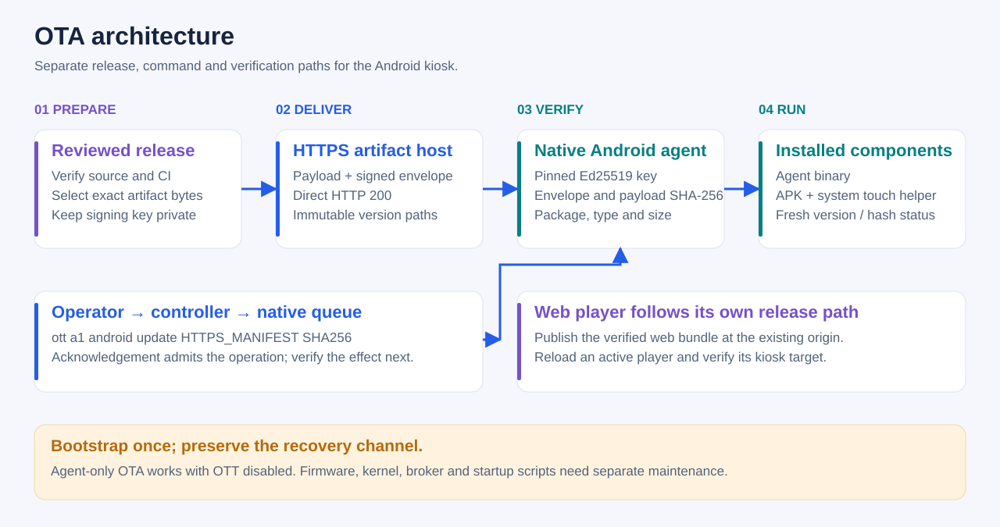
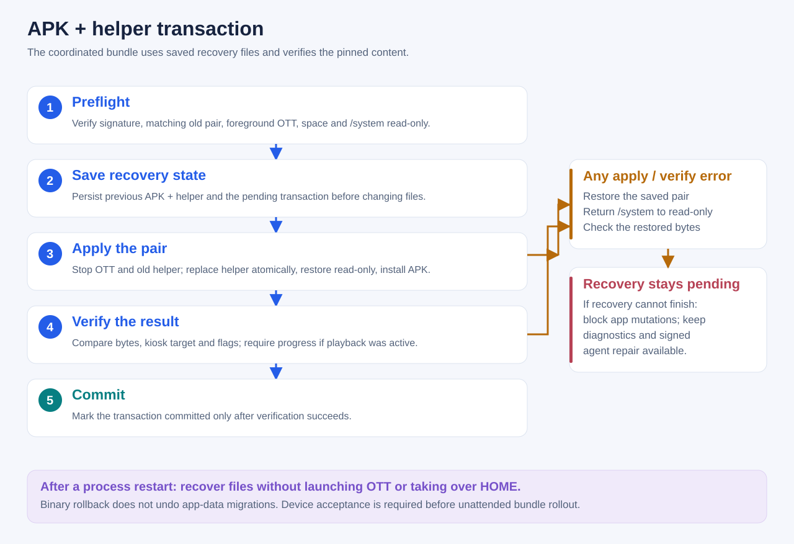
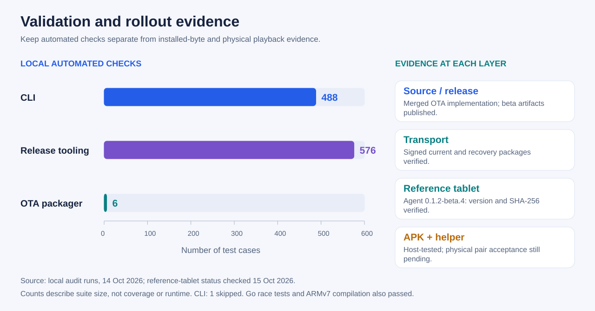

<div lang="uk" dir="ltr">

# Android OTA: звичайні програвачі й окремий агент із root

<!-- language-navigation:start -->
<p dir="ltr">
<a href="android-ota.md" lang="en" dir="ltr">English</a> · <a href="android-ota.ar.md" lang="ar" dir="rtl">العربية</a> · <a href="android-ota.bn.md" lang="bn" dir="ltr">বাংলা</a> · <a href="android-ota.cs.md" lang="cs" dir="ltr">Čeština</a> · <a href="android-ota.de.md" lang="de" dir="ltr">Deutsch</a> · <a href="android-ota.es.md" lang="es" dir="ltr">Español</a> · <a href="android-ota.fa.md" lang="fa" dir="rtl">فارسی</a> · <a href="android-ota.fr.md" lang="fr" dir="ltr">Français</a><br>
<a href="android-ota.he.md" lang="he" dir="rtl">עברית</a> · <a href="android-ota.hi.md" lang="hi" dir="ltr">हिन्दी</a> · <a href="android-ota.id.md" lang="id" dir="ltr">Bahasa Indonesia</a> · <a href="android-ota.it.md" lang="it" dir="ltr">Italiano</a> · <a href="android-ota.ja.md" lang="ja" dir="ltr">日本語</a> · <a href="android-ota.ko.md" lang="ko" dir="ltr">한국어</a> · <a href="android-ota.nl.md" lang="nl" dir="ltr">Nederlands</a> · <a href="android-ota.pl.md" lang="pl" dir="ltr">Polski</a><br>
<a href="android-ota.pt.md" lang="pt" dir="ltr">Português</a> · <a href="android-ota.ru.md" lang="ru" dir="ltr">Русский</a> · <a href="android-ota.th.md" lang="th" dir="ltr">ไทย</a> · <a href="android-ota.tr.md" lang="tr" dir="ltr">Türkçe</a> · <a href="android-ota.uk.md" lang="uk" dir="ltr">Українська</a> · <a href="android-ota.vi.md" lang="vi" dir="ltr">Tiếng Việt</a> · <a href="android-ota.zh-Hans.md" lang="zh-Hans" dir="ltr">简体中文</a> · <a href="android-ota.zh-Hant.md" lang="zh-Hant" dir="ltr">繁體中文</a>
</p>
<!-- language-navigation:end -->

Для **k8a/fire8 та інших програвачів Capacitor** використовуйте Wi-Fi-оновлювач звичайного програвача, а не команду агента з root:

```sh
ott k8a update --variant api22
ott k8a update --version v1.1.58-beta.3 --variant api22
ott k8a update --variant api22 --prepare-only
ott k8a update status
```

Без `--version` обирається остання опублікована бета. На Android 7+ використовуйте `full` замість `api22`. CLI знаходить офіційний випуск, перевіряє маніфест, готує APK та опитує його стан перед одноразовим запитом встановлення. Android може потребувати підтвердження на планшеті. Перед обслуговуванням явно вимкніть кіоск і розблокуйте захищені налаштування; команда ніколи не змінює ці політики. Див. [повну процедуру CLI](cli.md#capacitor-apk-updates-over-wi-fi).

Потрібні раніше встановлений APK із підтримкою `AppUpdate`, Wi-Fi та запущений програвач, підключений до контролера. Для звичайних наступних оновлень USB не потрібен, але офлайн-планшет або зупинений WebView недоступні. Перше встановлення, недоступний оновлювач, пошкоджена програма чи втрачена мережа можуть усе ще потребувати локального відновлення. Автоматичний планувальник випусків або універсальний тихий інсталятор не передбачаються.

Решта посібника описує **інший агент обслуговування a1 із root**, обмежений підготовленим встановленням Matricom/API19 `play.ott.kitkat`. Він не встановлений і не придатний до використання на звичайних Fire/Capacitor.

Після одноразового початкового налаштування через USB із root незалежний агент Android може отримувати підписані оновлення через власне вихідне HTTPS-з’єднання. Для самооновлення йому не потрібен робочий WebView. Агент 0.1.2 також підтримує узгоджений пакет APK та системного сенсорного помічника зі збереженими файлами відновлення й перевіркою перед остаточним підтвердженням.

Цей посібник пояснює весь шлях. Точні поля маніфесту, межі й апаратні вимоги наведено в [довіднику нативного агента](../native/android-agent/README.md#signed-updates-over-wi-fi).

## Що оновлюється



- **Нативний агент:** `kind: agent` замінює власний бінарний файл ARMv7. Цей шлях працює і з вимкненим OTT та іншою програмою HOME.
- **Лише APK:** `kind: apk` замінює оболонку зі збереженням даних. OTT має бути ввімкненим і на передньому плані. Вбудований помічник кандидата має точно відповідати встановленому системному помічнику.
- **APK та сенсорний помічник:** `kind: bundle` оновлює обидва компоненти парою. Старий агент спочатку має отримати окреме оновлення агента з підтримкою пакетів.
- **Розміщений програвач:** розгорніть перевірений вебартефакт на наявному origin, потім перезавантажте й огляньте активний програвач. Оновлення APK не розгортає розміщений JavaScript. Див. [процес випуску](release-workflow.md).
- **Контролер та CLI:** окремо розгорніть контролер і встановіть повний набір модулів CLI. Оновлення будь-якого з них не замінює код планшета.

Прошивка, ядро, системний WebView, root-брокер і стартові скрипти не входять до цього формату OTA. [Нативний довідник](../native/android-agent/README.md#bootstrap) описує межі початкового налаштування й відновлення. Підтримувані OTA-операції не потребують мережевого ADB чи довільної віддаленої оболонки.

## Від перевіреного випуску до підтвердженого встановлення

1. **Оберіть перевірені байти.** Злийте перевірені зміни після успішного CI. Завантажте потрібний артефакт і перевірте вихідну ревізію, незмінні докази випуску та контрольну суму. Витягніть бінарний файл `agent` із нативного архіву; сам архів не є встановлюваним вмістом агента.
2. **Підготуйте й підпишіть.** Використовуйте наявний приватний ключ Ed25519, чий відкритий ключ закріплено під час початкового налаштування. Зберігайте ключ та облікові дані пристрою приватними.
3. **Опублікуйте й перевірте транспорт.** Публікуйте лише вміст та `signed.json` за незмінними HTTPS-шляхами. Обидва мають повертати байти прямо з HTTP 200; оновлювач відхиляє перенаправлення. Запустіть `verify` пакувального інструмента.
4. **Надішліть одне оновлення.** Запишіть ID запиту й перевірте стан після підтвердження. Втрачена чи невизначена відповідь не є причиною повторювати операцію наосліп.
5. **Підтвердьте результат.** Порівняйте свіжі встановлені хеші й версії з підготовленим випуском. Для активного програвача також перевірте ціль кіоску, чергу та просування відтворення. Фізичне зображення й звук потребують спостереження.

Приклад випуску агента; підставте обрану версію та справжні шляхи:

```sh
python3 native/android-agent/prepare_update.py prepare \
  --kind agent --version 0.1.2-beta.4 \
  --payload /private/release/agent \
  --url https://updates.example/0.1.2-beta.4/agent \
  --manifest-url https://updates.example/0.1.2-beta.4/signed.json \
  --key /private/update.key --output /private/ota-0.1.2-beta.4

# Publish the prepared agent and signed.json, then verify the published bytes.
python3 native/android-agent/prepare_update.py verify \
  --directory /private/ota-0.1.2-beta.4

ott --receipt --timeout 40 a1 android update \
  https://updates.example/0.1.2-beta.4/signed.json ENVELOPE_SHA256
ott --timeout 30 a1 android status
ott a1 android operation REQUEST_ID
```

`ENVELOPE_SHA256` — це `envelope_sha256` пакувального інструмента, а не хеш вмісту. `accepted` означає прийняття, не успішне встановлення. Самозаміна може залишити стару квитанцію операції в стані `unknown`; нове виконуване середовище, очікувана версія агента та відповідний встановлений хеш підтверджують встановлення. [Довідник CLI](cli.md#independent-android-agent) описує незалежну нативну маршрутизацію та обробку квитанцій.

## Як відновлюється транзакція APK/помічник



Пакет містить рівно `app.apk` та `ott-touch-guard`. Інструмент може створити його безпосередньо з підписаного APK оболонки через `--kind bundle --apk`. Він витягує вбудований помічник, тому дві надані копії збігаються. Див. [команду пакета й вимоги](../native/android-agent/README.md#coordinated-wrapper-and-helper-updates).

Перед зміною файлів агент потребує відповідної встановленої пари, достатнього вільного місця, чутливого до запитів OTT на передньому плані, системного розділу лише для читання й заявленої підтримки зниження версії APK. У заблокованому кіоску перевіряються той самий ID телеканалу або впорядковані ID VPortal; однакової довжини черги недостатньо. Непідтримувані заблоковані черги відхиляються. Навмисно вимкнений OTT теж відхиляється, зберігаючи поточну програму HOME користувача.

Файли відновлення й очікувана транзакція зберігаються постійно до зупинки програми. Агент чекає завершення програми та старого помічника, атомарно замінює помічник, повертає `/system` у режим лише для читання, встановлює APK та перевіряє результат. Збій застосування чи перевірки запускає відновлення попередньої пари. Відновлення під час запуску повертає файли, не запускаючи OTT і не перехоплюючи HOME.

Якщо відновлення не завершується, `updates.recovery_failed` стає істинним. Діагностика й підписаний ремонт лише агента доступні, а зміни програми й сторож відтворення заблоковані. Не можна видаляти збережену транзакцію для примусового встановлення. Відновлення бінарних файлів не скасовує міграцій даних програми, а прошивка може й далі відмовляти у зниженні версії. Див. [обмеження відновлення](../native/android-agent/README.md#coordinated-wrapper-and-helper-updates).

## Результати й запис приймання



Аудит 14 жовтня 2026 пройшов 488 тестів CLI (один пропущено), 576 тестів інструментів випуску, шість тестів OTA-пакувальника, нативні Go race/статичні перевірки та збірку ARMv7. Ці числа описують розмір наборів, а не покриття чи продуктивність. Тести з ін’єкцією збоїв перевіряють некоректні архіви, перервані транзакції, часткове відновлення, зміни цілі й блокування під час відновлення. Незалежне рев’ю також знайшло й виправило недостатню перевірку ідентичності черги та різну перевірку APK/помічника на хості й пристрої.

Перевірений стан на 15 жовтня 2026:

- Реалізацію OTA злито в [PR контролера #104](https://github.com/open-ott-play/ottplay-control-server/pull/104) і включено до [v0.1.2-beta.4](https://github.com/open-ott-play/ottplay-control-server/releases/tag/v0.1.2-beta.4).
- Поточний і попередній підписані пакети агента опубліковані на [хості доставки OTA](https://android-updates.ottplay.here.now/). Байти вмісту й конверта успішно завантажено та порівняно через прямий HTTPS.
- Еталонний планшет оновився з `0.1.1-beta.21` до `0.1.2-beta.4` через незалежний OTA-канал. Версія запущеного агента й встановлений SHA-256 збіглися з обраним випуском; виконуване середовище змінилося, а ID завантаження ОС залишився тим самим. OTT і далі не мав запущеного процесу програми; команди запуску програми чи вибору HOME не надсилалися.
- Нативний стан повідомив хеш системного сенсорного помічника, відсутність очікуваного пакета та помилки відновлення. Метадані APK були недоступні, тож це спостереження не встановлює версію чи хеш встановленого APK.
- Узгоджену транзакцію APK/помічник перевірено на хості; фізичне встановлення, відновлення зниження версії, зображення та аудіо ще не прийняті на еталонному планшеті.

Для кожного наступного розгортання зберігайте джерело й контрольні суми випуску, хеш підготовленого конверта, ID запиту, нативний стан до/після та окремий результат фізичного приймання. Успішне завантаження або квитанція команди не замінюють цих спостережень.

</div>
