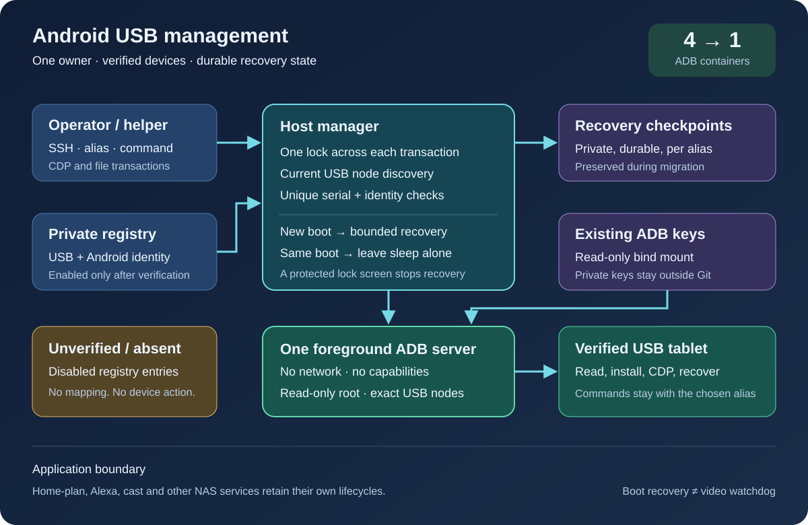
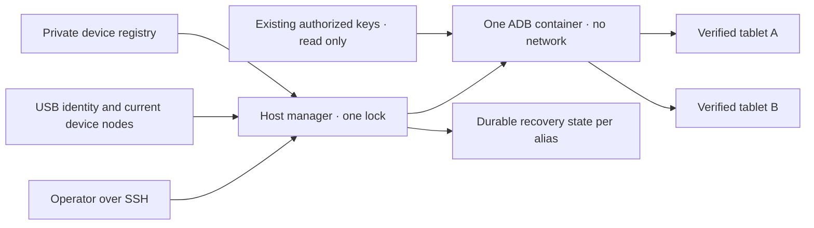

# مدير USB المشترك لأجهزة Android

<!-- language-navigation:start -->
<p dir="ltr">
<a href="android-usb-manager.md" lang="en" dir="ltr">English</a> · <a href="android-usb-manager.ar.md" lang="ar" dir="rtl">العربية</a> · <a href="android-usb-manager.bn.md" lang="bn" dir="ltr">বাংলা</a> · <a href="android-usb-manager.cs.md" lang="cs" dir="ltr">Čeština</a> · <a href="android-usb-manager.de.md" lang="de" dir="ltr">Deutsch</a> · <a href="android-usb-manager.es.md" lang="es" dir="ltr">Español</a> · <a href="android-usb-manager.fa.md" lang="fa" dir="rtl">فارسی</a> · <a href="android-usb-manager.fr.md" lang="fr" dir="ltr">Français</a><br>
<a href="android-usb-manager.he.md" lang="he" dir="rtl">עברית</a> · <a href="android-usb-manager.hi.md" lang="hi" dir="ltr">हिन्दी</a> · <a href="android-usb-manager.id.md" lang="id" dir="ltr">Bahasa Indonesia</a> · <a href="android-usb-manager.it.md" lang="it" dir="ltr">Italiano</a> · <a href="android-usb-manager.ja.md" lang="ja" dir="ltr">日本語</a> · <a href="android-usb-manager.ko.md" lang="ko" dir="ltr">한국어</a> · <a href="android-usb-manager.nl.md" lang="nl" dir="ltr">Nederlands</a> · <a href="android-usb-manager.pl.md" lang="pl" dir="ltr">Polski</a><br>
<a href="android-usb-manager.pt.md" lang="pt" dir="ltr">Português</a> · <a href="android-usb-manager.ru.md" lang="ru" dir="ltr">Русский</a> · <a href="android-usb-manager.th.md" lang="th" dir="ltr">ไทย</a> · <a href="android-usb-manager.tr.md" lang="tr" dir="ltr">Türkçe</a> · <a href="android-usb-manager.uk.md" lang="uk" dir="ltr">Українська</a> · <a href="android-usb-manager.vi.md" lang="vi" dir="ltr">Tiếng Việt</a> · <a href="android-usb-manager.zh-Hans.md" lang="zh-Hans" dir="ltr">简体中文</a> · <a href="android-usb-manager.zh-Hant.md" lang="zh-Hant" dir="ltr">繁體中文</a>
</p>
<!-- language-navigation:end -->

<div dir="rtl" lang="ar">

يستبدل المدير المشترك حاويات ADB المنفصلة لكل جهاز لوحي بخادم ADB واحد وسجل صريح للأجهزة. تدير خدمة على المضيف توصيل USB وفصله أثناء التشغيل، وتستعيد OTT على أجهزة لوحية محددة بعد إقلاع Android من جديد. يظل تشغيل المحتوى المعتاد وبروتوكول OTT البعيد مستقلين عن ذلك.

## الحصول على حزمة النشر

نزّل `ottplay-control-server-deployment.tar.gz` و`release-manifest.json` من [الإصدار](https://github.com/open-ott-play/ottplay-control-server/releases) نفسه. طابق SHA-256 للأرشيف مع القيمة الخاصة به في ملف البيان، ثم فك ضغطه في دليل جديد:

</div>

<div dir="ltr">

```sh
mkdir ott-android-release
tar -xzf ottplay-control-server-deployment.tar.gz -C ott-android-release
cd ott-android-release
python3 -B tools/android_usb_manager_remote.py --help
```

</div>

<div dir="rtl" lang="ar">

يحافظ الأرشيف على `tools/` و`deploy/` و`docs/`، بما فيها جميع نصوص USB الستة المشتركة والقديمة المذكورة أدناه. اتبع ترتيب الملفات على المضيف وخطوات التجهيز في هذا الدليل؛ فك الضغط وحده لا يثبّت خدمة. أبقِ المدير والمشرف ومحوّل المعاملات على مراجعة إصدار واحدة. ملف Dockerfile الخاص بالنقل هو وصفة بناء؛ ملف إصدار OCI الخاص بخادم التحكم ليس صورة نقل USB.

أرشيفات النشر الأقدم، ومنها `v0.1.5-beta.6`، لا تحتوي على `tools/`. لهذه الإصدارات، استخدم أرشيف المصدر المطابق أو اختر إصدارًا أحدث يحتوي على حزمة النشر الكاملة. لا تخلط نصوصًا من إصدارات مختلفة.

يتكوّن التنفيذ من:

- [`tools/android_usb_manager.py`](../tools/android_usb_manager.py): السجل، والتحقق من النقل، ومواءمة حالة الحاوية، وتنفيذ الأوامر تسلسليًا.
- [`tools/android_usb_supervisor.py`](../tools/android_usb_supervisor.py): السياسة الحالية للإقلاع وقفل الشاشة واستعادة التطبيق إلى الواجهة.
- [`tools/android_usb_manager_remote.py`](../tools/android_usb_manager_remote.py): غلاف أوامر SSH يحافظ على المخرجات الثنائية دون تغيير.
- [`tools/android_usb_legacy_redirect.py`](../tools/android_usb_legacy_redirect.py): إعادة توجيه اختيارية لمسار أوامر منفصل لكل جهاز لوحي ومثبّت مسبقًا.
- [`tools/android_usb_remote.py`](../tools/android_usb_remote.py): غلاف SSH القديم، المحتفظ به للجهات الحالية التي تستدعي أوامر كل جهاز لوحي على حدة.
- [`tools/android_usb_transaction.py`](../tools/android_usb_transaction.py): نقل ذري للملفات، وتجهيز APK، وعمليات CDP لأدوات الصيانة الموثوقة.
- [`deploy/android-usb-manager`](../deploy/android-usb-manager): إعداد نموذجي وخدمة systemd ونص إقلاع Synology DSM و[وصفة صورة النقل](../deploy/android-usb-manager/README.md).



</div>

<div dir="ltr">



</div>

<div dir="rtl" lang="ar">

## العزل والهوية

تشغّل الحاوية ADB في المقدمة، بدلًا من عملية `sleep` خاملة تحتوي عرضًا على خدمة ADB في الخلفية. يستمع ADB على واجهة loopback الخاصة بالحاوية فقط. تستخدم الحاوية `--network none`، ولا تنشر منافذ، ولديها نظام ملفات جذري للقراءة فقط، وجميع capabilities مسقطة، وخيار no-new-privileges، ومساحة `/tmp` قابلة للكتابة ومحدودة. لا تحتوي على مقبس Docker أو تركيب واسع لـ`/dev` أو `/dev/bus/usb`. يجب تثبيت الصورة باستخدام SHA-256.

يفرض المدير حدًا لذاكرة الحاوية قدره 256 MiB، وحدًا إجماليًا للذاكرة وswap قدره 256 MiB، وحصص CPU بقيمة 128. تساوي حدّي الذاكرة والذاكرة مع swap لا يسمح بمساحة swap إضافية. تقلل حصص CPU الأولوية النسبية عند التنافس على الموارد دون فرض حصة CPU قصوى صارمة. لا يوجد حد أقصى صارم لعدد PID لأن نواة DSM المستهدفة لا تدعم متحكمه. سقف tmpfs الخاص بـ`/tmp` هو 256 MiB، ويُخصّص عند الطلب ويُحتسب ضمن حد الذاكرة نفسه، وليس بدل ذاكرة إضافيًا. يقبل تجهيز APK ملفات حتى 128 MiB، ويكتبها على أجزاء بحجم 1 MiB لتجنب الاحتفاظ بنسخة APK كاملة أخرى في كومة Python داخل الحاوية. مع ذلك، لا يزال الطلب على جانب المضيف يخزّن حمولته في الذاكرة.

يشرف Docker ومدير المضيف على عملية ADB الأمامية. تعطّل الحاوية صراحة فحوص الصحة الموروثة من الصورة: فحص نبضات أو إعدادات مدير آخر لا يصف هذه العملية. تُعد إعدادات الموارد وفحوص الصحة جزءًا من المواءمة، لذا يؤدي انحرافها إلى استبدال الحاوية التابعة للمدير أثناء الاحتفاظ بقفله.

يستخدم أمر المقدمة `adb -L tcp:5037 nodaemon server`. يرفض ADB 29 اسم مضيف صريحًا في وسيطة المستمع (`tcp:127.0.0.1:5037`)؛ حذف اسم المضيف يربط بواجهة loopback لأن `-a` غير مفعّل. يظل إعداد العميل `ADB_SERVER_SOCKET=tcp:127.0.0.1:5037` صريحًا. لا تنشر صيغة التوافق هذه المنفذ ولا تفعّل ADB الشبكي على أي جهاز لوحي.

لا تُمرّر إلا عقد الأجهزة الحالية للمدخلات المفعّلة في السجل والتي طوبقت بشكل فريد، مع إذن قراءة الجهاز وكتابته. قد تكون عقد USB في Synology مملوكة لـroot بوضع `0600`، لذا يشغّل هذا النشر عملية ADB بصلاحيات root داخل الحاوية المقيّدة. لا يغيّر عقد المضيف لتصبح قابلة للكتابة من الجميع. يحتاج مدير المضيف أيضًا إلى صلاحيات root لفحص العقد وإدارة Docker والحفاظ على الحالة الخاصة. عزل الحاوية لا يحوّل تلك الصلاحيات على المضيف إلى صلاحيات غير مميّزة.

يحدّد السجل الجهاز بالرقم التسلسلي لواجهة USB والمنتج، ويمكن إضافة معرّفَي مورّد USB ومنتجه، ثم بطراز Android وSDK و`android_id`. يطابق المدير مسار USB الحالي مع قائمة وسائل نقل ADB، ثم ينفّذ الأوامر باستخدام الرقم التسلسلي الفريد الذي تم التحقق منه. قد يعيد ADB استخدام معرّفات النقل الرقمية بعد إعادة تشغيله، لذا لا تُستخدم هذه المعرّفات أبدًا لتوجيه أمر. تؤدي الأرقام التسلسلية المكررة إلى الرفض بدل اختيار وسيلة نقل اعتباطية. يجب ألا يتلقى جهاز غير مطابق أو غائب أو غير مخوّل أو ملتبس أي أمر.

يجب أن تملك المدخلات المفعّلة أرقام USB تسلسلية فريدة. تشترك بعض الأجهزة اللوحية الرخيصة في الرقم التسلسلي البديل `0123456789ABCDEF`؛ ولا تجعل أسماء طرازاتها تسجيلها معًا آمنًا. أبقِ الأجهزة المتعارضة معطّلة إلى أن تُنفّذ استراتيجية منفصلة ومراجعة للهوية المادية. لا تعِد تسمية الرقم التسلسلي نفسه وتفترض أنه يحدّد وسيلة نقل أخرى.

يمنح الدمج عملية ADB واحدة الوصول إلى جميع الأجهزة اللوحية الممررة إليها. قد تقاطع إعادة التشغيل أو مواءمة التوصيل أثناء التشغيل العمليات على هذه الأجهزة. تستخدم الأوامر والمواءمة قفلًا واحدًا على المضيف، `/var/lib/ott-android-manager/manager.lock`، لمنع التغييرات المتنافسة. يرفض مسار أوامر ADB العام الأوامر الشاملة للخادم أو المغيّرة للنقل، مثل `kill-server` و`tcpip` و`connect` و`root`.

## الإعدادات والمفاتيح الخاصة

ابدأ بـ[`config.example.json`](../deploy/android-usb-manager/config.example.json). هوياته وبصمة الصورة المؤلفة كلها من أصفار خيالية عن قصد، وكلا الجهازين النموذجيين معطّل. المثال ليس نشرًا قابلًا للتشغيل.

استخدم ترتيب الملفات التالي على المضيف:

</div>

<div dir="ltr">

```text
/usr/local/etc/ott-android-manager/
  android_usb_manager.py
  android_usb_supervisor.py
  android_usb_transaction.py
  config.json
  ott-android-manager.service
  adb-keys/
    adbkey
    adbkey.pub
    vendor/
      additional-authorized.adb_key
/var/lib/ott-android-manager/
  manager.lock
  captures/
  <alias>/state.json
```

</div>

<div dir="rtl" lang="ar">

يجب أن يكون المدير والمشرف ومحوّل المعاملات من المراجعة نفسها التي تمت مراجعتها. أبقِ الإعدادات والمفاتيح خارج Git وأرشيفات الإصدارات. اضبط الأدلة الخاصة على `0700`، والإعدادات والمفاتيح الخاصة على `0600`، واجعل ملفات المصدر والخدمة مملوكة لـroot. يُركّب دليل المفاتيح للقراءة فقط. يجب أن يكون `adbkey` و`adbkey.pub` موجودين مسبقًا؛ ويجب أن يوجد `vendor/` حتى إن كان فارغًا. يمكن وضع مفاتيح خاصة إضافية مخوّلة مسبقًا في `vendor/`، الذي يُمرّر عبر `ADB_VENDOR_KEYS`. سمِّ كل ملف خاص `<source>.adb_key`: يتجاهل ADB 29 أسماء الملفات الأخرى بصمت عند فحص هذا الدليل. ملف مرافق مطابق باسم `<source>.adb_key.pub` اختياري. يرفض المدير أسماء الملفات غير المعروفة قبل تغيير الحاوية.

احفظ المفاتيح المخوّلة الحالية قبل إخراج أي حاوية من الخدمة. قارن بصمات المفاتيح العامة لتحديد المكررات؛ ولا تطبع المفاتيح الخاصة. لا تستبدل مفتاحًا موجودًا بآخر مولّد حديثًا لمجرد دمج الحاويات: فقد يستلزم ذلك تأكيدًا على أجهزة لوحية غير متصلة.

يحتاج كل جهاز مفعّل إلى هوية كاملة تم جمعها أثناء تجهيز بحضور مسؤول. معرّف UUID لجهاز OTT أو عنوان MAC أو قيمة مخمّنة ليس دليلًا على `android_id` في Android. إذا افتقد سجل الإثبات هذا الحقل، فأبقِ المدخل على `"enabled": false`؛ ويمكن أن تحتوي المدخلات المعطّلة على بيانات وصفية غير مكتملة، ولا تُمرّر أجهزتها أو يُتحكّم بها أبدًا.

يمثل `recover_on_boot` سياسة مستقلة. اتركه false لجهاز لوحي يجب أن يتيح أوامر الصيانة فقط. عند تفعيله، اضبط `package` على التطبيق الذي اختُبر تشغيله في الواجهة فعليًا على ذلك الجهاز.

## ما تفعله الاستعادة التلقائية

الفاصل الافتراضي خمس ثوانٍ بعد كل دورة مكتملة، وليس ضمانًا للاستعادة الكاملة خلال خمس ثوانٍ. تطيل عمليات USB البطيئة هذا الفاصل. المهلة الافتراضية للأمر 60 ثانية، والحد ثلاث محاولات استعادة لكل إقلاع Android.

عند الملاحظة الأولى، يسجّل المدير الإقلاع الحالي دون إيقاظ الجهاز اللوحي أو فتح قفله. عند إقلاع جديد لاحق تكون فيه الاستعادة مفعّلة، يقوم بما يلي:

1. ينتظر `sys.boot_completed=1` ويتحقق من هوية الجهاز.
2. يشترط دليلًا صريحًا على أن قفل الشاشة غير محمي برمز PIN أو كلمة مرور أو نمط.
3. يوقظ الشاشة ويزيل قفل السحب العادي عند الحاجة.
4. يشغّل الحزمة المحددة ويفحص النشاط المستأنف/ذي التركيز.
5. يعيد فحص الإقلاع وقفل الشاشة، ثم فقط يحفظ نقطة تحقق ناجحة.

توقف حالة قفل الشاشة المجهولة أو المحمية عملية الاستعادة. يتطلب نشر Fire القديم مسبارًا محميًا بصلاحية shell، كما هو موضح في [الاستعادة عبر USB](android-usb-recovery.md#read-only-keyguard-probe-on-older-firmware).

يعيد الإقلاع الذي أُنجز بالفعل `same_boot_no_action`. إطفاء الشاشة المعتاد لا يفعّل الإيقاظ. لا يراقب هذا المدير فك ترميز الفيديو، ولا يعيد تشغيل بث متوقف، ولا يفرض استمرار التطبيق في الواجهة. هذه سياسات مختلفة تخص المشغّل أو watchdog تمت مراجعته بشكل منفصل.

## الأوامر

على مضيف USB:

</div>

<div dir="ltr">

```sh
sudo -n /usr/bin/python3 -B /usr/local/etc/ott-android-manager/android_usb_manager.py \
  --config /usr/local/etc/ott-android-manager/config.json status
```

</div>

<div dir="rtl" lang="ar">

من حاسوب آخر باستخدام اسم مضيف بديل موجود لـSSH:

</div>

<div dir="ltr">

```sh
python3 tools/android_usb_manager_remote.py --host tablet-host status
python3 tools/android_usb_manager_remote.py --host tablet-host status lobby
python3 tools/android_usb_manager_remote.py --host tablet-host wake lobby
python3 tools/android_usb_manager_remote.py --host tablet-host recover lobby
python3 tools/android_usb_manager_remote.py --host tablet-host reboot lobby
python3 tools/android_usb_manager_remote.py --host tablet-host swipe lobby 400 600 400 100 --duration 500
python3 tools/android_usb_manager_remote.py --host tablet-host screenshot lobby lobby-check.png
python3 tools/android_usb_manager_remote.py --host tablet-host adb lobby -- shell getprop ro.product.model
python3 tools/android_usb_manager_remote.py --host tablet-host adb lobby -- exec-out screencap -p > lobby.png
```

</div>

<div dir="rtl" lang="ar">

يفحص `status` الحالة دون إنشاء الحاوية أو إعادة تشغيلها أو تغيير إعداداتها. ينفّذ `tick` دورة واحدة من المواءمة/الاستعادة وقد يغيّر حالة الجهاز؛ ويكرر `run` هذه الدورات وهو مخصص للخدمة.

يستخدم الغلاف SSH دون PTY، ويقتبس الوسيطات منفردة لقشرة الأوامر، ويمرّر حالة خروج العملية كما هي، ولا يحوّل مخرجات ADB إلى JSON. افحص حالة الخروج قبل اعتبار لقطة شاشة أُعيد توجيهها صالحة. لا يقبل أمر `screenshot` إلا اسم ملف PNG مجردًا، مثل `lobby-check.png`، ويحفظه في `<state_dir>/captures/` على مضيف USB. يجب أن يطابق الاسم `[A-Za-z0-9][A-Za-z0-9_-]{0,119}\.png`؛ لا تُقبل المسارات أو النقاط الإضافية أو الامتدادات الضمنية. يتحقق الأمر من PNG وينشئ ملفًا جديدًا لا يُتاح إلا للمالك، ويرفض الروابط الرمزية وأسماء الملفات الموجودة قبل الالتقاط. أما مثال `adb ... exec-out` فيبث البايتات إلى ملف على حاسوب المشغّل. يستخدم `swipe` أبعاد الشاشة الحالية ويرفض حالة قفل الشاشة المحمية أو المجهولة؛ والإحداثيات أعلاه أمثلة وليست إيماءة عامة لفتح القفل. تشير مسارات ملفات ADB إلى نطاقَي أسماء الحاوية/الجهاز: هذا الغلاف لا يرفع APK تلقائيًا من حاسوبك المحمول. يجب أن يستخدم تجهيز الملف وتثبيته اللاحق محوّل المعاملات الذرية الموضح أدناه.

يمثل `adb <alias> -- <arguments>` واجهة صيانة للمسؤول، وليس API عامًا مقيّدًا. قد يغيّر أمر `shell` مسموح به ذلك الجهاز اللوحي. استخدم فحوص الهوية والقفل؛ ولا تُتِح وصول SSH أو Docker غير مقيّد عبر نقطة نهاية ويب.

## خدمة الإقلاع والترحيل

يشغّل [قالب systemd](../deploy/android-usb-manager/ott-android-manager.service) المدير باستمرار ويعيد تشغيل العملية بعد عشر ثوانٍ من خروجها. يتحقق [غلاف DSM](../deploy/android-usb-manager/S99ott-android-manager.sh) من ملفات النشر، ويثبّت الوحدة/يفعّلها، ثم يبدأ تشغيلها. يرفض البدء إذا كانت الخدمة القديمة `ott-k8a-recovery.service` نشطة أو مفعّلة. لتوزيعة أخرى، كيّف اعتماد Docker والمسارات مع مدير الخدمات لديها.

نفّذ تسليمًا مضبوطًا:

1. سجّل إعدادات الحاويات الحالية وبصمات المفاتيح المخوّلة وحالة الاستعادة. انسخ الملفات الخاصة احتياطيًا بصلاحيات للمالك فقط.
2. ثبّت المصدر الجديد والصورة التي تمت مراجعتها والمفاتيح والسجل. أبقِ الأجهزة غير المجهزة معطّلة. لا تشغّل مشرفًا ثانيًا للجهاز اللوحي نفسه.
3. أوقف خدمة الاستعادة القديمة على المضيف وعطّلها، وأخرج غلاف إقلاع DSM الخاص بها من الخدمة. احتفظ بالملفات للرجوع. إيقاف الخدمة وحده لا يزيل حاوية ADB الخاصة بها.
4. انسخ نقطة تحقق الاستعادة القديمة التي تم التحقق منها إلى `<alias>/state.json` الجديد المطابق. حافظ على هوية الإقلاع الخاصة بها؛ ولا تعِد ضبط الحالة كاختصار روتيني للترحيل.
5. أوقف حاويات ADB القديمة قبل بدء الخادم المشترك حتى لا يتنافس خادمان على واجهة USB نفسها.
6. ثبّت غلاف DSM الجديد كملف تنفيذي مملوك لـroot داخل `/usr/local/etc/rc.d/`، وشغّل إجراء `start` الخاص به، وافحص الخدمة/الحالة.
7. رحّل الجهات المستدعية، وتحقق من الأوامر المعتادة وسياسة الاستعادة المحتفظ بها، ثم أزل فقط الحاويات القديمة التي أُخرجت اعتمادياتها من الاستخدام.

كثيرًا ما تخفي الأدوات القديمة اعتماديات خلف أسماء تبدو بسيطة. راجع `bootstrap.py` و`reconnect.py` ومحوّلات CDP والأسماء البديلة في shell. قد ينسخ نص التجهيز المفاتيح من حاوية قديمة. وقد يضبط نص إعادة الاتصال `OLD` من أداة مستوردة ثم يوقفه أو يزيله لاحقًا؛ وبعد تغيير تلك الأداة إلى الاسم المشترك الجديد، قد يوقف الخادم المشترك عن طريق الخطأ. أزل إدارة الحاويات التلقائية هذه من العملاء بدل الاكتفاء بتغيير اسم.

وجّه أوامر ADB الفعلية عبر المدير باستخدام الاسم البديل. يجب على محوّل توافق يحتاج إلى `docker exec` لتجهيز الملفات أو عميل CDP محلي أن يحتفظ بقفل المضيف نفسه طوال معاملة التجهيز/الأمر. لا تُدخِل عملية ثانية تحاول اكتساب هذا القفل داخل القسم المقفل؛ استدعِ مسارًا متوافقًا داخل العملية أو نظّم المعاملة مرة واحدة. خصّص منافذ إعادة توجيه مؤقتة وأزلها بعد الاستخدام.

ثبّت `android_usb_transaction.py` بجانب المدير والمشرف. يقبل طلب JSON واحدًا على الإدخال القياسي، مع إشارة `--config` إلى السجل الخاص نفسه، ويعيد مخرجات العملية الخام على الإخراج القياسي. الطلبات المدعومة هي:

- `pull`: الحقل `alias` ومسار `device_path` مطلق؛ يعيد بايتات ملف عادي واحد بحد أقصى 128 MiB. تُرفض الأدلة وملفات الأجهزة. كما يوقف حد صارم لحجم ملف الوجهة مصدرًا يزداد حجمه أثناء النقل.
- `staged_adb`: الحقول `alias` و`data` بترميز base64 و`arguments`، مثل `["install", "-r", "@staged"]` أو `["push", "@staged", "/sdcard/example.json"]`.
- `cdp`: الحقل `alias` وحزمة التطبيق `package`، و`expected_model` اختياريًا، ومصدر عميل Python الموثوق `source` الذي يحتوي على `__OTT_CDP_PORT__`، وطلبه بصيغة JSON في `request`.

يتحقق كل طلب من الجهاز ويحتفظ بقفل مدير واحد خلال الإعداد والاستخدام والتنظيف. تستخدم عمليات الملفات أسماء مؤقتة فريدة؛ وتُحجز الملفات المجهزة حصريًا بوضع `0600` قبل تفعيل التنظيف. تحتفظ عمليات تثبيت APK باللاحقة `.apk` التي يتطلبها محلل وسيطة الحزمة في ADB. يترك تضارب الأسماء الملف الموجود دون تغيير. لا يفتح كاتب التجهيز إلا الملف العادي الفارغ الذي حجزه، دون اتباع روابط رمزية. تستهدف أوامر Docker المساعدة معرّف الحاوية الذي تمت ملاحظته. يحل CDP عملية تطبيق واحدة بالضبط ومقبس تصحيحها، ويخصّص `tcp:0`، ويستبدل المنفذ المخصّص في مصدر العميل، ويزيل مدخل إعادة التوجيه هذا وحده عند الإكمال أو الفشل. لا تستطيع المواءمة إعادة تشغيل الخادم بين هذه الخطوات.

تحتفظ أداة توافق a1 المرحّلة ببيانات `copy_in` في ذاكرة محلية للخيط حتى أمر `adb install` أو `adb push` التالي داخل العملية نفسها. يصبح هذا الزوج معاملة مضيف واحدة؛ ولم يعد `copy_in` وحده ينشئ ملفًا في الحاوية المشتركة. تستخدم أدوات CDP الخاصة بـHome Plan والمشغّل آلية المعاملات نفسها. قد تحتوي الطلبات على بيانات تطبيق خاصة وشيفرة تنفيذية موثوقة: أرسلها فقط عبر قناة SSH الحالية الخاصة بالمسؤول، ولا تُتِح هذا المحوّل أبدًا كنقطة نهاية عامة ولا تسجّل حمولاته.

تتبع منافذ إعادة توجيه ADB الخادم المشترك، لا جهازًا لوحيًا بعينه. استخدم منافذ CDP المخصّصة ديناميكيًا، أو منافذ مختلفة لكل اسم بديل في الجلسات اليدوية. يفرض المدير `--no-rebind` عند إنشاء إعادة توجيه، ويسمح بإعادة استخدام تعيين مطابق، ويرفض الكتابة فوق إعادة توجيه تخص اسمًا بديلًا آخر أو إزالتها. تُرشَّح نتائج `forward --list` للاسم البديل المحدد؛ ويُرفض `forward --remove-all`.

بعد نسخ النص القديم احتياطيًا، يمكن تثبيت إعادة التوجيه القديمة الاختيارية في `/usr/local/etc/ott-k8a-recovery/android_usb_supervisor.py` للمحافظة على نقاط الدخول اليدوية القديمة للأوامر. لا تقبل إلا مسار الإعداد القديم المعروف، وتشترط أن يتطابق رقمه التسلسلي وطرازه وSDK ومعرّف Android مع مدخل واحد مفعّل بالضبط في السجل الجديد، وتستبدل عمليتها بالمدير الجديد. لا تستورد المشرف القديم ولا تنفّذه. يُرفض `run` صراحة: يجب أن تبقى الخدمة القديمة وغلاف إقلاعها معطّلين/خارج الخدمة، حتى عند تثبيت التوافق اليدوي.

للرجوع، أوقف خدمة المضيف الجديدة وعطّلها، وأخرج غلاف إقلاعها من الخدمة، وأوقف حاويتها. استعد اللقطات القديمة للمفاتيح/الحالة وخدمة المضيف القديمة. تحقق من أن مديرًا واحدًا فقط يملك كل جهاز USB قبل الاستئناف.

## مشغّلات الإصدار دون CDP

قد يعطّل APK الإنتاجي تصحيح WebView عمدًا. في هذه الحالة، يُبلغ محوّل المعاملات عن `Application debugging socket is unavailable`؛ اتصال ADB العامل لا ينشئ هذا المقبس. لا يفعّل المدير التصحيح ولا يغيّر إعدادات المشغّل ولا يستبدل APK.

لمشغّل متصل بالفعل بوحدة تحكم OTT، استخدم أدوات التشخيص المدعومة للقراءة فقط. استبدل `lobby` باسمه البديل المحدد في OTT:

</div>

<div dir="ltr">

```sh
ott -t 20 lobby debug -j
ott -t 20 lobby inspect -j
```

</div>

<div dir="rtl" lang="ar">

تعيد هذه الأوامر الملاحظات التي يبلغ عنها المشغّل، بما فيها حالة بيئة التشغيل والوسائط المتاحة. لا تتيح تنفيذ JavaScript اعتباطي أو فحص DOM مباشرة أو اتصال CDP. تم التحقق من الأمرين على مشغّل إصدار متصل يعمل بـAPI 22 بينما كان مقبس CDP لديه غائبًا؛ ويعتمد توفرهما على مشغّل آخر على القدرات التي يدعمها.

## القبول والحدود

سجّل النتائج بالنسبة إلى المصدر/الصورة والعتاد المثبّت فعليًا. عند بدء هذا الدمج، كان **k8a** وحده يملك أدلة مادية على سياسة الاستعادة القديمة. استعاد مشرفه القديم التشغيل بعد إعادة إقلاع فعلية للجهاز اللوحي وترك السكون المعتاد دون تدخل؛ لا تثبت تلك الفحوص قبول التنفيذ المشترك الجديد. كانت هويات الأجهزة اللوحية الأخرى المحفوظة غير مكتملة، ويجب أن تبقى معطّلة إلى أن يُجرى تحقق بحضور مسؤول.

فحوص القبول المطلوبة للمدير المشترك:

- تظهر هوية USB المخوّلة الحالية عبر الخادم المشترك.
- لا تتلقى الأجهزة المجهولة أو الغائبة أو المكررة أو المعطّلة أي إجراء.
- يستخدم أمر للقراءة فقط ولقطة شاشة ثنائية وسيلة النقل المقصودة.
- تنجح الاستعادة بعد إقلاع جديد على جهاز فُعّلت عليه هذه السياسة.
- تبقى الشاشة مطفأة عند إطفائها المعتاد.
- لا تعيد إعادة تعداد USB إلا تعيين الجهاز المتوقع.
- تحافظ إعادة تشغيل خدمة المضيف على الحالة وتتجنب تكرار الاستعادة.
- تعيد إعادة إقلاع فعلية للمضيف الخدمة وترتيب الملكية.
- تعمل كل أداة محلية مرحّلة دون إعادة إنشاء الحاويات القديمة.

اذكر صراحة الفحوص التي لم تُجرَ. الخدمة العاملة أو التشغيل الناجح في الواجهة لا يثبتان تشغيل البث، أو توافق كل جهاز لوحي، أو الاستعادة دون تدخل بعد إعادة إقلاع NAS.

</div>
