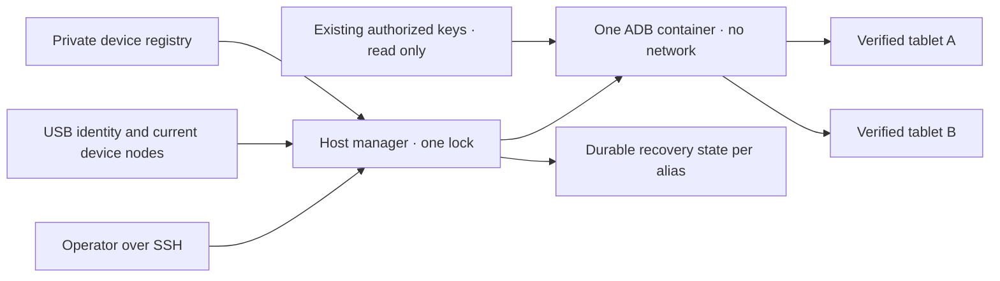

# ভাগাভাগি করা Android USB ম্যানেজার

<!-- language-navigation:start -->
<p dir="ltr">
<a href="android-usb-manager.md" lang="en" dir="ltr">English</a> · <a href="android-usb-manager.ar.md" lang="ar" dir="rtl">العربية</a> · <a href="android-usb-manager.bn.md" lang="bn" dir="ltr">বাংলা</a> · <a href="android-usb-manager.cs.md" lang="cs" dir="ltr">Čeština</a> · <a href="android-usb-manager.de.md" lang="de" dir="ltr">Deutsch</a> · <a href="android-usb-manager.es.md" lang="es" dir="ltr">Español</a> · <a href="android-usb-manager.fa.md" lang="fa" dir="rtl">فارسی</a> · <a href="android-usb-manager.fr.md" lang="fr" dir="ltr">Français</a><br>
<a href="android-usb-manager.he.md" lang="he" dir="rtl">עברית</a> · <a href="android-usb-manager.hi.md" lang="hi" dir="ltr">हिन्दी</a> · <a href="android-usb-manager.id.md" lang="id" dir="ltr">Bahasa Indonesia</a> · <a href="android-usb-manager.it.md" lang="it" dir="ltr">Italiano</a> · <a href="android-usb-manager.ja.md" lang="ja" dir="ltr">日本語</a> · <a href="android-usb-manager.ko.md" lang="ko" dir="ltr">한국어</a> · <a href="android-usb-manager.nl.md" lang="nl" dir="ltr">Nederlands</a> · <a href="android-usb-manager.pl.md" lang="pl" dir="ltr">Polski</a><br>
<a href="android-usb-manager.pt.md" lang="pt" dir="ltr">Português</a> · <a href="android-usb-manager.ru.md" lang="ru" dir="ltr">Русский</a> · <a href="android-usb-manager.th.md" lang="th" dir="ltr">ไทย</a> · <a href="android-usb-manager.tr.md" lang="tr" dir="ltr">Türkçe</a> · <a href="android-usb-manager.uk.md" lang="uk" dir="ltr">Українська</a> · <a href="android-usb-manager.vi.md" lang="vi" dir="ltr">Tiếng Việt</a> · <a href="android-usb-manager.zh-Hans.md" lang="zh-Hans" dir="ltr">简体中文</a> · <a href="android-usb-manager.zh-Hant.md" lang="zh-Hant" dir="ltr">繁體中文</a>
</p>
<!-- language-navigation:end -->

এই ম্যানেজার প্রতিটি ট্যাবলেটের পৃথক ADB কন্টেইনারের বদলে একটি ADB সার্ভার ও সুস্পষ্ট ডিভাইস রেজিস্ট্রি ব্যবহার করে। হোস্ট সার্ভিস USB লাগানো/খোলা সামলায় এবং নির্বাচিত ট্যাবলেটে নতুন Android বুটের পরে OTT ফিরিয়ে আনে। স্বাভাবিক প্লেব্যাক ও দূরবর্তী OTT প্রোটোকল স্বাধীনভাবে চলতে থাকে।

## ডিপ্লয়মেন্ট প্যাকেজ নেওয়া

একই [রিলিজ](https://github.com/open-ott-play/ottplay-control-server/releases) থেকে `ottplay-control-server-deployment.tar.gz` ও `release-manifest.json` নামান। আর্কাইভের SHA-256 ম্যানিফেস্টের সংশ্লিষ্ট এন্ট্রির সঙ্গে মিলিয়ে নতুন ডিরেক্টরিতে খুলুন:

```sh
mkdir ott-android-release
tar -xzf ottplay-control-server-deployment.tar.gz -C ott-android-release
cd ott-android-release
python3 -B tools/android_usb_manager_remote.py --help
```

আর্কাইভ `tools/`, `deploy/` ও `docs/` রাখে, নিচের ছয়টি ভাগাভাগি ও পুরোনো USB স্ক্রিপ্টসহ। এই নির্দেশিকার হোস্ট বিন্যাস ও প্রস্তুতির ধাপ অনুসরণ করুন; শুধু খোলায় সার্ভিস ইনস্টল হয় না। ম্যানেজার, supervisor ও লেনদেন অ্যাডাপ্টার একই রিলিজ রিভিশনের রাখুন। ট্রান্সপোর্ট Dockerfile বিল্ডের রেসিপি; control-server-এর OCI রিলিজ ফাইল USB ট্রান্সপোর্ট ইমেজ নয়।

পুরোনো ডিপ্লয়মেন্ট আর্কাইভ, যেমন `v0.1.5-beta.6`, এ `tools/` নেই। সেগুলোর জন্য মিল থাকা সোর্স আর্কাইভ অথবা পূর্ণ প্যাকেজসহ নতুন রিলিজ নিন। আলাদা সংস্করণের স্ক্রিপ্ট মেশাবেন না।

বাস্তবায়নে রয়েছে:

- [`tools/android_usb_manager.py`](../tools/android_usb_manager.py): রেজিস্ট্রি, ট্রান্সপোর্ট যাচাই, কন্টেইনার সমন্বয় ও ধারাবাহিক কমান্ড।
- [`tools/android_usb_supervisor.py`](../tools/android_usb_supervisor.py): বিদ্যমান বুট, স্ক্রিন লক ও সামনের অ্যাপ পুনরুদ্ধার নীতি।
- [`tools/android_usb_manager_remote.py`](../tools/android_usb_manager_remote.py): বাইনারি আউটপুট অক্ষুণ্ণ রাখা SSH কমান্ড র‍্যাপার।
- [`tools/android_usb_legacy_redirect.py`](../tools/android_usb_legacy_redirect.py): ইনস্টল থাকা প্রতি-ট্যাবলেট কমান্ড পথের ঐচ্ছিক পুনর্নির্দেশ।
- [`tools/android_usb_remote.py`](../tools/android_usb_remote.py): বিদ্যমান প্রতি-ট্যাবলেট কলারের জন্য রাখা পুরোনো SSH র‍্যাপার।
- [`tools/android_usb_transaction.py`](../tools/android_usb_transaction.py): বিশ্বস্ত রক্ষণাবেক্ষণ সহায়কের জন্য অ্যাটমিক ফাইল স্থানান্তর, APK স্টেজিং ও CDP কাজ।
- [`deploy/android-usb-manager`](../deploy/android-usb-manager): উদাহরণ কনফিগারেশন, systemd সার্ভিস, Synology DSM বুট স্ক্রিপ্ট ও [ট্রান্সপোর্ট ইমেজ রেসিপি](../deploy/android-usb-manager/README.md)।




## বিচ্ছিন্নতা ও পরিচয়

কন্টেইনার অলস `sleep` প্রক্রিয়া এবং পটভূমিতে ADB daemon চালানোর বদলে ADB-কে সামনে চালায়। ADB শুধু কন্টেইনারের loopback-এ শোনে। কন্টেইনারে `--network none`, প্রকাশিত পোর্ট নেই, মূল ফাইলসিস্টেম শুধু-পঠন, সব capability বাদ, no-new-privileges এবং সীমিত লেখাযোগ্য `/tmp` থাকে। Docker socket বা বিস্তৃত `/dev` কিংবা `/dev/bus/usb` mount নেই। ইমেজ SHA-256 দিয়ে পিন করতে হবে।

ম্যানেজার কন্টেইনার মেমরি 256 MiB, মেমরি ও swap মিলিয়ে 256 MiB এবং CPU shares 128 কার্যকর করে। সমান মেমরি/swap সীমায় অতিরিক্ত swap মেলে না। CPU shares প্রতিযোগিতায় আপেক্ষিক অগ্রাধিকার কমায়, কঠোর CPU quota দেয় না। লক্ষ্য DSM kernel সংশ্লিষ্ট controller সমর্থন করে না বলে কঠোর PID সীমা নেই। `/tmp` সর্বোচ্চ 256 MiB tmpfs, প্রয়োজনমতো বরাদ্দ হয় এবং একই মেমরি সীমায় গোনা হয়, বাড়তি মেমরি নয়। APK স্টেজিং সর্বোচ্চ 128 MiB নেয়, 1 MiB খণ্ডে লেখে যাতে কন্টেইনারের Python heap-এ আরেকটি পূর্ণ APK না থাকে। হোস্টের অনুরোধ এখনও তার payload বাফার করে।

Docker ও হোস্ট ম্যানেজার সামনের ADB প্রক্রিয়া তদারক করে। কন্টেইনার ইমেজ থেকে আসা health check স্পষ্টভাবে বন্ধ করে: অন্য ম্যানেজারের heartbeat বা সেটিং পরীক্ষা এই প্রক্রিয়াকে বর্ণনা করে না। রিসোর্স ও health-check সেটিং সমন্বয়ের অংশ; অমিল হলে ম্যানেজারের lock ধরে নিজের কন্টেইনার প্রতিস্থাপন করে।

সামনের কমান্ড `adb -L tcp:5037 nodaemon server`। ADB 29 listener আর্গুমেন্টে স্পষ্ট hostname (`tcp:127.0.0.1:5037`) নেয় না; hostname বাদ দিলে `-a` বন্ধ থাকায় loopback-এ বাঁধে। ক্লায়েন্টে `ADB_SERVER_SOCKET=tcp:127.0.0.1:5037` স্পষ্টই থাকে। এই সামঞ্জস্যপূর্ণ সিনট্যাক্স পোর্ট প্রকাশ বা কোনো ট্যাবলেটে নেটওয়ার্ক ADB চালু করে না।

শুধু সক্রিয় এন্ট্রির সঙ্গে অনন্যভাবে মেলা বর্তমান ডিভাইস নোড পড়া/লেখার অনুমতিতে ম্যাপ হয়। Synology USB নোড root-এর এবং `0600` মোডে হতে পারে, তাই সীমিত কন্টেইনারে ADB root হিসেবে চলে। হোস্ট নোড সবার লেখাযোগ্য করা হয় না। নোড দেখা, Docker পরিচালনা ও ব্যক্তিগত অবস্থা বাঁচাতে হোস্ট ম্যানেজারেরও root ক্ষমতা লাগে। কন্টেইনার বিচ্ছিন্নতা এই হোস্ট ক্ষমতাকে সাধারণ ক্ষমতা বানায় না।

রেজিস্ট্রি USB serial ও product, ঐচ্ছিক USB vendor/product ID, তারপর Android model, SDK ও `android_id` দিয়ে ডিভাইস চেনে। ম্যানেজার বর্তমান USB পথকে ADB transport তালিকার সঙ্গে মিলিয়ে যাচাইকৃত অনন্য serial-এ কমান্ড চালায়। ADB restart-এর পরে সংখ্যার transport ID আবার ব্যবহার করতে পারে, তাই কমান্ড পাঠাতে কখনো সেগুলো ব্যবহার হয় না। একই serial একাধিক হলে ইচ্ছেমতো বাছার বদলে প্রত্যাখ্যান হয়। অমিল, অনুপস্থিত, অননুমোদিত বা দ্ব্যর্থক ডিভাইসে কমান্ড যাবে না।

সক্রিয় এন্ট্রির USB serial অনন্য হতে হবে। কিছু সস্তা ট্যাবলেট `0123456789ABCDEF` placeholder ভাগ করে; আলাদা model নাম একইসঙ্গে নিবন্ধন নিরাপদ করে না। আলাদা পর্যালোচিত ভৌত পরিচয় কৌশল বাস্তবায়ন না হওয়া পর্যন্ত সংঘাতপূর্ণ ডিভাইস বন্ধ রাখুন। একই serial-এর নাম বদলে অন্য transport ভাববেন না।

একত্রীকরণ একটি ADB প্রক্রিয়াকে সব ম্যাপ করা ট্যাবলেটের প্রবেশাধিকার দেয়। restart বা hotplug সমন্বয় সেগুলোর কাজ বাধা দিতে পারে। কমান্ড ও সমন্বয় প্রতিযোগী পরিবর্তন ঠেকাতে একই হোস্ট lock `/var/lib/ott-android-manager/manager.lock` ধরে। সাধারণ ADB পথে সার্ভারব্যাপী বা transport-বদলানো `kill-server`, `tcpip`, `connect` ও `root` কমান্ড প্রত্যাখ্যাত হয়।

## ব্যক্তিগত কনফিগারেশন ও চাবি

[`config.example.json`](../deploy/android-usb-manager/config.example.json) দিয়ে শুরু করুন। পরিচয়গুলো ও সব শূন্যের image digest ইচ্ছাকৃত কাল্পনিক; দুই উদাহরণ ডিভাইসই বন্ধ। উদাহরণ সরাসরি চালানোর উপযুক্ত ডিপ্লয়মেন্ট নয়।

হোস্টে এই বিন্যাস ব্যবহার করুন:

```text
/usr/local/etc/ott-android-manager/
  android_usb_manager.py
  android_usb_supervisor.py
  android_usb_transaction.py
  config.json
  ott-android-manager.service
  adb-keys/
    adbkey
    adbkey.pub
    vendor/
      additional-authorized.adb_key
/var/lib/ott-android-manager/
  manager.lock
  captures/
  <alias>/state.json
```

ম্যানেজার, supervisor ও transaction adapter একই পর্যালোচিত revision-এর হতে হবে। কনফিগারেশন ও চাবি Git এবং release archive-এর বাইরে রাখুন। ব্যক্তিগত ডিরেক্টরি `0700`, সেটিং ও private key `0600` করুন; source/service file root-এর মালিকানায় রাখুন। key directory শুধু-পঠন mount হয়। `adbkey` ও `adbkey.pub` আগে থেকে থাকতে হবে; `vendor/` খালি হলেও চাই। বাড়তি পূর্বানুমোদিত private key `vendor/`-এ রাখা যায়, যা `ADB_VENDOR_KEYS` দিয়ে দেওয়া হয়। প্রতিটি private file-এর নাম `<source>.adb_key` দিন; ADB 29 স্ক্যানে অন্য নাম নীরবে উপেক্ষা করে। মেলা `<source>.adb_key.pub` ঐচ্ছিক। কন্টেইনার বদলানোর আগে ম্যানেজার অচেনা নাম প্রত্যাখ্যান করে।

কোনো কন্টেইনার সরানোর আগে বিদ্যমান অনুমোদিত চাবি রাখুন। public-key fingerprint মিলিয়ে duplicate ধরুন; private key ছাপাবেন না। শুধু একত্রীকরণের জন্য বিদ্যমান চাবি নতুন চাবি দিয়ে বদলাবেন না: বিচ্ছিন্ন ট্যাবলেটে নিশ্চিতকরণ লাগতে পারে।

প্রতিটি সক্রিয় ডিভাইসের পরিচয় উপস্থিত মানুষের তত্ত্বাবধানে provisioning-এর সময় সম্পূর্ণ সংগ্রহ করতে হবে। OTT UUID, MAC বা অনুমান Android `android_id`-এর প্রমাণ নয়। নথিতে সেটি না থাকলে `"enabled": false` রাখুন; বন্ধ এন্ট্রিতে অসম্পূর্ণ বর্ণনামূলক metadata থাকতে পারে এবং সেগুলো কখনো ম্যাপ বা নিয়ন্ত্রিত হয় না।

`recover_on_boot` আলাদা নীতি। শুধু রক্ষণাবেক্ষণ কমান্ডের ট্যাবলেটে false রাখুন। চালু করলে `package` সেই অ্যাপ হবে যার সামনের অবস্থায় শুরু হওয়া ওই ডিভাইসে সত্যিই পরীক্ষা করা হয়েছে।

## স্বয়ংক্রিয় পুনরুদ্ধারের কাজ

ডিফল্ট বিরতি প্রতিটি সম্পূর্ণ চক্রের পরে পাঁচ সেকেন্ড, পাঁচ সেকেন্ডে পুরো পুনরুদ্ধারের নিশ্চয়তা নয়। ধীর USB কাজ বিরতি বাড়ায়। ডিফল্ট command timeout 60 সেকেন্ড এবং প্রতি Android boot-এ সর্বোচ্চ তিন পুনরুদ্ধার চেষ্টা।

প্রথম পর্যবেক্ষণে ম্যানেজার ট্যাবলেট জাগানো বা খোলা ছাড়া বর্তমান boot লিখে রাখে। পরের নতুন boot-এ পুনরুদ্ধার চালু থাকলে:

1. `sys.boot_completed=1` পর্যন্ত অপেক্ষা করে পরিচয় যাচাই করে।
2. PIN, password বা pattern দিয়ে keyguard সুরক্ষিত নয়—এর স্পষ্ট প্রমাণ চায়।
3. পর্দা জাগিয়ে প্রয়োজনে সাধারণ swipe lock সরায়।
4. সেট করা package চালিয়ে resumed/focused activity দেখে।
5. আবার boot/keyguard পরীক্ষা করে তবেই সফল checkpoint রাখে।

অজানা বা সুরক্ষিত keyguard পুনরুদ্ধার থামায়। পুরোনো Fire deployment-এর জন্য [USB recovery](android-usb-recovery.md#read-only-keyguard-probe-on-older-firmware)-তে বর্ণিত shell-permission-সুরক্ষিত probe লাগে।

সম্পূর্ণ হওয়া boot-এ `same_boot_no_action` ফেরে। স্বাভাবিক screen-off জাগায় না। ম্যানেজার ভিডিও decoding দেখে না, আটকে থাকা stream restart করে না, বা অ্যাপকে সবসময় সামনে বাধ্য করে না। এগুলো player বা আলাদা পর্যালোচিত watchdog-এর ভিন্ন নীতি।

## কমান্ড

USB হোস্টে:

```sh
sudo -n /usr/bin/python3 -B /usr/local/etc/ott-android-manager/android_usb_manager.py \
  --config /usr/local/etc/ott-android-manager/config.json status
```

বিদ্যমান SSH host alias ব্যবহার করে অন্য কম্পিউটার থেকে:

```sh
python3 tools/android_usb_manager_remote.py --host tablet-host status
python3 tools/android_usb_manager_remote.py --host tablet-host status lobby
python3 tools/android_usb_manager_remote.py --host tablet-host wake lobby
python3 tools/android_usb_manager_remote.py --host tablet-host recover lobby
python3 tools/android_usb_manager_remote.py --host tablet-host reboot lobby
python3 tools/android_usb_manager_remote.py --host tablet-host swipe lobby 400 600 400 100 --duration 500
python3 tools/android_usb_manager_remote.py --host tablet-host screenshot lobby lobby-check.png
python3 tools/android_usb_manager_remote.py --host tablet-host adb lobby -- shell getprop ro.product.model
python3 tools/android_usb_manager_remote.py --host tablet-host adb lobby -- exec-out screencap -p > lobby.png
```

`status` কন্টেইনার তৈরি, restart বা reconfigure না করে দেখে। `tick` একবার সমন্বয়/পুনরুদ্ধার চালায় এবং ডিভাইসের অবস্থা বদলাতে পারে; `run` সার্ভিসের জন্য সেই চক্র পুনরাবৃত্তি করে।

র‍্যাপার PTY ছাড়া SSH ব্যবহার করে, shell-এর জন্য আর্গুমেন্ট আলাদা quote করে, process exit status পাঠায় এবং ADB output-কে JSON বানায় না। redirected screenshot বৈধ ভাবার আগে exit status দেখুন। `screenshot` শুধু `lobby-check.png`-এর মতো সরল PNG নাম নেয় এবং USB হোস্টের `<state_dir>/captures/`-এ রাখে। নাম `[A-Za-z0-9][A-Za-z0-9_-]{0,119}\.png` মেনে চলবে; path, বাড়তি dot বা implicit extension চলে না। PNG যাচাই করে শুধু মালিকের জন্য নতুন file তৈরি হয়; capture-এর আগে symlink ও বিদ্যমান নাম প্রত্যাখ্যান হয়। অন্যদিকে `adb ... exec-out` অপারেটরের কম্পিউটারের file-এ byte stream পাঠায়। `swipe` বর্তমান screen geometry ব্যবহার করে এবং সুরক্ষিত/অজানা keyguard নেয় না; coordinate উদাহরণ, সর্বজনীন unlock gesture নয়। ADB path কন্টেইনার/ডিভাইস namespace-এর: র‍্যাপার laptop থেকে APK নিজে upload করে না। File staging ও পরের install নিচের atomic adapter দিয়ে করতে হবে।

`adb <alias> -- <arguments>` প্রশাসকের রক্ষণাবেক্ষণ interface, সীমিত public API নয়। অনুমোদিত `shell` কমান্ড ট্যাবলেট বদলাতে পারে। পরিচয় পরীক্ষা ও lock ব্যবহার করুন; web endpoint দিয়ে সীমাহীন SSH বা Docker খুলবেন না।

## বুট সার্ভিস ও স্থানান্তর

[systemd template](../deploy/android-usb-manager/ott-android-manager.service) ম্যানেজার অবিরত চালায় এবং বন্ধ process দশ সেকেন্ড পরে restart করে। [DSM wrapper](../deploy/android-usb-manager/S99ott-android-manager.sh) file যাচাই করে unit install/enable করে চালায়। পুরোনো `ott-k8a-recovery.service` চললে বা enabled থাকলে শুরু করতে অস্বীকার করে। অন্য distribution-এ Docker dependency ও path তার service manager অনুযায়ী বদলান।

নিয়ন্ত্রিত হস্তান্তর করুন:

1. পুরোনো container configuration, অনুমোদিত key fingerprint ও recovery state লিখুন। ব্যক্তিগত file শুধু-মালিক অনুমতিতে backup করুন।
2. নতুন source, পর্যালোচিত image, key ও registry বসান। অপ্রস্তুত ডিভাইস বন্ধ রাখুন। একই ট্যাবলেটের দ্বিতীয় supervisor চালাবেন না।
3. পুরোনো host recovery service বন্ধ/disable করুন এবং DSM boot wrapper সরান। ফেরার জন্য file রাখুন। শুধু service বন্ধ করলে ADB container যায় না।
4. যাচাইকৃত পুরোনো checkpoint মেলা নতুন `<alias>/state.json`-এ নিন। boot identity রাখুন; সাধারণ migration shortcut হিসেবে state reset করবেন না।
5. shared server চালুর আগে পুরোনো ADB container থামান, যাতে দুই server একই USB interface নিয়ে প্রতিযোগিতা না করে।
6. নতুন DSM wrapper root-মালিকানার executable হিসেবে `/usr/local/etc/rc.d/`-এ বসান, `start` চালিয়ে service/status দেখুন।
7. caller স্থানান্তর করুন, স্বাভাবিক command ও রাখা policy যাচাই করুন, তারপর শুধু dependency শেষ হওয়া পুরোনো container সরান।

পুরোনো helper নিরীহ নামের আড়ালে dependency রাখে। `bootstrap.py`, `reconnect.py`, CDP adapter ও shell alias পরখ করুন। Bootstrap পুরোনো container থেকে key নিতে পারে। Reconnect imported helper থেকে `OLD` নিয়ে পরে stop/remove করতে পারে; সেখানে শুধু shared name বসালে shared server ভুল করে বন্ধ হতে পারে। নাম পাল্টানোর বদলে client থেকে এই automatic container management সরান।

আসল ADB command alias দিয়ে ম্যানেজারের পথে পাঠান। file staging বা local CDP client-এর জন্য `docker exec` দরকার এমন compatibility adapter পুরো transaction জুড়ে একই host lock রাখবে। locked section-এর ভেতর একই lock নেওয়া দ্বিতীয় process চালাবেন না; একই process-এর compatible path নিন বা একবারে transaction সাজান। অস্থায়ী forwarding port বরাদ্দ করে পরে সরান।

`android_usb_transaction.py` ম্যানেজার ও supervisor-এর পাশে বসান। stdin-এ একটি JSON request নেয়, `--config` একই private registry নির্দেশ করে এবং stdout-এ অপরিবর্তিত ফল ফেরায়। সমর্থিত request:

- `pull`: `alias` ও absolute `device_path`; সর্বোচ্চ 128 MiB-এর একটি regular file-এর byte দেয়। directory ও device file চলে না। destination file-এর কঠোর size limit স্থানান্তরের সময় বাড়তে থাকা source-ও থামায়।
- `staged_adb`: `alias`, base64 `data` ও `arguments`, যেমন `["install", "-r", "@staged"]` অথবা `["push", "@staged", "/sdcard/example.json"]`।
- `cdp`: `alias`, application `package`, ঐচ্ছিক `expected_model`, `__OTT_CDP_PORT__`-সহ বিশ্বস্ত Python client `source` ও তার JSON `request`।

প্রতি request ডিভাইস যাচাই করে প্রস্তুতি, ব্যবহার ও পরিষ্কারের সময় এক lock ধরে। file operation অনন্য temporary name ব্যবহার করে; cleanup সক্রিয় করার আগে file একচেটিয়াভাবে `0600` mode-এ reserve হয়। APK install ADB package argument parser-এর প্রয়োজনীয় `.apk` suffix রাখে। নাম মিলে গেলে পুরোনো file অক্ষত থাকে। writer symlink না মেনে শুধু নিজের ফাঁকা regular reservation খোলে। সহায়ক Docker command দেখা container ID ব্যবহার করে। CDP ঠিক একটি app process ও debugging socket পায়, `tcp:0` বরাদ্দ করে client source-এ port বসায় এবং সফলতা/ব্যর্থতায় শুধু ওই forwarding সরায়। মাঝের ধাপে reconciliation server restart করতে পারে না।

স্থানান্তরিত a1 helper `copy_in` data একই process-এর পরের `adb install` বা `adb push` পর্যন্ত thread-local memory-তে রাখে। জোড়াটি এক host transaction হয়; শুধু `copy_in` আর shared container file বানায় না। Home Plan ও player CDP helper একই ব্যবস্থা নেয়। Request-এ private app data ও trusted executable code থাকতে পারে; শুধু বিদ্যমান admin SSH channel-এ পাঠান, adapter public করবেন না বা payload log করবেন না।

ADB forwarding port shared server-এর, এক ট্যাবলেটের নয়। dynamic CDP port বা manual session-এ প্রতি alias-এর আলাদা port নিন। ম্যানেজার তৈরির সময় `--no-rebind` বাধ্যতামূলক করে, একই mapping reuse করতে দেয় এবং অন্য alias-এর forwarding overwrite/remove বন্ধ করে। `forward --list` নির্বাচিত alias পর্যন্ত সীমিত; `forward --remove-all` প্রত্যাখ্যাত।

পুরোনো script backup করে optional legacy redirect `/usr/local/etc/ott-k8a-recovery/android_usb_supervisor.py`-এ বসিয়ে পুরোনো manual entry রাখা যায়। শুধু জানা পুরোনো config path নেয়, serial/model/SDK/Android ID ঠিক একটি enabled নতুন entry-র সঙ্গে মিলতে হয়, তারপর নিজের process নতুন ম্যানেজার দিয়ে বদলায়। পুরোনো supervisor import বা execute করে না। `run` স্পষ্টভাবে নিষিদ্ধ: manual compatibility থাকলেও পুরোনো service ও boot wrapper disabled/সরানো থাকতে হবে।

ফেরার জন্য নতুন host service stop/disable করুন, boot wrapper সরিয়ে container বন্ধ করুন। পুরোনো key/state snapshot ও service ফিরিয়ে দিন। আবার শুরুর আগে প্রতি USB ডিভাইসের মালিক একটিই ম্যানেজার নিশ্চিত করুন।

## CDP ছাড়া রিলিজ প্লেয়ার

Production APK ইচ্ছাকৃত WebView debugging বন্ধ করতে পারে। তখন adapter `Application debugging socket is unavailable` জানায়; কার্যকর ADB সংযোগ সেই socket বানায় না। ম্যানেজার debugging চালায় না, player setting বদলায় না বা APK প্রতিস্থাপন করে না।

OTT controller-এ যুক্ত player-এর সমর্থিত read-only diagnostics ব্যবহার করুন। `lobby`-র জায়গায় সেট করা OTT alias দিন:

```sh
ott -t 20 lobby debug -j
ott -t 20 lobby inspect -j
```

Command player-এর পর্যবেক্ষণ ফেরায়, উপলব্ধ runtime ও media state-সহ। ইচ্ছেমতো JavaScript evaluation, সরাসরি DOM inspection বা CDP attachment দেয় না। দুটিই সংযুক্ত API 22 release player-এ CDP socket অনুপস্থিত অবস্থায় পরীক্ষা করা; অন্য player-এ তার supported capability-র ওপর নির্ভর করে।

## গ্রহণ পরীক্ষা ও সীমা

বাস্তবে ইনস্টল source/image ও hardware অনুযায়ী ফল লিখুন। একত্রীকরণের শুরুতে শুধু **k8a**-তে পুরোনো recovery policy-র বাস্তব প্রমাণ ছিল। তার পুরোনো supervisor আসল tablet reboot-এর পরে ফিরিয়ে আনত এবং স্বাভাবিক sleep ছাড়ত; এতে নতুন shared implementation গ্রহণ প্রমাণিত হয় না। অন্য saved identity অসম্পূর্ণ ছিল এবং উপস্থিত তত্ত্বাবধানে validation পর্যন্ত disabled থাকতে হবে।

Shared manager-এর আবশ্যিক গ্রহণ পরীক্ষা:

- আগে অনুমোদিত USB identity shared server দিয়ে দেখা যায়।
- অচেনা, অনুপস্থিত, duplicate ও disabled ডিভাইস কোনো action পায় না।
- Read-only command ও binary screenshot উদ্দেশ্যপ্রণোদিত transport নেয়।
- Policy চালু ডিভাইসে নতুন boot-এর recovery সফল হয়।
- স্বাভাবিক screen-off ঘুমিয়েই থাকে।
- USB re-enumeration শুধু প্রত্যাশিত mapping ফেরায়।
- Host service restart state রাখে ও দ্বিগুণ recovery ঠেকায়।
- সত্যিকারের host reboot service ও ownership ফেরায়।
- প্রতিটি migrated local helper পুরোনো container আবার না বানিয়ে চলে।

না করা পরীক্ষা স্পষ্ট জানান। চলমান service বা সফল foreground launch stream playback, সব tablet-এর compatibility অথবা NAS reboot-এর পরে unattended recovery প্রমাণ করে না।
