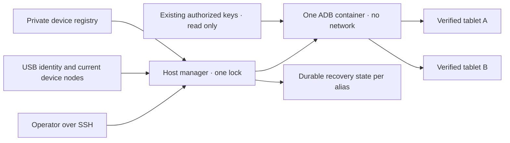

# Sdílený správce Android USB

<!-- language-navigation:start -->
<p dir="ltr">
<a href="android-usb-manager.md" lang="en" dir="ltr">English</a> · <a href="android-usb-manager.ar.md" lang="ar" dir="rtl">العربية</a> · <a href="android-usb-manager.bn.md" lang="bn" dir="ltr">বাংলা</a> · <a href="android-usb-manager.cs.md" lang="cs" dir="ltr">Čeština</a> · <a href="android-usb-manager.de.md" lang="de" dir="ltr">Deutsch</a> · <a href="android-usb-manager.es.md" lang="es" dir="ltr">Español</a> · <a href="android-usb-manager.fa.md" lang="fa" dir="rtl">فارسی</a> · <a href="android-usb-manager.fr.md" lang="fr" dir="ltr">Français</a><br>
<a href="android-usb-manager.he.md" lang="he" dir="rtl">עברית</a> · <a href="android-usb-manager.hi.md" lang="hi" dir="ltr">हिन्दी</a> · <a href="android-usb-manager.id.md" lang="id" dir="ltr">Bahasa Indonesia</a> · <a href="android-usb-manager.it.md" lang="it" dir="ltr">Italiano</a> · <a href="android-usb-manager.ja.md" lang="ja" dir="ltr">日本語</a> · <a href="android-usb-manager.ko.md" lang="ko" dir="ltr">한국어</a> · <a href="android-usb-manager.nl.md" lang="nl" dir="ltr">Nederlands</a> · <a href="android-usb-manager.pl.md" lang="pl" dir="ltr">Polski</a><br>
<a href="android-usb-manager.pt.md" lang="pt" dir="ltr">Português</a> · <a href="android-usb-manager.ru.md" lang="ru" dir="ltr">Русский</a> · <a href="android-usb-manager.th.md" lang="th" dir="ltr">ไทย</a> · <a href="android-usb-manager.tr.md" lang="tr" dir="ltr">Türkçe</a> · <a href="android-usb-manager.uk.md" lang="uk" dir="ltr">Українська</a> · <a href="android-usb-manager.vi.md" lang="vi" dir="ltr">Tiếng Việt</a> · <a href="android-usb-manager.zh-Hans.md" lang="zh-Hans" dir="ltr">简体中文</a> · <a href="android-usb-manager.zh-Hant.md" lang="zh-Hant" dir="ltr">繁體中文</a>
</p>
<!-- language-navigation:end -->

Sdílený správce nahrazuje samostatné ADB kontejnery tabletů jedním serverem ADB a výslovným registrem zařízení. Hostitelská služba řeší připojování USB a u vybraných tabletů obnovuje OTT po novém startu Androidu. Běžné přehrávání a vzdálený protokol OTT fungují nezávisle dál.

## Získání balíčku nasazení

Stáhněte `ottplay-control-server-deployment.tar.gz` a `release-manifest.json` ze stejného [vydání](https://github.com/open-ott-play/ottplay-control-server/releases). Porovnejte SHA-256 archivu s jeho položkou manifestu a rozbalte jej do nového adresáře:

```sh
mkdir ott-android-release
tar -xzf ottplay-control-server-deployment.tar.gz -C ott-android-release
cd ott-android-release
python3 -B tools/android_usb_manager_remote.py --help
```

Archiv zachovává `tools/`, `deploy/` a `docs/`, včetně všech šesti níže uvedených sdílených i starších USB skriptů. Dodržte strukturu hostitele a postup zřízení z této příručky; samotné rozbalení službu neinstaluje. Správce, supervisor a transakční adaptér musí pocházet ze stejné revize vydání. Transportní Dockerfile je návod k sestavení; vydaný OCI artefakt control-serveru není obraz USB transportu.

Starší archivy, včetně `v0.1.5-beta.6`, neobsahují `tools/`. Použijte k nim odpovídající zdrojový archiv nebo novější vydání s úplným balíčkem. Nemíchejte skripty různých verzí.

Implementaci tvoří:

- [`tools/android_usb_manager.py`](../tools/android_usb_manager.py): registr, ověření transportu, sladění kontejnerů a serializované příkazy.
- [`tools/android_usb_supervisor.py`](../tools/android_usb_supervisor.py): dosavadní pravidla startu, zámku obrazovky a obnovy popředí.
- [`tools/android_usb_manager_remote.py`](../tools/android_usb_manager_remote.py): obálka SSH zachovávající binární výstup.
- [`tools/android_usb_legacy_redirect.py`](../tools/android_usb_legacy_redirect.py): volitelné přesměrování již instalované cesty příkazů jednoho tabletu.
- [`tools/android_usb_remote.py`](../tools/android_usb_remote.py): původní obálka SSH pro stávající volající jednotlivých tabletů.
- [`tools/android_usb_transaction.py`](../tools/android_usb_transaction.py): atomový přenos souborů, příprava APK a CDP operace důvěryhodných servisních nástrojů.
- [`deploy/android-usb-manager`](../deploy/android-usb-manager): příklad konfigurace, služba systemd, startovací skript Synology DSM a [předpis transportního obrazu](../deploy/android-usb-manager/README.md).




## Izolace a identita

Kontejner spouští ADB v popředí, nikoli nečinný proces `sleep` doprovázený démonem ADB na pozadí. ADB naslouchá pouze na loopbacku kontejneru. Kontejner používá `--network none`, nemá publikované porty, kořenový systém souborů je jen ke čtení, všechna capabilities jsou odebrána, platí no-new-privileges a zapisovatelný `/tmp` je omezen. Nemá socket Dockeru ani plošný mount `/dev` či `/dev/bus/usb`. Obraz musí být připnut SHA-256.

Správce vynucuje 256 MiB paměti, 256 MiB paměti a swapu dohromady a CPU shares 128. Stejné limity paměti/swapu nepovolují další swap. CPU shares snižují relativní prioritu při konkurenci bez pevné kvóty CPU. Pevný limit PID není nastaven, protože cílové jádro DSM tento řadič nepodporuje. `/tmp` má strop tmpfs 256 MiB, přiděluje se podle potřeby a počítá do stejného paměťového limitu; nejde o další paměť. Příprava APK přijímá nejvýše 128 MiB a zapisuje bloky 1 MiB, aby halda Pythonu v kontejneru neuchovávala další celé APK. Požadavek na hostiteli svůj obsah stále bufferuje.

ADB v popředí sledují Docker a hostitelský správce. Kontejner výslovně vypíná zděděné health checks obrazu: kontrola heartbeat či konfigurace jiného správce tento proces nepopisuje. Nastavení prostředků a kontrol patří do sladění; při odchylce se vlastní kontejner pod zámkem správce nahradí.

Příkaz v popředí je `adb -L tcp:5037 nodaemon server`. ADB 29 odmítá výslovný hostname v argumentu naslouchání (`tcp:127.0.0.1:5037`); bez hostname se váže loopback, protože `-a` není povoleno. Klientské `ADB_SERVER_SOCKET=tcp:127.0.0.1:5037` zůstává výslovné. Tato kompatibilní syntaxe nepublikuje port ani nezapíná síťové ADB na tabletech.

Mapují se jen aktuální uzly zařízení jednoznačně odpovídající povoleným záznamům, s právy čtení/zápisu. USB uzly Synology mohou patřit root a mít režim `0600`, proto ADB běží jako root uvnitř omezeného kontejneru. Uzly hostitele se nezpřístupňují k zápisu všem. Také hostitelský správce vyžaduje root pro kontrolu uzlů, správu Dockeru a zachování soukromého stavu. Izolace kontejneru tuto hostitelskou pravomoc neodstraňuje.

Registr určuje zařízení podle USB sériového čísla a produktu, volitelně USB ID výrobce/produktu, poté modelu Androidu, SDK a `android_id`. Správce porovná aktuální cestu USB s inventářem transportů ADB a příkazy posílá ověřenému jedinečnému sériovému číslu. ADB může po restartu znovu použít číselná ID transportu, proto se k adresování příkazů nikdy nepoužívají. Duplicitní sériová čísla vedou k odmítnutí, ne náhodnému výběru transportu. Neshodné, chybějící, neautorizované nebo nejednoznačné zařízení nesmí dostat příkaz.

Povolené záznamy musí mít jedinečná USB sériová čísla. Některé levné tablety sdílejí zástupnou hodnotu `0123456789ABCDEF`; odlišné modely nečiní souběžnou registraci bezpečnou. Konfliktní zařízení ponechte zakázaná, dokud nebude implementována samostatně prověřená strategie fyzické identity. Nepřejmenovávejte totéž sériové číslo s domněnkou, že označuje jiný transport.

Konsolidace dává jednomu ADB procesu přístup ke všem mapovaným tabletům. Restart či sladění hotplug může přerušit jejich operace. Příkazy a sladění sdílejí hostitelský zámek `/var/lib/ott-android-manager/manager.lock`, aby zabránily konkurenčním změnám. Obecná cesta ADB odmítá příkazy pro celý server nebo změnu transportu, například `kill-server`, `tcpip`, `connect` a `root`.

## Soukromá konfigurace a klíče

Začněte souborem [`config.example.json`](../deploy/android-usb-manager/config.example.json). Identity i nulový digest obrazu jsou záměrně smyšlené; obě ukázková zařízení jsou zakázaná. Příklad není spustitelné nasazení.

Použijte tuto strukturu hostitele:

```text
/usr/local/etc/ott-android-manager/
  android_usb_manager.py
  android_usb_supervisor.py
  android_usb_transaction.py
  config.json
  ott-android-manager.service
  adb-keys/
    adbkey
    adbkey.pub
    vendor/
      additional-authorized.adb_key
/var/lib/ott-android-manager/
  manager.lock
  captures/
  <alias>/state.json
```

Správce, supervisor a transakční adaptér musí být ze stejné prověřené revize. Konfiguraci a klíče uchovávejte mimo Git i archivy vydání. Soukromé adresáře nastavte na `0700`, konfiguraci a soukromé klíče na `0600`; zdroje a soubory služby mají patřit root. Adresář klíčů je připojen jen ke čtení. `adbkey` a `adbkey.pub` musí již existovat; `vendor/` musí existovat i prázdný. Další dříve autorizované soukromé klíče lze dát do `vendor/`, předávaného přes `ADB_VENDOR_KEYS`. Soukromý soubor pojmenujte `<source>.adb_key`: ADB 29 jiné názvy při procházení tiše ignoruje. Doprovodný `<source>.adb_key.pub` je volitelný. Správce odmítá neznámé názvy před změnou kontejneru.

Před vyřazením kontejneru zachovejte dosavadní autorizované klíče. Duplicity určujte porovnáním otisků veřejných klíčů; soukromé klíče nevypisujte. Jen kvůli sloučení nenahrazujte existující klíč nově vytvořeným: může to vyžadovat potvrzení na odpojených tabletech.

Každé povolené zařízení potřebuje úplnou identitu zachycenou při asistovaném zřízení. UUID zařízení OTT, MAC adresa či odhad nejsou důkazem Android `android_id`. Pokud toto pole v záznamu chybí, ponechte `"enabled": false`; zakázané položky mohou mít neúplná popisná metadata a nikdy se nemapují ani neovládají.

`recover_on_boot` je nezávislá politika. U tabletu jen pro servisní příkazy ji ponechte false. Při povolení musí `package` označovat aplikaci, jejíž spuštění v popředí bylo na zařízení skutečně vyzkoušeno.

## Co dělá automatická obnova

Výchozí interval je pět sekund po každém dokončeném průchodu, nikoli záruka celé obnovy do pěti sekund. Pomalé USB operace jej prodlužují. Výchozí timeout příkazu je 60 sekund a limit tři pokusy na jedno spuštění Androidu.

Při prvním pozorování správce zaznamená současné spuštění bez probuzení či odemknutí. Při pozdějším novém spuštění s povolenou obnovou:

1. Čeká na `sys.boot_completed=1` a ověří identitu.
2. Vyžaduje výslovný důkaz, že zámek není chráněn PINem, heslem ani gestem.
3. Probudí obrazovku a případně odstraní obyčejný zámek přejetím.
4. Spustí nastavený balíček a zkontroluje obnovenou/aktivní activity.
5. Znovu ověří spuštění a zámek a až pak uloží úspěšný checkpoint.

Neznámý nebo chráněný zámek obnovu zastaví. Starší nasazení Fire potřebuje sondu chráněnou oprávněním shellu popsanou v [obnově USB](android-usb-recovery.md#read-only-keyguard-probe-on-older-firmware).

Již dokončené spuštění vrací `same_boot_no_action`. Běžné vypnutí obrazovky nevyvolá probuzení. Správce nesleduje dekódování videa, nerestartuje zaseklý stream ani trvale nevynucuje popředí aplikace. To jsou jiné politiky přehrávače nebo samostatně prověřeného watchdogu.

## Příkazy

Na USB hostiteli:

```sh
sudo -n /usr/bin/python3 -B /usr/local/etc/ott-android-manager/android_usb_manager.py \
  --config /usr/local/etc/ott-android-manager/config.json status
```

Z jiného počítače přes existující SSH alias hostitele:

```sh
python3 tools/android_usb_manager_remote.py --host tablet-host status
python3 tools/android_usb_manager_remote.py --host tablet-host status lobby
python3 tools/android_usb_manager_remote.py --host tablet-host wake lobby
python3 tools/android_usb_manager_remote.py --host tablet-host recover lobby
python3 tools/android_usb_manager_remote.py --host tablet-host reboot lobby
python3 tools/android_usb_manager_remote.py --host tablet-host swipe lobby 400 600 400 100 --duration 500
python3 tools/android_usb_manager_remote.py --host tablet-host screenshot lobby lobby-check.png
python3 tools/android_usb_manager_remote.py --host tablet-host adb lobby -- shell getprop ro.product.model
python3 tools/android_usb_manager_remote.py --host tablet-host adb lobby -- exec-out screencap -p > lobby.png
```

`status` kontroluje bez vytváření, restartu či změny konfigurace kontejneru. `tick` provede jeden průchod sladění/obnovy a může změnit stav zařízení; `run` průchody opakuje a je určen službě.

Obálka používá SSH bez PTY, cituje jednotlivé argumenty pro shell, předává návratový kód a nepřevádí výstup ADB na JSON. Před uznáním přesměrovaného snímku za platný zkontrolujte návratový kód. `screenshot` přijímá jen prostý název PNG jako `lobby-check.png` a ukládá do `<state_dir>/captures/` na USB hostiteli. Název musí odpovídat `[A-Za-z0-9][A-Za-z0-9_-]{0,119}\.png`; cesty, další tečky a implicitní přípony nejsou přípustné. Příkaz ověřuje PNG a vytváří nový soubor jen pro vlastníka; symlinky a existující názvy odmítá před snímáním. Naproti tomu `adb ... exec-out` streamuje bajty do souboru na počítači obsluhy. `swipe` používá současnou geometrii displeje a odmítá chráněný či neznámý zámek; souřadnice jsou příklad, ne univerzální odemykací gesto. Cesty ADB patří do jmenných prostorů kontejneru/zařízení: obálka sama nenahrává APK z notebooku. Příprava souboru a následující instalace musí používat níže uvedený atomový adaptér.

`adb <alias> -- <arguments>` je administrátorské servisní rozhraní, nikoli omezené veřejné API. Povolený příkaz `shell` může tablet změnit. Používejte ověření identity a zámek; nepublikujte neomezené SSH či Docker přes webový endpoint.

## Startovací služba a migrace

[Šablona systemd](../deploy/android-usb-manager/ott-android-manager.service) spouští správce nepřetržitě a ukončený proces obnoví po deseti sekundách. [Obálka DSM](../deploy/android-usb-manager/S99ott-android-manager.sh) ověří soubory, nainstaluje/povolí jednotku a spustí ji. Odmítne start, pokud je starý `ott-k8a-recovery.service` aktivní nebo povolený. Pro jinou distribuci přizpůsobte závislost Dockeru a cesty jejímu správci služeb.

Proveďte řízené předání:

1. Zaznamenejte konfiguraci starých kontejnerů, otisky autorizovaných klíčů a stav obnovy. Soukromé soubory zálohujte s právy jen pro vlastníka.
2. Nainstalujte nové zdroje, prověřený obraz, klíče a registr. Nezřízená zařízení ponechte zakázaná. Nespouštějte druhý supervisor téhož tabletu.
3. Zastavte a zakažte starou hostitelskou obnovovací službu a vyřaďte její DSM obálku. Soubory zachovejte pro návrat. Samotné zastavení služby neodstraní ADB kontejner.
4. Zkopírujte ověřený starý checkpoint do příslušného nového `<alias>/state.json`. Zachovejte identitu spuštění; nemažte stav jako běžnou migrační zkratku.
5. Zastavte staré ADB kontejnery před sdíleným serverem, aby dva servery nesoutěžily o stejné USB rozhraní.
6. Nainstalujte novou spustitelnou DSM obálku vlastněnou root do `/usr/local/etc/rc.d/`, spusťte `start` a ověřte službu/stav.
7. Migrujte volající, ověřte běžné příkazy a zachovanou politiku obnovy; pak odstraňte pouze staré kontejnery bez zbývajících závislostí.

Starší nástroje často skrývají závislosti za nevinným názvem. Prověřte `bootstrap.py`, `reconnect.py`, CDP adaptéry a shellové aliasy. Bootstrap může kopírovat klíče ze starého kontejneru. Reconnect může načíst `OLD` z importovaného nástroje a později jej zastavit či smazat; po změně názvu na sdílený by mohl omylem zastavit nový server. Automatickou správu kontejnerů z klientů odstraňte místo pouhé změny názvu.

Skutečné příkazy ADB směrujte přes správce pomocí aliasu. Adaptér kompatibility potřebující `docker exec` k přípravě souborů či místního CDP klienta musí držet stejný hostitelský zámek po celou transakci. Uvnitř zamčené sekce nespouštějte druhý proces získávající tentýž zámek; použijte kompatibilní cestu v procesu nebo transakci uspořádejte jednou. Přidělte dočasné přesměrovací porty a po použití je odstraňte.

Nainstalujte `android_usb_transaction.py` vedle správce a supervisoru. Přijímá jeden JSON požadavek na standardním vstupu, `--config` ukazuje na stejný soukromý registr a standardní výstup vrací surový výsledek. Podporuje:

- `pull`: `alias` a absolutní `device_path`; vrací bajty jednoho běžného souboru do 128 MiB. Adresáře a zařízení odmítá. Pevný limit cílového souboru zastaví i zdroj rostoucí během přenosu.
- `staged_adb`: `alias`, base64 `data` a `arguments`, například `["install", "-r", "@staged"]` nebo `["push", "@staged", "/sdcard/example.json"]`.
- `cdp`: `alias`, aplikační `package`, volitelný `expected_model`, důvěryhodný Python klient v `source` s `__OTT_CDP_PORT__` a jeho JSON `request`.

Každý požadavek ověří zařízení a drží jeden zámek přes přípravu, použití i úklid. Operace souborů mají jedinečné dočasné názvy; soubory se rezervují výhradně v režimu `0600` před aktivací úklidu. Instalace APK zachovává příponu `.apk` vyžadovanou parserem balíčkového argumentu ADB. Kolize názvu ponechá existující soubor nedotčený. Zápis otevírá jen vlastní prázdnou běžnou rezervaci, nesleduje symlinky. Pomocné příkazy Dockeru adresují pozorované ID kontejneru. CDP určí právě jeden aplikační proces a debug socket, přidělí `tcp:0`, nahradí port ve zdroji klienta a při dokončení či chybě odstraní pouze toto přesměrování. Sladění nemůže mezi kroky restartovat server.

Migrovaný pomocný adaptér a1 drží data `copy_in` v paměti vlákna do následujícího `adb install` nebo `adb push` stejného procesu. Dvojice tvoří jednu transakci hostitele; samotné `copy_in` už nevytváří sdílený soubor kontejneru. Home Plan a CDP nástroje přehrávače používají stejný mechanismus. Požadavky mohou obsahovat soukromá aplikační data a důvěryhodný spustitelný kód: posílejte je jen stávajícím administrátorským SSH kanálem; adaptér nezveřejňujte a obsah požadavků nelogujte.

Přesměrovací porty ADB patří sdílenému serveru, ne jednotlivému tabletu. Používejte dynamické CDP porty nebo různé porty pro aliasy ručních relací. Správce při vytvoření vynucuje `--no-rebind`, dovolí znovu použít totožné mapování a odmítá přepis či smazání přesměrování jiného aliasu. `forward --list` filtruje vybraný alias; `forward --remove-all` odmítá.

Po záloze starého skriptu lze volitelné přesměrování instalovat do `/usr/local/etc/ott-k8a-recovery/android_usb_supervisor.py`, čímž zůstanou staré ruční vstupy. Přijímá pouze známou starou cestu konfigurace, vyžaduje přesnou shodu série/modelu/SDK/Android ID s právě jednou povolenou novou položkou a nahradí svůj proces novým správcem. Starý supervisor neimportuje ani nespouští. `run` výslovně odmítá: stará služba i startovací obálka musí zůstat zakázané/vyřazené i při ruční kompatibilitě.

Pro návrat zastavte a zakažte novou službu, vyřaďte startovací obálku a zastavte kontejner. Obnovte staré snímky klíčů/stavu a původní službu. Před pokračováním ověřte, že každé USB zařízení vlastní jen jeden správce.

## Vydané přehrávače bez CDP

Produkční APK může záměrně vypnout ladění WebView. Adaptér pak hlásí `Application debugging socket is unavailable`; funkční ADB spojení tento socket nevytvoří. Správce nezapíná ladění, nemění nastavení přehrávače ani nenahrazuje APK.

U přehrávače připojeného k OTT řadiči použijte podporovanou diagnostiku jen pro čtení. Nahraďte `lobby` jeho nastaveným OTT aliasem:

```sh
ott -t 20 lobby debug -j
ott -t 20 lobby inspect -j
```

Příkazy vracejí pozorování přehrávače, včetně dostupného runtime a mediálního stavu. Nenabízejí libovolné vyhodnocení JavaScriptu, přímou inspekci DOM ani CDP připojení. Oba byly ověřeny na připojeném vydaném přehrávači API 22 bez CDP socketu; dostupnost jinde závisí na schopnostech přehrávače.

## Přijetí a omezení

Výsledky zaznamenávejte proti skutečně instalovanému zdroji, obrazu a hardwaru. Na začátku konsolidace měl fyzický důkaz původní politiky pouze **k8a**. Starý supervisor obnovoval po skutečném restartu tabletu a běžný spánek nechával být; to neprokazuje přijetí nové sdílené implementace. Jiné uložené identity byly neúplné a musí zůstat zakázané do asistovaného ověření.

Požadované přijetí sdíleného správce:

- Existující autorizovaná USB identita se objeví přes sdílený server.
- Neznámá, chybějící, duplicitní a zakázaná zařízení nedostanou akci.
- Příkaz jen pro čtení a binární snímek použijí zamýšlený transport.
- Obnova po novém spuštění uspěje na zařízení s povolenou politikou.
- Běžné vypnutí obrazovky zůstane spát.
- Opětovná enumerace USB obnoví jen očekávané mapování.
- Restart služby zachová stav a zabrání dvojité obnově.
- Skutečný restart hostitele obnoví službu a rozdělení vlastnictví.
- Každý migrovaný místní nástroj funguje bez obnovování starých kontejnerů.

Neprovedené kontroly výslovně uveďte. Běžící služba nebo úspěšný start v popředí neprokazují přehrávání streamu, kompatibilitu všech tabletů ani bezobslužnou obnovu po restartu NAS.
