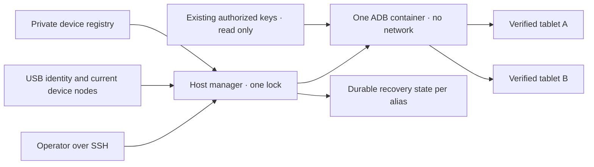

# Gemeinsamer Android-USB-Manager

<!-- language-navigation:start -->
<p dir="ltr">
<a href="android-usb-manager.md" lang="en" dir="ltr">English</a> · <a href="android-usb-manager.ar.md" lang="ar" dir="rtl">العربية</a> · <a href="android-usb-manager.bn.md" lang="bn" dir="ltr">বাংলা</a> · <a href="android-usb-manager.cs.md" lang="cs" dir="ltr">Čeština</a> · <a href="android-usb-manager.de.md" lang="de" dir="ltr">Deutsch</a> · <a href="android-usb-manager.es.md" lang="es" dir="ltr">Español</a> · <a href="android-usb-manager.fa.md" lang="fa" dir="rtl">فارسی</a> · <a href="android-usb-manager.fr.md" lang="fr" dir="ltr">Français</a><br>
<a href="android-usb-manager.he.md" lang="he" dir="rtl">עברית</a> · <a href="android-usb-manager.hi.md" lang="hi" dir="ltr">हिन्दी</a> · <a href="android-usb-manager.id.md" lang="id" dir="ltr">Bahasa Indonesia</a> · <a href="android-usb-manager.it.md" lang="it" dir="ltr">Italiano</a> · <a href="android-usb-manager.ja.md" lang="ja" dir="ltr">日本語</a> · <a href="android-usb-manager.ko.md" lang="ko" dir="ltr">한국어</a> · <a href="android-usb-manager.nl.md" lang="nl" dir="ltr">Nederlands</a> · <a href="android-usb-manager.pl.md" lang="pl" dir="ltr">Polski</a><br>
<a href="android-usb-manager.pt.md" lang="pt" dir="ltr">Português</a> · <a href="android-usb-manager.ru.md" lang="ru" dir="ltr">Русский</a> · <a href="android-usb-manager.th.md" lang="th" dir="ltr">ไทย</a> · <a href="android-usb-manager.tr.md" lang="tr" dir="ltr">Türkçe</a> · <a href="android-usb-manager.uk.md" lang="uk" dir="ltr">Українська</a> · <a href="android-usb-manager.vi.md" lang="vi" dir="ltr">Tiếng Việt</a> · <a href="android-usb-manager.zh-Hans.md" lang="zh-Hans" dir="ltr">简体中文</a> · <a href="android-usb-manager.zh-Hant.md" lang="zh-Hant" dir="ltr">繁體中文</a>
</p>
<!-- language-navigation:end -->

Der gemeinsame Manager ersetzt ADB-Container pro Tablet durch einen ADB-Server und ein ausdrückliches Geräteregister. Ein Hostdienst verwaltet USB-Hotplug und stellt bei ausgewählten Tablets OTT nach einem neuen Android-Start wieder her. Normale Wiedergabe und das OTT-Fernsteuerungsprotokoll laufen unabhängig weiter.

## Bereitstellungspaket beziehen

Laden Sie `ottplay-control-server-deployment.tar.gz` und `release-manifest.json` aus derselben [Veröffentlichung](https://github.com/open-ott-play/ottplay-control-server/releases). Prüfen Sie den SHA-256 des Archivs gegen seinen Manifesteintrag und entpacken Sie es in ein neues Verzeichnis:

```sh
mkdir ott-android-release
tar -xzf ottplay-control-server-deployment.tar.gz -C ott-android-release
cd ott-android-release
python3 -B tools/android_usb_manager_remote.py --help
```

Das Archiv erhält `tools/`, `deploy/` und `docs/`, einschließlich aller sechs unten genannten gemeinsamen und älteren USB-Skripte. Befolgen Sie die Hoststruktur und Einrichtungsschritte dieses Leitfadens; Entpacken allein installiert keinen Dienst. Manager, Supervisor und Transaktionsadapter müssen aus derselben Release-Revision stammen. Das Transport-Dockerfile ist eine Bauanleitung; das OCI-Release-Artefakt des Control-Servers ist nicht das USB-Transport-Image.

Ältere Bereitstellungsarchive, darunter `v0.1.5-beta.6`, enthalten kein `tools/`. Verwenden Sie dafür das passende Quellarchiv oder ein neueres Release mit vollständigem Bereitstellungspaket. Mischen Sie keine Skripte verschiedener Versionen.

Die Implementierung besteht aus:

- [`tools/android_usb_manager.py`](../tools/android_usb_manager.py): Register, Transportprüfung, Containerabgleich und serialisierte Befehle.
- [`tools/android_usb_supervisor.py`](../tools/android_usb_supervisor.py): bestehende Richtlinie für Start, Displaysperre und Vordergrundwiederherstellung.
- [`tools/android_usb_manager_remote.py`](../tools/android_usb_manager_remote.py): SSH-Befehlswrapper mit binärtreuer Ausgabe.
- [`tools/android_usb_legacy_redirect.py`](../tools/android_usb_legacy_redirect.py): optionale Weiterleitung eines bereits installierten tabletbezogenen Befehlspfads.
- [`tools/android_usb_remote.py`](../tools/android_usb_remote.py): älterer SSH-Wrapper für bestehende tabletbezogene Aufrufer.
- [`tools/android_usb_transaction.py`](../tools/android_usb_transaction.py): atomare Dateiübertragung, APK-Bereitstellung und CDP-Operationen für vertrauenswürdige Wartungshelfer.
- [`deploy/android-usb-manager`](../deploy/android-usb-manager): Beispielkonfiguration, systemd-Dienst, Synology-DSM-Startskript und [Bauanleitung für das Transport-Image](../deploy/android-usb-manager/README.md).




## Isolation und Identität

Im Container läuft ADB im Vordergrund statt eines untätigen `sleep`-Prozesses mit beiläufig im Hintergrund laufendem ADB-Daemon. ADB lauscht ausschließlich auf Container-Loopback. Der Container nutzt `--network none`, keine veröffentlichten Ports, ein schreibgeschütztes Root-Dateisystem, entfernte Capabilities, no-new-privileges und ein begrenztes beschreibbares `/tmp`. Er hat weder Docker-Socket noch pauschalen Mount von `/dev` oder `/dev/bus/usb`. Das Image muss per SHA-256 festgelegt sein.

Der Manager erzwingt 256 MiB Containerspeicher, 256 MiB für Speicher und Swap zusammen sowie CPU-Shares von 128. Die identischen Speicher-/Swap-Grenzen erlauben keinen zusätzlichen Swap. CPU-Shares senken bei Konkurrenz die relative Priorität ohne harte CPU-Quote. Eine harte PID-Grenze gibt es nicht, weil der DSM-Zielkernel diesen Controller nicht unterstützt. `/tmp` hat eine tmpfs-Obergrenze von 256 MiB, wird bedarfsweise belegt und zählt zum selben Speicherlimit; es ist kein zusätzlicher Speicher. APK-Bereitstellung akzeptiert höchstens 128 MiB und schreibt in 1-MiB-Blöcken, damit nicht ein weiteres vollständiges APK im Python-Heap des Containers liegt. Die hostseitige Anfrage puffert ihre Nutzdaten weiterhin.

Docker und Hostmanager überwachen den ADB-Vordergrundprozess. Geerbte Image-Healthchecks werden ausdrücklich deaktiviert: Eine Prüfung des Heartbeats oder der Konfiguration eines anderen Managers beschreibt diesen Prozess nicht. Ressourcen- und Healthcheck-Einstellungen gehören zum Abgleich; Abweichungen führen dazu, dass der eigene Container unter der Managersperre ersetzt wird.

Der Vordergrundbefehl lautet `adb -L tcp:5037 nodaemon server`. ADB 29 lehnt einen ausdrücklichen Hostnamen im Listenerargument (`tcp:127.0.0.1:5037`) ab. Ohne Hostnamen wird Loopback gebunden, weil `-a` nicht aktiviert ist. Clientseitig bleibt `ADB_SERVER_SOCKET=tcp:127.0.0.1:5037` ausdrücklich gesetzt. Diese Kompatibilitätssyntax veröffentlicht keinen Port und aktiviert auf keinem Tablet Netzwerk-ADB.

Nur aktuelle Geräteknoten eindeutig zugeordneter, aktivierter Registereinträge werden mit Lese-/Schreibrechten eingebunden. Synology-USB-Knoten können root gehören und Modus `0600` haben; deshalb läuft ADB innerhalb des eingeschränkten Containers als root. Hostknoten werden dadurch nicht für alle beschreibbar. Auch der Hostmanager benötigt root-Rechte zur Knotenprüfung, Docker-Verwaltung und Sicherung privater Zustände. Containerisolation macht diese Hostberechtigung nicht unprivilegiert.

Das Register identifiziert Geräte anhand USB-Seriennummer und Produkt, optional USB-Hersteller-/Produkt-IDs, danach Android-Modell, SDK und `android_id`. Der Manager gleicht den aktuellen USB-Pfad mit dem ADB-Transportverzeichnis ab und führt Befehle mit der geprüften eindeutigen Seriennummer aus. ADB kann numerische Transport-IDs nach Neustarts wiederverwenden; deshalb werden sie nie zur Befehlszustellung benutzt. Doppelte Seriennummern führen zur Ablehnung statt zur Auswahl eines beliebigen Transports. Ein abweichendes, fehlendes, nicht autorisiertes oder mehrdeutiges Gerät darf keinen Befehl erhalten.

Aktivierte Einträge brauchen eindeutige USB-Seriennummern. Manche günstigen Tablets teilen den Platzhalter `0123456789ABCDEF`; unterschiedliche Modellnamen machen gleichzeitige Registrierung nicht sicher. Lassen Sie kollidierende Geräte deaktiviert, bis eine gesonderte, geprüfte Strategie für physische Identität umgesetzt ist. Benennen Sie dieselbe Seriennummer nicht einfach um und nehmen an, sie identifiziere einen anderen Transport.

Die Zusammenlegung gibt einem ADB-Prozess Zugriff auf alle eingebundenen Tablets. Neustart oder Hotplug-Abgleich können Operationen auf mehreren Tablets unterbrechen. Befehle und Abgleich verwenden die gemeinsame Hostsperre `/var/lib/ott-android-manager/manager.lock`, um konkurrierende Änderungen zu verhindern. Serverweite oder transportändernde Befehle wie `kill-server`, `tcpip`, `connect` und `root` werden im allgemeinen ADB-Befehlspfad abgelehnt.

## Private Konfiguration und Schlüssel

Beginnen Sie mit [`config.example.json`](../deploy/android-usb-manager/config.example.json). Identitäten und der ausschließlich aus Nullen bestehende Image-Digest sind absichtlich erfunden; beide Beispielgeräte sind deaktiviert. Das Beispiel ist keine lauffähige Bereitstellung.

Verwenden Sie diese Hoststruktur:

```text
/usr/local/etc/ott-android-manager/
  android_usb_manager.py
  android_usb_supervisor.py
  android_usb_transaction.py
  config.json
  ott-android-manager.service
  adb-keys/
    adbkey
    adbkey.pub
    vendor/
      additional-authorized.adb_key
/var/lib/ott-android-manager/
  manager.lock
  captures/
  <alias>/state.json
```

Manager, Supervisor und Transaktionsadapter müssen aus derselben geprüften Revision stammen. Konfiguration und Schlüssel gehören weder in Git noch in Release-Archive. Private Verzeichnisse erhalten `0700`, Konfiguration und private Schlüssel `0600`; Quell- und Dienstdateien gehören root. Das Schlüsselverzeichnis wird schreibgeschützt eingebunden. `adbkey` und `adbkey.pub` müssen bereits vorhanden sein; `vendor/` muss auch leer existieren. Zusätzliche bereits autorisierte private Schlüssel können nach `vendor/`, das durch `ADB_VENDOR_KEYS` bereitgestellt wird. Nennen Sie jede private Datei `<source>.adb_key`: ADB 29 ignoriert beim Durchsuchen dieses Verzeichnisses andere Dateinamen stillschweigend. Eine passende Begleitdatei `<source>.adb_key.pub` ist optional. Der Manager lehnt unbekannte Dateinamen vor einer Containeränderung ab.

Sichern Sie vorhandene autorisierte Schlüssel, bevor Sie einen Container außer Betrieb nehmen. Vergleichen Sie Fingerabdrücke öffentlicher Schlüssel zur Duplikaterkennung; geben Sie private Schlüssel nicht aus. Ersetzen Sie einen bestehenden Schlüssel nicht nur zur Containerzusammenlegung durch einen neuen: Das kann Bestätigung auf getrennten Tablets erforderlich machen.

Jedes aktivierte Gerät braucht eine vollständige Identität, die bei beaufsichtigter Einrichtung erfasst wurde. Eine OTT-Geräte-UUID, MAC-Adresse oder ein geratener Wert belegt keine Android-`android_id`. Fehlt dieses Feld im Nachweis, bleibt der Eintrag `"enabled": false`; deaktivierte Einträge dürfen unvollständige beschreibende Metadaten enthalten und werden nie eingebunden oder gesteuert.

`recover_on_boot` ist eine unabhängige Richtlinie. Für ein Tablet, das nur Wartungsbefehle anbieten soll, bleibt sie false. Bei Aktivierung muss `package` die Anwendung bezeichnen, deren Vordergrundstart auf diesem Gerät tatsächlich getestet wurde.

## Verhalten der automatischen Wiederherstellung

Das Standardintervall beträgt fünf Sekunden nach jedem abgeschlossenen Durchlauf, keine garantierte Wiederherstellung innerhalb von fünf Sekunden. Langsame USB-Operationen verlängern das Intervall. Das Standard-Befehlszeitlimit beträgt 60 Sekunden; pro Android-Start gibt es höchstens drei Wiederherstellungsversuche.

Bei der ersten Beobachtung speichert der Manager den aktuellen Start, ohne das Tablet aufzuwecken oder zu entsperren. Bei einem späteren neuen Start mit aktivierter Wiederherstellung:

1. Wartet er auf `sys.boot_completed=1` und prüft die Geräteidentität.
2. Verlangt er einen ausdrücklichen Nachweis, dass die Displaysperre nicht durch PIN, Passwort oder Muster geschützt ist.
3. Weckt er das Display und entfernt nötigenfalls eine einfache Wischsperre.
4. Startet er das konfigurierte Paket und prüft die fortgesetzte/fokussierte Activity.
5. Prüft er Start und Displaysperre erneut und speichert erst danach einen erfolgreichen Kontrollpunkt.

Unbekannter oder geschützter Sperrzustand stoppt die Wiederherstellung. Die ältere Fire-Bereitstellung benötigt die durch Shell-Berechtigungen geschützte Prüfung aus [USB-Wiederherstellung](android-usb-recovery.md#read-only-keyguard-probe-on-older-firmware).

Ein bereits abgeschlossener Start liefert `same_boot_no_action`. Normales Ausschalten des Bildschirms löst kein Aufwecken aus. Der Manager überwacht weder Videodekodierung noch startet er hängen gebliebene Streams neu oder erzwingt dauerhaft den Anwendungsvordergrund. Das sind andere Richtlinien des Players oder eines gesondert geprüften Watchdogs.

## Befehle

Auf dem USB-Host:

```sh
sudo -n /usr/bin/python3 -B /usr/local/etc/ott-android-manager/android_usb_manager.py \
  --config /usr/local/etc/ott-android-manager/config.json status
```

Von einem anderen Computer über einen vorhandenen SSH-Hostalias:

```sh
python3 tools/android_usb_manager_remote.py --host tablet-host status
python3 tools/android_usb_manager_remote.py --host tablet-host status lobby
python3 tools/android_usb_manager_remote.py --host tablet-host wake lobby
python3 tools/android_usb_manager_remote.py --host tablet-host recover lobby
python3 tools/android_usb_manager_remote.py --host tablet-host reboot lobby
python3 tools/android_usb_manager_remote.py --host tablet-host swipe lobby 400 600 400 100 --duration 500
python3 tools/android_usb_manager_remote.py --host tablet-host screenshot lobby lobby-check.png
python3 tools/android_usb_manager_remote.py --host tablet-host adb lobby -- shell getprop ro.product.model
python3 tools/android_usb_manager_remote.py --host tablet-host adb lobby -- exec-out screencap -p > lobby.png
```

`status` prüft, ohne Container zu erzeugen, neu zu starten oder umzukonfigurieren. `tick` führt einen Abgleich-/Wiederherstellungsdurchlauf aus und kann den Gerätezustand ändern; `run` wiederholt diese Durchläufe und ist für den Dienst gedacht.

Der Wrapper verwendet SSH ohne PTY, maskiert einzelne Argumente für die Shell, reicht den Prozess-Exitstatus durch und wandelt ADB-Ausgabe nicht in JSON um. Prüfen Sie den Exitstatus, bevor Sie einen umgeleiteten Screenshot für gültig halten. `screenshot` akzeptiert nur einen einfachen PNG-Dateinamen wie `lobby-check.png` und speichert ihn auf dem USB-Host unter `<state_dir>/captures/`. Der Name muss `[A-Za-z0-9][A-Za-z0-9_-]{0,119}\.png` entsprechen; Pfade, zusätzliche Punkte und implizite Erweiterungen sind unzulässig. Der Befehl prüft das PNG und erzeugt eine neue, nur dem Eigentümer zugängliche Datei; Symlinks und vorhandene Namen werden vor der Aufnahme abgelehnt. Das Beispiel `adb ... exec-out` streamt dagegen Bytes in eine Datei auf dem Bediencomputer. `swipe` verwendet die aktuelle Bildschirmgeometrie und lehnt geschützte oder unbekannte Displaysperren ab; die Beispielkoordinaten sind keine universelle Entsperrgeste. ADB-Dateipfade liegen im Namensraum von Container/Gerät: Der Wrapper lädt ein APK vom Laptop nicht automatisch hoch. Dateibereitstellung und anschließende Installation müssen den unten beschriebenen atomaren Transaktionsadapter verwenden.

`adb <alias> -- <arguments>` ist eine Administrator-Wartungsschnittstelle, keine eingeschränkte öffentliche API. Ein erlaubter `shell`-Befehl kann das Tablet verändern. Nutzen Sie Identitätsprüfungen und Sperre; stellen Sie unbeschränkten SSH- oder Docker-Zugriff nicht über einen Webendpunkt bereit.

## Startdienst und Migration

Die [systemd-Vorlage](../deploy/android-usb-manager/ott-android-manager.service) lässt den Manager dauerhaft laufen und startet einen beendeten Prozess nach zehn Sekunden neu. Der [DSM-Wrapper](../deploy/android-usb-manager/S99ott-android-manager.sh) prüft Bereitstellungsdateien, installiert/aktiviert die Unit und startet sie. Er verweigert den Start, solange der alte `ott-k8a-recovery.service` aktiv oder aktiviert ist. Passen Sie für andere Distributionen Docker-Abhängigkeit und Pfade an deren Dienstverwaltung an.

Führen Sie eine kontrollierte Übergabe durch:

1. Erfassen Sie bestehende Containerkonfiguration, Fingerabdrücke autorisierter Schlüssel und Wiederherstellungszustand. Sichern Sie private Dateien mit Zugriff nur für den Eigentümer.
2. Installieren Sie neue Quellen, geprüftes Image, Schlüssel und Register. Nicht eingerichtete Geräte bleiben deaktiviert. Starten Sie keinen zweiten Supervisor für dasselbe Tablet.
3. Stoppen und deaktivieren Sie den alten Host-Wiederherstellungsdienst und nehmen Sie seinen DSM-Startwrapper außer Betrieb. Bewahren Sie Dateien für einen Rückweg auf. Das Stoppen allein entfernt den ADB-Container nicht.
4. Kopieren Sie den validierten alten Kontrollpunkt nach `<alias>/state.json` des passenden neuen Eintrags. Bewahren Sie die Startidentität; setzen Sie den Zustand nicht als routinemäßige Migrationsabkürzung zurück.
5. Stoppen Sie alte ADB-Container vor dem gemeinsamen Server, damit nicht zwei Server um dieselbe USB-Schnittstelle konkurrieren.
6. Installieren Sie den neuen DSM-Wrapper als ausführbare Datei im Besitz von root unter `/usr/local/etc/rc.d/`, führen Sie seine Aktion `start` aus und prüfen Sie Dienst und Status.
7. Migrieren Sie Aufrufer, prüfen Sie normale Befehle und erhaltene Wiederherstellungsrichtlinie; entfernen Sie danach nur alte Container ohne verbleibende Abhängigkeiten.

Ältere Helfer verstecken Abhängigkeiten oft hinter harmlosen Namen. Prüfen Sie `bootstrap.py`, `reconnect.py`, CDP-Adapter und Shell-Aliase. Bootstrap kann Schlüssel aus einem alten Container kopieren. Ein Reconnect-Skript kann `OLD` aus einem importierten Helfer beziehen und später stoppen oder entfernen; wird dort nur der Name auf den gemeinsamen Container geändert, kann es versehentlich den gemeinsamen Server stoppen. Entfernen Sie automatische Containerverwaltung aus Clients, statt nur Namen zu ändern.

Leiten Sie echte ADB-Befehle per Alias durch den Manager. Ein Kompatibilitätsadapter, der `docker exec` zur Dateibereitstellung oder für einen lokalen CDP-Client benötigt, muss dieselbe Hostsperre über die gesamte Bereitstellungs-/Befehlstransaktion halten. Starten Sie innerhalb des gesperrten Abschnitts keinen zweiten Prozess, der dieselbe Sperre anfordert; verwenden Sie einen kompatiblen Aufruf im Prozess oder organisieren Sie die Transaktion einmalig. Weisen Sie temporäre Weiterleitungsports zu und entfernen Sie sie nach Gebrauch.

Installieren Sie `android_usb_transaction.py` neben Manager und Supervisor. Der Adapter akzeptiert eine JSON-Anfrage auf Standardeingabe, wobei `--config` auf dasselbe private Register zeigt, und liefert rohe Operationsausgabe auf Standardausgabe. Unterstützte Anfragen:

- `pull`: `alias` und absoluter `device_path`; liefert die Bytes einer regulären Datei bis 128 MiB. Verzeichnisse und Gerätedateien werden abgelehnt. Eine harte Größenbegrenzung der Zieldatei stoppt auch eine während der Übertragung wachsende Quelle.
- `staged_adb`: `alias`, base64-`data` und `arguments`, etwa `["install", "-r", "@staged"]` oder `["push", "@staged", "/sdcard/example.json"]`.
- `cdp`: `alias`, Anwendungs-`package`, optionales `expected_model`, vertrauenswürdiger Python-Client in `source` mit `__OTT_CDP_PORT__` sowie dessen JSON-`request`.

Jede Anfrage prüft das Gerät und hält eine Managersperre während Vorbereitung, Nutzung und Bereinigung. Dateioperationen nutzen eindeutige temporäre Namen; Dateien werden exklusiv mit `0600` reserviert, bevor die Bereinigung aktiviert wird. APK-Installationen behalten das vom ADB-Paketargumentparser benötigte Suffix `.apk`. Namenskollisionen lassen bestehende Dateien unverändert. Der Schreibpfad öffnet nur seine leere reguläre Reservierung und folgt keinen Symlinks. Hilfsbefehle für Docker adressieren die beobachtete Container-ID. CDP ermittelt genau einen Anwendungsprozess und dessen Debugsocket, reserviert `tcp:0`, ersetzt den zugeteilten Port im Clientquelltext und entfernt bei Abschluss oder Fehler ausschließlich diese Weiterleitung. Zwischen diesen Schritten kann kein Abgleich den Server neu starten.

Der migrierte a1-Kompatibilitätshelfer hält `copy_in`-Daten bis zum nächsten `adb install` oder `adb push` desselben Prozesses in threadlokalem Speicher. Das Paar wird eine Hosttransaktion; `copy_in` allein erzeugt keine gemeinsame Containerdatei mehr. Home Plan und Player-CDP-Helfer verwenden denselben Mechanismus. Anfragen können private Anwendungsdaten und vertrauenswürdigen ausführbaren Code enthalten: ausschließlich über den vorhandenen Administrator-SSH-Kanal senden, niemals den Adapter als öffentlichen Endpunkt anbieten oder Nutzdaten protokollieren.

ADB-Weiterleitungsports gehören dem gemeinsamen Server, nicht einem einzelnen Tablet. Verwenden Sie dynamisch zugewiesene CDP-Ports oder unterschiedliche Ports pro Alias für manuelle Sitzungen. Der Manager erzwingt `--no-rebind` beim Anlegen, erlaubt Wiederverwendung identischer Zuordnungen und verweigert Überschreiben oder Entfernen von Weiterleitungen anderer Aliase. `forward --list` ist auf den gewählten Alias gefiltert; `forward --remove-all` wird abgelehnt.

Nach Sicherung des alten Skripts kann die optionale Legacy-Weiterleitung unter `/usr/local/etc/ott-k8a-recovery/android_usb_supervisor.py` installiert werden, um alte manuelle Einstiegspunkte zu erhalten. Sie akzeptiert nur den bekannten alten Konfigurationspfad, verlangt die exakte Übereinstimmung von Seriennummer, Modell, SDK und Android-ID mit genau einem aktivierten neuen Registereintrag und ersetzt ihren Prozess durch den neuen Manager. Sie importiert oder startet den alten Supervisor nicht. `run` wird ausdrücklich abgelehnt: Alter Dienst und Startwrapper müssen auch mit manueller Kompatibilität deaktiviert beziehungsweise außer Betrieb bleiben.

Für einen Rückweg stoppen und deaktivieren Sie den neuen Hostdienst, nehmen seinen Startwrapper außer Betrieb und stoppen seinen Container. Stellen Sie alte Schlüssel-/Zustandssicherungen und den alten Hostdienst wieder her. Prüfen Sie vor Fortsetzung, dass genau ein Manager jedes USB-Gerät besitzt.

## Release-Player ohne CDP

Ein Produktions-APK kann WebView-Debugging absichtlich deaktivieren. Dann meldet der Transaktionsadapter `Application debugging socket is unavailable`; eine funktionierende ADB-Verbindung erzeugt diesen Socket nicht. Der Manager aktiviert weder Debugging noch ändert er Playereinstellungen oder ersetzt das APK.

Verwenden Sie bei einem bereits mit dem OTT-Controller verbundenen Player dessen unterstützte schreibgeschützte Diagnose. Ersetzen Sie `lobby` durch seinen konfigurierten OTT-Alias:

```sh
ott -t 20 lobby debug -j
ott -t 20 lobby inspect -j
```

Diese Befehle liefern Beobachtungen des Players einschließlich verfügbarer Laufzeit- und Medienzustände. Sie ermöglichen weder beliebige JavaScript-Ausführung noch direkte DOM-Inspektion oder eine CDP-Verbindung. Beide wurden am verbundenen API-22-Release-Player ohne CDP-Socket geprüft; die Verfügbarkeit bei anderen Playern hängt von deren Fähigkeiten ab.

## Abnahme und Grenzen

Dokumentieren Sie Ergebnisse gegen tatsächlich installierte Quellen, Image und Hardware. Zu Beginn dieser Zusammenlegung gab es nur für **k8a** physische Nachweise der alten Wiederherstellungsrichtlinie. Sein alter Supervisor stellte nach echtem Tablet-Neustart wieder her und ließ normalen Schlaf unberührt; das belegt nicht die Abnahme der neuen gemeinsamen Implementierung. Andere gespeicherte Tabletidentitäten waren unvollständig und müssen bis zur beaufsichtigten Validierung deaktiviert bleiben.

Erforderliche Abnahme des gemeinsamen Managers:

- Eine bestehende autorisierte USB-Identität erscheint über den gemeinsamen Server.
- Unbekannte, fehlende, doppelte und deaktivierte Geräte erhalten keine Aktion.
- Ein schreibgeschützter Befehl und ein binärer Screenshot verwenden den beabsichtigten Transport.
- Wiederherstellung nach neuem Start gelingt auf einem Gerät mit aktivierter Richtlinie.
- Normales Ausschalten des Bildschirms bleibt im Schlaf.
- USB-Neuerkennung stellt nur die erwartete Gerätezuordnung wieder her.
- Ein Hostdienst-Neustart erhält Zustand und verhindert doppelte Wiederherstellung.
- Ein echter Hostneustart stellt Dienst und Besitzverhältnisse wieder her.
- Jeder migrierte lokale Helfer funktioniert, ohne alte Container neu zu erzeugen.

Kennzeichnen Sie nicht ausgeführte Prüfungen ausdrücklich. Ein laufender Dienst oder erfolgreicher Vordergrundstart beweist weder Streamwiedergabe noch die Kompatibilität jedes Tablets oder unbeaufsichtigte Wiederherstellung nach NAS-Neustart.
