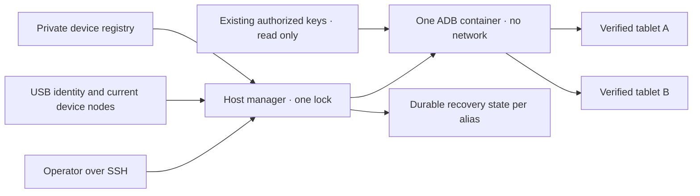

# Gestor USB Android compartido

<!-- language-navigation:start -->
<p dir="ltr">
<a href="android-usb-manager.md" lang="en" dir="ltr">English</a> · <a href="android-usb-manager.ar.md" lang="ar" dir="rtl">العربية</a> · <a href="android-usb-manager.bn.md" lang="bn" dir="ltr">বাংলা</a> · <a href="android-usb-manager.cs.md" lang="cs" dir="ltr">Čeština</a> · <a href="android-usb-manager.de.md" lang="de" dir="ltr">Deutsch</a> · <a href="android-usb-manager.es.md" lang="es" dir="ltr">Español</a> · <a href="android-usb-manager.fa.md" lang="fa" dir="rtl">فارسی</a> · <a href="android-usb-manager.fr.md" lang="fr" dir="ltr">Français</a><br>
<a href="android-usb-manager.he.md" lang="he" dir="rtl">עברית</a> · <a href="android-usb-manager.hi.md" lang="hi" dir="ltr">हिन्दी</a> · <a href="android-usb-manager.id.md" lang="id" dir="ltr">Bahasa Indonesia</a> · <a href="android-usb-manager.it.md" lang="it" dir="ltr">Italiano</a> · <a href="android-usb-manager.ja.md" lang="ja" dir="ltr">日本語</a> · <a href="android-usb-manager.ko.md" lang="ko" dir="ltr">한국어</a> · <a href="android-usb-manager.nl.md" lang="nl" dir="ltr">Nederlands</a> · <a href="android-usb-manager.pl.md" lang="pl" dir="ltr">Polski</a><br>
<a href="android-usb-manager.pt.md" lang="pt" dir="ltr">Português</a> · <a href="android-usb-manager.ru.md" lang="ru" dir="ltr">Русский</a> · <a href="android-usb-manager.th.md" lang="th" dir="ltr">ไทย</a> · <a href="android-usb-manager.tr.md" lang="tr" dir="ltr">Türkçe</a> · <a href="android-usb-manager.uk.md" lang="uk" dir="ltr">Українська</a> · <a href="android-usb-manager.vi.md" lang="vi" dir="ltr">Tiếng Việt</a> · <a href="android-usb-manager.zh-Hans.md" lang="zh-Hans" dir="ltr">简体中文</a> · <a href="android-usb-manager.zh-Hant.md" lang="zh-Hant" dir="ltr">繁體中文</a>
</p>
<!-- language-navigation:end -->

El gestor compartido sustituye los contenedores ADB por tableta por un servidor ADB y un registro explícito de dispositivos. Un servicio del host gestiona la conexión USB en caliente y, en las tabletas seleccionadas, recupera OTT tras un nuevo arranque de Android. La reproducción normal y el protocolo remoto OTT siguen funcionando independientemente.

## Obtener el paquete de despliegue

Descargue `ottplay-control-server-deployment.tar.gz` y `release-manifest.json` de la misma [versión](https://github.com/open-ott-play/ottplay-control-server/releases). Verifique el SHA-256 del archivo contra su entrada del manifiesto y extráigalo en un directorio nuevo:

```sh
mkdir ott-android-release
tar -xzf ottplay-control-server-deployment.tar.gz -C ott-android-release
cd ott-android-release
python3 -B tools/android_usb_manager_remote.py --help
```

El archivo conserva `tools/`, `deploy/` y `docs/`, incluidos los seis scripts USB compartidos y heredados enumerados abajo. Siga la estructura del host y los pasos de preparación de esta guía; extraer no instala un servicio. Mantenga gestor, supervisor y adaptador de transacciones en la misma revisión de lanzamiento. El Dockerfile de transporte es una receta de compilación; el artefacto OCI del control-server no es la imagen de transporte USB.

Los archivos de despliegue antiguos, incluido `v0.1.5-beta.6`, omiten `tools/`. En esas versiones use el archivo de fuentes correspondiente o una versión más reciente que incluya el paquete completo. No mezcle scripts de versiones diferentes.

La implementación consta de:

- [`tools/android_usb_manager.py`](../tools/android_usb_manager.py): registro, verificación del transporte, reconciliación de contenedores y comandos serializados.
- [`tools/android_usb_supervisor.py`](../tools/android_usb_supervisor.py): política existente de arranque, bloqueo de pantalla y recuperación del primer plano.
- [`tools/android_usb_manager_remote.py`](../tools/android_usb_manager_remote.py): envoltorio SSH con salida que conserva los datos binarios.
- [`tools/android_usb_legacy_redirect.py`](../tools/android_usb_legacy_redirect.py): redirección opcional de una ruta de comandos por tableta ya instalada.
- [`tools/android_usb_remote.py`](../tools/android_usb_remote.py): envoltorio SSH heredado, conservado para los clientes existentes por tableta.
- [`tools/android_usb_transaction.py`](../tools/android_usb_transaction.py): transferencia atómica de archivos, preparación de APK y operaciones CDP para auxiliares de mantenimiento de confianza.
- [`deploy/android-usb-manager`](../deploy/android-usb-manager): configuración de ejemplo, servicio systemd, script de arranque Synology DSM y [receta de imagen de transporte](../deploy/android-usb-manager/README.md).




## Aislamiento e identidad

El contenedor ejecuta ADB en primer plano, en lugar de un proceso `sleep` inactivo acompañado por un demonio ADB en segundo plano. ADB escucha únicamente en el loopback del contenedor. Este usa `--network none`, ningún puerto publicado, sistema raíz de solo lectura, todas las capacidades retiradas, no-new-privileges y un `/tmp` escribible limitado. No tiene socket Docker ni montaje amplio de `/dev` o `/dev/bus/usb`. La imagen debe fijarse por SHA-256.

El gestor impone 256 MiB de memoria del contenedor, 256 MiB de memoria y swap combinados y CPU shares de 128. La igualdad de los límites de memoria/swap impide swap adicional. CPU shares reduce la prioridad relativa cuando existe competencia sin imponer una cuota dura de CPU. No hay límite duro de PID porque el kernel DSM de destino no admite ese controlador. `/tmp` tiene un techo tmpfs de 256 MiB, asignado a demanda y contabilizado dentro del mismo límite de memoria, no como memoria adicional. La preparación de APK acepta hasta 128 MiB y escribe bloques de 1 MiB para no conservar otro APK completo en el heap Python del contenedor. La solicitud del host sigue almacenando su contenido en memoria.

Docker y el gestor del host supervisan el proceso ADB en primer plano. El contenedor desactiva explícitamente los health checks heredados de la imagen: comprobar el latido o configuración de otro gestor no describe este proceso. Los recursos y health checks forman parte de la reconciliación, por lo que una desviación provoca sustituir el contenedor propio bajo el bloqueo del gestor.

El comando principal es `adb -L tcp:5037 nodaemon server`. ADB 29 rechaza un nombre de host explícito en el argumento de escucha (`tcp:127.0.0.1:5037`); omitirlo enlaza loopback porque `-a` no está activado. El cliente mantiene explícito `ADB_SERVER_SOCKET=tcp:127.0.0.1:5037`. Esta sintaxis compatible no publica el puerto ni activa ADB de red en ninguna tableta.

Solo se mapean, con permiso de lectura/escritura, los nodos actuales de dispositivos que coinciden inequívocamente con entradas activadas. En Synology los nodos USB pueden pertenecer a root con modo `0600`, así que ADB se ejecuta como root dentro del contenedor restringido. No se hacen los nodos del host escribibles para todos. El gestor también necesita autoridad root en el host para inspeccionar nodos, administrar Docker y conservar estado privado. El aislamiento del contenedor no elimina esos privilegios del host.

El registro identifica dispositivos por serie USB y producto, opcionalmente ID USB de fabricante/producto, y después por modelo Android, SDK y `android_id`. El gestor resuelve la ruta USB actual contra el inventario de transportes ADB y ejecuta comandos con la serie única verificada. ADB puede reutilizar ID numéricos de transporte tras reiniciar, por lo que nunca se usan para enviar comandos. Las series duplicadas provocan rechazo, no selección arbitraria. Un dispositivo no coincidente, ausente, no autorizado o ambiguo no debe recibir comandos.

Las entradas activadas requieren series USB únicas. Algunas tabletas económicas comparten el marcador `0123456789ABCDEF`; distintos nombres de modelo no hacen seguro registrarlas simultáneamente. Mantenga los dispositivos conflictivos desactivados hasta implementar una estrategia separada y revisada de identidad física. No cambie la etiqueta de una misma serie suponiendo que identifica otro transporte.

La consolidación da a un proceso ADB acceso a todas las tabletas mapeadas. Un reinicio o reconciliación de conexión en caliente puede interrumpir operaciones entre ellas. Comandos y reconciliación comparten un bloqueo del host, `/var/lib/ott-android-manager/manager.lock`, para evitar cambios concurrentes. La ruta genérica ADB rechaza comandos de alcance global o que modifican transportes, como `kill-server`, `tcpip`, `connect` y `root`.

## Configuración privada y claves

Comience con [`config.example.json`](../deploy/android-usb-manager/config.example.json). Sus identidades y el digest de imagen compuesto de ceros son ficticios deliberadamente; ambos dispositivos de ejemplo están desactivados. No es un despliegue ejecutable.

Use esta estructura del host:

```text
/usr/local/etc/ott-android-manager/
  android_usb_manager.py
  android_usb_supervisor.py
  android_usb_transaction.py
  config.json
  ott-android-manager.service
  adb-keys/
    adbkey
    adbkey.pub
    vendor/
      additional-authorized.adb_key
/var/lib/ott-android-manager/
  manager.lock
  captures/
  <alias>/state.json
```

Gestor, supervisor y adaptador de transacciones deben provenir de la misma revisión revisada. Mantenga configuración y claves fuera de Git y archivos de lanzamiento. Aplique `0700` a directorios privados y `0600` a configuración y claves privadas; fuentes y archivos de servicio deben pertenecer a root. El directorio de claves se monta en solo lectura. `adbkey` y `adbkey.pub` deben existir previamente; `vendor/` debe existir aunque esté vacío. Las claves privadas adicionales ya autorizadas pueden ir en `vendor/`, proporcionado mediante `ADB_VENDOR_KEYS`. Nombre cada archivo privado `<source>.adb_key`: ADB 29 ignora silenciosamente otros nombres al explorar ese directorio. Un acompañante `<source>.adb_key.pub` es opcional. El gestor rechaza nombres desconocidos antes de modificar el contenedor.

Conserve las claves autorizadas existentes antes de retirar cualquier contenedor. Compare huellas de claves públicas para identificar duplicados; no imprima claves privadas. No reemplace una clave existente por otra recién generada solo para consolidar contenedores: podría requerir confirmación en tabletas desconectadas.

Cada dispositivo activado necesita una identidad completa capturada durante una preparación supervisada. Un UUID de dispositivo OTT, una MAC o una suposición no demuestran el `android_id` de Android. Si el comprobante carece de ese campo, mantenga `"enabled": false`; las entradas desactivadas pueden contener metadatos descriptivos incompletos y nunca se mapean ni controlan.

`recover_on_boot` es una política independiente. Déjela en false para una tableta que solo deba ofrecer comandos de mantenimiento. Si se activa, establezca `package` en la aplicación cuyo inicio en primer plano se haya probado realmente en ese dispositivo.

## Qué hace la recuperación automática

El intervalo predeterminado es cinco segundos después de cada pasada terminada, no una garantía de recuperación completa en cinco segundos. Las operaciones USB lentas alargan el intervalo. El timeout predeterminado del comando es 60 segundos y se permiten tres intentos de recuperación por arranque Android.

En la primera observación, el gestor registra el arranque actual sin despertar ni desbloquear la tableta. En un nuevo arranque posterior, con recuperación activada:

1. Espera `sys.boot_completed=1` y verifica la identidad.
2. Exige evidencia explícita de que el bloqueo no está protegido por PIN, contraseña o patrón.
3. Despierta la pantalla y descarta un bloqueo de deslizamiento normal si hace falta.
4. Inicia el paquete configurado y comprueba la actividad reanudada/enfocada.
5. Vuelve a comprobar arranque/bloqueo y solo entonces guarda un punto de control satisfactorio.

Un bloqueo desconocido o protegido detiene la recuperación. El despliegue Fire heredado requiere la sonda protegida por permisos shell descrita en [recuperación USB](android-usb-recovery.md#read-only-keyguard-probe-on-older-firmware).

Un arranque ya completado devuelve `same_boot_no_action`. El apagado normal de pantalla no provoca despertar. Este gestor no supervisa decodificación de vídeo, reinicia emisiones atascadas ni fuerza continuamente el primer plano. Esas políticas corresponden al reproductor o a un watchdog revisado por separado.

## Comandos

En el host USB:

```sh
sudo -n /usr/bin/python3 -B /usr/local/etc/ott-android-manager/android_usb_manager.py \
  --config /usr/local/etc/ott-android-manager/config.json status
```

Desde otro equipo con un alias de host SSH existente:

```sh
python3 tools/android_usb_manager_remote.py --host tablet-host status
python3 tools/android_usb_manager_remote.py --host tablet-host status lobby
python3 tools/android_usb_manager_remote.py --host tablet-host wake lobby
python3 tools/android_usb_manager_remote.py --host tablet-host recover lobby
python3 tools/android_usb_manager_remote.py --host tablet-host reboot lobby
python3 tools/android_usb_manager_remote.py --host tablet-host swipe lobby 400 600 400 100 --duration 500
python3 tools/android_usb_manager_remote.py --host tablet-host screenshot lobby lobby-check.png
python3 tools/android_usb_manager_remote.py --host tablet-host adb lobby -- shell getprop ro.product.model
python3 tools/android_usb_manager_remote.py --host tablet-host adb lobby -- exec-out screencap -p > lobby.png
```

`status` inspecciona sin crear, reiniciar ni reconfigurar el contenedor. `tick` realiza una pasada de reconciliación/recuperación y puede cambiar el estado del dispositivo; `run` repite esas pasadas y está destinado al servicio.

El envoltorio usa SSH sin PTY, cita individualmente los argumentos para la shell, propaga el estado de salida y no convierte la salida ADB en JSON. Compruebe dicho estado antes de considerar válida una captura redirigida. `screenshot` solo acepta un nombre PNG simple como `lobby-check.png` y lo guarda en `<state_dir>/captures/` del host USB. Debe coincidir con `[A-Za-z0-9][A-Za-z0-9_-]{0,119}\.png`; no acepta rutas, puntos adicionales ni extensiones implícitas. Valida el PNG y crea un archivo nuevo exclusivo del propietario, rechazando enlaces simbólicos y nombres existentes antes de capturar. En cambio, `adb ... exec-out` transmite bytes a un archivo del equipo del operador. `swipe` usa la geometría actual y rechaza bloqueos protegidos o desconocidos; las coordenadas son ejemplos, no un gesto universal. Las rutas ADB pertenecen al espacio de nombres del contenedor/dispositivo: el envoltorio no sube automáticamente un APK del portátil. La preparación del archivo y su instalación deben usar el adaptador atómico descrito abajo.

`adb <alias> -- <arguments>` es una interfaz de mantenimiento administrativo, no una API pública restringida. Un comando `shell` permitido puede modificar la tableta. Use verificación de identidad y bloqueo; no exponga acceso SSH o Docker ilimitado mediante un endpoint web.

## Servicio de arranque y migración

La [plantilla systemd](../deploy/android-usb-manager/ott-android-manager.service) ejecuta el gestor continuamente y reinicia un proceso terminado tras diez segundos. El [envoltorio DSM](../deploy/android-usb-manager/S99ott-android-manager.sh) comprueba archivos, instala/activa la unidad y la inicia. Rechaza arrancar mientras `ott-k8a-recovery.service` esté activo o habilitado. En otras distribuciones adapte la dependencia Docker y las rutas a su gestor de servicios.

Haga un traspaso controlado:

1. Registre configuración de contenedores, huellas de claves autorizadas y estado de recuperación. Respalde archivos privados con permisos solo del propietario.
2. Instale fuentes nuevas, imagen revisada, claves y registro. Deje desactivados los dispositivos sin preparar. No inicie un segundo supervisor para la misma tableta.
3. Detenga y desactive el antiguo servicio de recuperación del host y retire su envoltorio de arranque DSM. Conserve los archivos para revertir. Detener el servicio no elimina por sí solo su contenedor ADB.
4. Copie el punto de control antiguo validado al nuevo `<alias>/state.json` correspondiente. Conserve su identidad de arranque; no reinicie el estado como atajo habitual.
5. Detenga los contenedores ADB antiguos antes del servidor compartido para evitar que dos servidores compitan por la misma interfaz USB.
6. Instale el nuevo envoltorio DSM ejecutable y propiedad de root bajo `/usr/local/etc/rc.d/`, ejecute `start` e inspeccione servicio/estado.
7. Migre clientes, compruebe comandos normales y política conservada; después elimine solo contenedores antiguos cuyas dependencias se hayan retirado.

Los auxiliares heredados suelen ocultar dependencias bajo nombres inocentes. Audite `bootstrap.py`, `reconnect.py`, adaptadores CDP y alias shell. Un bootstrap puede copiar claves de un contenedor antiguo. Un script reconnect puede obtener `OLD` de un auxiliar importado y después detenerlo o eliminarlo; cambiar ese auxiliar al nombre compartido podría detener accidentalmente el servidor común. Elimine de los clientes esa administración automática en lugar de cambiar solo un nombre.

Encamine comandos ADB reales por el gestor mediante alias. Un adaptador de compatibilidad que necesite `docker exec` para preparar archivos o un cliente CDP local debe mantener el mismo bloqueo durante toda la transacción. No anide otro proceso que adquiera ese bloqueo dentro de la sección bloqueada; use una ruta compatible en el mismo proceso u organice la transacción una sola vez. Asigne puertos temporales de reenvío y retírelos después.

Instale `android_usb_transaction.py` junto al gestor y supervisor. Acepta una solicitud JSON por entrada estándar, con `--config` apuntando al mismo registro privado, y devuelve salida bruta por salida estándar. Admite:

- `pull`: `alias` y `device_path` absoluto; devuelve bytes de un archivo regular de hasta 128 MiB. Rechaza directorios y archivos de dispositivo. Un límite duro del archivo de destino también detiene una fuente que crezca durante la transferencia.
- `staged_adb`: `alias`, `data` en base64 y `arguments`, como `["install", "-r", "@staged"]` o `["push", "@staged", "/sdcard/example.json"]`.
- `cdp`: `alias`, `package` de aplicación, `expected_model` opcional, cliente Python confiable en `source` que contenga `__OTT_CDP_PORT__`, y su `request` JSON.

Cada solicitud verifica el dispositivo y conserva un bloqueo durante preparación, uso y limpieza. Las operaciones usan nombres temporales únicos; los archivos se reservan exclusivamente con modo `0600` antes de armar la limpieza. Las instalaciones APK conservan el sufijo `.apk` que exige el analizador de argumentos de paquetes ADB. Una colisión deja intacto el archivo existente. El escritor solo abre su reserva regular vacía, sin seguir enlaces simbólicos. Los comandos Docker auxiliares usan el ID observado del contenedor. CDP resuelve exactamente un proceso y su socket de depuración, asigna `tcp:0`, sustituye el puerto asignado en el código cliente y elimina solo ese reenvío al terminar o fallar. Ninguna reconciliación puede reiniciar el servidor entre esos pasos.

El auxiliar a1 migrado conserva los datos de `copy_in` en memoria local del hilo hasta el siguiente `adb install` o `adb push` del mismo proceso. El par se convierte en una transacción del host; `copy_in` por sí solo ya no crea un archivo compartido. Los auxiliares CDP de Home Plan y del reproductor usan el mismo mecanismo. Las solicitudes pueden contener datos privados y código ejecutable confiable: envíelas solo por el canal SSH administrativo existente; nunca publique el adaptador ni registre sus cargas útiles.

Los puertos reenviados de ADB pertenecen al servidor compartido, no a una tableta individual. Use puertos CDP dinámicos o puertos distintos por alias en sesiones manuales. El gestor fuerza `--no-rebind` al crear reenvíos, permite reutilizar asignaciones idénticas y rechaza sobrescribir o eliminar las de otro alias. `forward --list` se filtra al alias seleccionado; `forward --remove-all` se rechaza.

Tras respaldar el script antiguo, puede instalar la redirección heredada opcional en `/usr/local/etc/ott-k8a-recovery/android_usb_supervisor.py` para conservar entradas manuales antiguas. Solo acepta la ruta de configuración antigua conocida, exige que serie/modelo/SDK/Android ID coincidan con exactamente una entrada nueva activada y sustituye su proceso por el gestor nuevo. No importa ni ejecuta el supervisor anterior. Rechaza explícitamente `run`: el servicio y envoltorio antiguos deben permanecer desactivados/retirados incluso con compatibilidad manual.

Para revertir, detenga y desactive el servicio nuevo, retire su envoltorio y detenga su contenedor. Restaure las copias antiguas de claves/estado y el servicio previo. Antes de continuar confirme que solo un gestor posee cada dispositivo USB.

## Reproductores de producción sin CDP

Un APK de producción puede desactivar deliberadamente la depuración WebView. En ese caso el adaptador informa `Application debugging socket is unavailable`; una conexión ADB funcional no crea ese socket. El gestor no activa depuración, cambia ajustes del reproductor ni sustituye el APK.

Para un reproductor conectado al controlador OTT, use sus diagnósticos admitidos de solo lectura. Sustituya `lobby` por su alias OTT configurado:

```sh
ott -t 20 lobby debug -j
ott -t 20 lobby inspect -j
```

Estos comandos devuelven observaciones del reproductor, incluido el estado disponible de ejecución y medios. No proporcionan evaluación arbitraria de JavaScript, inspección DOM directa ni conexión CDP. Ambos se verificaron en el reproductor de producción API 22 conectado sin socket CDP; en otro reproductor dependen de sus capacidades.

## Aceptación y límites

Registre resultados respecto a fuentes, imagen y hardware realmente instalados. Al comenzar esta consolidación, solo **k8a** tenía evidencia física de la política heredada. Su supervisor anterior recuperó tras reiniciar realmente la tableta y no alteró el sueño normal; eso no acredita la implementación compartida nueva. Otras identidades guardadas estaban incompletas y deben seguir desactivadas hasta validación supervisada.

Aceptación requerida del gestor compartido:

- Una identidad USB ya autorizada aparece por el servidor compartido.
- Los dispositivos desconocidos, ausentes, duplicados y desactivados no reciben acciones.
- Un comando de solo lectura y una captura binaria usan el transporte previsto.
- La recuperación tras un nuevo arranque funciona en un dispositivo con esa política activada.
- El apagado normal de pantalla permanece dormido.
- La reenumeración USB restablece solo el mapeo esperado.
- Reiniciar el servicio conserva estado y evita recuperaciones duplicadas.
- Reiniciar realmente el host recupera servicio y propiedad.
- Cada auxiliar local migrado funciona sin recrear contenedores antiguos.

Informe explícitamente las pruebas no realizadas. Un servicio activo o un inicio en primer plano correcto no prueban reproducción, compatibilidad de todas las tabletas ni recuperación desatendida tras reiniciar el NAS.
