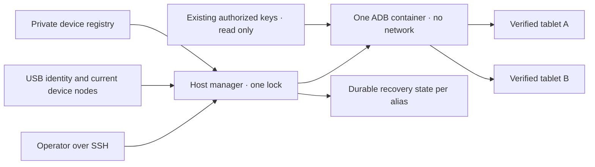

# مدیر مشترک USB اندروید

<!-- language-navigation:start -->
<p dir="ltr">
<a href="android-usb-manager.md" lang="en" dir="ltr">English</a> · <a href="android-usb-manager.ar.md" lang="ar" dir="rtl">العربية</a> · <a href="android-usb-manager.bn.md" lang="bn" dir="ltr">বাংলা</a> · <a href="android-usb-manager.cs.md" lang="cs" dir="ltr">Čeština</a> · <a href="android-usb-manager.de.md" lang="de" dir="ltr">Deutsch</a> · <a href="android-usb-manager.es.md" lang="es" dir="ltr">Español</a> · <a href="android-usb-manager.fa.md" lang="fa" dir="rtl">فارسی</a> · <a href="android-usb-manager.fr.md" lang="fr" dir="ltr">Français</a><br>
<a href="android-usb-manager.he.md" lang="he" dir="rtl">עברית</a> · <a href="android-usb-manager.hi.md" lang="hi" dir="ltr">हिन्दी</a> · <a href="android-usb-manager.id.md" lang="id" dir="ltr">Bahasa Indonesia</a> · <a href="android-usb-manager.it.md" lang="it" dir="ltr">Italiano</a> · <a href="android-usb-manager.ja.md" lang="ja" dir="ltr">日本語</a> · <a href="android-usb-manager.ko.md" lang="ko" dir="ltr">한국어</a> · <a href="android-usb-manager.nl.md" lang="nl" dir="ltr">Nederlands</a> · <a href="android-usb-manager.pl.md" lang="pl" dir="ltr">Polski</a><br>
<a href="android-usb-manager.pt.md" lang="pt" dir="ltr">Português</a> · <a href="android-usb-manager.ru.md" lang="ru" dir="ltr">Русский</a> · <a href="android-usb-manager.th.md" lang="th" dir="ltr">ไทย</a> · <a href="android-usb-manager.tr.md" lang="tr" dir="ltr">Türkçe</a> · <a href="android-usb-manager.uk.md" lang="uk" dir="ltr">Українська</a> · <a href="android-usb-manager.vi.md" lang="vi" dir="ltr">Tiếng Việt</a> · <a href="android-usb-manager.zh-Hans.md" lang="zh-Hans" dir="ltr">简体中文</a> · <a href="android-usb-manager.zh-Hant.md" lang="zh-Hant" dir="ltr">繁體中文</a>
</p>
<!-- language-navigation:end -->

<div dir="rtl" lang="fa">

مدیر مشترک، کانتینرهای ADB جداگانهٔ هر تبلت را با یک سرور ADB و فهرست صریح دستگاه‌ها جایگزین می‌کند. سرویسی روی میزبان، اتصال و جداسازی USB و برای تبلت‌های منتخب، بازگرداندن OTT پس از راه‌اندازی تازهٔ اندروید را مدیریت می‌کند. پخش عادی و پروتکل کنترل از راه دور OTT همچنان مستقل اجرا می‌شوند.

## دریافت بستهٔ استقرار

فایل‌های `ottplay-control-server-deployment.tar.gz` و `release-manifest.json` را از یک [انتشار](https://github.com/open-ott-play/ottplay-control-server/releases) یکسان دریافت کنید. SHA-256 آرشیو را با مدخل آن در مانیفست مقایسه و تأیید کنید، سپس آن را در پوشه‌ای تازه استخراج کنید:

</div>

<div dir="ltr">

```sh
mkdir ott-android-release
tar -xzf ottplay-control-server-deployment.tar.gz -C ott-android-release
cd ott-android-release
python3 -B tools/android_usb_manager_remote.py --help
```

</div>

<div dir="rtl" lang="fa">

آرشیو ساختار `tools/`، `deploy/` و `docs/` را حفظ می‌کند و شامل هر شش اسکریپت USB مشترک و قدیمیِ فهرست‌شده در پایین است. چیدمان میزبان و مراحل آماده‌سازی این راهنما را دنبال کنید؛ استخراج به‌تنهایی سرویسی نصب نمی‌کند. مدیر، ناظر و مبدل تراکنش را کنار هم و در یک بازبینی از انتشار نگه دارید. Dockerfile انتقال، دستور ساخت تصویر است؛ دارایی OCI انتشارِ سرور کنترل، تصویر انتقال USB نیست.

آرشیوهای استقرار قدیمی‌تر، از جمله `v0.1.5-beta.6`، فاقد `tools/` هستند. برای آن نسخه‌ها از آرشیو کد منبع همان نسخه استفاده کنید یا انتشار تازه‌تری با بستهٔ استقرار کامل انتخاب کنید. اسکریپت‌های نسخه‌های متفاوت را با هم ترکیب نکنید.

پیاده‌سازی از اجزای زیر تشکیل شده است:

- [`tools/android_usb_manager.py`](../tools/android_usb_manager.py): فهرست دستگاه‌ها، تأیید مسیر ارتباطی، تطبیق وضعیت کانتینر و اجرای ترتیبی فرمان‌ها.
- [`tools/android_usb_supervisor.py`](../tools/android_usb_supervisor.py): سیاست موجودِ راه‌اندازی، قفل صفحه و بازگرداندن برنامه به پیش‌زمینه.
- [`tools/android_usb_manager_remote.py`](../tools/android_usb_manager_remote.py): واسط فرمان SSH که خروجی دودویی را بدون تغییر حفظ می‌کند.
- [`tools/android_usb_legacy_redirect.py`](../tools/android_usb_legacy_redirect.py): هدایت اختیاری برای مسیر فرمان جداگانهٔ تبلتی که از قبل نصب شده است.
- [`tools/android_usb_remote.py`](../tools/android_usb_remote.py): واسط قدیمی SSH که برای فراخوان‌های موجودِ هر تبلت حفظ شده است.
- [`tools/android_usb_transaction.py`](../tools/android_usb_transaction.py): انتقال اتمی فایل، آماده‌سازی APK و عملیات CDP برای ابزارهای کمکی قابل اعتمادِ نگهداری.
- [`deploy/android-usb-manager`](../deploy/android-usb-manager): پیکربندی نمونه، سرویس systemd، اسکریپت راه‌اندازی Synology DSM و [دستور ساخت تصویر انتقال](../deploy/android-usb-manager/README.md).


</div>

<div dir="ltr">



</div>

<div dir="rtl" lang="fa">

## جداسازی و هویت

کانتینر ADB را در پیش‌زمینه اجرا می‌کند؛ نه فرایند بیکار `sleep` که اتفاقاً یک دیمن ADB نیز در پس‌زمینهٔ آن باشد. ADB فقط روی آدرس loopback کانتینر گوش می‌دهد. کانتینر دارای `--network none` است، هیچ درگاهی منتشر نمی‌کند، فایل‌سیستم ریشهٔ آن فقط‌خواندنی است، تمام قابلیت‌های ویژه حذف شده‌اند، افزایش امتیاز ممنوع است و `/tmp` قابل‌نوشتن آن اندازه‌ای محدود دارد. کانتینر نه سوکت Docker دارد و نه اتصال گستردهٔ `/dev` یا `/dev/bus/usb`. تصویر باید با SHA-256 ثابت شود.

مدیر، حافظهٔ کانتینر را به 256 MiB، مجموع حافظه و swap را به 256 MiB و سهم CPU را به 128 محدود می‌کند. برابر بودن تنظیمات حافظه و swap اجازهٔ swap اضافی نمی‌دهد. سهم CPU در هنگام رقابت، اولویت نسبی را کاهش می‌دهد، بی‌آنکه سهمیهٔ سخت CPU اعمال کند. سقف سخت PID وجود ندارد، زیرا کرنل DSM هدف از آن کنترل‌کننده پشتیبانی نمی‌کند. `/tmp` سقف 256 MiB از نوع tmpfs دارد که بر حسب نیاز تخصیص می‌یابد و از همان محدودیت حافظه حساب می‌شود؛ حافظهٔ اضافی نیست. آماده‌سازی APK حداکثر 128 MiB را می‌پذیرد و در قطعات 1 MiB می‌نویسد تا یک نسخهٔ کامل دیگر APK در هیپ Python کانتینر نگه داشته نشود. درخواست سمت میزبان همچنان محمولهٔ خود را در حافظه بافر می‌کند.

Docker و مدیر میزبان بر فرایند ADB پیش‌زمینه نظارت می‌کنند. کانتینر صریحاً بررسی‌های سلامت به‌ارث‌رسیده از تصویر را غیرفعال می‌کند: بررسی ضربان یا پیکربندی مدیر دیگر نمی‌تواند وضعیت این فرایند را توصیف کند. این تنظیمات منابع و بررسی سلامت بخشی از تطبیق وضعیت هستند؛ بنابراین انحراف از آن‌ها موجب جایگزینی کانتینر تحت مدیریت، زیر قفل مدیر، می‌شود.

فرمان پیش‌زمینه از `adb -L tcp:5037 nodaemon server` استفاده می‌کند. ADB 29 نام میزبان صریح را در آرگومان شنونده (`tcp:127.0.0.1:5037`) رد می‌کند؛ حذف نام میزبان موجب اتصال به loopback می‌شود، زیرا `-a` فعال نیست. در سمت کارخواه، `ADB_SERVER_SOCKET=tcp:127.0.0.1:5037` همچنان صریح باقی می‌ماند. این نحو سازگار، درگاه را منتشر نمی‌کند و ADB شبکه را روی هیچ تبلتی فعال نمی‌سازد.

فقط گره‌های فعلی دستگاه برای مدخل‌های فعال فهرست که به‌طور یکتا تطبیق یافته‌اند، با مجوز خواندن/نوشتن نگاشت می‌شوند. گره‌های USB در Synology ممکن است متعلق به root و دارای حالت `0600` باشند؛ بنابراین این استقرار، فرایند ADB را داخل کانتینر محدودشده با کاربر root اجرا می‌کند. مجوز گره‌های میزبان برای نوشتن همگانی تغییر نمی‌کند. مدیر میزبان نیز برای بررسی گره‌ها، مدیریت Docker و حفظ وضعیت خصوصی به اختیار root نیاز دارد. جداسازی کانتینر این اختیار میزبان را به دسترسی فاقد امتیاز تبدیل نمی‌کند.

فهرست دستگاه را ابتدا با شمارهٔ سریال و محصول USB، در صورت نیاز با شناسه‌های سازنده/محصول USB، و سپس با مدل اندروید، SDK و `android_id` شناسایی می‌کند. مدیر مسیر فعلی USB را با فهرست مسیرهای ارتباطی ADB تطبیق می‌دهد و سپس فرمان‌ها را با سریال تأییدشده و یکتا اجرا می‌کند. ADB پس از راه‌اندازی مجدد می‌تواند شناسه‌های عددی مسیر ارتباطی را دوباره استفاده کند؛ بنابراین این شناسه‌ها هرگز برای ارسال فرمان به کار نمی‌روند. سریال تکراری موجب رد عملیات می‌شود، نه انتخاب یک مسیر دلخواه. دستگاه نامنطبق، مفقود، تأییدنشده یا مبهم نباید فرمانی دریافت کند.

مدخل‌های فعال باید سریال USB یکتا داشته باشند. برخی تبلت‌های ارزان، سریال جایگزین مشترک `0123456789ABCDEF` دارند؛ متفاوت بودن نام مدل، ثبت هم‌زمان آن‌ها را ایمن نمی‌کند. تا پیاده‌سازی راهبرد جداگانه و بازبینی‌شدهٔ هویت فیزیکی، دستگاه‌های دارای تعارض را غیرفعال نگه دارید. به همان سریال برچسب تازه نزنید و تصور نکنید که مسیر دیگری را مشخص می‌کند.

یکپارچه‌سازی به یک فرایند ADB دسترسی به همهٔ تبلت‌های نگاشت‌شده می‌دهد. راه‌اندازی مجدد یا تطبیق وضعیت پس از اتصال/جداسازی می‌تواند عملیات روی همهٔ آن تبلت‌ها را قطع کند. فرمان‌ها و تطبیق وضعیت از یک قفل میزبان، `/var/lib/ott-android-manager/manager.lock`، استفاده می‌کنند تا تغییرات با هم رقابت نکنند. فرمان‌های سراسری سرور یا تغییردهندهٔ مسیر ارتباطی مانند `kill-server`، `tcpip`، `connect` و `root` از طریق مسیر عمومی فرمان ADB رد می‌شوند.

## پیکربندی و کلیدهای خصوصی

از [`config.example.json`](../deploy/android-usb-manager/config.example.json) شروع کنید. هویت‌ها و هش سراسر صفر تصویر عمداً ساختگی‌اند و هر دو دستگاه نمونه غیرفعال هستند. این نمونه یک استقرار قابل اجرا نیست.

از چیدمان زیر روی میزبان استفاده کنید:

</div>

<div dir="ltr">

```text
/usr/local/etc/ott-android-manager/
  android_usb_manager.py
  android_usb_supervisor.py
  android_usb_transaction.py
  config.json
  ott-android-manager.service
  adb-keys/
    adbkey
    adbkey.pub
    vendor/
      additional-authorized.adb_key
/var/lib/ott-android-manager/
  manager.lock
  captures/
  <alias>/state.json
```

</div>

<div dir="rtl" lang="fa">

مدیر، ناظر و مبدل تراکنش باید از همان بازبینیِ بررسی‌شده باشند. پیکربندی و کلیدها را خارج از Git و آرشیوهای انتشار نگه دارید. مجوز پوشه‌های خصوصی را `0700` و پیکربندی و کلیدهای خصوصی را `0600` قرار دهید و مالکیت فایل‌های منبع/سرویس را به root بدهید. پوشهٔ کلید به‌صورت فقط‌خواندنی متصل می‌شود. `adbkey` و `adbkey.pub` باید از قبل وجود داشته باشند؛ `vendor/` حتی اگر خالی است باید موجود باشد. کلیدهای خصوصی اضافه که قبلاً مجاز شده‌اند می‌توانند در `vendor/` قرار گیرند؛ این پوشه از طریق `ADB_VENDOR_KEYS` معرفی می‌شود. نام هر فایل خصوصی را `<source>.adb_key` بگذارید: ADB 29 هنگام پیمایش این پوشه، نام‌های دیگر را بی‌صدا نادیده می‌گیرد. فایل عمومی همراهِ منطبقِ `<source>.adb_key.pub` اختیاری است. مدیر پیش از تغییر کانتینر، نام فایل‌های ناشناخته را رد می‌کند.

پیش از بازنشسته کردن هر کانتینر، کلیدهای مجاز موجود را حفظ کنید. برای شناسایی نسخه‌های تکراری، اثر انگشت کلیدهای عمومی را مقایسه کنید؛ کلیدهای خصوصی را چاپ نکنید. فقط برای یکپارچه‌سازی کانتینرها، کلید موجود را با کلیدی تازه‌تولیدشده جایگزین نکنید: این کار ممکن است به تأیید روی تبلت‌های جداشده نیاز داشته باشد.

هر دستگاه فعال به هویت کاملی نیاز دارد که هنگام آماده‌سازی با حضور اپراتور ثبت شده باشد. UUID دستگاه OTT، آدرس MAC یا مقدار حدس‌زده‌شده، مدرک `android_id` اندروید نیست. اگر رسید این فیلد را ندارد، مدخل را با `"enabled": false` نگه دارید؛ مدخل‌های غیرفعال می‌توانند فرادادهٔ توصیفی ناقص داشته باشند و هرگز نگاشت یا کنترل نمی‌شوند.

`recover_on_boot` سیاستی مستقل است. برای تبلتی که فقط باید فرمان‌های نگهداری را ارائه کند، آن را false نگه دارید. وقتی فعال است، `package` را روی برنامه‌ای تنظیم کنید که اجرای آن در پیش‌زمینه واقعاً روی همان دستگاه آزمایش شده است.

## بازیابی خودکار چه می‌کند

فاصلهٔ پیش‌فرض، پنج ثانیه پس از پایان هر دور است؛ تضمین بازیابی سرتاسری در پنج ثانیه نیست. عملیات کند USB فاصله را افزایش می‌دهد. مهلت پیش‌فرض فرمان 60 ثانیه است و حداکثر سه تلاش بازیابی در هر راه‌اندازی اندروید مجاز است.

در نخستین مشاهده، مدیر راه‌اندازی فعلی را بدون بیدار کردن یا باز کردن قفل تبلت ثبت می‌کند. در راه‌اندازی تازهٔ بعدی، اگر بازیابی فعال باشد:

1. منتظر `sys.boot_completed=1` می‌ماند و هویت دستگاه را بررسی می‌کند.
2. مدرک صریح می‌خواهد که قفل صفحه با PIN، گذرواژه یا الگو محافظت نشده باشد.
3. نمایشگر را بیدار می‌کند و در صورت نیاز قفل سادهٔ کشیدنی را کنار می‌زند.
4. بستهٔ پیکربندی‌شده را اجرا می‌کند و فعالیت ازسرگرفته‌شده/دارای تمرکز را بررسی می‌کند.
5. راه‌اندازی و قفل صفحه را دوباره بررسی می‌کند و تنها پس از آن نقطهٔ کنترل موفق را ذخیره می‌کند.

وضعیت نامعلوم یا محافظت‌شدهٔ قفل صفحه، بازیابی را متوقف می‌کند. استقرار قدیمی Fire به کاوشی نیاز دارد که با مجوز shell محافظت می‌شود و در [بازیابی USB](android-usb-recovery.md#read-only-keyguard-probe-on-older-firmware) شرح داده شده است.

برای راه‌اندازی‌ای که قبلاً تکمیل شده، `same_boot_no_action` برگردانده می‌شود. خاموش شدن عادی صفحه باعث بیدار کردن نمی‌شود. این مدیر رمزگشایی ویدیو را پایش نمی‌کند، جریان متوقف‌شده را دوباره راه نمی‌اندازد و حضور دائمی برنامه در پیش‌زمینه را تحمیل نمی‌کند. این‌ها سیاست‌های دیگری هستند که به پخش‌کننده یا ناظر جداگانهٔ بازبینی‌شده تعلق دارند.

## فرمان‌ها

روی میزبان USB:

</div>

<div dir="ltr">

```sh
sudo -n /usr/bin/python3 -B /usr/local/etc/ott-android-manager/android_usb_manager.py \
  --config /usr/local/etc/ott-android-manager/config.json status
```

</div>

<div dir="rtl" lang="fa">

از رایانه‌ای دیگر با نام مستعار موجود میزبان SSH:

</div>

<div dir="ltr">

```sh
python3 tools/android_usb_manager_remote.py --host tablet-host status
python3 tools/android_usb_manager_remote.py --host tablet-host status lobby
python3 tools/android_usb_manager_remote.py --host tablet-host wake lobby
python3 tools/android_usb_manager_remote.py --host tablet-host recover lobby
python3 tools/android_usb_manager_remote.py --host tablet-host reboot lobby
python3 tools/android_usb_manager_remote.py --host tablet-host swipe lobby 400 600 400 100 --duration 500
python3 tools/android_usb_manager_remote.py --host tablet-host screenshot lobby lobby-check.png
python3 tools/android_usb_manager_remote.py --host tablet-host adb lobby -- shell getprop ro.product.model
python3 tools/android_usb_manager_remote.py --host tablet-host adb lobby -- exec-out screencap -p > lobby.png
```

</div>

<div dir="rtl" lang="fa">

`status` بدون ایجاد، راه‌اندازی مجدد یا پیکربندی دوبارهٔ کانتینر، وضعیت را بررسی می‌کند. `tick` یک دور تطبیق وضعیت/بازیابی انجام می‌دهد و می‌تواند وضعیت دستگاه را تغییر دهد؛ `run` این دورها را تکرار می‌کند و برای سرویس در نظر گرفته شده است.

واسط از SSH بدون PTY استفاده می‌کند، هر آرگومان را جداگانه برای shell نقل‌قول‌گذاری می‌کند، وضعیت خروج فرایند را عبور می‌دهد و خروجی ADB را به JSON تبدیل نمی‌کند. پیش از معتبر دانستن تصویر صفحه‌ای که خروجی آن به فایل هدایت شده، وضعیت خروج را بررسی کنید. فرمان `screenshot` فقط نام سادهٔ فایل PNG، مانند `lobby-check.png`، را می‌پذیرد و آن را در `<state_dir>/captures/` روی میزبان USB ذخیره می‌کند. نام باید با `[A-Za-z0-9][A-Za-z0-9_-]{0,119}\.png` مطابقت داشته باشد؛ مسیر، نقطه‌های اضافی و پسوند ضمنی پذیرفته نمی‌شوند. فرمان PNG را اعتبارسنجی و فایل تازه‌ای با دسترسی انحصاری مالک ایجاد می‌کند و پیش از ثبت تصویر، پیوند نمادین و نام فایل موجود را رد می‌کند. در مقابل، مثال `adb ... exec-out` بایت‌ها را به فایلی روی رایانهٔ اپراتور ارسال می‌کند. `swipe` از هندسهٔ فعلی صفحه استفاده می‌کند و وضعیت محافظت‌شده یا نامعلوم قفل صفحه را رد می‌کند؛ مختصات بالا نمونه‌اند، نه حرکت همگانی برای باز کردن قفل. مسیرهای فایل ADB به فضای نام کانتینر/دستگاه اشاره می‌کنند: این واسط APK را خودکار از لپ‌تاپ شما بارگذاری نمی‌کند. آماده‌سازی فایل و نصب پس از آن باید با مبدل تراکنش اتمیِ شرح‌داده‌شده در پایین انجام شود.

`adb <alias> -- <arguments>` رابط نگهداری برای مدیر سیستم است، نه API عمومی محدودشده. فرمان مجاز `shell` می‌تواند آن تبلت را تغییر دهد. از بررسی‌های هویت و قفل استفاده کنید؛ دسترسی نامحدود SSH یا Docker را از طریق یک نقطهٔ پایانی وب ارائه نکنید.

## سرویس راه‌اندازی و مهاجرت

[قالب systemd](../deploy/android-usb-manager/ott-android-manager.service) مدیر را پیوسته اجرا می‌کند و فرایند خاتمه‌یافته را پس از ده ثانیه دوباره راه می‌اندازد. [واسط DSM](../deploy/android-usb-manager/S99ott-android-manager.sh) فایل‌های استقرار را بررسی می‌کند، واحد سرویس را نصب/فعال می‌کند و سپس آن را اجرا می‌کند. تا زمانی که `ott-k8a-recovery.service` قدیمی فعال یا برای اجرا فعال‌سازی شده باشد، شروع به کار را رد می‌کند. برای توزیعی دیگر، وابستگی Docker و مسیرها را با مدیر سرویس آن سازگار کنید.

تحویل کنترل را به‌صورت کنترل‌شده انجام دهید:

1. پیکربندی کانتینر موجود، اثر انگشت کلیدهای مجاز و وضعیت بازیابی را ثبت کنید. از فایل‌های خصوصی با مجوز دسترسی انحصاری مالک نسخهٔ پشتیبان بگیرید.
2. منبع تازه، تصویر بازبینی‌شده، کلیدها و فهرست دستگاه‌ها را نصب کنید. دستگاه‌های آماده‌سازی‌نشده را غیرفعال نگه دارید. برای همان تبلت ناظر دومی اجرا نکنید.
3. سرویس بازیابی قدیمی میزبان را متوقف و غیرفعال کنید و واسط راه‌اندازی DSM آن را بازنشسته کنید. فایل‌ها را برای بازگشت نگه دارید. توقف سرویس به‌تنهایی کانتینر ADB آن را حذف نمی‌کند.
4. نقطهٔ کنترل بازیابی قدیمیِ اعتبارسنجی‌شده را در `<alias>/state.json` تازهٔ متناظر کپی کنید. هویت راه‌اندازی آن را حفظ کنید؛ بازنشانی وضعیت را میان‌بُر معمول مهاجرت قرار ندهید.
5. پیش از اجرای سرور مشترک، کانتینرهای ADB قدیمی را متوقف کنید تا دو سرور برای همان رابط USB رقابت نکنند.
6. واسط تازهٔ DSM را به‌صورت فایل اجرایی متعلق به root در `/usr/local/etc/rc.d/` نصب کنید، عمل `start` آن را اجرا کنید و سرویس/وضعیت را بررسی کنید.
7. فراخوان‌ها را مهاجرت دهید، فرمان‌های عادی و سیاست بازیابیِ حفظ‌شده را بررسی کنید و سپس فقط کانتینرهای قدیمی‌ای را حذف کنید که وابستگی‌هایشان بازنشسته شده‌اند.

ابزارهای کمکی قدیمی اغلب وابستگی‌ها را پشت نامی بی‌خطر پنهان می‌کنند. `bootstrap.py`، `reconnect.py`، مبدل‌های CDP و نام‌های مستعار shell را بررسی کنید. ابزار راه‌اندازی اولیه می‌تواند کلیدها را از کانتینر قدیمی کپی کند. اسکریپت اتصال مجدد می‌تواند `OLD` را از یک ابزار کمکی واردشده تنظیم کند و بعداً آن کانتینر را متوقف یا حذف کند؛ پس از تغییر آن ابزار به نام مشترک جدید، ممکن است تصادفاً سرور مشترک را متوقف کند. به‌جای صرفاً تغییر نام، چنین مدیریت خودکار کانتینر را از کارخواه‌ها حذف کنید.

فرمان‌های واقعی ADB را با نام مستعار از مسیر مدیر بفرستید. مبدل سازگاری‌ای که برای آماده‌سازی فایل یا کارخواه محلی CDP به `docker exec` نیاز دارد باید همان قفل میزبان را در تمام تراکنش آماده‌سازی/فرمان نگه دارد. داخل بخش قفل‌شده، فرایند دومی را برای گرفتن همان قفل تو در تو اجرا نکنید؛ مسیر سازگارِ درون‌فرایندی را فراخوانی کنید یا کل تراکنش را یک بار سازمان‌دهی کنید. درگاه‌های موقت انتقال را اختصاص دهید و پس از استفاده حذف کنید.

`android_usb_transaction.py` را کنار مدیر و ناظر نصب کنید. این ابزار یک درخواست JSON را از ورودی استاندارد می‌پذیرد؛ `--config` باید به همان فهرست خصوصی اشاره کند و خروجی خام عملیات در خروجی استاندارد برگردانده می‌شود. درخواست‌های پشتیبانی‌شده عبارت‌اند از:

- `pull`: شامل `alias` و `device_path` مطلق؛ بایت‌های یک فایل معمولی را تا سقف 128 MiB برمی‌گرداند. پوشه‌ها و فایل‌های دستگاه رد می‌شوند. محدودیت سخت اندازهٔ فایل مقصد، منبعی را که حین انتقال بزرگ می‌شود نیز متوقف می‌کند.
- `staged_adb`: شامل `alias`، `data` با کدگذاری base64 و `arguments`، مانند `["install", "-r", "@staged"]` یا `["push", "@staged", "/sdcard/example.json"]`.
- `cdp`: شامل `alias`، نام `package` برنامه، `expected_model` اختیاری، `source` کارخواه قابل اعتماد Python که حاوی `__OTT_CDP_PORT__` است، و `request` آن در قالب JSON.

هر درخواست دستگاه را تأیید می‌کند و یک قفل مدیر را طی آماده‌سازی، استفاده و پاک‌سازی نگه می‌دارد. عملیات فایل از نام‌های موقت یکتا استفاده می‌کنند؛ پیش از فعال شدن پاک‌سازی، فایل‌های آماده‌شده به‌طور انحصاری با حالت `0600` رزرو می‌شوند. نصب APK پسوند `.apk` موردنیاز تجزیه‌گر آرگومان بسته در ADB را حفظ می‌کند. تعارض نام، فایل موجود را دست‌نخورده می‌گذارد. نویسندهٔ فایل آماده‌سازی‌شده فقط فایل معمولیِ خالیِ رزروشدهٔ خودش را بدون دنبال کردن پیوند نمادین باز می‌کند. فرمان‌های کمکی Docker، شناسهٔ کانتینر مشاهده‌شده را هدف می‌گیرند. CDP دقیقاً یک فرایند برنامه و سوکت اشکال‌زدایی آن را پیدا می‌کند، `tcp:0` را اختصاص می‌دهد، درگاه اختصاص‌یافته را در منبع کارخواه جایگزین می‌کند و هنگام پایان یا شکست فقط همان مدخل انتقال را حذف می‌کند. تطبیق وضعیت نمی‌تواند سرور را میان این مراحل دوباره راه‌اندازی کند.

ابزار سازگاری مهاجرت‌یافتهٔ a1 داده‌های `copy_in` را تا `adb install` یا `adb push` بعدی در همان فرایند، در حافظهٔ محلی هر نخ نگه می‌دارد. این جفت عملیات به یک تراکنش میزبان تبدیل می‌شود؛ `copy_in` به‌تنهایی دیگر فایلی در کانتینر مشترک ایجاد نمی‌کند. ابزارهای کمکی CDP در Home Plan و پخش‌کننده از همین سازوکار تراکنش استفاده می‌کنند. درخواست‌ها ممکن است حاوی دادهٔ خصوصی برنامه و کد اجرایی قابل اعتماد باشند: آن‌ها را فقط از کانال موجود SSH مدیر سیستم بفرستید، هرگز این مبدل را به‌عنوان نقطهٔ پایانی عمومی ارائه نکنید و محتوای درخواست‌ها را در گزارش ثبت نکنید.

درگاه‌های انتقال ADB متعلق به سرور مشترک‌اند، نه به یک تبلت خاص. برای CDP از درگاه‌های پویا یا برای نشست‌های دستی از درگاه متفاوت برای هر نام مستعار استفاده کنید. مدیر هنگام ایجاد انتقال، `--no-rebind` را اجبار می‌کند، استفادهٔ دوباره از نگاشت یکسان را می‌پذیرد و بازنویسی یا حذف انتقالِ نام مستعار دیگر را رد می‌کند. `forward --list` به نام مستعار انتخابی فیلتر می‌شود؛ `forward --remove-all` رد می‌شود.

پس از پشتیبان‌گیری از اسکریپت قدیمی، هدایت‌کنندهٔ اختیاری قدیمی را می‌توان در `/usr/local/etc/ott-k8a-recovery/android_usb_supervisor.py` نصب کرد تا نقاط ورود قدیمی فرمان‌های دستی حفظ شوند. این ابزار فقط مسیر پیکربندی قدیمیِ شناخته‌شده را می‌پذیرد، تطبیق دقیق سریال/مدل/SDK/شناسهٔ اندروید آن با دقیقاً یک مدخل فعال فهرست جدید را الزامی می‌کند و فرایند خود را با مدیر تازه جایگزین می‌کند. ناظر قدیمی را وارد یا اجرا نمی‌کند. `run` صریحاً رد می‌شود: سرویس قدیمی و واسط راه‌اندازی آن حتی در صورت نصب سازگاری دستی باید غیرفعال/بازنشسته بمانند.

برای بازگشت، سرویس تازهٔ میزبان را متوقف و غیرفعال کنید، واسط راه‌اندازی آن را بازنشسته و کانتینرش را متوقف کنید. نسخه‌های ذخیره‌شدهٔ قدیمی کلید/وضعیت و سرویس قدیمی میزبان را برگردانید. پیش از ادامه مطمئن شوید فقط یک مدیر مالک هر دستگاه USB است.

## پخش‌کننده‌های انتشار نهایی بدون CDP

APK تولیدی می‌تواند عمداً اشکال‌زدایی WebView را غیرفعال کند. در این حالت مبدل تراکنش `Application debugging socket is unavailable` گزارش می‌دهد؛ اتصال سالم ADB آن سوکت را ایجاد نمی‌کند. مدیر اشکال‌زدایی را فعال نمی‌کند، تنظیمات پخش‌کننده را تغییر نمی‌دهد و APK را جایگزین نمی‌کند.

برای پخش‌کننده‌ای که از قبل به کنترل‌کنندهٔ OTT متصل است، از امکانات تشخیصی فقط‌خواندنیِ پشتیبانی‌شدهٔ آن استفاده کنید. `lobby` را با نام مستعار OTT پیکربندی‌شدهٔ آن جایگزین کنید:

</div>

<div dir="ltr">

```sh
ott -t 20 lobby debug -j
ott -t 20 lobby inspect -j
```

</div>

<div dir="rtl" lang="fa">

این فرمان‌ها مشاهدات گزارش‌شده توسط پخش‌کننده، از جمله وضعیت در دسترسِ محیط اجرا و رسانه، را برمی‌گردانند. اجرای دلخواه JavaScript، بررسی مستقیم DOM یا اتصال CDP ارائه نمی‌کنند. هر دو فرمان روی پخش‌کنندهٔ انتشار نهاییِ متصل با API 22، در حالی که سوکت CDP آن وجود نداشت، تأیید شده‌اند؛ در دسترس بودن آن‌ها روی پخش‌کننده‌ای دیگر به قابلیت‌های پشتیبانی‌شدهٔ آن بستگی دارد.

## پذیرش و محدودیت‌ها

نتایج را نسبت به کد منبع/تصویر واقعاً نصب‌شده و سخت‌افزار ثبت کنید. در آغاز این یکپارچه‌سازی، فقط **k8a** مدرک فیزیکی برای سیاست بازیابی قدیمی داشت. ناظر قدیمی آن پس از راه‌اندازی مجدد واقعی تبلت بازیابی انجام داد و خواب عادی را دست‌نخورده گذاشت؛ این بررسی‌ها پذیرش پیاده‌سازی مشترک تازه را ثابت نمی‌کنند. هویت‌های ذخیره‌شدهٔ دیگر تبلت‌ها ناقص بودند و باید تا اعتبارسنجی با حضور اپراتور غیرفعال بمانند.

موارد الزامی برای پذیرش مدیر مشترک:

- هویت USB مجاز موجود از طریق سرور مشترک دیده شود.
- دستگاه‌های ناشناخته، غایب، تکراری و غیرفعال هیچ عملیاتی دریافت نکنند.
- فرمان فقط‌خواندنی و تصویر صفحهٔ دودویی از مسیر ارتباطی موردنظر استفاده کنند.
- بازیابی پس از راه‌اندازی تازه روی دستگاهی که این سیاست در آن فعال است موفق شود.
- خاموش شدن عادی صفحه، آن را در حالت خواب نگه دارد.
- شناسایی مجدد USB فقط نگاشت دستگاه موردانتظار را برگرداند.
- راه‌اندازی مجدد سرویس میزبان وضعیت را حفظ کند و از بازیابی تکراری جلوگیری کند.
- راه‌اندازی مجدد واقعی میزبان، سرویس و ترتیب مالکیت را برگرداند.
- هر ابزار کمکی محلیِ مهاجرت‌یافته بدون ایجاد دوبارهٔ کانتینرهای قدیمی کار کند.

بررسی‌های انجام‌نشده را صریحاً گزارش کنید. سرویس در حال اجرا یا اجرای موفق برنامه در پیش‌زمینه، پخش جریان، سازگاری همهٔ تبلت‌ها یا بازیابی بدون حضور اپراتور پس از راه‌اندازی مجدد NAS را ثابت نمی‌کند.

</div>
