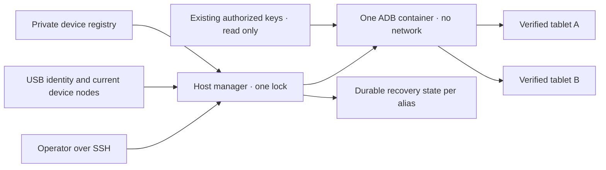

# Gestionnaire USB Android partagé

<!-- language-navigation:start -->
<p dir="ltr">
<a href="android-usb-manager.md" lang="en" dir="ltr">English</a> · <a href="android-usb-manager.ar.md" lang="ar" dir="rtl">العربية</a> · <a href="android-usb-manager.bn.md" lang="bn" dir="ltr">বাংলা</a> · <a href="android-usb-manager.cs.md" lang="cs" dir="ltr">Čeština</a> · <a href="android-usb-manager.de.md" lang="de" dir="ltr">Deutsch</a> · <a href="android-usb-manager.es.md" lang="es" dir="ltr">Español</a> · <a href="android-usb-manager.fa.md" lang="fa" dir="rtl">فارسی</a> · <a href="android-usb-manager.fr.md" lang="fr" dir="ltr">Français</a><br>
<a href="android-usb-manager.he.md" lang="he" dir="rtl">עברית</a> · <a href="android-usb-manager.hi.md" lang="hi" dir="ltr">हिन्दी</a> · <a href="android-usb-manager.id.md" lang="id" dir="ltr">Bahasa Indonesia</a> · <a href="android-usb-manager.it.md" lang="it" dir="ltr">Italiano</a> · <a href="android-usb-manager.ja.md" lang="ja" dir="ltr">日本語</a> · <a href="android-usb-manager.ko.md" lang="ko" dir="ltr">한국어</a> · <a href="android-usb-manager.nl.md" lang="nl" dir="ltr">Nederlands</a> · <a href="android-usb-manager.pl.md" lang="pl" dir="ltr">Polski</a><br>
<a href="android-usb-manager.pt.md" lang="pt" dir="ltr">Português</a> · <a href="android-usb-manager.ru.md" lang="ru" dir="ltr">Русский</a> · <a href="android-usb-manager.th.md" lang="th" dir="ltr">ไทย</a> · <a href="android-usb-manager.tr.md" lang="tr" dir="ltr">Türkçe</a> · <a href="android-usb-manager.uk.md" lang="uk" dir="ltr">Українська</a> · <a href="android-usb-manager.vi.md" lang="vi" dir="ltr">Tiếng Việt</a> · <a href="android-usb-manager.zh-Hans.md" lang="zh-Hans" dir="ltr">简体中文</a> · <a href="android-usb-manager.zh-Hant.md" lang="zh-Hant" dir="ltr">繁體中文</a>
</p>
<!-- language-navigation:end -->

Le gestionnaire partagé remplace les conteneurs ADB par tablette par un serveur ADB et un registre explicite des appareils. Un service hôte gère le branchement USB à chaud et, pour les tablettes choisies, restaure OTT après un nouveau démarrage Android. La lecture normale et le protocole OTT distant continuent indépendamment.

## Obtenir le paquet de déploiement

Téléchargez `ottplay-control-server-deployment.tar.gz` et `release-manifest.json` depuis la même [version](https://github.com/open-ott-play/ottplay-control-server/releases). Vérifiez le SHA-256 de l'archive par rapport à son entrée du manifeste, puis extrayez-la dans un nouveau répertoire :

```sh
mkdir ott-android-release
tar -xzf ottplay-control-server-deployment.tar.gz -C ott-android-release
cd ott-android-release
python3 -B tools/android_usb_manager_remote.py --help
```

L'archive conserve `tools/`, `deploy/` et `docs/`, dont les six scripts USB partagés et historiques indiqués ci-dessous. Suivez l'organisation de l'hôte et les étapes de préparation de ce guide ; l'extraction seule n'installe aucun service. Gardez gestionnaire, superviseur et adaptateur de transactions à la même révision de publication. Le Dockerfile de transport est une recette de construction ; l'artefact OCI publié du control-server n'est pas l'image de transport USB.

Les anciennes archives de déploiement, dont `v0.1.5-beta.6`, omettent `tools/`. Pour ces versions, utilisez l'archive source correspondante ou une version plus récente contenant le paquet complet. Ne mélangez pas les scripts de versions différentes.

L'implémentation comprend :

- [`tools/android_usb_manager.py`](../tools/android_usb_manager.py) : registre, vérification du transport, réconciliation des conteneurs et commandes sérialisées.
- [`tools/android_usb_supervisor.py`](../tools/android_usb_supervisor.py) : politique existante de démarrage, verrouillage et retour au premier plan.
- [`tools/android_usb_manager_remote.py`](../tools/android_usb_manager_remote.py) : enveloppe de commandes SSH préservant la sortie binaire.
- [`tools/android_usb_legacy_redirect.py`](../tools/android_usb_legacy_redirect.py) : redirection facultative d'un chemin de commande par tablette déjà installé.
- [`tools/android_usb_remote.py`](../tools/android_usb_remote.py) : ancienne enveloppe SSH, conservée pour les appelants existants par tablette.
- [`tools/android_usb_transaction.py`](../tools/android_usb_transaction.py) : transfert atomique de fichiers, préparation d'APK et opérations CDP pour les outils de maintenance de confiance.
- [`deploy/android-usb-manager`](../deploy/android-usb-manager) : exemple de configuration, service systemd, script de démarrage Synology DSM et [recette d'image de transport](../deploy/android-usb-manager/README.md).




## Isolation et identité

Le conteneur exécute ADB au premier plan, plutôt qu'un processus `sleep` inactif accompagné d'un démon ADB en arrière-plan. ADB écoute uniquement sur le loopback du conteneur. Celui-ci utilise `--network none`, aucun port publié, une racine en lecture seule, toutes les capacités supprimées, no-new-privileges et un `/tmp` inscriptible borné. Il ne possède ni socket Docker ni montage général de `/dev` ou `/dev/bus/usb`. L'image doit être fixée par SHA-256.

Le gestionnaire impose 256 MiB de mémoire au conteneur, 256 MiB pour mémoire et swap réunis, et 128 parts CPU. L'égalité des limites mémoire/swap interdit du swap supplémentaire. Les parts CPU réduisent la priorité relative en concurrence sans imposer de quota CPU strict. Il n'existe pas de limite stricte de PID, car le noyau DSM cible ne prend pas ce contrôleur en charge. `/tmp` est un tmpfs plafonné à 256 MiB, alloué à la demande et imputé à la même limite mémoire, non une allocation supplémentaire. La préparation des APK accepte au plus 128 MiB et écrit par blocs de 1 MiB pour éviter une autre copie complète de l'APK dans le tas Python du conteneur. La requête côté hôte conserve toujours son contenu en mémoire.

Docker et le gestionnaire hôte surveillent le processus ADB au premier plan. Le conteneur désactive explicitement les contrôles de santé hérités de l'image : vérifier le heartbeat ou la configuration d'un autre gestionnaire ne décrit pas ce processus. Ressources et contrôles de santé font partie de la réconciliation ; tout écart entraîne le remplacement du conteneur détenu sous le verrou du gestionnaire.

La commande principale est `adb -L tcp:5037 nodaemon server`. ADB 29 refuse un nom d'hôte explicite dans l'argument d'écoute (`tcp:127.0.0.1:5037`) ; sans nom d'hôte, il se lie au loopback puisque `-a` n'est pas activé. Le client conserve explicitement `ADB_SERVER_SOCKET=tcp:127.0.0.1:5037`. Cette syntaxe de compatibilité ne publie aucun port et n'active pas ADB réseau sur les tablettes.

Seuls les nœuds actuels correspondant sans ambiguïté aux entrées activées du registre sont exposés, avec permission de lecture/écriture. Les nœuds USB Synology peuvent appartenir à root avec le mode `0600` ; ce déploiement exécute donc ADB comme root dans le conteneur restreint. Il ne rend pas les nœuds hôtes inscriptibles par tous. Le gestionnaire hôte exige lui aussi les droits root pour inspecter les nœuds, gérer Docker et conserver l'état privé. L'isolation du conteneur ne supprime pas ces privilèges hôtes.

Le registre identifie un appareil par numéro de série USB et produit, éventuellement par identifiants USB fabricant/produit, puis par modèle Android, SDK et `android_id`. Le gestionnaire rapproche le chemin USB courant de l'inventaire des transports ADB, puis exécute les commandes avec la série unique vérifiée. ADB peut réutiliser ses identifiants numériques de transport après redémarrage : ils ne servent jamais à adresser une commande. Une série dupliquée provoque un refus plutôt qu'un choix arbitraire. Un appareil non conforme, absent, non autorisé ou ambigu ne doit recevoir aucune commande.

Les entrées activées doivent avoir des séries USB uniques. Certaines tablettes économiques partagent la valeur fictive `0123456789ABCDEF` ; leurs noms de modèle ne sécurisent pas un enregistrement simultané. Gardez les appareils en conflit désactivés jusqu'à l'implémentation d'une stratégie distincte et revue d'identité physique. Renommer une même série ne permet pas de supposer qu'elle désigne un autre transport.

La consolidation donne à un processus ADB accès à toutes les tablettes exposées. Un redémarrage ou une réconciliation du branchement à chaud peut interrompre leurs opérations. Commandes et réconciliation partagent le verrou hôte `/var/lib/ott-android-manager/manager.lock` pour empêcher les modifications concurrentes. Le chemin de commande ADB générique refuse les commandes globales ou modifiant le transport, notamment `kill-server`, `tcpip`, `connect` et `root`.

## Configuration privée et clés

Commencez par [`config.example.json`](../deploy/android-usb-manager/config.example.json). Ses identités et son digest d'image composé de zéros sont volontairement fictifs ; les deux appareils d'exemple sont désactivés. Ce n'est pas un déploiement exécutable.

Utilisez cette organisation hôte :

```text
/usr/local/etc/ott-android-manager/
  android_usb_manager.py
  android_usb_supervisor.py
  android_usb_transaction.py
  config.json
  ott-android-manager.service
  adb-keys/
    adbkey
    adbkey.pub
    vendor/
      additional-authorized.adb_key
/var/lib/ott-android-manager/
  manager.lock
  captures/
  <alias>/state.json
```

Gestionnaire, superviseur et adaptateur de transactions doivent provenir de la même révision revue. Gardez configuration et clés hors de Git et des archives de publication. Définissez les répertoires privés en `0700`, configuration et clés privées en `0600`, et attribuez les sources et fichiers de service à root. Le répertoire des clés est monté en lecture seule. `adbkey` et `adbkey.pub` doivent déjà exister ; `vendor/` doit exister même vide. Des clés privées supplémentaires déjà autorisées peuvent être placées dans `vendor/`, transmis par `ADB_VENDOR_KEYS`. Nommez chaque fichier privé `<source>.adb_key` : ADB 29 ignore silencieusement les autres noms lors de l'exploration du répertoire. Un fichier associé `<source>.adb_key.pub` est facultatif. Le gestionnaire refuse les noms non reconnus avant de modifier le conteneur.

Préservez les clés autorisées existantes avant de retirer un conteneur. Comparez les empreintes publiques pour repérer les doublons ; n'affichez pas les clés privées. Ne remplacez pas une clé existante par une nouvelle uniquement pour consolider les conteneurs : cela peut exiger une confirmation sur des tablettes déconnectées.

Chaque appareil activé exige une identité complète recueillie lors d'une préparation supervisée. Un UUID OTT, une adresse MAC ou une valeur devinée ne prouvent pas l'`android_id` Android. Si cette donnée manque dans le relevé, gardez `"enabled": false` ; les entrées désactivées peuvent avoir des métadonnées descriptives incomplètes et ne sont jamais exposées ni commandées.

`recover_on_boot` est une politique indépendante. Laissez-la à false pour une tablette ne devant proposer que la maintenance. Si elle est activée, `package` doit désigner l'application dont le lancement au premier plan a réellement été testé sur l'appareil.

## Fonctionnement de la récupération automatique

L'intervalle par défaut est cinq secondes après chaque passage terminé, et non une garantie de récupération complète en cinq secondes. Les opérations USB lentes l'allongent. Le délai de commande par défaut est 60 secondes, avec au plus trois tentatives par démarrage Android.

À la première observation, le gestionnaire enregistre le démarrage courant sans réveiller ni déverrouiller la tablette. Lors d'un nouveau démarrage ultérieur avec récupération activée, il :

1. Attend `sys.boot_completed=1` et vérifie l'identité.
2. Exige la preuve explicite que le verrouillage n'est protégé ni par PIN, ni par mot de passe, ni par schéma.
3. Réveille l'écran et supprime si nécessaire un simple verrouillage par glissement.
4. Lance le paquet configuré et contrôle l'activité reprise/ayant le focus.
5. Revérifie démarrage et verrouillage, puis seulement enregistre un point de contrôle réussi.

Un état de verrouillage inconnu ou protégé arrête la récupération. L'ancien déploiement Fire exige la sonde protégée par permission shell décrite dans [la récupération USB](android-usb-recovery.md#read-only-keyguard-probe-on-older-firmware).

Un démarrage déjà traité renvoie `same_boot_no_action`. L'extinction normale de l'écran ne déclenche pas de réveil. Le gestionnaire ne surveille pas le décodage vidéo, ne relance pas un flux bloqué et n'impose pas continuellement le premier plan. Ces politiques relèvent du lecteur ou d'un watchdog revu séparément.

## Commandes

Sur l'hôte USB :

```sh
sudo -n /usr/bin/python3 -B /usr/local/etc/ott-android-manager/android_usb_manager.py \
  --config /usr/local/etc/ott-android-manager/config.json status
```

Depuis un autre ordinateur avec un alias SSH existant :

```sh
python3 tools/android_usb_manager_remote.py --host tablet-host status
python3 tools/android_usb_manager_remote.py --host tablet-host status lobby
python3 tools/android_usb_manager_remote.py --host tablet-host wake lobby
python3 tools/android_usb_manager_remote.py --host tablet-host recover lobby
python3 tools/android_usb_manager_remote.py --host tablet-host reboot lobby
python3 tools/android_usb_manager_remote.py --host tablet-host swipe lobby 400 600 400 100 --duration 500
python3 tools/android_usb_manager_remote.py --host tablet-host screenshot lobby lobby-check.png
python3 tools/android_usb_manager_remote.py --host tablet-host adb lobby -- shell getprop ro.product.model
python3 tools/android_usb_manager_remote.py --host tablet-host adb lobby -- exec-out screencap -p > lobby.png
```

`status` inspecte sans créer, redémarrer ni reconfigurer le conteneur. `tick` effectue un passage de réconciliation/récupération et peut changer l'état de l'appareil ; `run` répète ces passages pour le service.

L'enveloppe utilise SSH sans PTY, protège chaque argument pour le shell, transmet le code de sortie et ne convertit pas la sortie ADB en JSON. Vérifiez ce code avant de considérer une capture redirigée valide. `screenshot` accepte seulement un nom PNG simple, tel que `lobby-check.png`, et enregistre dans `<state_dir>/captures/` sur l'hôte USB. Le nom doit correspondre à `[A-Za-z0-9][A-Za-z0-9_-]{0,119}\.png` ; chemins, points supplémentaires et extensions implicites sont refusés. Il valide le PNG et crée un nouveau fichier accessible au seul propriétaire, refusant liens symboliques et noms existants avant la capture. À l'inverse, `adb ... exec-out` transmet les octets dans un fichier de l'ordinateur de l'opérateur. `swipe` utilise la géométrie actuelle et refuse un verrouillage protégé ou inconnu ; les coordonnées illustrent un cas, pas un geste universel. Les chemins ADB appartiennent aux espaces de noms conteneur/appareil : l'enveloppe n'envoie pas automatiquement un APK de votre portable. Préparation du fichier et installation doivent utiliser l'adaptateur atomique ci-dessous.

`adb <alias> -- <arguments>` est une interface de maintenance administrateur, pas une API publique restreinte. Une commande `shell` autorisée peut modifier la tablette. Employez vérifications d'identité et verrou ; n'exposez pas un accès SSH ou Docker sans restriction via une adresse web.

## Service de démarrage et migration

Le [modèle systemd](../deploy/android-usb-manager/ott-android-manager.service) exécute le gestionnaire continuellement et relance un processus terminé après dix secondes. L'[enveloppe DSM](../deploy/android-usb-manager/S99ott-android-manager.sh) vérifie les fichiers, installe/active l'unité puis la démarre. Elle refuse de démarrer tant que `ott-k8a-recovery.service` est actif ou activé. Pour une autre distribution, adaptez dépendance Docker et chemins à son gestionnaire de services.

Effectuez une passation contrôlée :

1. Relevez configuration des conteneurs, empreintes des clés autorisées et état de récupération. Sauvegardez les fichiers privés avec accès réservé au propriétaire.
2. Installez nouvelles sources, image revue, clés et registre. Gardez les appareils non préparés désactivés. Ne lancez pas deux superviseurs pour la même tablette.
3. Arrêtez et désactivez l'ancien service hôte de récupération et retirez son enveloppe de démarrage DSM. Gardez les fichiers pour revenir en arrière. L'arrêt du service ne retire pas son conteneur ADB.
4. Copiez le point de contrôle ancien validé dans le nouveau `<alias>/state.json` correspondant. Gardez son identité de démarrage ; ne réinitialisez pas l'état comme raccourci habituel.
5. Arrêtez les anciens conteneurs ADB avant le serveur partagé pour éviter que deux serveurs se disputent la même interface USB.
6. Installez la nouvelle enveloppe DSM exécutable, propriétaire root, sous `/usr/local/etc/rc.d/`, exécutez `start` puis inspectez service/état.
7. Migrez les appelants, vérifiez commandes ordinaires et politique conservée, puis retirez uniquement les conteneurs anciens sans dépendances restantes.

Les anciens auxiliaires cachent souvent des dépendances derrière un nom anodin. Auditez `bootstrap.py`, `reconnect.py`, adaptateurs CDP et alias shell. Un bootstrap peut copier des clés depuis un ancien conteneur. Un script reconnect peut définir `OLD` via un auxiliaire importé, puis l'arrêter ou le supprimer ; changer cet auxiliaire pour le nom partagé peut arrêter involontairement le serveur commun. Retirez cette gestion automatique des clients plutôt que de changer seulement un nom.

Faites passer les commandes ADB réelles par le gestionnaire, avec l'alias. Un adaptateur de compatibilité nécessitant `docker exec` pour préparer des fichiers ou un client CDP local doit garder le même verrou pendant toute la transaction. N'imbriquez pas un second processus prenant ce verrou dans la section verrouillée ; utilisez un chemin compatible interne au processus ou organisez la transaction une seule fois. Allouez des ports temporaires de redirection et retirez-les ensuite.

Installez `android_usb_transaction.py` près du gestionnaire et du superviseur. Il accepte une requête JSON sur l'entrée standard, avec `--config` pointant vers le même registre privé, puis renvoie la sortie brute de l'opération. Requêtes prises en charge :

- `pull` : `alias` et `device_path` absolu ; renvoie les octets d'un fichier ordinaire, jusqu'à 128 MiB. Répertoires et fichiers de périphériques sont refusés. Une limite stricte du fichier destination arrête aussi une source qui grossit pendant le transfert.
- `staged_adb` : `alias`, `data` en base64 et `arguments`, par exemple `["install", "-r", "@staged"]` ou `["push", "@staged", "/sdcard/example.json"]`.
- `cdp` : `alias`, `package` applicatif, `expected_model` facultatif, client Python de confiance dans `source` contenant `__OTT_CDP_PORT__`, et sa `request` JSON.

Chaque requête vérifie l'appareil et garde un verrou unique pendant préparation, utilisation et nettoyage. Les fichiers ont des noms temporaires uniques ; ils sont réservés exclusivement avec le mode `0600` avant d'armer le nettoyage. Les installations APK conservent le suffixe `.apk` exigé par l'analyseur d'arguments ADB. Une collision laisse le fichier existant intact. L'écrivain ouvre uniquement sa réservation vide et ordinaire, sans suivre les liens symboliques. Les commandes Docker auxiliaires ciblent l'ID observé du conteneur. CDP identifie exactement un processus applicatif et son socket de débogage, alloue `tcp:0`, remplace le port alloué dans la source cliente et supprime uniquement cette redirection à la fin ou en cas d'échec. La réconciliation ne peut pas redémarrer le serveur entre ces étapes.

L'auxiliaire de compatibilité a1 migré garde les données `copy_in` dans la mémoire locale du thread jusqu'au prochain `adb install` ou `adb push` du même processus. La paire devient une transaction hôte ; `copy_in` seul ne crée plus de fichier partagé dans le conteneur. Home Plan et les auxiliaires CDP du lecteur utilisent le même mécanisme. Les requêtes peuvent contenir des données privées et du code exécutable de confiance : transmettez-les uniquement via le canal SSH administrateur existant, sans exposer publiquement l'adaptateur ni journaliser leurs contenus.

Les ports de redirection ADB appartiennent au serveur partagé, pas à une tablette. Utilisez des ports CDP dynamiques ou des ports distincts par alias pour les sessions manuelles. Le gestionnaire impose `--no-rebind` à la création, autorise la réutilisation d'un mappage identique et refuse d'écraser ou supprimer celui d'un autre alias. `forward --list` ne montre que l'alias choisi ; `forward --remove-all` est refusé.

Après sauvegarde de l'ancien script, la redirection facultative peut être installée à `/usr/local/etc/ott-k8a-recovery/android_usb_supervisor.py` pour préserver les anciennes commandes manuelles. Elle accepte uniquement l'ancien chemin de configuration connu, exige une correspondance exacte série/modèle/SDK/Android ID avec une entrée activée unique du nouveau registre et remplace son processus par le nouveau gestionnaire. Elle n'importe ni n'exécute l'ancien superviseur. `run` est explicitement refusé : l'ancien service et son enveloppe doivent rester désactivés/retirés, même avec compatibilité manuelle.

Pour revenir en arrière, arrêtez et désactivez le nouveau service, retirez son enveloppe et arrêtez son conteneur. Restaurez les anciennes copies des clés/états et l'ancien service. Avant reprise, confirmez qu'un seul gestionnaire possède chaque appareil USB.

## Lecteurs de production sans CDP

Un APK de production peut désactiver volontairement le débogage WebView. L'adaptateur signale alors `Application debugging socket is unavailable` ; une connexion ADB fonctionnelle ne crée pas ce socket. Le gestionnaire n'active pas le débogage, ne change pas les paramètres du lecteur et ne remplace pas l'APK.

Pour un lecteur déjà connecté au contrôleur OTT, utilisez ses diagnostics pris en charge en lecture seule. Remplacez `lobby` par son alias OTT configuré :

```sh
ott -t 20 lobby debug -j
ott -t 20 lobby inspect -j
```

Ces commandes renvoient les observations du lecteur, dont les états disponibles d'exécution et de média. Elles n'offrent ni évaluation JavaScript arbitraire, ni inspection DOM directe, ni connexion CDP. Les deux ont été vérifiées sur le lecteur de production API 22 connecté sans socket CDP ; ailleurs, leur disponibilité dépend des capacités du lecteur.

## Acceptation et limites

Consignez les résultats en fonction des sources, image et matériel réellement installés. Au début de cette consolidation, seul **k8a** disposait de preuves physiques pour l'ancienne politique. Son ancien superviseur récupérait après un vrai redémarrage de tablette et laissait le sommeil normal intact ; cela ne valide pas la nouvelle implémentation partagée. Les autres identités enregistrées étaient incomplètes et doivent rester désactivées jusqu'à une validation supervisée.

Acceptation requise du gestionnaire partagé :

- Une identité USB déjà autorisée apparaît via le serveur partagé.
- Les appareils inconnus, absents, dupliqués et désactivés ne reçoivent aucune action.
- Une commande en lecture seule et une capture binaire utilisent le transport voulu.
- La récupération après un nouveau démarrage réussit sur un appareil où elle est activée.
- L'extinction normale de l'écran reste en sommeil.
- La réénumération USB restaure uniquement le mappage prévu.
- Le redémarrage du service conserve l'état et évite les récupérations doubles.
- Un vrai redémarrage hôte restaure service et répartition de propriété.
- Chaque auxiliaire local migré fonctionne sans recréer d'anciens conteneurs.

Indiquez explicitement les tests non effectués. Un service actif ou un lancement réussi au premier plan ne prouve ni lecture de flux, ni compatibilité de toutes les tablettes, ni récupération autonome après redémarrage du NAS.
