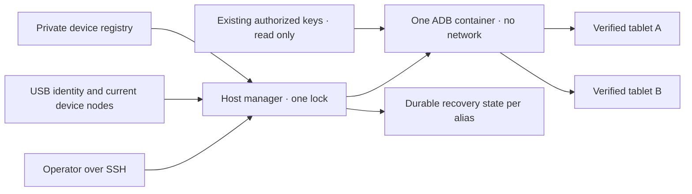

# מנהל USB משותף ל־Android

<!-- language-navigation:start -->
<p dir="ltr">
<a href="android-usb-manager.md" lang="en" dir="ltr">English</a> · <a href="android-usb-manager.ar.md" lang="ar" dir="rtl">العربية</a> · <a href="android-usb-manager.bn.md" lang="bn" dir="ltr">বাংলা</a> · <a href="android-usb-manager.cs.md" lang="cs" dir="ltr">Čeština</a> · <a href="android-usb-manager.de.md" lang="de" dir="ltr">Deutsch</a> · <a href="android-usb-manager.es.md" lang="es" dir="ltr">Español</a> · <a href="android-usb-manager.fa.md" lang="fa" dir="rtl">فارسی</a> · <a href="android-usb-manager.fr.md" lang="fr" dir="ltr">Français</a><br>
<a href="android-usb-manager.he.md" lang="he" dir="rtl">עברית</a> · <a href="android-usb-manager.hi.md" lang="hi" dir="ltr">हिन्दी</a> · <a href="android-usb-manager.id.md" lang="id" dir="ltr">Bahasa Indonesia</a> · <a href="android-usb-manager.it.md" lang="it" dir="ltr">Italiano</a> · <a href="android-usb-manager.ja.md" lang="ja" dir="ltr">日本語</a> · <a href="android-usb-manager.ko.md" lang="ko" dir="ltr">한국어</a> · <a href="android-usb-manager.nl.md" lang="nl" dir="ltr">Nederlands</a> · <a href="android-usb-manager.pl.md" lang="pl" dir="ltr">Polski</a><br>
<a href="android-usb-manager.pt.md" lang="pt" dir="ltr">Português</a> · <a href="android-usb-manager.ru.md" lang="ru" dir="ltr">Русский</a> · <a href="android-usb-manager.th.md" lang="th" dir="ltr">ไทย</a> · <a href="android-usb-manager.tr.md" lang="tr" dir="ltr">Türkçe</a> · <a href="android-usb-manager.uk.md" lang="uk" dir="ltr">Українська</a> · <a href="android-usb-manager.vi.md" lang="vi" dir="ltr">Tiếng Việt</a> · <a href="android-usb-manager.zh-Hans.md" lang="zh-Hans" dir="ltr">简体中文</a> · <a href="android-usb-manager.zh-Hant.md" lang="zh-Hant" dir="ltr">繁體中文</a>
</p>
<!-- language-navigation:end -->

<div dir="rtl" lang="he">

המנהל המשותף מחליף קונטיינרי ADB נפרדים לכל טאבלט בשרת ADB אחד ובמרשם התקנים מפורש. שירות במארח מנהל חיבור וניתוק USB בזמן פעולה, ובטאבלטים נבחרים משחזר את OTT לאחר אתחול חדש של Android. הניגון הרגיל ופרוטוקול OTT המרוחק ממשיכים לפעול באופן עצמאי.

## קבלת חבילת הפריסה

הורידו את `ottplay-control-server-deployment.tar.gz` ואת `release-manifest.json` מאותה [גרסה](https://github.com/open-ott-play/ottplay-control-server/releases). השוו את SHA-256 של הארכיון לרשומה שלו בקובץ המניפסט, ואז חלצו אותו לתיקייה חדשה:

</div>

<div dir="ltr">

```sh
mkdir ott-android-release
tar -xzf ottplay-control-server-deployment.tar.gz -C ott-android-release
cd ott-android-release
python3 -B tools/android_usb_manager_remote.py --help
```

</div>

<div dir="rtl" lang="he">

הארכיון משמר את `tools/`, את `deploy/` ואת `docs/`, לרבות כל ששת סקריפטי ה־USB המשותפים והישנים המפורטים בהמשך. פעלו לפי מבנה הקבצים במארח ושלבי ההכנה שבמדריך; החילוץ לבדו אינו מתקין שירות. החזיקו את המנהל, את המפקח ואת מתאם הטרנזקציות באותה רביזיית גרסה. Dockerfile של התעבורה הוא מתכון לבנייה; קובץ ה־OCI של מהדורת שרת הבקרה אינו תמונת תעבורת ה־USB.

ארכיוני פריסה ישנים, ובהם `v0.1.5-beta.6`, אינם כוללים את `tools/`. עבור גרסאות אלו השתמשו בארכיון המקור התואם, או בחרו גרסה חדשה יותר המכילה את חבילת הפריסה המלאה. אל תערבבו סקריפטים מגרסאות שונות.

המימוש כולל:

- [`tools/android_usb_manager.py`](../tools/android_usb_manager.py): מרשם התקנים, אימות תעבורה, התאמת מצב הקונטיינר וביצוע פקודות בזו אחר זו.
- [`tools/android_usb_supervisor.py`](../tools/android_usb_supervisor.py): המדיניות הקיימת לאתחול, לנעילת מסך ולהחזרת היישום לחזית.
- [`tools/android_usb_manager_remote.py`](../tools/android_usb_manager_remote.py): מעטפת פקודות SSH המשמרת פלט בינארי.
- [`tools/android_usb_legacy_redirect.py`](../tools/android_usb_legacy_redirect.py): הפניה אופציונלית מנתיב פקודות נפרד לטאבלט שכבר הותקן.
- [`tools/android_usb_remote.py`](../tools/android_usb_remote.py): מעטפת ה־SSH הישנה, הנשמרת עבור קוראים קיימים הפועלים לכל טאבלט בנפרד.
- [`tools/android_usb_transaction.py`](../tools/android_usb_transaction.py): העברת קבצים אטומית, הכנת APK ופעולות CDP עבור כלי תחזוקה מהימנים.
- [`deploy/android-usb-manager`](../deploy/android-usb-manager): תצורה לדוגמה, שירות systemd, סקריפט אתחול של Synology DSM ו[מתכון לתמונת התעבורה](../deploy/android-usb-manager/README.md).


</div>

<div dir="ltr">



</div>

<div dir="rtl" lang="he">

## בידוד וזהות

הקונטיינר מפעיל את ADB כתהליך קדמי, במקום תהליך `sleep` שאינו עושה דבר ובמקרה מכיל דמון ADB ברקע. ADB מאזין רק בממשק ה־loopback של הקונטיינר. הקונטיינר משתמש ב־`--network none`, ללא פורטים מפורסמים, עם מערכת קבצים שורשית לקריאה בלבד, ללא capabilities, עם no-new-privileges ועם `/tmp` מוגבל הניתן לכתיבה. אין בו שקע Docker ואין בו עיגון רחב של `/dev` או `/dev/bus/usb`. חובה להצמיד את התמונה לפי SHA-256.

המנהל אוכף זיכרון קונטיינר של 256 MiB, סך זיכרון ו־swap של 256 MiB ומשקל CPU של 128. הערכים השווים של הזיכרון ושל הזיכרון יחד עם swap אינם מאפשרים swap נוסף. משקל ה־CPU מפחית את העדיפות היחסית בעת תחרות על משאבים, בלי להטיל מכסת CPU קשיחה. אין מגבלת PID קשיחה, מפני שליבת DSM המיועדת אינה תומכת בבקר הזה. `/tmp` הוא tmpfs בעל תקרה של 256 MiB, המוקצה לפי דרישה ונזקף לאותה מגבלת זיכרון, ולא הקצבת זיכרון נוספת. הכנת APK מקבלת עד 128 MiB וכותבת במקטעים של 1 MiB, כדי לא להחזיק APK שלם נוסף בערימת Python של הקונטיינר. הבקשה בצד המארח עדיין אוגרת את המטען שלה בזיכרון.

תהליך ה־ADB הקדמי מפוקח בידי Docker ומנהל המארח. הקונטיינר משבית במפורש בדיקות בריאות שהתקבלו בירושה מהתמונה: בדיקת פעימת חיים או תצורה של מנהל אחר אינה יכולה לתאר תהליך זה. הגדרות המשאבים ובדיקות הבריאות נכללות בהתאמת המצב, ולכן סטייה מהן גורמת להחלפת הקונטיינר שבבעלות המנהל תחת נעילת המנהל.

פקודת התהליך הקדמי היא `adb -L tcp:5037 nodaemon server`. ADB 29 דוחה שם מארח מפורש בארגומנט ההאזנה (`tcp:127.0.0.1:5037`); השמטת שם המארח קושרת ל־loopback, משום ש־`-a` אינו מופעל. הגדרת הלקוח `ADB_SERVER_SOCKET=tcp:127.0.0.1:5037` נשארת מפורשת. תחביר התאימות הזה אינו מפרסם את הפורט ואינו מפעיל ADB ברשת באף טאבלט.

רק צומתי ההתקנים הנוכחיים של רשומות מרשם מאופשרות שזוהו באופן חד־משמעי ממופים, עם הרשאת קריאה וכתיבה להתקן. צומתי USB של Synology עשויים להיות בבעלות root עם מצב `0600`, ולכן פריסה זו מפעילה את תהליך ADB כ־root בתוך הקונטיינר המוגבל. היא אינה משנה את צומתי המארח כדי שכל משתמש יוכל לכתוב אליהם. גם מנהל המארח דורש הרשאות root כדי לבדוק צמתים, לנהל את Docker ולשמר מצב פרטי. בידוד הקונטיינר אינו הופך את הסמכות הזו במארח לחסרת הרשאות מיוחדות.

המרשם מזהה התקן לפי המספר הסידורי של USB והמוצר, לפי הצורך גם לפי מזהי היצרן והמוצר של USB, ובהמשך לפי דגם Android, ה־SDK ו־`android_id`. המנהל מתאים את נתיב ה־USB הנוכחי לרשימת ערוצי התעבורה של ADB, ואז מבצע פקודות באמצעות המספר הסידורי הייחודי שאומת. ADB עשוי להשתמש מחדש במזהי תעבורה מספריים אחרי הפעלה מחדש, ולכן לעולם אין משתמשים בהם כדי לנתב פקודה. מספרים סידוריים כפולים גורמים לסירוב במקום לבחירה שרירותית בערוץ תעבורה. התקן שאינו תואם, חסר, אינו מורשה או אינו חד־משמעי לא יקבל פקודה.

לרשומות מאופשרות חייבים להיות מספרי USB סידוריים ייחודיים. טאבלטים זולים מסוימים חולקים את המספר הסידורי הסתמי `0123456789ABCDEF`; שמות הדגמים שלהם אינם הופכים רישום בו־זמני לבטוח. השאירו התקנים מתנגשים מושבתים עד למימוש אסטרטגיה נפרדת ובדוקה לזיהוי פיזי. אל תשנו את התווית של אותו מספר סידורי מתוך הנחה שהיא מזהה ערוץ תעבורה אחר.

האיחוד מעניק לתהליך ADB אחד גישה לכל הטאבלטים הממופים. הפעלה מחדש או התאמת מצב עקב חיבור התקן עשויות להפריע לפעולות בכל הטאבלטים האלה. פקודות והתאמת מצב משתמשות בנעילת מארח אחת, `/var/lib/ott-android-manager/manager.lock`, כדי למנוע שינויים מתחרים. נתיב פקודות ה־ADB הכללי דוחה פקודות ברמת השרת כולו ופקודות המשנות תעבורה, כגון `kill-server`,‏ `tcpip`,‏ `connect` ו־`root`.

## תצורה ומפתחות פרטיים

התחילו מ־[`config.example.json`](../deploy/android-usb-manager/config.example.json). הזהויות שבו ותקציר התמונה המורכב כולו מאפסים בדויים במכוון; שני ההתקנים לדוגמה מושבתים. הדוגמה אינה פריסה הניתנת להפעלה.

השתמשו במבנה הבא במארח:

</div>

<div dir="ltr">

```text
/usr/local/etc/ott-android-manager/
  android_usb_manager.py
  android_usb_supervisor.py
  android_usb_transaction.py
  config.json
  ott-android-manager.service
  adb-keys/
    adbkey
    adbkey.pub
    vendor/
      additional-authorized.adb_key
/var/lib/ott-android-manager/
  manager.lock
  captures/
  <alias>/state.json
```

</div>

<div dir="rtl" lang="he">

המנהל, המפקח ומתאם הטרנזקציות חייבים להגיע מאותה רביזיה שנבדקה. שמרו את התצורה והמפתחות מחוץ ל־Git ולארכיוני הגרסאות. הגדירו תיקיות פרטיות ל־`0700`, תצורה ומפתחות פרטיים ל־`0600`, ואת קובצי המקור והשירות בבעלות root. תיקיית המפתחות מעוגנת לקריאה בלבד. `adbkey` ו־`adbkey.pub` חייבים כבר להתקיים; גם `vendor/` חייבת להתקיים, אפילו כשהיא ריקה. מפתחות פרטיים נוספים שכבר אושרו יכולים להימצא ב־`vendor/`, המועברת באמצעות `ADB_VENDOR_KEYS`. תנו לכל קובץ פרטי שם בתבנית `<source>.adb_key`:‏ ADB 29 מתעלם בשקט משמות אחרים בעת סריקת תיקייה זו. קובץ ציבורי תואם בשם `<source>.adb_key.pub` הוא אופציונלי. המנהל דוחה שמות קבצים לא מוכרים לפני שינוי הקונטיינר.

שמרו מפתחות מורשים קיימים לפני הוצאת קונטיינר כלשהו משימוש. השוו טביעות אצבע של מפתחות ציבוריים כדי לזהות כפילויות; אל תדפיסו מפתחות פרטיים. אל תחליפו מפתח קיים במפתח חדש רק לשם איחוד קונטיינרים: הדבר עלול לדרוש אישור בטאבלטים מנותקים.

כל התקן מאופשר זקוק לזהות מלאה שנאספה במהלך הכנה בנוכחות מפעיל. UUID של התקן OTT, כתובת MAC או ערך מנוחש אינם ראיה ל־`android_id` של Android. אם תיעוד האימות אינו כולל שדה זה, השאירו את הרשומה במצב `"enabled": false`; רשומות מושבתות עשויות להכיל מטא־נתונים תיאוריים חלקיים, ולעולם אינן ממופות או נשלטות.

`recover_on_boot` היא מדיניות עצמאית. השאירו אותה false עבור טאבלט שאמור לחשוף רק פקודות תחזוקה. כאשר היא מופעלת, הגדירו את `package` ליישום שהפעלתו בחזית נבדקה בפועל באותו התקן.

## מה עושה השחזור האוטומטי

מרווח ברירת המחדל הוא חמש שניות אחרי כל סבב שהושלם, ולא התחייבות לשחזור מקצה לקצה בתוך חמש שניות. פעולות USB איטיות מאריכות את המרווח. זמן ההמתנה המרבי לפקודה כברירת מחדל הוא 60 שניות, והמגבלה היא שלושה ניסיונות שחזור לכל אתחול Android.

בתצפית הראשונה המנהל מתעד את האתחול הנוכחי בלי להעיר את הטאבלט או לבטל את נעילתו. באתחול חדש מאוחר יותר, כאשר השחזור מאופשר, הוא:

1. ממתין ל־`sys.boot_completed=1` ומאמת את זהות ההתקן.
2. דורש ראיה מפורשת לכך שנעילת המסך אינה מוגנת בקוד PIN, בסיסמה או בדפוס.
3. מעיר את התצוגה ומבטל נעילת החלקה רגילה לפי הצורך.
4. מפעיל את החבילה שהוגדרה ובודק את ה־activity שחודשה או נמצאת במיקוד.
5. בודק מחדש את האתחול ואת נעילת המסך, ורק אז שומר נקודת ביקורת מוצלחת.

מצב נעילת מסך לא ידוע או מוגן עוצר את השחזור. פריסת Fire הישנה דורשת את הגשוש המוגן בהרשאת shell שמתואר ב[שחזור USB](android-usb-recovery.md#read-only-keyguard-probe-on-older-firmware).

אתחול שכבר הושלם מחזיר `same_boot_no_action`. כיבוי מסך רגיל אינו מעורר את הטאבלט. המנהל אינו מנטר פענוח וידאו, אינו מפעיל מחדש זרם שנתקע ואינו כופה ברציפות שהיישום יהיה בחזית. אלה מדיניות נפרדת השייכת לנגן או ל־watchdog שנבדק בנפרד.

## פקודות

במארח ה־USB:

</div>

<div dir="ltr">

```sh
sudo -n /usr/bin/python3 -B /usr/local/etc/ott-android-manager/android_usb_manager.py \
  --config /usr/local/etc/ott-android-manager/config.json status
```

</div>

<div dir="rtl" lang="he">

ממחשב אחר באמצעות כינוי מארח SSH קיים:

</div>

<div dir="ltr">

```sh
python3 tools/android_usb_manager_remote.py --host tablet-host status
python3 tools/android_usb_manager_remote.py --host tablet-host status lobby
python3 tools/android_usb_manager_remote.py --host tablet-host wake lobby
python3 tools/android_usb_manager_remote.py --host tablet-host recover lobby
python3 tools/android_usb_manager_remote.py --host tablet-host reboot lobby
python3 tools/android_usb_manager_remote.py --host tablet-host swipe lobby 400 600 400 100 --duration 500
python3 tools/android_usb_manager_remote.py --host tablet-host screenshot lobby lobby-check.png
python3 tools/android_usb_manager_remote.py --host tablet-host adb lobby -- shell getprop ro.product.model
python3 tools/android_usb_manager_remote.py --host tablet-host adb lobby -- exec-out screencap -p > lobby.png
```

</div>

<div dir="rtl" lang="he">

`status` בודק בלי ליצור את הקונטיינר, להפעילו מחדש או לשנות את תצורתו. `tick` מבצע סבב אחד של התאמת מצב ושחזור, ויכול לשנות את מצב ההתקן; `run` חוזר על הסבבים ונועד לשירות.

המעטפת משתמשת ב־SSH ללא PTY, מצטטת כל ארגומנט בנפרד עבור shell, מעבירה את קוד היציאה של התהליך ואינה ממירה פלט ADB ל־JSON. בדקו את קוד היציאה לפני שתחשיבו צילום מסך שנותב לקובץ כתקין. הפקודה `screenshot` מקבלת רק שם קובץ PNG ללא נתיב, כגון `lobby-check.png`, ושומרת אותו ב־`<state_dir>/captures/` במארח ה־USB. השם חייב להתאים ל־`[A-Za-z0-9][A-Za-z0-9_-]{0,119}\.png`; נתיבים, נקודות נוספות וסיומות משתמעות אינם מתקבלים. הפקודה מאמתת את ה־PNG ויוצרת קובץ חדש הנגיש רק לבעליו, ודוחה קישורים סימבוליים ושמות קבצים קיימים לפני הצילום. לעומתה, הדוגמה `adb ... exec-out` מזרימה בתים לקובץ במחשב המפעיל. `swipe` משתמש בגאומטריית המסך הנוכחית ודוחה נעילת מסך מוגנת או לא ידועה; הקואורדינטות שלמעלה הן דוגמה ולא מחוות ביטול נעילה אוניברסלית. נתיבי קבצים ב־ADB מתייחסים למרחבי השמות של הקונטיינר וההתקן: מעטפת זו אינה מעלה אוטומטית APK מהמחשב הנייד שלכם. הכנת קובץ וההתקנה שבעקבותיה חייבות להשתמש במתאם הטרנזקציות האטומיות המתואר להלן.

`adb <alias> -- <arguments>` הוא ממשק תחזוקה למנהל מערכת, ולא API ציבורי מוגבל. פקודת `shell` מותרת עשויה לשנות את הטאבלט. השתמשו בבדיקות הזהות ובנעילה; אל תחשפו גישת SSH או Docker בלתי מוגבלת דרך נקודת קצה באינטרנט.

## שירות אתחול ומעבר

[תבנית systemd](../deploy/android-usb-manager/ott-android-manager.service) מפעילה את המנהל ברציפות ומפעילה מחדש תהליך שיצא לאחר עשר שניות. [מעטפת DSM](../deploy/android-usb-manager/S99ott-android-manager.sh) בודקת את קובצי הפריסה, מתקינה ומאפשרת את היחידה ואז מפעילה אותה. היא מסרבת להתחיל כאשר השירות הישן `ott-k8a-recovery.service` פעיל או מאופשר. בהפצה אחרת התאימו את התלות ב־Docker ואת הנתיבים למנהל השירותים שלה.

בצעו העברת אחריות מבוקרת:

1. תעדו את תצורת הקונטיינרים הקיימים, את טביעות האצבע של המפתחות המורשים ואת מצב השחזור. גבו קבצים פרטיים עם הרשאות לבעלים בלבד.
2. התקינו את המקור החדש, את התמונה שנבדקה, את המפתחות ואת המרשם. השאירו התקנים שלא הוכנו מושבתים. אל תפעילו מפקח שני עבור אותו טאבלט.
3. עצרו והשביתו את שירות השחזור הישן במארח והוציאו משימוש את מעטפת האתחול שלו ב־DSM. שמרו את הקבצים לצורך חזרה לאחור. עצירת השירות לבדה אינה מסירה את קונטיינר ה־ADB שלו.
4. העתיקו את נקודת ביקורת השחזור הישנה שאומתה אל `<alias>/state.json` החדש המתאים. שימרו את זהות האתחול שלה; אל תאפסו מצב כקיצור דרך שגרתי במעבר.
5. עצרו את קונטיינרי ה־ADB הישנים לפני הפעלת השרת המשותף, כדי ששני שרתים לא יתחרו על אותו ממשק USB.
6. התקינו את מעטפת DSM החדשה כקובץ הניתן להרצה בבעלות root תחת `/usr/local/etc/rc.d/`, הפעילו את פעולת `start` שלה ובדקו את השירות והמצב.
7. העבירו את הקוראים, אמתו פקודות רגילות ואת מדיניות השחזור שנשמרה, ואז הסירו רק קונטיינרים ישנים שהתלויות בהם הוצאו משימוש.

כלי עזר ישנים מסתירים לעיתים תלות מאחורי שם תמים. סקרו את `bootstrap.py`, את `reconnect.py`, מתאמי CDP וכינויי shell. סקריפט הכנה יכול להעתיק מפתחות מקונטיינר ישן. סקריפט חיבור מחדש יכול להגדיר את `OLD` מתוך כלי עזר מיובא ובהמשך לעצור או להסיר אותו; אחרי שינוי כלי העזר לשם המשותף החדש הוא עלול לעצור בטעות את השרת המשותף. הסירו ניהול קונטיינרים אוטומטי כזה מהלקוחות במקום לשנות רק שם.

נתבו פקודות ADB בפועל דרך המנהל לפי כינוי. מתאם תאימות הזקוק ל־`docker exec` להכנת קבצים או ללקוח CDP מקומי חייב להחזיק באותה נעילת מארח במשך כל טרנזקציית ההכנה והפקודה. אל תקננו תהליך שני שרוכש את הנעילה בתוך המקטע הנעול; קראו לנתיב תואם בתוך התהליך או ארגנו את הטרנזקציה פעם אחת. הקצו פורטים זמניים להעברה והסירו אותם לאחר השימוש.

התקינו את `android_usb_transaction.py` לצד המנהל והמפקח. הוא מקבל בקשת JSON אחת בקלט הסטנדרטי, כאשר `--config` מצביע לאותו מרשם פרטי, ומחזיר את הפלט הגולמי של הפעולה בפלט הסטנדרטי. הבקשות הנתמכות הן:

- `pull`:‏ `alias` ו־`device_path` מוחלט; מחזירה את הבתים של קובץ רגיל אחד, עד 128 MiB. תיקיות וקובצי התקנים נדחים. מגבלה קשיחה על גודל קובץ היעד עוצרת גם מקור שגדל במהלך ההעברה.
- `staged_adb`:‏ `alias`,‏ `data` בקידוד base64 ו־`arguments`, כגון `["install", "-r", "@staged"]` או `["push", "@staged", "/sdcard/example.json"]`.
- `cdp`:‏ `alias`, חבילת היישום `package`, ערך `expected_model` אופציונלי, קוד `source` של לקוח Python מהימן המכיל `__OTT_CDP_PORT__` ובקשת ה־JSON שלו ב־`request`.

כל בקשה מאמתת את ההתקן ומחזיקה בנעילת מנהל אחת לאורך ההכנה, השימוש והניקוי. פעולות קבצים משתמשות בשמות זמניים ייחודיים; קבצים בהכנה נשמרים באופן בלעדי במצב `0600` לפני הפעלת מנגנון הניקוי. התקנות APK שומרות על הסיומת `.apk` הנדרשת למנתח ארגומנט החבילה של ADB. התנגשות בשם משאירה את הקובץ הקיים ללא שינוי. כותב קובץ ההכנה פותח רק את הקובץ הרגיל והריק ששוריין עבורו, בלי לעקוב אחרי קישורים סימבוליים. פקודות Docker עזר פונות למזהה הקונטיינר שנצפה. CDP מזהה בדיוק תהליך יישום אחד ואת שקע הניפוי שלו, מקצה `tcp:0`, מציב את הפורט שהוקצה בקוד הלקוח ומסיר רק את רשומת ההעברה הזו בסיום או בכשל. התאמת מצב אינה יכולה להפעיל מחדש את השרת בין הצעדים האלה.

כלי התאימות a1 שהועבר שומר נתוני `copy_in` בזיכרון מקומי לתהליכון עד ל־`adb install` או ל־`adb push` הבא באותו תהליך. הצמד הזה הופך לטרנזקציית מארח אחת; `copy_in` לבדו כבר אינו יוצר קובץ בקונטיינר המשותף. כלי ה־CDP של Home Plan ושל הנגן משתמשים באותו מנגנון טרנזקציות. בקשות עשויות להכיל נתוני יישום פרטיים וקוד מהימן הניתן להרצה: שלחו אותן רק בערוץ SSH הקיים של מנהל המערכת, לעולם אל תחשפו מתאם זה כנקודת קצה ציבורית ואל תרשמו את המטענים שלו ביומן.

פורטי העברת ADB שייכים לשרת המשותף, לא לטאבלט בודד. השתמשו בפורטי CDP המוקצים דינמית, או בפורטים שונים לכל כינוי בהפעלות ידניות. המנהל כופה `--no-rebind` בעת יצירת העברה, מאפשר שימוש חוזר במיפוי זהה ומסרב לדרוס או להסיר העברה של כינוי אחר. `forward --list` מסונן לכינוי הנבחר; `forward --remove-all` נדחה.

אחרי גיבוי הסקריפט הישן אפשר להתקין את ההפניה הישנה האופציונלית ב־`/usr/local/etc/ott-k8a-recovery/android_usb_supervisor.py`, כדי לשמר נקודות כניסה ישנות לפקודות ידניות. היא מקבלת רק את נתיב התצורה הישן המוכר, דורשת שמספרו הסידורי, דגמו, ה־SDK ומזהה Android שלו יתאימו בדיוק לרשומה מאופשרת אחת במרשם החדש, ומחליפה את התהליך שלה במנהל החדש. היא אינה מייבאת או מפעילה את המפקח הישן. `run` נדחה במפורש: השירות הישן ומעטפת האתחול שלו חייבים להישאר מושבתים ומחוץ לשימוש, גם כאשר מותקנת תאימות לפקודות ידניות.

לחזרה לאחור עצרו והשביתו את שירות המארח החדש, הוציאו משימוש את מעטפת האתחול שלו ועצרו את הקונטיינר שלו. שחזרו את תמונות המצב הישנות של המפתחות והמצב ואת שירות המארח הישן. ודאו שרק מנהל אחד אחראי לכל התקן USB לפני חידוש הפעולה.

## נגני גרסת הפצה ללא CDP

APK של גרסת ייצור עשוי להשבית במכוון ניפוי של WebView. במקרה כזה מתאם הטרנזקציות מדווח `Application debugging socket is unavailable`; חיבור ADB פעיל אינו יוצר את השקע הזה. המנהל אינו מאפשר ניפוי, משנה הגדרות נגן או מחליף את ה־APK.

עבור נגן שכבר מחובר לבקר OTT השתמשו באבחון הנתמך לקריאה בלבד. החליפו את `lobby` בכינוי ה־OTT שהוגדר עבורו:

</div>

<div dir="ltr">

```sh
ott -t 20 lobby debug -j
ott -t 20 lobby inspect -j
```

</div>

<div dir="rtl" lang="he">

פקודות אלה מחזירות תצפיות שדווחו בידי הנגן, לרבות מצב סביבת הריצה והמדיה הזמין. הן אינן מספקות הרצת JavaScript שרירותית, בדיקת DOM ישירה או חיבור CDP. שתי הפקודות אומתו בנגן גרסת ההפצה המחובר ב־API 22 כאשר שקע ה־CDP שלו לא היה קיים; הזמינות בנגן אחר תלויה ביכולות שהוא תומך בהן.

## קבלה ומגבלות

תעדו תוצאות מול המקור, התמונה והחומרה המותקנים בפועל. בתחילת האיחוד הזה רק ל־**k8a** היו ראיות פיזיות למדיניות השחזור הישנה. המפקח הישן שלו שיחזר לאחר אתחול אמיתי של הטאבלט והותיר שינה רגילה ללא התערבות; בדיקות אלה אינן מהוות בדיקות קבלה של המימוש המשותף החדש. זהויות שמורות של טאבלטים אחרים היו חלקיות, ועליהן להישאר מושבתות עד לאימות בנוכחות מפעיל.

בדיקות הקבלה הנדרשות למנהל המשותף:

- זהות USB מורשית קיימת מופיעה דרך השרת המשותף.
- התקנים לא ידועים, חסרים, כפולים או מושבתים אינם מקבלים שום פעולה.
- פקודה לקריאה בלבד וצילום מסך בינארי משתמשים בערוץ התעבורה המיועד.
- שחזור אחרי אתחול חדש מצליח בהתקן שבו המדיניות הזו מאופשרת.
- מסך שכובה באופן רגיל נשאר כבוי.
- זיהוי USB מחדש משחזר רק את מיפוי ההתקן הצפוי.
- הפעלה מחדש של שירות המארח משמרת מצב ומונעת שחזור כפול.
- אתחול אמיתי של המארח משחזר את השירות ואת חלוקת האחריות על ההתקנים.
- כל כלי עזר מקומי שהועבר עובד בלי ליצור מחדש קונטיינרים ישנים.

ציינו במפורש בדיקות שלא בוצעו. שירות פועל או פתיחה מוצלחת בחזית אינם מוכיחים ניגון של זרם, תאימות לכל טאבלט או שחזור ללא התערבות לאחר אתחול ה־NAS.

</div>
