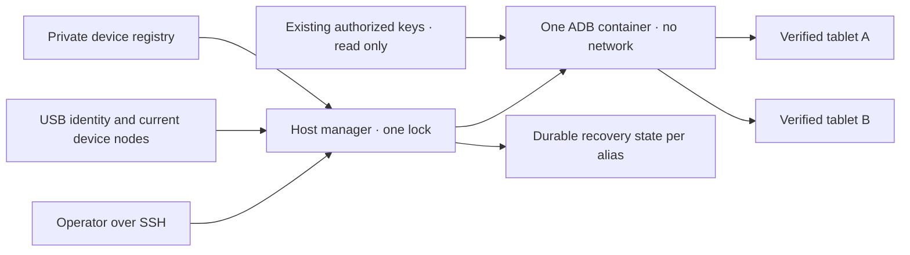

# साझा Android USB प्रबंधक

<!-- language-navigation:start -->
<p dir="ltr">
<a href="android-usb-manager.md" lang="en" dir="ltr">English</a> · <a href="android-usb-manager.ar.md" lang="ar" dir="rtl">العربية</a> · <a href="android-usb-manager.bn.md" lang="bn" dir="ltr">বাংলা</a> · <a href="android-usb-manager.cs.md" lang="cs" dir="ltr">Čeština</a> · <a href="android-usb-manager.de.md" lang="de" dir="ltr">Deutsch</a> · <a href="android-usb-manager.es.md" lang="es" dir="ltr">Español</a> · <a href="android-usb-manager.fa.md" lang="fa" dir="rtl">فارسی</a> · <a href="android-usb-manager.fr.md" lang="fr" dir="ltr">Français</a><br>
<a href="android-usb-manager.he.md" lang="he" dir="rtl">עברית</a> · <a href="android-usb-manager.hi.md" lang="hi" dir="ltr">हिन्दी</a> · <a href="android-usb-manager.id.md" lang="id" dir="ltr">Bahasa Indonesia</a> · <a href="android-usb-manager.it.md" lang="it" dir="ltr">Italiano</a> · <a href="android-usb-manager.ja.md" lang="ja" dir="ltr">日本語</a> · <a href="android-usb-manager.ko.md" lang="ko" dir="ltr">한국어</a> · <a href="android-usb-manager.nl.md" lang="nl" dir="ltr">Nederlands</a> · <a href="android-usb-manager.pl.md" lang="pl" dir="ltr">Polski</a><br>
<a href="android-usb-manager.pt.md" lang="pt" dir="ltr">Português</a> · <a href="android-usb-manager.ru.md" lang="ru" dir="ltr">Русский</a> · <a href="android-usb-manager.th.md" lang="th" dir="ltr">ไทย</a> · <a href="android-usb-manager.tr.md" lang="tr" dir="ltr">Türkçe</a> · <a href="android-usb-manager.uk.md" lang="uk" dir="ltr">Українська</a> · <a href="android-usb-manager.vi.md" lang="vi" dir="ltr">Tiếng Việt</a> · <a href="android-usb-manager.zh-Hans.md" lang="zh-Hans" dir="ltr">简体中文</a> · <a href="android-usb-manager.zh-Hant.md" lang="zh-Hant" dir="ltr">繁體中文</a>
</p>
<!-- language-navigation:end -->

साझा प्रबंधक हर टैबलेट के अलग ADB कंटेनर की जगह एक ADB सर्वर और स्पष्ट डिवाइस रजिस्ट्री देता है। होस्ट सेवा USB के जुड़ने/हटने को संभालती है और चुने टैबलेट पर नए Android बूट के बाद OTT बहाल करती है। सामान्य प्लेबैक और दूरस्थ OTT प्रोटोकॉल स्वतंत्र रूप से चलते रहते हैं।

## डिप्लॉयमेंट पैकेज प्राप्त करना

एक ही [रिलीज़](https://github.com/open-ott-play/ottplay-control-server/releases) से `ottplay-control-server-deployment.tar.gz` और `release-manifest.json` डाउनलोड करें। आर्काइव का SHA-256 उसके मैनिफ़ेस्ट रिकॉर्ड से मिलाएँ, फिर नई डायरेक्टरी में निकालें:

```sh
mkdir ott-android-release
tar -xzf ottplay-control-server-deployment.tar.gz -C ott-android-release
cd ott-android-release
python3 -B tools/android_usb_manager_remote.py --help
```

आर्काइव `tools/`, `deploy/` और `docs/` की संरचना रखता है, जिसमें नीचे बताए सभी छह साझा और पुराने USB स्क्रिप्ट शामिल हैं। इस मार्गदर्शिका के होस्ट लेआउट और प्रोविज़निंग चरण अपनाएँ; केवल निकालने से सेवा इंस्टॉल नहीं होती। प्रबंधक, सुपरवाइज़र और ट्रांज़ैक्शन अडैप्टर को एक रिलीज़ रिविज़न पर रखें। ट्रांसपोर्ट Dockerfile बिल्ड की विधि है; control-server की OCI रिलीज़ फ़ाइल USB ट्रांसपोर्ट इमेज नहीं है।

पुराने डिप्लॉयमेंट आर्काइव, जिनमें `v0.1.5-beta.6` शामिल है, में `tools/` नहीं है। उनके लिए संबंधित सोर्स आर्काइव लें या पूर्ण पैकेज वाली नई रिलीज़ चुनें। अलग संस्करणों के स्क्रिप्ट न मिलाएँ।

कार्यान्वयन में ये भाग हैं:

- [`tools/android_usb_manager.py`](../tools/android_usb_manager.py): रजिस्ट्री, ट्रांसपोर्ट सत्यापन, कंटेनर मिलान और क्रमबद्ध कमांड।
- [`tools/android_usb_supervisor.py`](../tools/android_usb_supervisor.py): मौजूदा बूट, स्क्रीन लॉक और फ़ोरग्राउंड बहाली नीति।
- [`tools/android_usb_manager_remote.py`](../tools/android_usb_manager_remote.py): बाइनरी आउटपुट सुरक्षित रखने वाला SSH कमांड रैपर।
- [`tools/android_usb_legacy_redirect.py`](../tools/android_usb_legacy_redirect.py): पहले से इंस्टॉल प्रति-टैबलेट कमांड पथ का वैकल्पिक पुनर्निर्देशन।
- [`tools/android_usb_remote.py`](../tools/android_usb_remote.py): मौजूदा प्रति-टैबलेट कॉलर के लिए रखा पुराना SSH रैपर।
- [`tools/android_usb_transaction.py`](../tools/android_usb_transaction.py): भरोसेमंद रखरखाव सहायकों के लिए एटॉमिक फ़ाइल ट्रांसफ़र, APK स्टेजिंग और CDP कार्य।
- [`deploy/android-usb-manager`](../deploy/android-usb-manager): उदाहरण कॉन्फ़िगरेशन, systemd सेवा, Synology DSM बूट स्क्रिप्ट और [ट्रांसपोर्ट इमेज विधि](../deploy/android-usb-manager/README.md)।




## अलगाव और पहचान

कंटेनर निष्क्रिय `sleep` प्रक्रिया के साथ पृष्ठभूमि में ADB डेमन चलाने के बजाय ADB को फ़ोरग्राउंड में चलाता है। ADB केवल कंटेनर लूपबैक पर सुनता है। कंटेनर में `--network none`, कोई प्रकाशित पोर्ट नहीं, केवल-पढ़ने योग्य रूट फ़ाइलसिस्टम, सभी capabilities हटाई हुई, no-new-privileges और सीमित लिखने योग्य `/tmp` है। Docker सॉकेट या व्यापक `/dev` अथवा `/dev/bus/usb` माउंट नहीं है। इमेज SHA-256 से पिन होनी चाहिए।

प्रबंधक कंटेनर मेमोरी 256 MiB, मेमोरी और स्वैप का कुल 256 MiB तथा CPU shares 128 लागू करता है। बराबर मेमोरी/स्वैप सीमाएँ अतिरिक्त स्वैप नहीं देतीं। CPU shares प्रतिस्पर्धा में सापेक्ष प्राथमिकता घटाते हैं, कठोर CPU कोटा नहीं लगाते। कठोर PID सीमा नहीं है क्योंकि लक्ष्य DSM कर्नेल वह नियंत्रक नहीं संभालता। `/tmp` की tmpfs सीमा 256 MiB है, आवश्यकता पर आवंटित होकर उसी मेमोरी सीमा में गिनी जाती है, अतिरिक्त भत्ता नहीं है। APK स्टेजिंग अधिकतम 128 MiB लेती है और 1 MiB खंडों में लिखती है ताकि कंटेनर के Python हीप में एक और पूरा APK न रखा जाए। होस्ट-पक्ष अनुरोध अभी भी अपना पेलोड बफ़र करता है।

Docker और होस्ट प्रबंधक फ़ोरग्राउंड ADB की निगरानी करते हैं। कंटेनर इमेज से मिले हेल्थ चेक स्पष्ट रूप से बंद करता है: किसी दूसरे प्रबंधक की heartbeat या कॉन्फ़िगरेशन जाँचना इस प्रक्रिया की स्थिति नहीं बताता। संसाधन और हेल्थ-चेक सेटिंग मिलान का भाग हैं; अंतर होने पर प्रबंधक लॉक के भीतर अपने कंटेनर को बदलता है।

फ़ोरग्राउंड कमांड `adb -L tcp:5037 nodaemon server` है। ADB 29 सुनने वाले तर्क में स्पष्ट होस्टनेम (`tcp:127.0.0.1:5037`) अस्वीकार करता है; नाम हटाने पर लूपबैक से बंधता है क्योंकि `-a` चालू नहीं है। क्लाइंट में `ADB_SERVER_SOCKET=tcp:127.0.0.1:5037` स्पष्ट रहता है। यह संगत सिंटैक्स पोर्ट प्रकाशित नहीं करता और टैबलेट पर नेटवर्क ADB चालू नहीं करता।

केवल सक्रिय रजिस्ट्री प्रविष्टियों से अद्वितीय रूप से मिलने वाले वर्तमान डिवाइस नोड पढ़ने/लिखने की अनुमति से मैप होते हैं। Synology USB नोड root के स्वामित्व और `0600` मोड में हो सकते हैं, इसलिए सीमित कंटेनर में ADB root चलता है। होस्ट नोड सबके लिए लिखने योग्य नहीं बनते। नोड जाँचने, Docker प्रबंधन और निजी स्थिति बचाने के लिए होस्ट प्रबंधक को भी root अधिकार चाहिए। कंटेनर अलगाव इस होस्ट अधिकार को गैर-विशेषाधिकार नहीं बनाता।

रजिस्ट्री पहले USB सीरियल और उत्पाद, वैकल्पिक USB निर्माता/उत्पाद ID, फिर Android मॉडल, SDK और `android_id` से डिवाइस पहचानती है। प्रबंधक वर्तमान USB पथ को ADB ट्रांसपोर्ट सूची से मिलाता है और सत्यापित अद्वितीय सीरियल पर कमांड चलाता है। ADB रीस्टार्ट के बाद संख्यात्मक ट्रांसपोर्ट ID दोबारा दे सकता है, इसलिए उनसे कभी कमांड नहीं भेजे जाते। डुप्लीकेट सीरियल पर मनमाना ट्रांसपोर्ट चुनने के बजाय कार्य अस्वीकृत होता है। बेमेल, अनुपस्थित, अनधिकृत या अस्पष्ट डिवाइस को कमांड नहीं मिलना चाहिए।

सक्रिय प्रविष्टियों के USB सीरियल अद्वितीय हों। कुछ सस्ते टैबलेट `0123456789ABCDEF` प्लेसहोल्डर साझा करते हैं; अलग मॉडल नाम एकसाथ रजिस्ट्रेशन सुरक्षित नहीं बनाते। अलग, समीक्षा की गई भौतिक पहचान रणनीति बनने तक विरोधी डिवाइस निष्क्रिय रखें। एक सीरियल का लेबल बदलकर उसे दूसरा ट्रांसपोर्ट न मानें।

एकीकरण एक ADB प्रक्रिया को सभी मैप किए टैबलेट तक पहुँच देता है। रीस्टार्ट या हॉटप्लग मिलान उन पर चल रहे कार्य रोक सकता है। कमांड और मिलान प्रतिस्पर्धी बदलाव रोकने के लिए एक होस्ट लॉक `/var/lib/ott-android-manager/manager.lock` लेते हैं। सामान्य ADB पथ सर्वर-व्यापी या ट्रांसपोर्ट बदलने वाले `kill-server`, `tcpip`, `connect` और `root` जैसे कमांड अस्वीकार करता है।

## निजी कॉन्फ़िगरेशन और कुंजियाँ

[`config.example.json`](../deploy/android-usb-manager/config.example.json) से शुरू करें। इसकी पहचानें और केवल शून्यों वाला इमेज डाइजेस्ट जानबूझकर काल्पनिक हैं; दोनों उदाहरण डिवाइस निष्क्रिय हैं। उदाहरण सीधे चलने वाला डिप्लॉयमेंट नहीं है।

होस्ट पर यह लेआउट रखें:

```text
/usr/local/etc/ott-android-manager/
  android_usb_manager.py
  android_usb_supervisor.py
  android_usb_transaction.py
  config.json
  ott-android-manager.service
  adb-keys/
    adbkey
    adbkey.pub
    vendor/
      additional-authorized.adb_key
/var/lib/ott-android-manager/
  manager.lock
  captures/
  <alias>/state.json
```

प्रबंधक, सुपरवाइज़र और ट्रांज़ैक्शन अडैप्टर एक ही समीक्षा किए रिविज़न से आएँ। कॉन्फ़िगरेशन और कुंजियाँ Git व रिलीज़ आर्काइव से बाहर रखें। निजी डायरेक्टरी `0700`, कॉन्फ़िगरेशन और निजी कुंजी `0600` हों; सोर्स/सेवा फ़ाइलों का मालिक root हो। कुंजी डायरेक्टरी केवल-पढ़ने योग्य माउंट होती है। `adbkey` और `adbkey.pub` पहले से हों; `vendor/` खाली हो तब भी मौजूद रहे। अतिरिक्त पहले से अधिकृत निजी कुंजियाँ `vendor/` में रख सकते हैं, जो `ADB_VENDOR_KEYS` से दिया जाता है। हर निजी फ़ाइल को `<source>.adb_key` नाम दें: ADB 29 स्कैन करते समय अन्य नाम चुपचाप छोड़ देता है। साथी `<source>.adb_key.pub` वैकल्पिक है। प्रबंधक कंटेनर बदलने से पहले अपरिचित नाम अस्वीकार करता है।

किसी कंटेनर को हटाने से पहले मौजूदा अधिकृत कुंजियाँ बचाएँ। डुप्लीकेट पहचानने के लिए सार्वजनिक कुंजी फ़िंगरप्रिंट मिलाएँ; निजी कुंजियाँ न छापें। केवल कंटेनर एकीकरण हेतु पुरानी कुंजी नई से न बदलें: इससे डिसकनेक्टेड टैबलेट पर पुष्टि चाहिए हो सकती है।

हर सक्रिय डिवाइस को उपस्थित व्यक्ति की देखरेख में प्रोविज़निंग के दौरान दर्ज पूर्ण पहचान चाहिए। OTT डिवाइस UUID, MAC या अनुमान Android `android_id` का प्रमाण नहीं है। रिकॉर्ड में फ़ील्ड न हो तो `"enabled": false` रखें; निष्क्रिय प्रविष्टियों में अधूरी वर्णनात्मक जानकारी हो सकती है और वे कभी मैप या नियंत्रित नहीं होतीं।

`recover_on_boot` स्वतंत्र नीति है। केवल रखरखाव कमांड देने वाले टैबलेट के लिए false रखें। सक्षम करने पर `package` वह ऐप हो जिसका फ़ोरग्राउंड शुरू होना उस डिवाइस पर वास्तव में जाँचा गया हो।

## स्वचालित बहाली क्या करती है

डिफ़ॉल्ट अंतर हर पूरे चक्र के बाद पाँच सेकंड है, पाँच सेकंड में पूरी बहाली की गारंटी नहीं। धीमे USB कार्य अंतर बढ़ाते हैं। डिफ़ॉल्ट कमांड टाइमआउट 60 सेकंड और हर Android बूट पर अधिकतम तीन बहाली प्रयास हैं।

पहली बार प्रबंधक टैबलेट जगाए या अनलॉक किए बिना वर्तमान बूट दर्ज करता है। बाद के नए बूट पर, बहाली सक्षम हो तो:

1. `sys.boot_completed=1` की प्रतीक्षा कर पहचान सत्यापित करता है।
2. स्पष्ट प्रमाण माँगता है कि स्क्रीन लॉक PIN, पासवर्ड या पैटर्न से सुरक्षित नहीं है।
3. स्क्रीन जगाता है और आवश्यकता हो तो सामान्य स्वाइप लॉक हटाता है।
4. सेट किया पैकेज खोलकर फिर चालू/फ़ोकस वाली activity जाँचता है।
5. बूट और लॉक दोबारा जाँचने के बाद ही सफल चेकपॉइंट बचाता है।

अनजान या सुरक्षित लॉक बहाली रोकता है। पुराने Fire डिप्लॉयमेंट को [USB बहाली](android-usb-recovery.md#read-only-keyguard-probe-on-older-firmware) में वर्णित shell-अनुमति सुरक्षित प्रोब चाहिए।

पहले पूरे हुए बूट पर `same_boot_no_action` मिलता है। सामान्य स्क्रीन बंद होना जगाने का कारण नहीं है। प्रबंधक वीडियो डिकोडिंग नहीं देखता, अटकी स्ट्रीम रीस्टार्ट नहीं करता और ऐप को लगातार फ़ोरग्राउंड नहीं रखता। वे प्लेयर या अलग समीक्षा किए watchdog की दूसरी नीतियाँ हैं।

## कमांड

USB होस्ट पर:

```sh
sudo -n /usr/bin/python3 -B /usr/local/etc/ott-android-manager/android_usb_manager.py \
  --config /usr/local/etc/ott-android-manager/config.json status
```

दूसरे कंप्यूटर से मौजूदा SSH होस्ट उपनाम द्वारा:

```sh
python3 tools/android_usb_manager_remote.py --host tablet-host status
python3 tools/android_usb_manager_remote.py --host tablet-host status lobby
python3 tools/android_usb_manager_remote.py --host tablet-host wake lobby
python3 tools/android_usb_manager_remote.py --host tablet-host recover lobby
python3 tools/android_usb_manager_remote.py --host tablet-host reboot lobby
python3 tools/android_usb_manager_remote.py --host tablet-host swipe lobby 400 600 400 100 --duration 500
python3 tools/android_usb_manager_remote.py --host tablet-host screenshot lobby lobby-check.png
python3 tools/android_usb_manager_remote.py --host tablet-host adb lobby -- shell getprop ro.product.model
python3 tools/android_usb_manager_remote.py --host tablet-host adb lobby -- exec-out screencap -p > lobby.png
```

`status` कंटेनर बनाए, रीस्टार्ट या फिर कॉन्फ़िगर किए बिना जाँचता है। `tick` एक मिलान/बहाली चक्र चलाता है और डिवाइस स्थिति बदल सकता है; `run` सेवा के लिए चक्र दोहराता है।

रैपर PTY रहित SSH इस्तेमाल करता है, हर तर्क को shell के लिए अलग quote करता है, प्रक्रिया का exit status आगे देता है और ADB आउटपुट JSON में नहीं बदलता। रीडायरेक्ट स्क्रीनशॉट मान्य मानने से पहले exit status देखें। `screenshot` केवल `lobby-check.png` जैसा साधारण PNG नाम लेता है और USB होस्ट के `<state_dir>/captures/` में बचाता है। नाम `[A-Za-z0-9][A-Za-z0-9_-]{0,119}\.png` से मिले; पथ, अतिरिक्त बिंदु और अप्रकट एक्सटेंशन नहीं। यह PNG जाँचता है और केवल मालिक के लिए नई फ़ाइल बनाता है; कैप्चर से पहले symlink और पहले से मौजूद नाम अस्वीकार होते हैं। इसके उलट `adb ... exec-out` ऑपरेटर के कंप्यूटर की फ़ाइल में बाइट भेजता है। `swipe` वर्तमान स्क्रीन माप लेता है और सुरक्षित/अनजान लॉक अस्वीकार करता है; निर्देशांक उदाहरण हैं, सार्वभौमिक अनलॉक इशारा नहीं। ADB पथ कंटेनर/डिवाइस नामस्थान के हैं: रैपर लैपटॉप से APK अपने आप नहीं चढ़ाता। फ़ाइल स्टेजिंग और अगली इंस्टॉलेशन नीचे के एटॉमिक अडैप्टर से हों।

`adb <alias> -- <arguments>` प्रशासक रखरखाव इंटरफ़ेस है, सीमित सार्वजनिक API नहीं। अनुमत `shell` कमांड टैबलेट बदल सकती है। पहचान जाँच और लॉक लें; असीमित SSH या Docker पहुँच वेब एंडपॉइंट से न खोलें।

## बूट सेवा और माइग्रेशन

[systemd टेम्पलेट](../deploy/android-usb-manager/ott-android-manager.service) प्रबंधक लगातार चलाता है और बंद प्रक्रिया दस सेकंड बाद रीस्टार्ट करता है। [DSM रैपर](../deploy/android-usb-manager/S99ott-android-manager.sh) फ़ाइल जाँचकर यूनिट इंस्टॉल/सक्षम करता और चलाता है। पुरानी `ott-k8a-recovery.service` सक्रिय या सक्षम हो तो शुरू नहीं करता। दूसरे वितरण के लिए Docker निर्भरता और पथ उसके सेवा प्रबंधक के अनुसार बदलें।

नियंत्रित हस्तांतरण करें:

1. पुराने कंटेनर कॉन्फ़िगरेशन, अधिकृत कुंजी फ़िंगरप्रिंट और बहाली स्थिति लिखें। निजी फ़ाइलें केवल-मालिक अनुमति से बैकअप करें।
2. नया सोर्स, समीक्षित इमेज, कुंजियाँ और रजिस्ट्री इंस्टॉल करें। अप्रस्तुत डिवाइस निष्क्रिय रहें। एक टैबलेट पर दूसरा सुपरवाइज़र न चलाएँ।
3. पुरानी होस्ट बहाली सेवा रोकें/निष्क्रिय करें और उसका DSM बूट रैपर हटाएँ। वापस लौटने के लिए फ़ाइलें रखें। केवल सेवा रोकना ADB कंटेनर नहीं हटाता।
4. सत्यापित पुराना चेकपॉइंट संबंधित नए `<alias>/state.json` में कॉपी करें। बूट पहचान बचाएँ; माइग्रेशन आसान करने के लिए नियमित रूप से स्थिति रीसेट न करें।
5. साझा सर्वर शुरू करने से पहले पुराने ADB कंटेनर रोकें ताकि दो सर्वर एक USB इंटरफ़ेस पर न लड़ें।
6. नया DSM रैपर root-स्वामित्व वाली executable फ़ाइल के रूप में `/usr/local/etc/rc.d/` में रखें, `start` चलाएँ और सेवा/स्थिति देखें।
7. कॉलर माइग्रेट करें, सामान्य कमांड और बची नीति जाँचें; फिर केवल वे पुराने कंटेनर हटाएँ जिनकी निर्भरताएँ समाप्त हैं।

पुराने सहायक साधारण नाम में निर्भरताएँ छिपाते हैं। `bootstrap.py`, `reconnect.py`, CDP अडैप्टर और shell aliases जाँचें। Bootstrap पुराने कंटेनर से कुंजी ले सकता है। Reconnect आयातित सहायक से `OLD` लेकर बाद में उसे रोक/हटा सकता है; सहायक में साझा नाम भर बदलने पर साझा सर्वर गलती से रुक सकता है। केवल नाम बदलने के बजाय क्लाइंट से स्वचालित कंटेनर प्रबंधन हटाएँ।

असली ADB कमांड उपनाम के साथ प्रबंधक से भेजें। फ़ाइल स्टेजिंग या स्थानीय CDP क्लाइंट हेतु `docker exec` चाहने वाला अडैप्टर पूरे स्टेजिंग/कमांड ट्रांज़ैक्शन में वही होस्ट लॉक रखे। लॉक वाले भाग में वही लॉक माँगने वाली दूसरी प्रक्रिया न चलाएँ; संगत इन-प्रोसेस पथ लें या एक बार पूरी ट्रांज़ैक्शन बनाएँ। अस्थायी फ़ॉरवर्डिंग पोर्ट दें और उपयोग बाद हटाएँ।

`android_usb_transaction.py` को प्रबंधक और सुपरवाइज़र के पास रखें। यह stdin से एक JSON अनुरोध लेता है, `--config` उसी निजी रजिस्ट्री को दिखाता है और stdout पर मूल ऑपरेशन आउटपुट देता है। समर्थित अनुरोध:

- `pull`: `alias` और पूर्ण `device_path`; अधिकतम 128 MiB की एक सामान्य फ़ाइल के बाइट देता है। डायरेक्टरी और डिवाइस फ़ाइल अस्वीकृत हैं। लक्ष्य फ़ाइल की कठोर सीमा ट्रांसफ़र के दौरान बढ़ते स्रोत को भी रोकती है।
- `staged_adb`: `alias`, base64 `data` और `arguments`, जैसे `["install", "-r", "@staged"]` या `["push", "@staged", "/sdcard/example.json"]`।
- `cdp`: `alias`, ऐप `package`, वैकल्पिक `expected_model`, `__OTT_CDP_PORT__` वाला भरोसेमंद Python क्लाइंट `source` और उसका JSON `request`।

हर अनुरोध डिवाइस जाँचकर तैयारी, उपयोग और सफ़ाई में एक लॉक रखता है। फ़ाइलों के अद्वितीय अस्थायी नाम होते हैं; सफ़ाई सक्रिय करने से पहले वे `0600` में विशेष रूप से आरक्षित होती हैं। APK इंस्टॉल ADB पैकेज तर्क पार्सर का आवश्यक `.apk` प्रत्यय रखती है। नाम टकराने पर पुरानी फ़ाइल अछूती रहती है। स्टेजिंग लेखक केवल अपना खाली सामान्य आरक्षण खोलता है, symlink नहीं अपनाता। सहायक Docker कमांड देखी गई कंटेनर ID को संबोधित करती हैं। CDP ठीक एक ऐप प्रक्रिया और उसका डिबग सॉकेट ढूँढकर `tcp:0` आवंटित करता, पोर्ट क्लाइंट सोर्स में डालता और सफलता/विफलता पर केवल वही फ़ॉरवर्डिंग हटाता है। बीच में मिलान सर्वर रीस्टार्ट नहीं कर सकता।

माइग्रेट किया a1 सहायक `copy_in` डेटा उसी प्रक्रिया के अगले `adb install` या `adb push` तक thread-local मेमोरी में रखता है। जोड़ी एक होस्ट ट्रांज़ैक्शन बनती है; केवल `copy_in` अब साझा कंटेनर फ़ाइल नहीं बनाता। Home Plan और प्लेयर CDP सहायक यही तंत्र लेते हैं। अनुरोध निजी ऐप डेटा और भरोसेमंद executable कोड ला सकते हैं: केवल मौजूदा प्रशासक SSH चैनल से भेजें; अडैप्टर सार्वजनिक न करें और पेलोड लॉग न करें।

ADB फ़ॉरवर्डिंग पोर्ट साझा सर्वर के हैं, किसी एक टैबलेट के नहीं। गतिशील CDP पोर्ट या मैनुअल सत्रों में अलग उपनामों के अलग पोर्ट लें। प्रबंधक बनाते समय `--no-rebind` अनिवार्य करता है, समान मैपिंग पुनः लेने देता है और दूसरे उपनाम की फ़ॉरवर्डिंग बदलना/हटाना रोकता है। `forward --list` चुने उपनाम तक फ़िल्टर है; `forward --remove-all` अस्वीकृत है।

पुरानी स्क्रिप्ट का बैकअप लेकर वैकल्पिक लेगसी रीडायरेक्ट `/usr/local/etc/ott-k8a-recovery/android_usb_supervisor.py` पर रख सकते हैं ताकि पुराने मैनुअल प्रवेश बने रहें। यह केवल जाना पुराना कॉन्फ़िगरेशन पथ लेता है, serial/model/SDK/Android ID का ठीक एक सक्रिय नई प्रविष्टि से पूरा मिलान माँगता है और अपनी प्रक्रिया नए प्रबंधक से बदलता है। पुराने सुपरवाइज़र को आयात या चलाता नहीं। `run` स्पष्ट अस्वीकृत है: मैनुअल संगतता हो तब भी पुरानी सेवा और बूट रैपर निष्क्रिय/हटाए हुए रहें।

वापस लौटने के लिए नई होस्ट सेवा रोकें/निष्क्रिय करें, बूट रैपर हटाएँ और कंटेनर रोकें। पुराने कुंजी/स्थिति स्नैपशॉट तथा सेवा बहाल करें। आगे बढ़ने से पहले हर USB डिवाइस का केवल एक प्रबंधक सुनिश्चित करें।

## CDP रहित रिलीज़ प्लेयर

प्रोडक्शन APK जानबूझकर WebView डिबगिंग बंद कर सकता है। तब अडैप्टर `Application debugging socket is unavailable` बताता है; काम करता ADB कनेक्शन वह सॉकेट नहीं बनाता। प्रबंधक डिबगिंग चालू, प्लेयर सेटिंग परिवर्तन या APK प्रतिस्थापन नहीं करता।

OTT नियंत्रक से जुड़े प्लेयर पर उसकी समर्थित केवल-पढ़ने योग्य डायग्नोस्टिक्स लें। `lobby` को सेट किए OTT उपनाम से बदलें:

```sh
ott -t 20 lobby debug -j
ott -t 20 lobby inspect -j
```

कमांड प्लेयर द्वारा बताए अवलोकन, उपलब्ध रनटाइम और मीडिया स्थिति सहित, लौटाती हैं। मनमाना JavaScript मूल्यांकन, सीधा DOM निरीक्षण या CDP कनेक्शन नहीं मिलता। दोनों जुड़े API 22 रिलीज़ प्लेयर पर CDP सॉकेट न होने के समय जाँची गईं; दूसरे प्लेयर पर उसकी क्षमताओं पर निर्भर है।

## स्वीकृति और सीमाएँ

वास्तव में इंस्टॉल सोर्स/इमेज और हार्डवेयर के अनुसार परिणाम लिखें। एकीकरण की शुरुआत में केवल **k8a** पर पुरानी बहाली नीति का भौतिक प्रमाण था। उसका पुराना सुपरवाइज़र असली टैबलेट रीबूट के बाद बहाल करता और सामान्य नींद नहीं छेड़ता था; ये परीक्षण नई साझा कार्यान्विति की स्वीकृति नहीं हैं। अन्य सहेजी पहचानें अधूरी थीं और प्रत्यक्ष निगरानी में सत्यापन तक निष्क्रिय रहें।

साझा प्रबंधक की आवश्यक स्वीकृति:

- मौजूदा अधिकृत USB पहचान साझा सर्वर से दिखे।
- अनजान, गायब, डुप्लीकेट और निष्क्रिय डिवाइस कोई कार्य न पाएँ।
- केवल-पढ़ने वाली कमांड और बाइनरी स्क्रीनशॉट अपेक्षित ट्रांसपोर्ट लें।
- नीति सक्रिय डिवाइस नए बूट पर सफलतापूर्वक बहाल हो।
- सामान्य स्क्रीन बंद होना नींद में ही रहे।
- USB पुनः पहचान केवल अपेक्षित मैपिंग लौटाए।
- होस्ट सेवा रीस्टार्ट स्थिति बचाए और दोहरी बहाली रोके।
- वास्तविक होस्ट रीबूट सेवा और स्वामित्व व्यवस्था लौटाए।
- हर माइग्रेट स्थानीय सहायक पुराना कंटेनर दोबारा बनाए बिना चले।

न किए गए परीक्षण स्पष्ट बताएँ। चलती सेवा या सफल फ़ोरग्राउंड लॉन्च स्ट्रीम प्लेबैक, हर टैबलेट की संगतता या NAS रीबूट के बाद बिना निगरानी बहाली का प्रमाण नहीं है।
