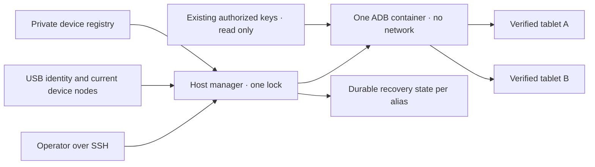

# Pengelola USB Android bersama

<!-- language-navigation:start -->
<p dir="ltr">
<a href="android-usb-manager.md" lang="en" dir="ltr">English</a> · <a href="android-usb-manager.ar.md" lang="ar" dir="rtl">العربية</a> · <a href="android-usb-manager.bn.md" lang="bn" dir="ltr">বাংলা</a> · <a href="android-usb-manager.cs.md" lang="cs" dir="ltr">Čeština</a> · <a href="android-usb-manager.de.md" lang="de" dir="ltr">Deutsch</a> · <a href="android-usb-manager.es.md" lang="es" dir="ltr">Español</a> · <a href="android-usb-manager.fa.md" lang="fa" dir="rtl">فارسی</a> · <a href="android-usb-manager.fr.md" lang="fr" dir="ltr">Français</a><br>
<a href="android-usb-manager.he.md" lang="he" dir="rtl">עברית</a> · <a href="android-usb-manager.hi.md" lang="hi" dir="ltr">हिन्दी</a> · <a href="android-usb-manager.id.md" lang="id" dir="ltr">Bahasa Indonesia</a> · <a href="android-usb-manager.it.md" lang="it" dir="ltr">Italiano</a> · <a href="android-usb-manager.ja.md" lang="ja" dir="ltr">日本語</a> · <a href="android-usb-manager.ko.md" lang="ko" dir="ltr">한국어</a> · <a href="android-usb-manager.nl.md" lang="nl" dir="ltr">Nederlands</a> · <a href="android-usb-manager.pl.md" lang="pl" dir="ltr">Polski</a><br>
<a href="android-usb-manager.pt.md" lang="pt" dir="ltr">Português</a> · <a href="android-usb-manager.ru.md" lang="ru" dir="ltr">Русский</a> · <a href="android-usb-manager.th.md" lang="th" dir="ltr">ไทย</a> · <a href="android-usb-manager.tr.md" lang="tr" dir="ltr">Türkçe</a> · <a href="android-usb-manager.uk.md" lang="uk" dir="ltr">Українська</a> · <a href="android-usb-manager.vi.md" lang="vi" dir="ltr">Tiếng Việt</a> · <a href="android-usb-manager.zh-Hans.md" lang="zh-Hans" dir="ltr">简体中文</a> · <a href="android-usb-manager.zh-Hant.md" lang="zh-Hant" dir="ltr">繁體中文</a>
</p>
<!-- language-navigation:end -->

Pengelola bersama menggantikan kontainer ADB per tablet dengan satu server ADB dan registri perangkat yang eksplisit. Layanan host mengelola hotplug USB dan, untuk tablet terpilih, memulihkan OTT setelah boot Android baru. Pemutaran biasa dan protokol OTT jarak jauh tetap berjalan secara independen.

## Mendapatkan paket deployment

Unduh `ottplay-control-server-deployment.tar.gz` dan `release-manifest.json` dari [rilis](https://github.com/open-ott-play/ottplay-control-server/releases) yang sama. Cocokkan SHA-256 arsip dengan entri manifesnya, lalu ekstrak ke direktori baru:

```sh
mkdir ott-android-release
tar -xzf ottplay-control-server-deployment.tar.gz -C ott-android-release
cd ott-android-release
python3 -B tools/android_usb_manager_remote.py --help
```

Arsip mempertahankan `tools/`, `deploy/`, dan `docs/`, termasuk keenam skrip USB bersama dan lama di bawah. Ikuti tata letak host dan langkah provisioning panduan ini; mengekstrak saja tidak memasang layanan. Gunakan pengelola, supervisor, dan adaptor transaksi dari satu revisi rilis. Dockerfile transport adalah resep build; artefak OCI rilis control-server bukan image transport USB.

Arsip deployment lama, termasuk `v0.1.5-beta.6`, tidak memuat `tools/`. Untuk versi tersebut gunakan arsip sumber yang sesuai atau rilis lebih baru dengan paket lengkap. Jangan mencampur skrip dari versi berbeda.

Implementasinya terdiri dari:

- [`tools/android_usb_manager.py`](../tools/android_usb_manager.py): registri, verifikasi transport, rekonsiliasi kontainer, dan perintah berseri.
- [`tools/android_usb_supervisor.py`](../tools/android_usb_supervisor.py): kebijakan boot, keyguard, dan pemulihan latar depan yang ada.
- [`tools/android_usb_manager_remote.py`](../tools/android_usb_manager_remote.py): pembungkus perintah SSH dengan keluaran yang mempertahankan biner.
- [`tools/android_usb_legacy_redirect.py`](../tools/android_usb_legacy_redirect.py): pengalihan opsional jalur perintah per tablet yang sudah terpasang.
- [`tools/android_usb_remote.py`](../tools/android_usb_remote.py): pembungkus SSH lama untuk pemanggil per tablet yang ada.
- [`tools/android_usb_transaction.py`](../tools/android_usb_transaction.py): transfer file atomik, staging APK, dan operasi CDP bagi alat pemeliharaan tepercaya.
- [`deploy/android-usb-manager`](../deploy/android-usb-manager): contoh konfigurasi, layanan systemd, skrip boot Synology DSM, dan [resep image transport](../deploy/android-usb-manager/README.md).




## Isolasi dan identitas

Kontainer menjalankan ADB di latar depan, bukan proses `sleep` menganggur yang kebetulan memiliki daemon ADB di belakang. ADB hanya mendengarkan loopback kontainer. Kontainer memakai `--network none`, tanpa port dipublikasikan, filesystem root hanya-baca, seluruh capability dilepas, no-new-privileges, dan `/tmp` yang dapat ditulis tetapi dibatasi. Tidak ada socket Docker atau mount luas `/dev` maupun `/dev/bus/usb`. Image harus dipatok dengan SHA-256.

Pengelola menetapkan memori kontainer 256 MiB, gabungan memori dan swap 256 MiB, serta CPU shares 128. Batas memori/swap yang sama tidak mengizinkan swap tambahan. CPU shares menurunkan prioritas relatif ketika bersaing tanpa kuota CPU keras. Tidak ada batas keras PID karena kernel DSM sasaran tidak mendukung pengontrol tersebut. `/tmp` memiliki plafon tmpfs 256 MiB, dialokasikan sesuai kebutuhan dan dihitung dalam batas memori yang sama, bukan jatah tambahan. Staging APK menerima paling banyak 128 MiB dan menulis potongan 1 MiB agar tidak menyimpan satu APK lengkap lagi dalam heap Python kontainer. Permintaan sisi host masih menampung payload-nya.

Docker dan pengelola host mengawasi proses ADB latar depan. Kontainer secara eksplisit mematikan health check bawaan image: pemeriksaan heartbeat atau konfigurasi pengelola lain tidak menjelaskan proses ini. Setelan sumber daya dan health check termasuk rekonsiliasi, sehingga penyimpangan mengganti kontainer milik pengelola di bawah kuncinya.

Perintah latar depan adalah `adb -L tcp:5037 nodaemon server`. ADB 29 menolak hostname eksplisit dalam argumen listener (`tcp:127.0.0.1:5037`); menghilangkannya mengikat loopback karena `-a` tidak aktif. Sisi klien tetap eksplisit memakai `ADB_SERVER_SOCKET=tcp:127.0.0.1:5037`. Sintaks kompatibel ini tidak memublikasikan port atau mengaktifkan ADB jaringan pada tablet.

Hanya node perangkat terkini yang cocok secara unik dengan entri aktif yang dipetakan, dengan izin baca/tulis. Node USB Synology dapat dimiliki root dengan mode `0600`, maka ADB berjalan sebagai root dalam kontainer terbatas. Node host tidak dibuat dapat ditulis semua orang. Pengelola host juga memerlukan kewenangan root untuk memeriksa node, mengelola Docker, dan menjaga status privat. Isolasi kontainer tidak menghapus hak istimewa host tersebut.

Registri mengenali perangkat melalui serial USB dan produk, opsional ID vendor/produk USB, lalu model Android, SDK, dan `android_id`. Pengelola mencocokkan jalur USB terkini dengan inventaris transport ADB, kemudian menjalankan perintah menggunakan serial unik yang terverifikasi. ADB dapat memakai ulang ID transport numerik setelah restart; ID itu tidak pernah dipakai untuk mengirim perintah. Serial duplikat ditolak, bukan dipilih secara acak. Perangkat yang tidak cocok, hilang, tidak berwenang, atau ambigu tidak boleh menerima perintah.

Entri aktif harus memiliki serial USB unik. Beberapa tablet murah berbagi placeholder `0123456789ABCDEF`; nama model berbeda tidak membuat pendaftaran bersamaan aman. Nonaktifkan perangkat yang berkonflik sampai strategi identitas fisik terpisah yang ditinjau diterapkan. Jangan mengganti label serial yang sama lalu menganggapnya transport lain.

Konsolidasi memberi satu proses ADB akses ke semua tablet yang dipetakan. Restart atau rekonsiliasi hotplug dapat mengganggu operasi pada tablet-tablet itu. Perintah dan rekonsiliasi memakai satu kunci host, `/var/lib/ott-android-manager/manager.lock`, untuk mencegah perubahan bersaing. Jalur ADB umum menolak perintah seluruh server atau pengubah transport seperti `kill-server`, `tcpip`, `connect`, dan `root`.

## Konfigurasi privat dan kunci

Mulai dengan [`config.example.json`](../deploy/android-usb-manager/config.example.json). Identitas dan digest image berisi nol sengaja fiktif; kedua perangkat contoh nonaktif. Contoh bukan deployment yang bisa langsung berjalan.

Gunakan tata letak host berikut:

```text
/usr/local/etc/ott-android-manager/
  android_usb_manager.py
  android_usb_supervisor.py
  android_usb_transaction.py
  config.json
  ott-android-manager.service
  adb-keys/
    adbkey
    adbkey.pub
    vendor/
      additional-authorized.adb_key
/var/lib/ott-android-manager/
  manager.lock
  captures/
  <alias>/state.json
```

Pengelola, supervisor, dan adaptor transaksi harus berasal dari revisi yang sama dan telah ditinjau. Simpan konfigurasi dan kunci di luar Git serta arsip rilis. Direktori privat memakai `0700`, konfigurasi dan kunci privat `0600`, dan file sumber/layanan dimiliki root. Direktori kunci di-mount hanya-baca. `adbkey` dan `adbkey.pub` harus sudah ada; `vendor/` harus ada meskipun kosong. Kunci privat tambahan yang sebelumnya diotorisasi dapat ditempatkan di `vendor/`, yang disediakan melalui `ADB_VENDOR_KEYS`. Namai setiap file privat `<source>.adb_key`: ADB 29 diam-diam mengabaikan nama lain saat memindai direktori. Pendamping `<source>.adb_key.pub` opsional. Pengelola menolak nama tidak dikenal sebelum mengubah kontainer.

Pertahankan kunci yang sudah diotorisasi sebelum memensiunkan kontainer. Bandingkan sidik jari kunci publik untuk menemukan duplikat; jangan mencetak kunci privat. Jangan mengganti kunci lama dengan yang baru hanya untuk menggabungkan kontainer: hal itu dapat memerlukan konfirmasi pada tablet yang terputus.

Setiap perangkat aktif membutuhkan identitas lengkap yang direkam saat provisioning didampingi. UUID perangkat OTT, alamat MAC, atau tebakan bukan bukti `android_id` Android. Jika catatan tidak memuatnya, pertahankan `"enabled": false`; entri nonaktif boleh berisi metadata deskriptif tidak lengkap dan tidak pernah dipetakan atau dikendalikan.

`recover_on_boot` adalah kebijakan independen. Biarkan false untuk tablet yang hanya menyediakan pemeliharaan. Jika aktif, `package` harus menunjuk aplikasi yang peluncuran latar depannya benar-benar diuji pada perangkat itu.

## Kerja pemulihan otomatis

Interval bawaan adalah lima detik setelah setiap putaran selesai, bukan jaminan pemulihan menyeluruh lima detik. Operasi USB lambat memperpanjang interval. Timeout perintah bawaan 60 detik, dengan maksimum tiga percobaan pemulihan per boot Android.

Pada pengamatan pertama, pengelola mencatat boot terkini tanpa membangunkan atau membuka kunci tablet. Pada boot baru berikutnya dengan pemulihan aktif, pengelola:

1. Menunggu `sys.boot_completed=1` dan memverifikasi identitas.
2. Memerlukan bukti eksplisit bahwa keyguard tidak dilindungi PIN, kata sandi, atau pola.
3. Membangunkan layar dan melepas kunci geser biasa jika diperlukan.
4. Meluncurkan paket yang ditentukan dan memeriksa aktivitas dilanjutkan/terfokus.
5. Memeriksa ulang boot/keyguard lalu menyimpan checkpoint sukses.

Keyguard tidak dikenal atau terlindungi menghentikan pemulihan. Deployment Fire lama memerlukan probe dengan perlindungan izin shell yang dijelaskan dalam [pemulihan USB](android-usb-recovery.md#read-only-keyguard-probe-on-older-firmware).

Boot yang sudah selesai mengembalikan `same_boot_no_action`. Layar mati biasa tidak memicu bangun. Pengelola ini tidak memantau decoding video, memulai ulang stream macet, atau terus memaksakan aplikasi di depan. Itu kebijakan lain milik pemutar atau watchdog yang ditinjau terpisah.

## Perintah

Pada host USB:

```sh
sudo -n /usr/bin/python3 -B /usr/local/etc/ott-android-manager/android_usb_manager.py \
  --config /usr/local/etc/ott-android-manager/config.json status
```

Dari komputer lain memakai alias host SSH yang sudah ada:

```sh
python3 tools/android_usb_manager_remote.py --host tablet-host status
python3 tools/android_usb_manager_remote.py --host tablet-host status lobby
python3 tools/android_usb_manager_remote.py --host tablet-host wake lobby
python3 tools/android_usb_manager_remote.py --host tablet-host recover lobby
python3 tools/android_usb_manager_remote.py --host tablet-host reboot lobby
python3 tools/android_usb_manager_remote.py --host tablet-host swipe lobby 400 600 400 100 --duration 500
python3 tools/android_usb_manager_remote.py --host tablet-host screenshot lobby lobby-check.png
python3 tools/android_usb_manager_remote.py --host tablet-host adb lobby -- shell getprop ro.product.model
python3 tools/android_usb_manager_remote.py --host tablet-host adb lobby -- exec-out screencap -p > lobby.png
```

`status` memeriksa tanpa membuat, memulai ulang, atau mengonfigurasi ulang kontainer. `tick` melakukan satu putaran rekonsiliasi/pemulihan dan dapat mengubah status perangkat; `run` mengulang putaran untuk layanan.

Pembungkus memakai SSH tanpa PTY, mengutip argumen satu per satu untuk shell, meneruskan status keluar, dan tidak mengubah keluaran ADB menjadi JSON. Periksa status keluar sebelum menganggap tangkapan layar yang dialihkan sah. `screenshot` hanya menerima nama PNG tanpa direktori seperti `lobby-check.png`, lalu menyimpan di `<state_dir>/captures/` pada host USB. Nama harus cocok dengan `[A-Za-z0-9][A-Za-z0-9_-]{0,119}\.png`; jalur, titik tambahan, dan ekstensi tersirat ditolak. Ia memvalidasi PNG dan membuat file baru khusus pemilik, menolak symlink serta nama yang sudah ada sebelum menangkap. Sebaliknya, `adb ... exec-out` mengalirkan byte ke file komputer operator. `swipe` memakai geometri layar terkini dan menolak keyguard terlindungi/tidak dikenal; koordinat hanya contoh, bukan gerakan buka kunci universal. Jalur ADB berada dalam namespace kontainer/perangkat: pembungkus tidak otomatis mengunggah APK dari laptop. Staging dan instalasi berikutnya harus memakai adaptor transaksi atomik di bawah.

`adb <alias> -- <arguments>` adalah antarmuka pemeliharaan administrator, bukan API publik terbatas. Perintah `shell` yang diizinkan dapat mengubah tablet. Gunakan pemeriksaan identitas dan kunci; jangan membuka akses SSH atau Docker tak terbatas melalui endpoint web.

## Layanan boot dan migrasi

[Templat systemd](../deploy/android-usb-manager/ott-android-manager.service) menjalankan pengelola terus-menerus dan memulai ulang proses yang keluar setelah sepuluh detik. [Pembungkus DSM](../deploy/android-usb-manager/S99ott-android-manager.sh) memeriksa file, memasang/mengaktifkan unit, lalu memulainya. Ia menolak mulai selama `ott-k8a-recovery.service` lama aktif atau diaktifkan. Untuk distribusi lain, sesuaikan dependensi Docker dan jalur dengan pengelola layanannya.

Lakukan serah-terima terkendali:

1. Catat konfigurasi kontainer, sidik jari kunci yang diotorisasi, dan status pemulihan. Cadangkan file privat dengan izin khusus pemilik.
2. Pasang sumber baru, image yang ditinjau, kunci, dan registri. Biarkan perangkat belum diprovisioning nonaktif. Jangan menjalankan supervisor kedua untuk tablet yang sama.
3. Hentikan dan nonaktifkan layanan pemulihan lama serta pensiunkan pembungkus boot DSM-nya. Simpan file untuk rollback. Menghentikan layanan saja tidak menghapus kontainer ADB.
4. Salin checkpoint lama tervalidasi ke `<alias>/state.json` baru yang sesuai. Pertahankan identitas boot; jangan mereset status sebagai jalan pintas migrasi rutin.
5. Hentikan kontainer ADB lama sebelum server bersama agar dua server tidak berebut antarmuka USB yang sama.
6. Pasang pembungkus DSM baru sebagai executable milik root di `/usr/local/etc/rc.d/`, jalankan `start`, dan periksa layanan/status.
7. Migrasikan pemanggil, verifikasi perintah biasa serta kebijakan yang dipertahankan, lalu hapus hanya kontainer lama yang dependensinya sudah dipensiunkan.

Alat lama sering menyembunyikan dependensi di balik nama sederhana. Audit `bootstrap.py`, `reconnect.py`, adaptor CDP, dan alias shell. Bootstrap dapat menyalin kunci dari kontainer lama. Skrip reconnect dapat memperoleh `OLD` dari helper impor kemudian menghentikan/menghapusnya; mengganti nama helper ke nama bersama dapat tanpa sengaja menghentikan server bersama. Hapus pengelolaan kontainer otomatis dari klien, bukan hanya mengganti nama.

Arahkan perintah ADB melalui pengelola berdasarkan alias. Adaptor kompatibilitas yang membutuhkan `docker exec` untuk staging file atau klien CDP lokal harus memegang kunci host yang sama sepanjang transaksi. Jangan menjalankan proses kedua yang mengambil kunci itu di bagian terkunci; gunakan jalur kompatibel dalam proses atau susun transaksi sekali saja. Alokasikan port penerusan sementara dan hapus setelah digunakan.

Pasang `android_usb_transaction.py` di samping pengelola dan supervisor. Ia menerima satu permintaan JSON pada stdin, dengan `--config` menuju registri privat yang sama, lalu mengembalikan keluaran operasi mentah pada stdout. Permintaan yang didukung:

- `pull`: `alias` dan `device_path` absolut; mengembalikan byte satu file reguler sampai 128 MiB. Direktori dan file perangkat ditolak. Batas keras ukuran file tujuan juga menghentikan sumber yang membesar selama transfer.
- `staged_adb`: `alias`, `data` base64 dan `arguments`, misalnya `["install", "-r", "@staged"]` atau `["push", "@staged", "/sdcard/example.json"]`.
- `cdp`: `alias`, `package` aplikasi, `expected_model` opsional, klien Python tepercaya `source` yang memuat `__OTT_CDP_PORT__`, dan `request` JSON-nya.

Setiap permintaan memverifikasi perangkat dan mempertahankan satu kunci selama persiapan, penggunaan, serta pembersihan. Operasi file memakai nama sementara unik; file dipesan eksklusif dengan mode `0600` sebelum pembersihan diaktifkan. Instalasi APK mempertahankan akhiran `.apk` yang diperlukan parser argumen paket ADB. Benturan nama membiarkan file lama utuh. Penulis staging hanya membuka reservasi kosong regulernya sendiri tanpa mengikuti symlink. Perintah Docker tambahan menunjuk ID kontainer yang diamati. CDP menemukan tepat satu proses aplikasi dan socket debugging-nya, mengalokasikan `tcp:0`, mengganti port tersebut dalam sumber klien, lalu menghapus hanya penerusan itu saat selesai atau gagal. Rekonsiliasi tidak dapat memulai ulang server di antara langkah tersebut.

Helper kompatibilitas a1 yang dimigrasikan menyimpan data `copy_in` dalam memori lokal thread sampai `adb install` atau `adb push` berikutnya dalam proses yang sama. Pasangan itu menjadi satu transaksi host; `copy_in` sendiri tidak lagi membuat file kontainer bersama. Helper CDP Home Plan dan pemutar memakai mekanisme sama. Permintaan dapat berisi data aplikasi privat dan kode executable tepercaya: kirim hanya melalui kanal SSH administrator yang ada, jangan buka adaptor sebagai endpoint publik atau catat payload-nya.

Port penerusan ADB milik server bersama, bukan tablet individual. Gunakan port CDP dinamis atau port berbeda per alias untuk sesi manual. Pengelola memaksakan `--no-rebind` saat membuat penerusan, mengizinkan pemakaian ulang pemetaan identik, dan menolak menimpa/menghapus penerusan alias lain. `forward --list` disaring untuk alias terpilih; `forward --remove-all` ditolak.

Setelah mencadangkan skrip lama, pengalih opsional dapat dipasang di `/usr/local/etc/ott-k8a-recovery/android_usb_supervisor.py` untuk mempertahankan titik masuk manual lama. Ia hanya menerima jalur konfigurasi lama yang dikenal, memerlukan kecocokan tepat serial/model/SDK/Android ID dengan satu entri baru aktif, dan mengganti prosesnya dengan pengelola baru. Ia tidak mengimpor atau menjalankan supervisor lama. `run` ditolak eksplisit: layanan dan pembungkus boot lama harus tetap nonaktif/dipensiunkan meskipun kompatibilitas manual terpasang.

Untuk rollback, hentikan dan nonaktifkan layanan baru, pensiunkan pembungkus boot, dan hentikan kontainernya. Pulihkan snapshot kunci/status lama dan layanan host lama. Sebelum melanjutkan, pastikan hanya satu pengelola memiliki setiap perangkat USB.

## Pemutar rilis tanpa CDP

APK produksi dapat sengaja menonaktifkan debugging WebView. Adaptor lalu melaporkan `Application debugging socket is unavailable`; koneksi ADB berfungsi tidak membuat socket itu. Pengelola tidak mengaktifkan debugging, mengubah setelan pemutar, atau mengganti APK.

Untuk pemutar yang sudah terhubung ke pengontrol OTT, gunakan diagnostik hanya-baca yang didukung. Ganti `lobby` dengan alias OTT yang dikonfigurasi:

```sh
ott -t 20 lobby debug -j
ott -t 20 lobby inspect -j
```

Perintah mengembalikan pengamatan pemutar, termasuk status runtime dan media yang tersedia. Tidak tersedia evaluasi JavaScript sembarang, inspeksi DOM langsung, atau koneksi CDP. Keduanya diverifikasi pada pemutar rilis API 22 yang terhubung tanpa socket CDP; ketersediaan pada pemutar lain bergantung pada kemampuannya.

## Penerimaan dan batas

Catat hasil terhadap sumber/image dan perangkat keras yang benar-benar terpasang. Saat konsolidasi dimulai, hanya **k8a** memiliki bukti fisik untuk kebijakan lama. Supervisor lamanya memulihkan setelah reboot tablet nyata dan membiarkan tidur biasa; itu tidak membuktikan penerimaan implementasi bersama yang baru. Identitas tablet lain tidak lengkap dan harus tetap nonaktif hingga validasi didampingi.

Penerimaan wajib pengelola bersama:

- Identitas USB yang sudah diotorisasi muncul melalui server bersama.
- Perangkat tidak dikenal, hilang, duplikat, dan nonaktif tidak menerima tindakan.
- Perintah hanya-baca dan tangkapan biner memakai transport yang dimaksud.
- Pemulihan boot baru berhasil pada perangkat yang kebijakannya aktif.
- Layar mati biasa tetap tidur.
- Enumerasi ulang USB hanya memulihkan pemetaan yang diharapkan.
- Restart layanan menjaga status dan mencegah pemulihan ganda.
- Reboot host nyata memulihkan layanan dan susunan kepemilikan.
- Setiap helper lokal yang dimigrasikan bekerja tanpa membuat ulang kontainer lama.

Nyatakan pemeriksaan yang belum dilakukan secara eksplisit. Layanan berjalan atau peluncuran latar depan berhasil tidak membuktikan pemutaran stream, kompatibilitas semua tablet, atau pemulihan tanpa pengawasan setelah reboot NAS.
