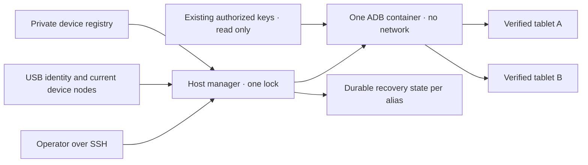

# Gestore USB Android condiviso

<!-- language-navigation:start -->
<p dir="ltr">
<a href="android-usb-manager.md" lang="en" dir="ltr">English</a> · <a href="android-usb-manager.ar.md" lang="ar" dir="rtl">العربية</a> · <a href="android-usb-manager.bn.md" lang="bn" dir="ltr">বাংলা</a> · <a href="android-usb-manager.cs.md" lang="cs" dir="ltr">Čeština</a> · <a href="android-usb-manager.de.md" lang="de" dir="ltr">Deutsch</a> · <a href="android-usb-manager.es.md" lang="es" dir="ltr">Español</a> · <a href="android-usb-manager.fa.md" lang="fa" dir="rtl">فارسی</a> · <a href="android-usb-manager.fr.md" lang="fr" dir="ltr">Français</a><br>
<a href="android-usb-manager.he.md" lang="he" dir="rtl">עברית</a> · <a href="android-usb-manager.hi.md" lang="hi" dir="ltr">हिन्दी</a> · <a href="android-usb-manager.id.md" lang="id" dir="ltr">Bahasa Indonesia</a> · <a href="android-usb-manager.it.md" lang="it" dir="ltr">Italiano</a> · <a href="android-usb-manager.ja.md" lang="ja" dir="ltr">日本語</a> · <a href="android-usb-manager.ko.md" lang="ko" dir="ltr">한국어</a> · <a href="android-usb-manager.nl.md" lang="nl" dir="ltr">Nederlands</a> · <a href="android-usb-manager.pl.md" lang="pl" dir="ltr">Polski</a><br>
<a href="android-usb-manager.pt.md" lang="pt" dir="ltr">Português</a> · <a href="android-usb-manager.ru.md" lang="ru" dir="ltr">Русский</a> · <a href="android-usb-manager.th.md" lang="th" dir="ltr">ไทย</a> · <a href="android-usb-manager.tr.md" lang="tr" dir="ltr">Türkçe</a> · <a href="android-usb-manager.uk.md" lang="uk" dir="ltr">Українська</a> · <a href="android-usb-manager.vi.md" lang="vi" dir="ltr">Tiếng Việt</a> · <a href="android-usb-manager.zh-Hans.md" lang="zh-Hans" dir="ltr">简体中文</a> · <a href="android-usb-manager.zh-Hant.md" lang="zh-Hant" dir="ltr">繁體中文</a>
</p>
<!-- language-navigation:end -->

Il gestore condiviso sostituisce i container ADB per tablet con un server ADB e un registro esplicito dei dispositivi. Un servizio host gestisce il collegamento USB a caldo e, sui tablet selezionati, ripristina OTT dopo un nuovo avvio Android. Riproduzione normale e protocollo OTT remoto continuano a funzionare indipendentemente.

## Ottenere il pacchetto di distribuzione

Scaricare `ottplay-control-server-deployment.tar.gz` e `release-manifest.json` dalla stessa [versione](https://github.com/open-ott-play/ottplay-control-server/releases). Verificare lo SHA-256 dell'archivio con la sua voce nel manifest, poi estrarlo in una nuova directory:

```sh
mkdir ott-android-release
tar -xzf ottplay-control-server-deployment.tar.gz -C ott-android-release
cd ott-android-release
python3 -B tools/android_usb_manager_remote.py --help
```

L'archivio conserva `tools/`, `deploy/` e `docs/`, compresi i sei script USB condivisi e precedenti elencati sotto. Seguire la struttura host e la preparazione di questa guida; estrarre non installa un servizio. Gestore, supervisore e adattatore delle transazioni devono restare alla stessa revisione di rilascio. Il Dockerfile del trasporto è una ricetta di compilazione; l'artefatto OCI pubblicato del control-server non è l'immagine del trasporto USB.

I vecchi archivi, incluso `v0.1.5-beta.6`, non contengono `tools/`. Per tali versioni usare l'archivio sorgente corrispondente oppure una versione recente con il pacchetto completo. Non mescolare script di versioni diverse.

L'implementazione comprende:

- [`tools/android_usb_manager.py`](../tools/android_usb_manager.py): registro, verifica del trasporto, riconciliazione dei container e comandi serializzati.
- [`tools/android_usb_supervisor.py`](../tools/android_usb_supervisor.py): politica esistente per avvio, blocco schermo e recupero del primo piano.
- [`tools/android_usb_manager_remote.py`](../tools/android_usb_manager_remote.py): wrapper SSH con output che preserva i dati binari.
- [`tools/android_usb_legacy_redirect.py`](../tools/android_usb_legacy_redirect.py): reindirizzamento opzionale di un percorso comandi per tablet già installato.
- [`tools/android_usb_remote.py`](../tools/android_usb_remote.py): wrapper SSH precedente, mantenuto per i chiamanti esistenti per tablet.
- [`tools/android_usb_transaction.py`](../tools/android_usb_transaction.py): trasferimento atomico di file, preparazione APK e operazioni CDP per strumenti di manutenzione fidati.
- [`deploy/android-usb-manager`](../deploy/android-usb-manager): configurazione d'esempio, servizio systemd, script di avvio Synology DSM e [ricetta dell'immagine di trasporto](../deploy/android-usb-manager/README.md).




## Isolamento e identità

Il container esegue ADB in primo piano, anziché un processo `sleep` inattivo con un demone ADB sullo sfondo. ADB ascolta soltanto sul loopback del container. Il container usa `--network none`, nessuna porta pubblicata, filesystem radice in sola lettura, tutte le capability rimosse, no-new-privileges e `/tmp` scrivibile ma limitato. Non possiede socket Docker né un mount generale di `/dev` o `/dev/bus/usb`. L'immagine deve essere fissata tramite SHA-256.

Il gestore impone 256 MiB di memoria, 256 MiB complessivi di memoria e swap e CPU shares pari a 128. Limiti memoria/swap uguali impediscono swap aggiuntivo. Le CPU shares riducono la priorità relativa in caso di contesa senza imporre una quota CPU rigida. Non esiste un limite rigido ai PID perché il kernel DSM di destinazione non supporta quel controller. `/tmp` è un tmpfs con tetto di 256 MiB, allocato su richiesta e conteggiato nello stesso limite di memoria, non una disponibilità aggiuntiva. La preparazione APK accetta al massimo 128 MiB e scrive blocchi da 1 MiB per non conservare un altro APK intero nell'heap Python del container. La richiesta lato host continua a bufferizzare il proprio contenuto.

Docker e il gestore host sorvegliano il processo ADB in primo piano. Il container disabilita esplicitamente gli health check ereditati dall'immagine: una verifica dell'heartbeat o della configurazione di un altro gestore non descrive questo processo. Risorse e health check fanno parte della riconciliazione; una divergenza comporta la sostituzione del container posseduto sotto il lock del gestore.

Il comando in primo piano è `adb -L tcp:5037 nodaemon server`. ADB 29 rifiuta un hostname esplicito nell'argomento di ascolto (`tcp:127.0.0.1:5037`); ometterlo collega il loopback perché `-a` non è abilitato. Sul client rimane esplicito `ADB_SERVER_SOCKET=tcp:127.0.0.1:5037`. Questa sintassi compatibile non pubblica porte né abilita ADB di rete sui tablet.

Sono mappati con permessi di lettura/scrittura soltanto i nodi correnti corrispondenti univocamente a voci abilitate. Su Synology i nodi USB possono appartenere a root con modalità `0600`; perciò ADB gira come root dentro il container limitato. Non si rendono i nodi host scrivibili da tutti. Anche il gestore host richiede privilegi root per ispezionare nodi, gestire Docker e conservare stato privato. L'isolamento del container non elimina tale autorità sull'host.

Il registro identifica il dispositivo tramite seriale e prodotto USB, facoltativamente ID USB di produttore/prodotto, poi modello Android, SDK e `android_id`. Il gestore confronta il percorso USB attuale con l'inventario dei trasporti ADB ed esegue i comandi sul seriale unico verificato. ADB può riutilizzare gli ID numerici di trasporto dopo il riavvio, quindi questi non vengono mai usati per indirizzare comandi. Seriali duplicati causano un rifiuto, non la selezione arbitraria di un trasporto. Un dispositivo discordante, assente, non autorizzato o ambiguo non deve ricevere comandi.

Le voci abilitate devono avere seriali USB unici. Alcuni tablet economici condividono il segnaposto `0123456789ABCDEF`; nomi di modello differenti non rendono sicura la registrazione simultanea. Tenere disabilitati i dispositivi in conflitto finché non sia implementata una strategia distinta e revisionata di identità fisica. Non rinominare lo stesso seriale supponendo che identifichi un altro trasporto.

Il consolidamento dà a un processo ADB accesso a tutti i tablet mappati. Riavvio o riconciliazione hotplug possono interrompere operazioni su più tablet. Comandi e riconciliazione usano un unico lock host, `/var/lib/ott-android-manager/manager.lock`, per impedire modifiche concorrenti. Il percorso ADB generico rifiuta comandi globali o che modificano il trasporto, come `kill-server`, `tcpip`, `connect` e `root`.

## Configurazione privata e chiavi

Partire da [`config.example.json`](../deploy/android-usb-manager/config.example.json). Identità e digest dell'immagine composto da zeri sono volutamente fittizi; entrambi i dispositivi d'esempio sono disabilitati. L'esempio non è un'installazione eseguibile.

Usare questa struttura host:

```text
/usr/local/etc/ott-android-manager/
  android_usb_manager.py
  android_usb_supervisor.py
  android_usb_transaction.py
  config.json
  ott-android-manager.service
  adb-keys/
    adbkey
    adbkey.pub
    vendor/
      additional-authorized.adb_key
/var/lib/ott-android-manager/
  manager.lock
  captures/
  <alias>/state.json
```

Gestore, supervisore e adattatore devono provenire dalla stessa revisione verificata. Tenere configurazione e chiavi fuori da Git e archivi di rilascio. Impostare `0700` per directory private, `0600` per configurazione e chiavi private e proprietà root per sorgenti e file del servizio. La directory delle chiavi viene montata in sola lettura. `adbkey` e `adbkey.pub` devono già esistere; `vendor/` deve esistere anche vuota. Chiavi private aggiuntive già autorizzate possono andare in `vendor/`, fornita tramite `ADB_VENDOR_KEYS`. Ogni file privato deve chiamarsi `<source>.adb_key`: ADB 29 ignora silenziosamente gli altri nomi durante la scansione. Il file associato `<source>.adb_key.pub` è opzionale. Il gestore rifiuta nomi sconosciuti prima di cambiare il container.

Conservare le chiavi autorizzate prima di dismettere qualsiasi container. Confrontare impronte delle chiavi pubbliche per individuare duplicati; non stampare chiavi private. Non sostituire una chiave esistente con una nuova solo per consolidare container: potrebbe richiedere conferma su tablet scollegati.

Ogni dispositivo abilitato richiede un'identità completa acquisita durante una preparazione presidiata. UUID OTT, indirizzo MAC o valore indovinato non dimostrano l'`android_id` Android. Se manca questo campo nel verbale, mantenere `"enabled": false`; le voci disabilitate possono avere metadati descrittivi incompleti e non sono mai mappate né controllate.

`recover_on_boot` è una politica indipendente. Lasciarla false su tablet che devono esporre solo comandi di manutenzione. Se abilitata, impostare `package` all'applicazione il cui avvio in primo piano è stato realmente verificato su quel dispositivo.

## Cosa fa il recupero automatico

L'intervallo predefinito è cinque secondi dopo ogni ciclo completato, non una garanzia di recupero complessivo entro cinque secondi. Operazioni USB lente lo allungano. Il timeout predefinito dei comandi è 60 secondi e il limite è tre tentativi per avvio Android.

Alla prima osservazione, il gestore registra l'avvio corrente senza svegliare né sbloccare il tablet. A un successivo nuovo avvio con recupero abilitato:

1. Attende `sys.boot_completed=1` e verifica l'identità.
2. Richiede prova esplicita che il blocco schermo non sia protetto da PIN, password o sequenza.
3. Sveglia lo schermo e rimuove, se necessario, un normale blocco a scorrimento.
4. Avvia il pacchetto configurato e controlla l'attività ripresa/con focus.
5. Ricontrolla avvio e blocco e solo dopo salva un checkpoint riuscito.

Un blocco sconosciuto o protetto ferma il recupero. Il vecchio deployment Fire richiede la sonda protetta da permessi shell descritta in [recupero USB](android-usb-recovery.md#read-only-keyguard-probe-on-older-firmware).

Un avvio già completato restituisce `same_boot_no_action`. Il normale spegnimento dello schermo non provoca risveglio. Questo gestore non sorveglia la decodifica video, non riavvia stream bloccati e non impone continuamente il primo piano. Queste politiche appartengono al player o a un watchdog revisionato separatamente.

## Comandi

Sull'host USB:

```sh
sudo -n /usr/bin/python3 -B /usr/local/etc/ott-android-manager/android_usb_manager.py \
  --config /usr/local/etc/ott-android-manager/config.json status
```

Da un altro computer con un alias host SSH esistente:

```sh
python3 tools/android_usb_manager_remote.py --host tablet-host status
python3 tools/android_usb_manager_remote.py --host tablet-host status lobby
python3 tools/android_usb_manager_remote.py --host tablet-host wake lobby
python3 tools/android_usb_manager_remote.py --host tablet-host recover lobby
python3 tools/android_usb_manager_remote.py --host tablet-host reboot lobby
python3 tools/android_usb_manager_remote.py --host tablet-host swipe lobby 400 600 400 100 --duration 500
python3 tools/android_usb_manager_remote.py --host tablet-host screenshot lobby lobby-check.png
python3 tools/android_usb_manager_remote.py --host tablet-host adb lobby -- shell getprop ro.product.model
python3 tools/android_usb_manager_remote.py --host tablet-host adb lobby -- exec-out screencap -p > lobby.png
```

`status` ispeziona senza creare, riavviare o riconfigurare il container. `tick` esegue un ciclo di riconciliazione/recupero e può cambiare lo stato del dispositivo; `run` ripete i cicli ed è destinato al servizio.

Il wrapper usa SSH senza PTY, quota per la shell ogni argomento, propaga il codice d'uscita e non converte l'output ADB in JSON. Controllare il codice prima di considerare valida una schermata rediretta. `screenshot` accetta solo un nome PNG semplice, come `lobby-check.png`, e salva in `<state_dir>/captures/` sull'host USB. Il nome deve rispettare `[A-Za-z0-9][A-Za-z0-9_-]{0,119}\.png`; percorsi, punti aggiuntivi ed estensioni implicite sono rifiutati. Valida il PNG e crea un nuovo file accessibile solo al proprietario, rifiutando symlink e nomi già esistenti prima dell'acquisizione. L'esempio `adb ... exec-out` trasmette invece byte a un file sul computer dell'operatore. `swipe` usa la geometria attuale e rifiuta blocchi protetti o sconosciuti; le coordinate sono esempi, non uno sblocco universale. I percorsi ADB appartengono ai namespace container/dispositivo: il wrapper non carica automaticamente un APK dal portatile. Preparazione e successiva installazione devono usare l'adattatore atomico descritto sotto.

`adb <alias> -- <arguments>` è un'interfaccia di manutenzione amministrativa, non un'API pubblica limitata. Un comando `shell` consentito può modificare il tablet. Usare controlli d'identità e lock; non esporre accesso SSH o Docker illimitato tramite un endpoint web.

## Servizio di avvio e migrazione

Il [modello systemd](../deploy/android-usb-manager/ott-android-manager.service) esegue il gestore continuamente e riavvia un processo terminato dopo dieci secondi. Il [wrapper DSM](../deploy/android-usb-manager/S99ott-android-manager.sh) verifica i file, installa/abilita l'unità e la avvia. Rifiuta l'avvio se `ott-k8a-recovery.service` è attivo o abilitato. Su altre distribuzioni adattare dipendenza Docker e percorsi al gestore dei servizi.

Effettuare un passaggio controllato:

1. Registrare configurazione dei container, impronte delle chiavi autorizzate e stato di recupero. Salvare file privati con permessi riservati al proprietario.
2. Installare nuovi sorgenti, immagine revisionata, chiavi e registro. Tenere disabilitati i dispositivi non preparati. Non avviare un secondo supervisore per lo stesso tablet.
3. Fermare e disabilitare il vecchio servizio di recupero host e dismettere il suo wrapper DSM. Conservare i file per il ripristino. Fermare il servizio non elimina da solo il container ADB.
4. Copiare il vecchio checkpoint validato nel nuovo `<alias>/state.json` corrispondente. Conservarne l'identità di avvio; non azzerare lo stato come normale scorciatoia di migrazione.
5. Fermare i vecchi container ADB prima del server condiviso, evitando che due server contendano la stessa interfaccia USB.
6. Installare il nuovo wrapper DSM eseguibile e di proprietà root in `/usr/local/etc/rc.d/`, eseguire `start` e controllare servizio/stato.
7. Migrare i chiamanti, verificare comandi normali e politica preservata, poi eliminare solo container vecchi le cui dipendenze siano state dismesse.

Gli strumenti precedenti spesso nascondono dipendenze dietro nomi innocui. Controllare `bootstrap.py`, `reconnect.py`, adattatori CDP e alias shell. Un bootstrap può copiare chiavi da un vecchio container. Un reconnect può impostare `OLD` da un modulo importato e poi fermarlo o eliminarlo; sostituire lì il nome con quello condiviso può arrestare accidentalmente il server comune. Rimuovere dai client la gestione automatica dei container, anziché cambiare soltanto un nome.

Instradare i veri comandi ADB attraverso il gestore, per alias. Un adattatore che richiede `docker exec` per preparare file o un client CDP locale deve mantenere lo stesso lock per tutta la transazione. Non annidare un secondo processo che acquisisce quel lock nella sezione già bloccata; usare un percorso compatibile nello stesso processo o organizzare la transazione una sola volta. Assegnare porte temporanee di inoltro e rimuoverle dopo l'uso.

Installare `android_usb_transaction.py` accanto a gestore e supervisore. Accetta una richiesta JSON su standard input, con `--config` rivolto allo stesso registro privato, e restituisce output grezzo su standard output. Richieste supportate:

- `pull`: `alias` e `device_path` assoluto; restituisce i byte di un file regolare fino a 128 MiB. Directory e file di dispositivo sono rifiutati. Un limite rigido del file di destinazione arresta anche una sorgente che cresce durante il trasferimento.
- `staged_adb`: `alias`, `data` in base64 e `arguments`, ad esempio `["install", "-r", "@staged"]` o `["push", "@staged", "/sdcard/example.json"]`.
- `cdp`: `alias`, `package` applicativo, `expected_model` opzionale, client Python fidato in `source` contenente `__OTT_CDP_PORT__` e relativa `request` JSON.

Ogni richiesta verifica il dispositivo e conserva un lock durante preparazione, uso e pulizia. I file usano nomi temporanei unici; sono riservati esclusivamente con modalità `0600` prima di attivare la pulizia. Le installazioni APK mantengono il suffisso `.apk` richiesto dal parser degli argomenti di pacchetto ADB. Una collisione lascia intatto il file esistente. Lo scrittore apre solo la propria prenotazione regolare vuota senza seguire symlink. I comandi Docker ausiliari indirizzano l'ID osservato del container. CDP individua esattamente un processo applicativo e il relativo socket di debug, assegna `tcp:0`, sostituisce la porta assegnata nel sorgente client e rimuove solo quell'inoltro a completamento o errore. La riconciliazione non può riavviare il server tra questi passaggi.

L'adattatore a1 migrato conserva i dati `copy_in` in memoria locale al thread fino al successivo `adb install` o `adb push` nello stesso processo. La coppia diventa una transazione host; `copy_in` da solo non crea più un file condiviso nel container. Home Plan e gli strumenti CDP del player usano lo stesso meccanismo. Le richieste possono contenere dati privati ed eseguibile fidato: inviarle solo tramite il canale SSH amministrativo esistente, senza esporre l'adattatore pubblicamente né registrare i payload.

Le porte di inoltro ADB appartengono al server condiviso, non al singolo tablet. Usare porte CDP assegnate dinamicamente o porte distinte per alias nelle sessioni manuali. Il gestore forza `--no-rebind` alla creazione, permette di riusare una mappatura identica e rifiuta sovrascrittura o rimozione dell'inoltro di un altro alias. `forward --list` è filtrato sull'alias selezionato; `forward --remove-all` è rifiutato.

Dopo avere salvato lo script precedente, il redirect opzionale può essere installato in `/usr/local/etc/ott-k8a-recovery/android_usb_supervisor.py` per preservare le vecchie entrate manuali. Accetta solo il percorso di configurazione precedente noto, richiede corrispondenza esatta di seriale/modello/SDK/Android ID con una sola voce nuova abilitata e sostituisce il proprio processo con il nuovo gestore. Non importa né esegue il vecchio supervisore. `run` è esplicitamente rifiutato: servizio e wrapper precedenti devono restare disabilitati/dismessi anche con compatibilità manuale.

Per tornare indietro, fermare e disabilitare il nuovo servizio host, dismetterne il wrapper e fermarne il container. Ripristinare le vecchie copie di chiavi/stato e il servizio precedente. Prima di riprendere verificare che ciascun dispositivo USB abbia un solo gestore.

## Player di produzione senza CDP

Un APK di produzione può disabilitare intenzionalmente il debug WebView. In quel caso l'adattatore segnala `Application debugging socket is unavailable`; una connessione ADB funzionante non crea quel socket. Il gestore non abilita debug, non cambia impostazioni del player e non sostituisce l'APK.

Per un player già connesso al controller OTT, usare la diagnostica supportata in sola lettura. Sostituire `lobby` con il suo alias OTT configurato:

```sh
ott -t 20 lobby debug -j
ott -t 20 lobby inspect -j
```

Questi comandi restituiscono osservazioni del player, incluso lo stato disponibile di runtime e media. Non offrono esecuzione JavaScript arbitraria, ispezione diretta del DOM o connessione CDP. Entrambi sono stati verificati sul player di produzione API 22 connesso ma senza socket CDP; su altri player la disponibilità dipende dalle capacità supportate.

## Accettazione e limiti

Registrare risultati rispetto a sorgenti, immagine e hardware realmente installati. All'inizio del consolidamento, solo **k8a** disponeva di prove fisiche della politica precedente. Il suo vecchio supervisore recuperava dopo un vero riavvio del tablet e non disturbava il normale sonno; ciò non dimostra l'accettazione della nuova implementazione condivisa. Le altre identità salvate erano incomplete e devono restare disabilitate fino alla validazione presidiata.

Accettazione richiesta del gestore condiviso:

- L'identità USB già autorizzata compare attraverso il server condiviso.
- Dispositivi sconosciuti, assenti, duplicati e disabilitati non ricevono azioni.
- Un comando in sola lettura e uno screenshot binario usano il trasporto previsto.
- Il recupero dopo un nuovo avvio riesce sul dispositivo con la politica abilitata.
- Il normale spegnimento dello schermo resta in sonno.
- La rienumerazione USB ripristina solo la mappatura attesa.
- Il riavvio del servizio conserva lo stato ed evita recuperi duplicati.
- Un vero riavvio host ripristina servizio e assegnazione del controllo.
- Ogni strumento locale migrato funziona senza ricreare vecchi container.

Dichiarare esplicitamente le verifiche non eseguite. Un servizio in esecuzione o un avvio in primo piano riuscito non provano riproduzione dello stream, compatibilità di tutti i tablet o recupero non presidiato dopo il riavvio del NAS.
