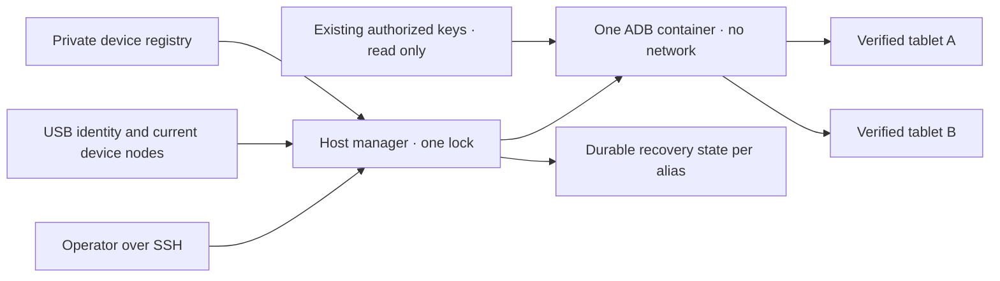

# 共有 Android USB マネージャー

<!-- language-navigation:start -->
<p dir="ltr">
<a href="android-usb-manager.md" lang="en" dir="ltr">English</a> · <a href="android-usb-manager.ar.md" lang="ar" dir="rtl">العربية</a> · <a href="android-usb-manager.bn.md" lang="bn" dir="ltr">বাংলা</a> · <a href="android-usb-manager.cs.md" lang="cs" dir="ltr">Čeština</a> · <a href="android-usb-manager.de.md" lang="de" dir="ltr">Deutsch</a> · <a href="android-usb-manager.es.md" lang="es" dir="ltr">Español</a> · <a href="android-usb-manager.fa.md" lang="fa" dir="rtl">فارسی</a> · <a href="android-usb-manager.fr.md" lang="fr" dir="ltr">Français</a><br>
<a href="android-usb-manager.he.md" lang="he" dir="rtl">עברית</a> · <a href="android-usb-manager.hi.md" lang="hi" dir="ltr">हिन्दी</a> · <a href="android-usb-manager.id.md" lang="id" dir="ltr">Bahasa Indonesia</a> · <a href="android-usb-manager.it.md" lang="it" dir="ltr">Italiano</a> · <a href="android-usb-manager.ja.md" lang="ja" dir="ltr">日本語</a> · <a href="android-usb-manager.ko.md" lang="ko" dir="ltr">한국어</a> · <a href="android-usb-manager.nl.md" lang="nl" dir="ltr">Nederlands</a> · <a href="android-usb-manager.pl.md" lang="pl" dir="ltr">Polski</a><br>
<a href="android-usb-manager.pt.md" lang="pt" dir="ltr">Português</a> · <a href="android-usb-manager.ru.md" lang="ru" dir="ltr">Русский</a> · <a href="android-usb-manager.th.md" lang="th" dir="ltr">ไทย</a> · <a href="android-usb-manager.tr.md" lang="tr" dir="ltr">Türkçe</a> · <a href="android-usb-manager.uk.md" lang="uk" dir="ltr">Українська</a> · <a href="android-usb-manager.vi.md" lang="vi" dir="ltr">Tiếng Việt</a> · <a href="android-usb-manager.zh-Hans.md" lang="zh-Hans" dir="ltr">简体中文</a> · <a href="android-usb-manager.zh-Hant.md" lang="zh-Hant" dir="ltr">繁體中文</a>
</p>
<!-- language-navigation:end -->

共有マネージャーは、タブレットごとの ADB コンテナを、1つの ADB サーバーと明示的なデバイス登録簿に置き換えます。ホストサービスが USB の着脱を管理し、選択したタブレットでは新しい Android 起動後に OTT を復旧します。通常の再生とリモート OTT プロトコルは独立して動作し続けます。

## 配備パッケージの取得

同じ[リリース](https://github.com/open-ott-play/ottplay-control-server/releases)から `ottplay-control-server-deployment.tar.gz` と `release-manifest.json` を取得します。アーカイブの SHA-256 をマニフェストの該当項目と照合し、新しいディレクトリへ展開します。

```sh
mkdir ott-android-release
tar -xzf ottplay-control-server-deployment.tar.gz -C ott-android-release
cd ott-android-release
python3 -B tools/android_usb_manager_remote.py --help
```

アーカイブは `tools/`、`deploy/`、`docs/` と、下記の共有・旧式 USB スクリプト6本をすべて保持します。本書のホスト配置と準備手順に従ってください。展開だけではサービスはインストールされません。マネージャー、スーパーバイザー、トランザクションアダプターは同一リリースのリビジョンに揃えます。トランスポート用 Dockerfile はビルド手順であり、control-server の OCI リリース資産は USB トランスポートイメージではありません。

`v0.1.5-beta.6` を含む古い配備アーカイブには `tools/` がありません。それらでは対応するソースアーカイブを使うか、完全なパッケージを含む新しいリリースを選びます。異なる版のスクリプトを混ぜないでください。

実装の構成は次のとおりです。

- [`tools/android_usb_manager.py`](../tools/android_usb_manager.py)：登録簿、トランスポート検証、コンテナの整合、コマンドの直列実行。
- [`tools/android_usb_supervisor.py`](../tools/android_usb_supervisor.py)：既存の起動、画面ロック、前面復旧ポリシー。
- [`tools/android_usb_manager_remote.py`](../tools/android_usb_manager_remote.py)：バイナリ出力を保持する SSH コマンドラッパー。
- [`tools/android_usb_legacy_redirect.py`](../tools/android_usb_legacy_redirect.py)：設置済みのタブレット別コマンドパス用の任意リダイレクト。
- [`tools/android_usb_remote.py`](../tools/android_usb_remote.py)：既存のタブレット別呼び出し元向けに残す旧 SSH ラッパー。
- [`tools/android_usb_transaction.py`](../tools/android_usb_transaction.py)：信頼できる保守ツール向けのアトミックなファイル転送、APK 準備、CDP 操作。
- [`deploy/android-usb-manager`](../deploy/android-usb-manager)：設定例、systemd サービス、Synology DSM 起動スクリプト、[トランスポートイメージの構築手順](../deploy/android-usb-manager/README.md)。




## 分離と識別

コンテナは、バックグラウンド ADB デーモンを伴う待機中の `sleep` プロセスではなく、ADB を前景プロセスとして実行します。ADB はコンテナ内のループバックだけで待ち受けます。コンテナは `--network none`、公開ポートなし、読み取り専用ルート、全 capability の削除、no-new-privileges、容量制限付きの書き込み可能な `/tmp` を使います。Docker ソケットや `/dev`、`/dev/bus/usb` 全体のマウントはありません。イメージは SHA-256 で固定してください。

マネージャーはコンテナメモリ 256 MiB、メモリとスワップ合計 256 MiB、CPU shares 128 を強制します。メモリと合計の上限が同じため、追加スワップは使えません。CPU shares は競合時の相対優先度を下げますが、CPU のハードクォータは設定しません。対象 DSM カーネルが対応しないため、PID のハード上限はありません。`/tmp` は上限 256 MiB の tmpfs で、必要に応じて割り当てられ、同じメモリ制限に計上されます。追加のメモリ枠ではありません。APK 準備は最大 128 MiB を受け付け、コンテナの Python ヒープに APK 全体をもう1部保持しないよう 1 MiB 単位で書きます。ホスト側の要求は引き続きペイロードをバッファーします。

Docker とホストマネージャーが前景 ADB を監視します。コンテナはイメージから継承したヘルスチェックを明示的に無効化します。別マネージャーのハートビートや設定の検査では、このプロセスを評価できないためです。資源とヘルスチェックの設定も整合処理の対象で、ずれがあればマネージャーロック内で所有コンテナを置き換えます。

前景コマンドは `adb -L tcp:5037 nodaemon server` です。ADB 29 は待ち受け引数の明示的なホスト名（`tcp:127.0.0.1:5037`）を拒否します。ホスト名を省略すると、`-a` が無効なのでループバックにバインドします。クライアント側では `ADB_SERVER_SOCKET=tcp:127.0.0.1:5037` を明示したままです。この互換構文はポートを公開せず、タブレットのネットワーク ADB も有効にしません。

有効な登録項目に一意に一致する現在のデバイスノードだけを、読み書き権限で割り当てます。Synology の USB ノードは root 所有、モード `0600` の場合があるため、この構成では制限されたコンテナ内の ADB を root として実行します。ホストノードを誰でも書き込める設定にはしません。ホストマネージャーもノード検査、Docker 管理、非公開状態の保持に root 権限を必要とします。コンテナ分離によって、このホスト権限が非特権になるわけではありません。

登録簿は USB シリアルと製品、任意の USB ベンダー/製品 ID、その後 Android モデル、SDK、`android_id` で機器を識別します。マネージャーは現在の USB パスを ADB トランスポート一覧と照合し、確認済みの一意なシリアルでコマンドを実行します。ADB は再起動後に数値トランスポート ID を再利用するため、コマンド宛先には絶対に使いません。シリアルの重複は任意選択ではなく拒否になります。不一致、欠落、未認可、曖昧な機器にコマンドを送ってはいけません。

有効な登録項目の USB シリアルは一意でなければなりません。安価なタブレットには `0123456789ABCDEF` を共有するものがあり、モデル名の違いだけでは同時登録を安全にできません。別途レビューした物理識別方式を実装するまで、競合する機器は無効にします。同じシリアルの表示名を変えて別のトランスポートだと考えないでください。

統合により1つの ADB プロセスが全割り当てタブレットへアクセスします。再起動やホットプラグ整合で複数タブレットの操作が中断されることがあります。コマンドと整合処理はホストロック `/var/lib/ott-android-manager/manager.lock` を共有し、競合変更を防ぎます。汎用 ADB 経路は `kill-server`、`tcpip`、`connect`、`root` などサーバー全体やトランスポートを変えるコマンドを拒否します。

## 非公開設定と鍵

[`config.example.json`](../deploy/android-usb-manager/config.example.json) を出発点にします。識別情報と全桁ゼロのイメージダイジェストは意図的な架空値で、例の2機器は無効です。この例はそのまま動く配備設定ではありません。

次のホスト配置を使います。

```text
/usr/local/etc/ott-android-manager/
  android_usb_manager.py
  android_usb_supervisor.py
  android_usb_transaction.py
  config.json
  ott-android-manager.service
  adb-keys/
    adbkey
    adbkey.pub
    vendor/
      additional-authorized.adb_key
/var/lib/ott-android-manager/
  manager.lock
  captures/
  <alias>/state.json
```

マネージャー、スーパーバイザー、トランザクションアダプターは同一のレビュー済みリビジョンから取得します。設定と鍵を Git やリリースアーカイブに入れないでください。非公開ディレクトリは `0700`、設定と秘密鍵は `0600`、ソースとサービスファイルは root 所有にします。鍵ディレクトリは読み取り専用でマウントします。`adbkey` と `adbkey.pub` は既存でなければならず、`vendor/` は空でも必要です。追加の認可済み秘密鍵は `ADB_VENDOR_KEYS` で渡される `vendor/` に置けます。秘密鍵ファイルは `<source>.adb_key` と命名します。ADB 29 は探索時に他の名前を黙って無視します。対応する `<source>.adb_key.pub` は任意です。マネージャーは不明な名前をコンテナ変更前に拒否します。

コンテナを廃止する前に既存の認可済み鍵を保持してください。公開鍵のフィンガープリントを比較して重複を見つけ、秘密鍵は出力しません。統合だけを目的に既存鍵を新規鍵へ交換しないでください。未接続タブレット側で確認操作が必要になる場合があります。

有効な各機器には、有人の初期設定で収集した完全な識別情報が必要です。OTT デバイス UUID、MAC アドレス、推測値は Android の `android_id` の証拠ではありません。記録にその項目がなければ `"enabled": false` を維持します。無効項目は説明メタデータが不完全でも構いませんが、割り当ても操作もされません。

`recover_on_boot` は独立したポリシーです。保守コマンドだけを提供するタブレットでは false のままにします。有効にする場合、`package` はその機器で前面起動を実際に確認したアプリにします。

## 自動復旧の動作

既定間隔は各処理の終了後5秒であり、5秒以内の完全復旧を保証しません。遅い USB 操作は間隔を延ばします。既定のコマンドタイムアウトは60秒で、Android 起動ごとの復旧試行は最大3回です。

初回観測では、タブレットを起こしたり解除したりせず現在の起動を記録します。その後の新しい起動で復旧が有効なら、次を実行します。

1. `sys.boot_completed=1` を待ち、機器の識別情報を検証します。
2. ロックが PIN、パスワード、パターンで保護されていない明示的証拠を要求します。
3. 画面を起こし、必要なら通常のスワイプロックを解除します。
4. 設定されたパッケージを起動し、再開/フォーカスされた activity を確認します。
5. 起動とロックを再確認してから成功チェックポイントを保存します。

不明または保護されたロック状態では復旧を止めます。旧 Fire 配備には、[USB 復旧](android-usb-recovery.md#read-only-keyguard-probe-on-older-firmware)で説明する shell 権限保護付きプローブが必要です。

完了済み起動は `same_boot_no_action` を返します。通常の画面消灯では起こしません。このマネージャーは動画デコードを監視せず、停止したストリームを再起動せず、アプリの前面を常時強制しません。それらはプレーヤーまたは別途レビューした watchdog の別ポリシーです。

## コマンド

USB ホスト上：

```sh
sudo -n /usr/bin/python3 -B /usr/local/etc/ott-android-manager/android_usb_manager.py \
  --config /usr/local/etc/ott-android-manager/config.json status
```

既存の SSH ホスト別名を使い、別のコンピューターから：

```sh
python3 tools/android_usb_manager_remote.py --host tablet-host status
python3 tools/android_usb_manager_remote.py --host tablet-host status lobby
python3 tools/android_usb_manager_remote.py --host tablet-host wake lobby
python3 tools/android_usb_manager_remote.py --host tablet-host recover lobby
python3 tools/android_usb_manager_remote.py --host tablet-host reboot lobby
python3 tools/android_usb_manager_remote.py --host tablet-host swipe lobby 400 600 400 100 --duration 500
python3 tools/android_usb_manager_remote.py --host tablet-host screenshot lobby lobby-check.png
python3 tools/android_usb_manager_remote.py --host tablet-host adb lobby -- shell getprop ro.product.model
python3 tools/android_usb_manager_remote.py --host tablet-host adb lobby -- exec-out screencap -p > lobby.png
```

`status` はコンテナの作成、再起動、再設定なしで検査します。`tick` は整合/復旧を1回実行し、機器状態を変える可能性があります。`run` は繰り返し実行するサービス用です。

ラッパーは PTY なしの SSH を使い、引数ごとに shell クォートし、プロセス終了状態を引き継ぎます。ADB 出力を JSON に変換しません。リダイレクトしたスクリーンショットを有効とみなす前に終了状態を確認します。`screenshot` は `lobby-check.png` のような単純な PNG 名だけを受け付け、USB ホストの `<state_dir>/captures/` に保存します。名前は `[A-Za-z0-9][A-Za-z0-9_-]{0,119}\.png` に一致する必要があり、パス、余分なドット、暗黙の拡張子は拒否されます。PNG を検証して所有者専用の新規ファイルを作り、シンボリックリンクや既存名は撮影前に拒否します。一方、`adb ... exec-out` の例は操作者のコンピューターへバイトを転送します。`swipe` は現在の画面形状を使い、保護された/不明なロックを拒否します。座標は例であり、万能な解除ジェスチャーではありません。ADB パスはコンテナ/機器の名前空間を指し、ラッパーがノート PC から APK を自動アップロードすることはありません。準備とその後のインストールには下記のアトミックなアダプターが必要です。

`adb <alias> -- <arguments>` は管理者用の保守インターフェースで、制限された公開 API ではありません。許可された `shell` コマンドはタブレットを変更できます。識別確認とロックを利用し、無制限の SSH/Docker アクセスを Web エンドポイントで公開しないでください。

## 起動サービスと移行

[systemd テンプレート](../deploy/android-usb-manager/ott-android-manager.service)はマネージャーを常時実行し、終了したプロセスを10秒後に再起動します。[DSM ラッパー](../deploy/android-usb-manager/S99ott-android-manager.sh)は配備ファイルを確認してユニットをインストール/有効化し、開始します。旧 `ott-k8a-recovery.service` が稼働中または有効なら開始を拒否します。別ディストリビューションでは、Docker 依存関係とパスをサービス管理方式に合わせます。

管理された引き継ぎを行います。

1. 既存コンテナ設定、認可済み鍵のフィンガープリント、復旧状態を記録します。非公開ファイルを所有者専用権限でバックアップします。
2. 新しいソース、レビュー済みイメージ、鍵、登録簿を設置します。未設定機器は無効にします。同じタブレットに2つ目の監視サービスを起動しません。
3. 旧ホスト復旧サービスを停止/無効化し、その DSM 起動ラッパーを廃止します。戻せるようファイルは保持します。サービス停止だけでは ADB コンテナは削除されません。
4. 検証した旧チェックポイントを対応する新しい `<alias>/state.json` にコピーします。起動識別情報を保持し、移行の近道として状態をリセットしません。
5. 共有サーバーを開始する前に旧 ADB コンテナを停止し、2サーバーによる USB インターフェース競合を避けます。
6. 新 DSM ラッパーを root 所有の実行可能ファイルとして `/usr/local/etc/rc.d/` に設置し、`start` を実行してサービス/状態を確認します。
7. 呼び出し元を移行し、通常コマンドと保持した復旧ポリシーを確認してから、依存関係がなくなった旧コンテナだけを削除します。

旧ツールは無害な名前の裏に依存関係を隠すことがあります。`bootstrap.py`、`reconnect.py`、CDP アダプター、shell 別名を監査します。Bootstrap が旧コンテナから鍵をコピーする場合があります。Reconnect がインポートした補助モジュールから `OLD` を得て後で停止/削除する場合、そこで共有名に変更すると共有サーバーを誤停止し得ます。名前だけでなく、クライアントの自動コンテナ管理を削除してください。

実際の ADB コマンドは別名指定でマネージャーを経由させます。ファイル準備やローカル CDP クライアントに `docker exec` が必要な互換アダプターは、準備とコマンドの全トランザクション中、同じホストロックを保持します。ロック区間内で同じロックを取得する別プロセスを入れ子にせず、互換のプロセス内経路か一括トランザクションを使います。一時転送ポートを割り当て、使用後は削除します。

`android_usb_transaction.py` をマネージャーとスーパーバイザーの隣に設置します。標準入力で JSON 要求を1つ受け、`--config` は同じ非公開登録簿を指し、標準出力に操作結果を加工せず返します。対応要求：

- `pull`：`alias` と絶対 `device_path`。通常ファイル1つのバイトを最大 128 MiB 返します。ディレクトリとデバイスファイルは拒否します。宛先ファイルのハードサイズ上限により、転送中に増大するソースも止めます。
- `staged_adb`：`alias`、base64 の `data`、`arguments`。例は `["install", "-r", "@staged"]`、`["push", "@staged", "/sdcard/example.json"]`。
- `cdp`：`alias`、アプリの `package`、任意の `expected_model`、`__OTT_CDP_PORT__` を含む信頼できる Python クライアント `source`、その JSON `request`。

各要求は機器を検証し、準備、使用、片付けを通して単一ロックを保持します。ファイルには一意な一時名を使い、片付けを有効化する前に `0600` で排他的に予約します。APK インストールは ADB のパッケージ引数パーサーが必要とする `.apk` を保持します。名前衝突で既存ファイルは変更しません。書き込み側はシンボリックリンクを追わず、自分が予約した空の通常ファイルだけを開きます。補助 Docker コマンドは観測済みコンテナ ID を指します。CDP はアプリプロセスとデバッグソケットをそれぞれ一意に特定し、`tcp:0` を割り当て、クライアントソースにポートを代入し、完了/失敗時にその転送だけを削除します。この間に整合処理がサーバーを再起動することはありません。

移行済み a1 互換ツールは `copy_in` データを、同じプロセスの次の `adb install` または `adb push` までスレッドローカルメモリに保持します。この対が1つのホストトランザクションとなり、`copy_in` 単独では共有コンテナファイルを作りません。Home Plan とプレーヤーの CDP ツールも同じ仕組みです。要求には私有アプリデータや信頼できる実行コードが含まれ得るため、既存管理者 SSH 経路だけで送り、公開エンドポイント化やペイロードのログ記録は行いません。

ADB 転送ポートは個別タブレットでなく共有サーバーに属します。動的 CDP ポートを使うか、手動セッションでは別名ごとに異なるポートを使います。マネージャーは作成時に `--no-rebind` を強制し、同一マッピングの再利用は許可、他の別名の転送を上書き/削除することは拒否します。`forward --list` は選択した別名で絞り込み、`forward --remove-all` は拒否します。

旧スクリプトをバックアップ後、任意の旧式リダイレクトを `/usr/local/etc/ott-k8a-recovery/android_usb_supervisor.py` に設置して手動コマンド入口を残せます。既知の旧設定パスだけを受け付け、serial/model/SDK/Android ID が有効な新登録項目1つと完全一致することを要求し、自プロセスを新マネージャーに置換します。旧スーパーバイザーをインポートも実行もしません。`run` は明示的に拒否し、手動互換機能があっても旧サービスと起動ラッパーは無効/廃止のままにします。

戻す場合は新ホストサービスを停止/無効化し、起動ラッパーを廃止してコンテナを停止します。旧鍵/状態のスナップショットと旧サービスを復元します。再開前に各 USB 機器を管理するのが1つのマネージャーだけであることを確認します。

## CDP のない製品版プレーヤー

製品 APK は意図的に WebView デバッグを無効にする場合があります。その際、アダプターは `Application debugging socket is unavailable` を返します。ADB 接続が正常でも、そのソケットは作成されません。マネージャーはデバッグ有効化、プレーヤー設定変更、APK 交換を行いません。

OTT コントローラーへ接続済みのプレーヤーでは、対応する読み取り専用診断を使います。`lobby` を設定済み OTT 別名に置き換えます。

```sh
ott -t 20 lobby debug -j
ott -t 20 lobby inspect -j
```

コマンドはプレーヤーが報告した観測値を返し、取得可能な実行時状態やメディア状態を含みます。任意の JavaScript 評価、直接の DOM 検査、CDP 接続は提供しません。両方とも CDP ソケットがない接続済み API 22 製品版プレーヤーで検証済みです。別プレーヤーでの利用可否は対応機能によります。

## 受け入れ確認と制限

実際に導入したソース/イメージとハードウェアに対して結果を記録します。統合開始時、旧復旧ポリシーの実機証拠があったのは **k8a** だけです。旧監視プログラムは実際のタブレット再起動後に復旧し、通常睡眠を妨げませんでしたが、それは新共有実装の受け入れ証明にはなりません。他の保存済み識別情報は不完全で、有人検証まで無効のままにします。

共有マネージャーに必要な確認：

- 既存の認可済み USB 身元が共有サーバー経由で現れる。
- 不明、欠落、重複、無効な機器は操作を受けない。
- 読み取り専用コマンドとバイナリ画像が意図した経路を使う。
- ポリシー有効機器で新規起動後の復旧に成功する。
- 通常の画面消灯では眠ったままになる。
- USB 再列挙が期待した機器割り当てだけを戻す。
- ホストサービス再起動が状態を保持し、二重復旧を防ぐ。
- 実際のホスト再起動がサービスと所有関係を戻す。
- 移行した各ローカルツールが旧コンテナを再作成せず動く。

未実施の確認を明示してください。サービス稼働や前面起動成功だけでは、ストリーム再生、全タブレット互換性、NAS 再起動後の無人復旧は証明できません。
