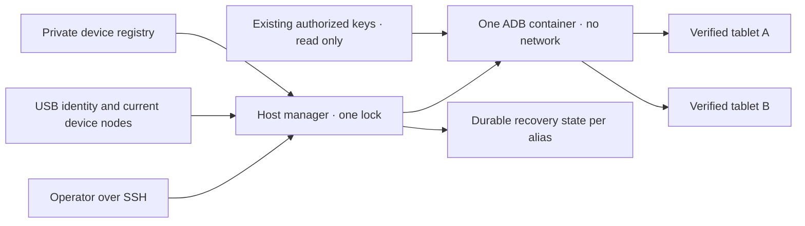

# 공유 Android USB 관리자

<!-- language-navigation:start -->
<p dir="ltr">
<a href="android-usb-manager.md" lang="en" dir="ltr">English</a> · <a href="android-usb-manager.ar.md" lang="ar" dir="rtl">العربية</a> · <a href="android-usb-manager.bn.md" lang="bn" dir="ltr">বাংলা</a> · <a href="android-usb-manager.cs.md" lang="cs" dir="ltr">Čeština</a> · <a href="android-usb-manager.de.md" lang="de" dir="ltr">Deutsch</a> · <a href="android-usb-manager.es.md" lang="es" dir="ltr">Español</a> · <a href="android-usb-manager.fa.md" lang="fa" dir="rtl">فارسی</a> · <a href="android-usb-manager.fr.md" lang="fr" dir="ltr">Français</a><br>
<a href="android-usb-manager.he.md" lang="he" dir="rtl">עברית</a> · <a href="android-usb-manager.hi.md" lang="hi" dir="ltr">हिन्दी</a> · <a href="android-usb-manager.id.md" lang="id" dir="ltr">Bahasa Indonesia</a> · <a href="android-usb-manager.it.md" lang="it" dir="ltr">Italiano</a> · <a href="android-usb-manager.ja.md" lang="ja" dir="ltr">日本語</a> · <a href="android-usb-manager.ko.md" lang="ko" dir="ltr">한국어</a> · <a href="android-usb-manager.nl.md" lang="nl" dir="ltr">Nederlands</a> · <a href="android-usb-manager.pl.md" lang="pl" dir="ltr">Polski</a><br>
<a href="android-usb-manager.pt.md" lang="pt" dir="ltr">Português</a> · <a href="android-usb-manager.ru.md" lang="ru" dir="ltr">Русский</a> · <a href="android-usb-manager.th.md" lang="th" dir="ltr">ไทย</a> · <a href="android-usb-manager.tr.md" lang="tr" dir="ltr">Türkçe</a> · <a href="android-usb-manager.uk.md" lang="uk" dir="ltr">Українська</a> · <a href="android-usb-manager.vi.md" lang="vi" dir="ltr">Tiếng Việt</a> · <a href="android-usb-manager.zh-Hans.md" lang="zh-Hans" dir="ltr">简体中文</a> · <a href="android-usb-manager.zh-Hant.md" lang="zh-Hant" dir="ltr">繁體中文</a>
</p>
<!-- language-navigation:end -->

공유 관리자는 태블릿별 ADB 컨테이너를 하나의 ADB 서버와 명시적 장치 등록부로 대체합니다. 호스트 서비스가 USB 연결 변경을 관리하고 선택한 태블릿에서 Android가 새로 부팅되면 OTT를 복구합니다. 일반 재생과 원격 OTT 프로토콜은 계속 독립적으로 동작합니다.

## 배포 패키지 받기

같은 [릴리스](https://github.com/open-ott-play/ottplay-control-server/releases)에서 `ottplay-control-server-deployment.tar.gz`와 `release-manifest.json`을 받습니다. 압축 파일의 SHA-256을 매니페스트 항목과 비교하고 새 디렉터리에 풉니다.

```sh
mkdir ott-android-release
tar -xzf ottplay-control-server-deployment.tar.gz -C ott-android-release
cd ott-android-release
python3 -B tools/android_usb_manager_remote.py --help
```

압축 파일은 `tools/`, `deploy/`, `docs/`와 아래의 공유 및 기존 USB 스크립트 여섯 개를 모두 보존합니다. 이 문서의 호스트 배치와 준비 절차를 따르십시오. 압축 해제만으로 서비스가 설치되지는 않습니다. 관리자, supervisor, 트랜잭션 어댑터는 같은 릴리스 리비전으로 맞춥니다. 전송 Dockerfile은 빌드 방법이며 control-server의 OCI 릴리스 자산은 USB 전송 이미지가 아닙니다.

`v0.1.5-beta.6` 등 이전 배포 압축 파일에는 `tools/`가 없습니다. 해당 버전의 소스 압축 파일을 쓰거나 전체 패키지가 포함된 새 릴리스를 선택하십시오. 다른 버전의 스크립트를 섞지 마십시오.

구현 구성 요소:

- [`tools/android_usb_manager.py`](../tools/android_usb_manager.py): 등록부, 전송 검증, 컨테이너 조정, 명령 직렬화.
- [`tools/android_usb_supervisor.py`](../tools/android_usb_supervisor.py): 기존 부팅, 화면 잠금, 전경 복구 정책.
- [`tools/android_usb_manager_remote.py`](../tools/android_usb_manager_remote.py): 바이너리 출력을 보존하는 SSH 명령 래퍼.
- [`tools/android_usb_legacy_redirect.py`](../tools/android_usb_legacy_redirect.py): 이미 설치된 태블릿별 명령 경로를 위한 선택적 리디렉션.
- [`tools/android_usb_remote.py`](../tools/android_usb_remote.py): 기존 태블릿별 호출자를 위해 보존한 이전 SSH 래퍼.
- [`tools/android_usb_transaction.py`](../tools/android_usb_transaction.py): 신뢰하는 유지보수 도구용 원자적 파일 전송, APK 준비, CDP 작업.
- [`deploy/android-usb-manager`](../deploy/android-usb-manager): 예제 설정, systemd 서비스, Synology DSM 부팅 스크립트, [전송 이미지 빌드 방법](../deploy/android-usb-manager/README.md).




## 격리와 식별

컨테이너는 백그라운드 ADB 데몬을 동반한 유휴 `sleep` 프로세스 대신 ADB를 전경에서 실행합니다. ADB는 컨테이너 루프백에서만 수신합니다. 컨테이너는 `--network none`, 공개 포트 없음, 읽기 전용 루트 파일 시스템, 모든 capability 제거, no-new-privileges, 크기가 제한된 쓰기 가능 `/tmp`를 사용합니다. Docker 소켓이나 광범위한 `/dev`, `/dev/bus/usb` 마운트가 없습니다. 이미지는 SHA-256으로 고정해야 합니다.

관리자는 컨테이너 메모리 256 MiB, 메모리와 스왑 합계 256 MiB, CPU shares 128을 적용합니다. 메모리와 합계 한도가 같아 추가 스왑을 허용하지 않습니다. CPU shares는 경쟁 시 상대 우선순위를 낮추지만 엄격한 CPU 할당량을 설정하지 않습니다. 대상 DSM 커널이 제어기를 지원하지 않아 PID 하드 한도는 없습니다. `/tmp`는 최대 256 MiB tmpfs로 필요할 때 할당되고 같은 메모리 한도에 포함되며 추가 메모리가 아닙니다. APK 준비는 최대 128 MiB를 받아 1 MiB씩 써서 컨테이너 Python 힙에 전체 APK를 하나 더 보관하지 않습니다. 호스트 쪽 요청은 여전히 페이로드를 버퍼링합니다.

Docker와 호스트 관리자가 전경 ADB를 감시합니다. 컨테이너는 이미지에서 상속한 상태 검사를 명시적으로 끕니다. 다른 관리자의 heartbeat나 설정 검사로 이 프로세스를 설명할 수 없기 때문입니다. 자원 및 상태 검사 설정도 조정 대상이므로 불일치 시 관리자 잠금 아래에서 소유 컨테이너를 교체합니다.

전경 명령은 `adb -L tcp:5037 nodaemon server`입니다. ADB 29는 수신 인수의 명시적 호스트 이름(`tcp:127.0.0.1:5037`)을 거부합니다. 이름을 생략하면 `-a`가 켜지지 않았으므로 루프백에 바인딩합니다. 클라이언트는 `ADB_SERVER_SOCKET=tcp:127.0.0.1:5037`을 명시합니다. 이 호환 구문은 포트를 공개하거나 태블릿의 네트워크 ADB를 켜지 않습니다.

활성 등록 항목과 유일하게 일치하는 현재 장치 노드만 읽기/쓰기 권한으로 매핑합니다. Synology USB 노드는 root 소유와 `0600` 모드일 수 있으므로 제한된 컨테이너 안에서 ADB를 root로 실행합니다. 호스트 노드를 모두에게 쓰기 가능하게 바꾸지 않습니다. 호스트 관리자도 노드 검사, Docker 관리, 비공개 상태 보존을 위해 root 권한이 필요합니다. 컨테이너 격리는 이 호스트 권한을 비특권으로 만들지 않습니다.

등록부는 USB 일련번호와 제품, 선택적 USB 공급업체/제품 ID, 이어서 Android 모델, SDK, `android_id`로 장치를 식별합니다. 관리자는 현재 USB 경로를 ADB 전송 목록과 대조하고 검증된 고유 일련번호로 명령을 실행합니다. ADB는 재시작 후 숫자 전송 ID를 재사용할 수 있어 명령 전달에 절대 쓰지 않습니다. 중복 일련번호는 임의 전송 선택 대신 거부를 유발합니다. 불일치, 부재, 미승인, 모호한 장치에 명령을 보내면 안 됩니다.

활성 항목에는 고유 USB 일련번호가 필요합니다. 일부 저가 태블릿은 자리표시자 `0123456789ABCDEF`를 공유하므로 모델명이 달라도 동시 등록이 안전해지지 않습니다. 별도로 검토한 물리 식별 전략이 구현될 때까지 충돌 장치를 비활성화하십시오. 같은 일련번호의 이름만 바꾸고 다른 전송을 뜻한다고 가정하지 마십시오.

통합은 한 ADB 프로세스에 모든 매핑 태블릿 접근을 줍니다. 재시작 또는 hotplug 조정이 여러 태블릿 작업을 중단할 수 있습니다. 명령과 조정은 호스트 잠금 `/var/lib/ott-android-manager/manager.lock`을 공유하여 경쟁 변경을 막습니다. 일반 ADB 경로는 `kill-server`, `tcpip`, `connect`, `root` 같은 서버 전체 또는 전송 변경 명령을 거부합니다.

## 비공개 설정과 키

[`config.example.json`](../deploy/android-usb-manager/config.example.json)에서 시작합니다. 식별 정보와 모두 0인 이미지 다이제스트는 의도적인 가상 값이며 두 예제 장치는 꺼져 있습니다. 예제는 바로 실행할 수 있는 배포가 아닙니다.

다음 호스트 배치를 사용합니다.

```text
/usr/local/etc/ott-android-manager/
  android_usb_manager.py
  android_usb_supervisor.py
  android_usb_transaction.py
  config.json
  ott-android-manager.service
  adb-keys/
    adbkey
    adbkey.pub
    vendor/
      additional-authorized.adb_key
/var/lib/ott-android-manager/
  manager.lock
  captures/
  <alias>/state.json
```

관리자, supervisor, 트랜잭션 어댑터는 같은 검토된 리비전이어야 합니다. 설정과 키를 Git 및 릴리스 압축 파일 밖에 두십시오. 비공개 디렉터리는 `0700`, 설정과 개인키는 `0600`, 소스/서비스 파일 소유자는 root로 합니다. 키 디렉터리는 읽기 전용 마운트입니다. `adbkey`, `adbkey.pub`가 미리 있어야 하고 `vendor/`도 비어 있더라도 필요합니다. 추가로 이전 승인된 개인키는 `ADB_VENDOR_KEYS`로 제공하는 `vendor/`에 넣을 수 있습니다. 각 개인키 이름은 `<source>.adb_key`로 합니다. ADB 29는 디렉터리 검색 시 다른 이름을 조용히 무시합니다. 짝인 `<source>.adb_key.pub`는 선택 사항입니다. 관리자는 컨테이너 변경 전에 미확인 이름을 거부합니다.

컨테이너를 퇴역시키기 전에 승인된 기존 키를 보존하십시오. 공개키 지문으로 중복을 식별하고 개인키는 출력하지 마십시오. 통합만을 위해 기존 키를 새로 생성한 키로 바꾸지 마십시오. 그렇게 하면 연결되지 않은 태블릿에서 재확인이 필요할 수 있습니다.

활성 장치마다 사람이 지켜보는 준비 과정에서 수집한 완전한 식별 정보가 필요합니다. OTT 장치 UUID, MAC 주소, 추측값은 Android `android_id` 증거가 아닙니다. 기록에 이 필드가 없으면 `"enabled": false`를 유지합니다. 비활성 항목은 설명 메타데이터가 불완전해도 되지만 매핑되거나 제어되지 않습니다.

`recover_on_boot`는 독립 정책입니다. 유지보수 명령만 제공할 태블릿에서는 false로 둡니다. 켠다면 `package`는 그 장치에서 전경 시작을 실제 검증한 앱이어야 합니다.

## 자동 복구 동작

기본 간격은 각 회차가 끝난 뒤 5초이며 전체 복구가 5초 내 끝난다는 보장이 아닙니다. 느린 USB 작업은 간격을 늘립니다. 기본 명령 제한 시간은 60초이고 Android 부팅당 복구 시도는 3회입니다.

첫 관찰에서는 장치를 깨우거나 잠금 해제하지 않고 현재 부팅을 기록합니다. 이후 새 부팅에서 복구가 활성화되면:

1. `sys.boot_completed=1`을 기다리고 장치 신원을 검증합니다.
2. PIN, 비밀번호, 패턴으로 보호된 잠금이 아니라는 명확한 증거를 요구합니다.
3. 화면을 깨우고 필요하면 일반 스와이프 잠금을 닫습니다.
4. 설정된 패키지를 시작하고 재개/포커스된 activity를 확인합니다.
5. 부팅과 잠금을 재확인한 뒤 성공 체크포인트를 저장합니다.

불명확하거나 보호된 잠금 상태에서는 복구를 멈춥니다. 기존 Fire 배포에는 [USB 복구](android-usb-recovery.md#read-only-keyguard-probe-on-older-firmware)의 shell 권한 보호 프로브가 필요합니다.

이미 완료된 부팅은 `same_boot_no_action`을 반환합니다. 일반 화면 꺼짐은 깨우기를 유발하지 않습니다. 관리자는 영상 디코딩을 감시하거나 멈춘 스트림을 재시작하거나 앱 전경을 계속 강제하지 않습니다. 그것은 플레이어 또는 별도로 검토한 watchdog의 다른 정책입니다.

## 명령

USB 호스트에서:

```sh
sudo -n /usr/bin/python3 -B /usr/local/etc/ott-android-manager/android_usb_manager.py \
  --config /usr/local/etc/ott-android-manager/config.json status
```

다른 컴퓨터에서 기존 SSH 호스트 별칭 사용:

```sh
python3 tools/android_usb_manager_remote.py --host tablet-host status
python3 tools/android_usb_manager_remote.py --host tablet-host status lobby
python3 tools/android_usb_manager_remote.py --host tablet-host wake lobby
python3 tools/android_usb_manager_remote.py --host tablet-host recover lobby
python3 tools/android_usb_manager_remote.py --host tablet-host reboot lobby
python3 tools/android_usb_manager_remote.py --host tablet-host swipe lobby 400 600 400 100 --duration 500
python3 tools/android_usb_manager_remote.py --host tablet-host screenshot lobby lobby-check.png
python3 tools/android_usb_manager_remote.py --host tablet-host adb lobby -- shell getprop ro.product.model
python3 tools/android_usb_manager_remote.py --host tablet-host adb lobby -- exec-out screencap -p > lobby.png
```

`status`는 컨테이너 생성, 재시작, 재설정 없이 검사합니다. `tick`은 조정/복구 한 회차를 실행하고 장치 상태를 바꿀 수 있습니다. `run`은 이를 반복하는 서비스용 명령입니다.

래퍼는 PTY 없는 SSH를 쓰고 개별 인수를 shell 인용 처리하며 종료 상태를 전달하고 ADB 출력을 JSON으로 바꾸지 않습니다. 리디렉션한 화면 캡처를 유효하다고 판단하기 전에 종료 상태를 확인하십시오. `screenshot`은 `lobby-check.png` 같은 단순 PNG 이름만 받고 USB 호스트의 `<state_dir>/captures/`에 저장합니다. 이름은 `[A-Za-z0-9][A-Za-z0-9_-]{0,119}\.png`와 일치해야 하며 경로, 추가 점, 암묵적 확장자는 거부합니다. PNG를 검증하고 소유자만 접근하는 새 파일을 만들며 캡처 전에 심볼릭 링크와 기존 이름을 거부합니다. 반면 `adb ... exec-out` 예제는 작업자 컴퓨터 파일로 바이트를 스트리밍합니다. `swipe`는 현재 화면 치수를 사용하고 보호/불명 잠금을 거부합니다. 좌표는 예제이지 범용 해제 동작이 아닙니다. ADB 경로는 컨테이너/장치 이름 공간을 가리킵니다. 래퍼가 노트북에서 APK를 자동 업로드하지는 않습니다. 파일 준비와 설치는 아래 원자적 어댑터를 사용해야 합니다.

`adb <alias> -- <arguments>`는 관리자 유지보수 인터페이스이며 제한된 공개 API가 아닙니다. 허용된 `shell` 명령은 태블릿을 바꿀 수 있습니다. 신원 검사와 잠금을 사용하고 무제한 SSH/Docker를 웹 엔드포인트로 공개하지 마십시오.

## 부팅 서비스와 이전

[systemd 템플릿](../deploy/android-usb-manager/ott-android-manager.service)은 관리자를 지속 실행하고 종료된 프로세스를 10초 뒤 재시작합니다. [DSM 래퍼](../deploy/android-usb-manager/S99ott-android-manager.sh)는 파일을 검사하고 유닛을 설치/활성화한 뒤 시작합니다. 기존 `ott-k8a-recovery.service`가 실행 중이거나 활성화되어 있으면 시작을 거부합니다. 다른 배포판에서는 Docker 의존성과 경로를 해당 서비스 관리자에 맞추십시오.

통제된 인계를 수행합니다.

1. 기존 컨테이너 설정, 승인 키 지문, 복구 상태를 기록합니다. 비공개 파일은 소유자 전용 권한으로 백업합니다.
2. 새 소스, 검토된 이미지, 키, 등록부를 설치합니다. 준비되지 않은 장치는 비활성으로 둡니다. 같은 태블릿용 두 번째 supervisor를 시작하지 마십시오.
3. 기존 호스트 복구 서비스를 중지/비활성화하고 DSM 부팅 래퍼를 퇴역시킵니다. 롤백용 파일을 보존합니다. 서비스 중지만으로 ADB 컨테이너가 제거되지는 않습니다.
4. 검증된 이전 체크포인트를 맞는 새 `<alias>/state.json`으로 복사합니다. 부팅 신원을 보존하고 편의상 상태를 초기화하지 마십시오.
5. 공유 서버 시작 전에 기존 ADB 컨테이너를 멈춰 같은 USB 인터페이스를 두 서버가 다투지 않게 합니다.
6. 새 DSM 래퍼를 root 소유 실행 파일로 `/usr/local/etc/rc.d/` 아래 설치하고 `start`를 실행하여 서비스/상태를 확인합니다.
7. 호출자를 이전하고 일반 명령과 유지된 복구 정책을 검증한 뒤 의존성이 퇴역한 기존 컨테이너만 제거합니다.

기존 도구는 무해한 이름 뒤에 의존성을 숨길 수 있습니다. `bootstrap.py`, `reconnect.py`, CDP 어댑터, shell 별칭을 점검합니다. Bootstrap은 기존 컨테이너에서 키를 복사할 수 있습니다. Reconnect가 import한 도구에서 `OLD`를 얻어 나중에 멈추거나 지운다면 이름만 공유 이름으로 바꿀 때 공유 서버를 잘못 중지할 수 있습니다. 이름 변경 대신 클라이언트에서 자동 컨테이너 관리를 제거하십시오.

실제 ADB 명령은 별칭을 통해 관리자로 전달합니다. 파일 준비나 로컬 CDP 클라이언트에 `docker exec`가 필요한 호환 어댑터는 전체 준비/명령 트랜잭션 동안 같은 호스트 잠금을 유지해야 합니다. 잠긴 구간 안에서 같은 잠금을 획득하는 다른 프로세스를 중첩하지 말고 호환되는 프로세스 내부 경로나 단일 트랜잭션을 사용하십시오. 임시 전달 포트를 배정하고 사용 후 제거합니다.

`android_usb_transaction.py`를 관리자와 supervisor 옆에 설치합니다. 표준 입력으로 JSON 요청 하나를 받고 `--config`는 같은 비공개 등록부를 가리키며 표준 출력으로 원시 결과를 반환합니다. 지원 요청:

- `pull`: `alias`, 절대 `device_path`. 최대 128 MiB인 일반 파일 하나의 바이트를 반환합니다. 디렉터리와 장치 파일은 거부합니다. 대상 파일 크기의 하드 한도는 전송 중 커지는 원본도 중단합니다.
- `staged_adb`: `alias`, base64 `data`, `arguments`. 예: `["install", "-r", "@staged"]`, `["push", "@staged", "/sdcard/example.json"]`.
- `cdp`: `alias`, 앱 `package`, 선택적 `expected_model`, `__OTT_CDP_PORT__`를 포함한 신뢰하는 Python 클라이언트 `source`, 해당 JSON `request`.

모든 요청은 장치를 검증하고 준비, 사용, 정리 중 하나의 잠금을 유지합니다. 파일 작업은 고유 임시 이름을 사용하며 정리를 활성화하기 전에 `0600`으로 독점 예약합니다. APK 설치는 ADB 패키지 인수 파서가 요구하는 `.apk` 확장자를 보존합니다. 이름 충돌은 기존 파일을 건드리지 않습니다. 준비 기록기는 심볼릭 링크를 따르지 않고 자신의 빈 일반 예약 파일만 엽니다. 보조 Docker 명령은 관찰한 컨테이너 ID를 지정합니다. CDP는 정확히 하나의 앱 프로세스와 디버그 소켓을 찾고 `tcp:0`을 할당하여 클라이언트 소스에 포트를 넣은 다음 완료/실패 시 해당 전달만 지웁니다. 이 단계 사이에 조정 작업이 서버를 재시작할 수 없습니다.

이전된 a1 호환 도구는 같은 프로세스의 다음 `adb install` 또는 `adb push`까지 `copy_in` 데이터를 스레드 로컬 메모리에 둡니다. 그 쌍이 하나의 호스트 트랜잭션이며 `copy_in`만으로 공유 컨테이너 파일을 만들지 않습니다. Home Plan과 플레이어 CDP 도구도 같은 방식을 씁니다. 요청은 비공개 앱 데이터와 신뢰하는 실행 코드를 담을 수 있으므로 기존 관리자 SSH 채널로만 보내며 어댑터를 공개하거나 페이로드를 로그에 남기지 마십시오.

ADB 전달 포트는 개별 태블릿이 아니라 공유 서버에 속합니다. 동적 CDP 포트 또는 수동 세션의 별칭별 다른 포트를 사용합니다. 관리자는 생성 시 `--no-rebind`를 강제하고 동일 매핑 재사용을 허용하며 다른 별칭 전달의 덮어쓰기/제거를 거부합니다. `forward --list`는 선택 별칭만 보이고 `forward --remove-all`은 거부합니다.

기존 스크립트 백업 후 선택적 이전 리디렉션을 `/usr/local/etc/ott-k8a-recovery/android_usb_supervisor.py`에 설치하여 수동 진입점을 유지할 수 있습니다. 알려진 이전 설정 경로만 허용하고 serial/model/SDK/Android ID가 활성 새 등록 항목 하나와 정확히 일치해야 하며 자신의 프로세스를 새 관리자로 바꿉니다. 이전 supervisor를 import하거나 실행하지 않습니다. `run`은 명시적으로 거부하므로 수동 호환 기능이 있어도 이전 서비스와 부팅 래퍼는 비활성/퇴역 상태로 남겨야 합니다.

롤백하려면 새 서비스를 중지/비활성화하고 부팅 래퍼를 퇴역시키고 컨테이너를 멈춥니다. 이전 키/상태 스냅샷과 서비스를 복원합니다. 재개 전에 USB 장치마다 관리자 하나만 소유하는지 확인합니다.

## CDP 없는 릴리스 플레이어

프로덕션 APK는 의도적으로 WebView 디버깅을 끌 수 있습니다. 그러면 어댑터가 `Application debugging socket is unavailable`을 보고하며 정상 ADB 연결이 그 소켓을 만들지는 않습니다. 관리자는 디버깅을 켜거나 플레이어 설정을 바꾸거나 APK를 교체하지 않습니다.

이미 OTT 컨트롤러에 연결된 플레이어는 지원하는 읽기 전용 진단을 사용합니다. `lobby`를 설정된 OTT 별칭으로 바꿉니다.

```sh
ott -t 20 lobby debug -j
ott -t 20 lobby inspect -j
```

명령은 사용 가능한 런타임/미디어 상태를 포함한 플레이어 관찰값을 반환합니다. 임의 JavaScript 평가, 직접 DOM 검사, CDP 연결은 제공하지 않습니다. 둘 다 CDP 소켓 없는 연결된 API 22 릴리스 플레이어에서 확인했습니다. 다른 플레이어의 가용성은 지원 기능에 따릅니다.

## 인수 확인과 한계

실제 설치된 소스/이미지와 하드웨어를 기준으로 결과를 기록하십시오. 통합 시작 당시 기존 복구 정책의 실물 증거가 있던 것은 **k8a**뿐입니다. 이전 supervisor는 실제 태블릿 재부팅 뒤 복구하고 일반 수면을 건드리지 않았지만 새 공유 구현의 검증은 아닙니다. 다른 저장된 식별 정보는 불완전하므로 사람이 지켜보는 검증까지 비활성으로 둡니다.

공유 관리자 필수 확인:

- 기존 승인 USB 식별 정보가 공유 서버를 통해 나타남.
- 불명, 부재, 중복, 비활성 장치는 작업을 받지 않음.
- 읽기 전용 명령과 바이너리 캡처가 의도한 전송을 사용함.
- 정책 활성 장치에서 새 부팅 후 복구 성공.
- 일반 화면 꺼짐은 수면을 유지함.
- USB 재열거는 예상 장치 매핑만 복원함.
- 호스트 서비스 재시작은 상태를 보존하고 중복 복구를 피함.
- 실제 호스트 재부팅은 서비스와 소유 관계를 복원함.
- 모든 이전된 로컬 도구가 이전 컨테이너를 다시 만들지 않고 작동함.

하지 않은 검사는 명확히 보고하십시오. 서비스 실행이나 전경 시작 성공만으로 스트림 재생, 모든 태블릿 호환성, NAS 재부팅 후 무인 복구를 입증할 수는 없습니다.
