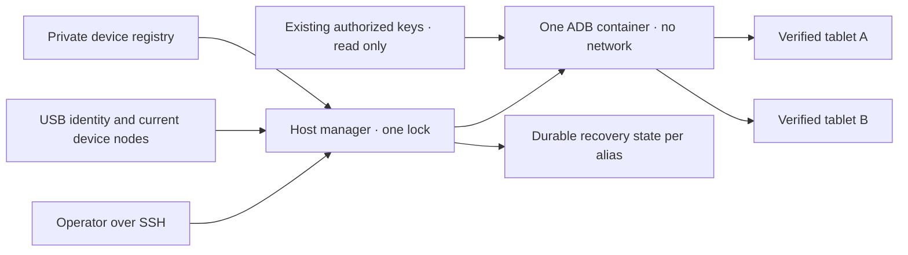

# Shared Android USB manager

<!-- language-navigation:start -->
<p dir="ltr">
<a href="android-usb-manager.md" lang="en" dir="ltr">English</a> · <a href="android-usb-manager.ar.md" lang="ar" dir="rtl">العربية</a> · <a href="android-usb-manager.bn.md" lang="bn" dir="ltr">বাংলা</a> · <a href="android-usb-manager.cs.md" lang="cs" dir="ltr">Čeština</a> · <a href="android-usb-manager.de.md" lang="de" dir="ltr">Deutsch</a> · <a href="android-usb-manager.es.md" lang="es" dir="ltr">Español</a> · <a href="android-usb-manager.fa.md" lang="fa" dir="rtl">فارسی</a> · <a href="android-usb-manager.fr.md" lang="fr" dir="ltr">Français</a><br>
<a href="android-usb-manager.he.md" lang="he" dir="rtl">עברית</a> · <a href="android-usb-manager.hi.md" lang="hi" dir="ltr">हिन्दी</a> · <a href="android-usb-manager.id.md" lang="id" dir="ltr">Bahasa Indonesia</a> · <a href="android-usb-manager.it.md" lang="it" dir="ltr">Italiano</a> · <a href="android-usb-manager.ja.md" lang="ja" dir="ltr">日本語</a> · <a href="android-usb-manager.ko.md" lang="ko" dir="ltr">한국어</a> · <a href="android-usb-manager.nl.md" lang="nl" dir="ltr">Nederlands</a> · <a href="android-usb-manager.pl.md" lang="pl" dir="ltr">Polski</a><br>
<a href="android-usb-manager.pt.md" lang="pt" dir="ltr">Português</a> · <a href="android-usb-manager.ru.md" lang="ru" dir="ltr">Русский</a> · <a href="android-usb-manager.th.md" lang="th" dir="ltr">ไทย</a> · <a href="android-usb-manager.tr.md" lang="tr" dir="ltr">Türkçe</a> · <a href="android-usb-manager.uk.md" lang="uk" dir="ltr">Українська</a> · <a href="android-usb-manager.vi.md" lang="vi" dir="ltr">Tiếng Việt</a> · <a href="android-usb-manager.zh-Hans.md" lang="zh-Hans" dir="ltr">简体中文</a> · <a href="android-usb-manager.zh-Hant.md" lang="zh-Hant" dir="ltr">繁體中文</a>
</p>
<!-- language-navigation:end -->

The shared manager replaces per-tablet ADB containers with one ADB server and
an explicit device registry. A host service manages USB hotplug and, for
selected tablets, restores OTT after a new Android boot. Ordinary playback and
the remote OTT protocol continue to run independently.

## Get the deployment package

Download `ottplay-control-server-deployment.tar.gz` and `release-manifest.json`
from the same [release](https://github.com/open-ott-play/ottplay-control-server/releases).
Verify the archive's SHA-256 against its manifest entry, then extract it into
a new directory:

```sh
mkdir ott-android-release
tar -xzf ottplay-control-server-deployment.tar.gz -C ott-android-release
cd ott-android-release
python3 -B tools/android_usb_manager_remote.py --help
```

The archive preserves `tools/`, `deploy/` and `docs/`, including all six
shared and legacy USB scripts listed below. Follow the host layout and
provisioning steps in this guide; extraction alone does not install a service.
Keep the manager, supervisor and transaction adapter together at one release
revision. The transport Dockerfile is a build recipe; the control-server OCI
release asset is not the USB transport image.

Older deployment archives, including `v0.1.5-beta.6`, omit `tools/`. For those
versions use the matching source archive, or choose a newer release containing
the complete deployment package. Do not mix scripts from different versions.

The implementation consists of:

- [`tools/android_usb_manager.py`](../tools/android_usb_manager.py): registry,
  transport verification, container reconciliation and serialized commands.
- [`tools/android_usb_supervisor.py`](../tools/android_usb_supervisor.py):
  the existing boot, keyguard and foreground-recovery policy.
- [`tools/android_usb_manager_remote.py`](../tools/android_usb_manager_remote.py):
  SSH command wrapper with binary-preserving output.
- [`tools/android_usb_legacy_redirect.py`](../tools/android_usb_legacy_redirect.py):
  optional redirect for an already installed per-tablet command path.
- [`tools/android_usb_remote.py`](../tools/android_usb_remote.py):
  the legacy SSH wrapper, retained for existing per-tablet callers.
- [`tools/android_usb_transaction.py`](../tools/android_usb_transaction.py):
  atomic file transfer, APK staging and CDP operations for trusted maintenance
  helpers.
- [`deploy/android-usb-manager`](../deploy/android-usb-manager): example
  configuration, systemd service, Synology DSM boot script and a
  [transport image recipe](../deploy/android-usb-manager/README.md).




## Isolation and identity

The container runs ADB in the foreground, rather than an idle `sleep` process
that happens to contain a background ADB daemon. ADB listens on container
loopback only. The container has `--network none`, no published ports, a
read-only root filesystem, all capabilities dropped, no-new-privileges and a
bounded writable `/tmp`. It has no Docker socket and no broad `/dev` or
`/dev/bus/usb` mount. The image must be pinned by SHA-256.

The manager enforces 256 MiB of container memory, 256 MiB of combined memory
and swap, and CPU shares of 128. The equal memory/swap settings permit no
additional swap. CPU shares lower relative priority under contention without
imposing a hard CPU quota. There is no PID hard limit because the target DSM
kernel does not support that controller. `/tmp` is a 256 MiB tmpfs ceiling,
allocated on demand and charged against the same memory limit, not an extra
memory allowance. APK staging accepts at most 128 MiB and writes in 1 MiB
chunks to avoid retaining another entire APK in the container's Python heap.
The host-side request still buffers its payload.

The foreground ADB process is supervised by Docker and the host manager.
The container explicitly disables inherited image health checks: a check for
another manager's heartbeat or configuration cannot describe this process.
These resource and health-check settings are part of reconciliation, so
drift causes the owned container to be replaced under the manager lock.

The foreground command uses `adb -L tcp:5037 nodaemon server`. ADB 29 rejects
an explicit hostname in the listener argument (`tcp:127.0.0.1:5037`); omitting
the hostname binds loopback because `-a` is not enabled. The client-side
`ADB_SERVER_SOCKET=tcp:127.0.0.1:5037` remains explicit. This compatibility
syntax does not publish the port or enable network ADB on any tablet.

Only the current device nodes of uniquely matched, enabled registry entries
are mapped, with read/write device permission. Synology USB nodes can be owned
by root with mode `0600`, so this deployment runs the ADB process as root
inside the restricted container. It does not change the host nodes to be
world-writable. The host manager also requires root authority to inspect nodes,
manage Docker and preserve private state. Container isolation does not make
that host authority unprivileged.

The registry identifies a device by USB serial and product, optionally USB
vendor/product IDs, then by Android model, SDK and `android_id`. The manager
resolves the current USB path against the ADB transport inventory and then
executes commands with the verified, unique serial. ADB can reuse numeric
transport IDs after restarting, so those IDs are never used to dispatch a
command. Duplicate serials cause refusal rather than selection of an arbitrary
transport. A mismatched, missing, unauthorized or ambiguous device must not
receive a command.

Enabled entries must have unique USB serials. Some inexpensive tablets share
the placeholder serial `0123456789ABCDEF`; their model names do not make
simultaneous registration safe. Keep conflicting devices disabled until a
separate, reviewed physical-identity strategy is implemented. Do not relabel
the same serial and assume it identifies another transport.

Consolidation gives one ADB process access to all mapped tablets. A restart or
hotplug reconciliation can interrupt operations across those tablets.
Commands and reconciliation use one host lock,
`/var/lib/ott-android-manager/manager.lock`, to prevent competing changes.
Server-wide and transport-changing commands such as `kill-server`, `tcpip`,
`connect` and `root` are refused by the generic ADB command path.

## Private configuration and keys

Start with [`config.example.json`](../deploy/android-usb-manager/config.example.json).
Its identities and all-zero image digest are deliberately fictional; both
example devices are disabled. The example is not a runnable deployment.

Use the following host layout:

```text
/usr/local/etc/ott-android-manager/
  android_usb_manager.py
  android_usb_supervisor.py
  android_usb_transaction.py
  config.json
  ott-android-manager.service
  adb-keys/
    adbkey
    adbkey.pub
    vendor/
      additional-authorized.adb_key
/var/lib/ott-android-manager/
  manager.lock
  captures/
  <alias>/state.json
```

The manager, supervisor and transaction adapter must come from the same reviewed revision.
Keep configuration and keys outside Git and release archives. Set private
directories to `0700`, configuration and private keys to `0600`, and make the
source/service files root-owned. The key directory is mounted read-only.
`adbkey` and `adbkey.pub` must already exist; `vendor/` must exist even when
empty. Additional previously authorized private keys can go in `vendor/`,
which is supplied through `ADB_VENDOR_KEYS`. Name each private file
`<source>.adb_key`: ADB 29 silently ignores other filenames when scanning
this directory. A matching `<source>.adb_key.pub` companion is optional.
The manager rejects unrecognized filenames before changing the container.

Preserve existing authorized keys before retiring any container. Compare
public-key fingerprints to identify duplicates; do not print private keys.
Do not replace an existing key with a newly generated one merely to consolidate
containers: doing so can require confirmation on disconnected tablets.

Each enabled device needs a complete identity captured during attended
provisioning. An OTT device UUID, MAC address or a guessed value is not evidence
of Android `android_id`. If a receipt lacks that field, retain the entry as
`"enabled": false`; disabled entries may contain incomplete descriptive
metadata and are never mapped or controlled.

`recover_on_boot` is an independent policy. Leave it false for a tablet that
should only expose maintenance commands. When enabled, set `package` to the
application whose foreground launch was actually tested on that device.

## What automatic recovery does

The default interval is five seconds after each completed pass, not a
five-second end-to-end recovery guarantee. Slow USB operations extend the
interval. The default command timeout is 60 seconds and the limit is three
recovery attempts per Android boot.

On first observation, the manager records the current boot without waking or
unlocking the tablet. On a later, new boot with recovery enabled it:

1. Waits for `sys.boot_completed=1` and verifies device identity.
2. Requires explicit evidence that the keyguard is not protected by a PIN,
   password or pattern.
3. Wakes the display and dismisses an ordinary swipe lock if necessary.
4. Launches the configured package and checks the resumed/focused activity.
5. Rechecks the boot/keyguard and only then stores a successful checkpoint.

Unknown or protected keyguard state stops recovery. The legacy Fire deployment
requires the shell-permission-protected probe described in
[USB recovery](android-usb-recovery.md#read-only-keyguard-probe-on-older-firmware).

An already completed boot returns `same_boot_no_action`. Ordinary screen-off
does not trigger a wake. This manager does not monitor video decoding, restart
a stalled stream or continuously enforce application foreground. Those are
different policies belonging to the player or a separately reviewed watchdog.

## Commands

On the USB host:

```sh
sudo -n /usr/bin/python3 -B /usr/local/etc/ott-android-manager/android_usb_manager.py \
  --config /usr/local/etc/ott-android-manager/config.json status
```

From another computer using an existing SSH host alias:

```sh
python3 tools/android_usb_manager_remote.py --host tablet-host status
python3 tools/android_usb_manager_remote.py --host tablet-host status lobby
python3 tools/android_usb_manager_remote.py --host tablet-host wake lobby
python3 tools/android_usb_manager_remote.py --host tablet-host recover lobby
python3 tools/android_usb_manager_remote.py --host tablet-host reboot lobby
python3 tools/android_usb_manager_remote.py --host tablet-host swipe lobby 400 600 400 100 --duration 500
python3 tools/android_usb_manager_remote.py --host tablet-host screenshot lobby lobby-check.png
python3 tools/android_usb_manager_remote.py --host tablet-host adb lobby -- shell getprop ro.product.model
python3 tools/android_usb_manager_remote.py --host tablet-host adb lobby -- exec-out screencap -p > lobby.png
```

`status` inspects without creating, restarting or reconfiguring the container.
`tick` performs one reconciliation/recovery pass and can change device state;
`run` repeats those passes and is intended for the service.

The wrapper uses SSH without a PTY, shell-quotes individual arguments, passes
the process exit status through, and does not turn ADB output into JSON.
Check the exit status before treating a redirected screenshot as valid.
The `screenshot` command accepts only a bare PNG filename, such as
`lobby-check.png`, and saves it in `<state_dir>/captures/` on the USB host.
The name must match `[A-Za-z0-9][A-Za-z0-9_-]{0,119}\.png`; paths, extra dots
and implicit extensions are not accepted. It validates the PNG and creates an
owner-only new file, refusing symlinks and existing filenames before capture.
The `adb ... exec-out`
example instead streams bytes to a file on the operator's computer. `swipe`
uses current screen geometry and refuses protected or unknown keyguard state;
the coordinates above are examples, not a universal unlock gesture.
ADB file paths refer to the container/device namespaces: this wrapper does
not automatically upload an APK from your laptop. File staging and the
following install must use the atomic transaction adapter described below.

`adb <alias> -- <arguments>` is an administrator maintenance interface, not a
restricted public API. A permitted `shell` command can change that tablet.
Use the identity checks and lock; do not expose unrestricted SSH or Docker
access through a web endpoint.

## Boot service and migration

The [systemd template](../deploy/android-usb-manager/ott-android-manager.service)
runs the manager continuously and restarts an exited process after ten seconds.
The [DSM wrapper](../deploy/android-usb-manager/S99ott-android-manager.sh) checks
the deployment files, installs/enables the unit, then starts it. It refuses
startup while the legacy `ott-k8a-recovery.service` is active or enabled.
For another distribution, adapt the Docker dependency and paths to its service
manager.

Perform a controlled handover:

1. Record existing container configuration, authorized-key fingerprints and
   recovery state. Back up private files with owner-only permissions.
2. Install the new source, reviewed image, keys and registry. Keep unprovisioned
   devices disabled. Do not start a second supervisor for the same tablet.
3. Stop and disable the old host recovery service and retire its DSM boot
   wrapper. Preserve the files for rollback. Stopping the service alone does
   not remove its ADB container.
4. Copy the validated old recovery checkpoint into the matching new
   `<alias>/state.json`. Preserve its boot identity; do not reset state as a
   routine migration shortcut.
5. Stop the old ADB containers before starting the shared server so that two
   servers do not compete for the same USB interface.
6. Install the new DSM wrapper as root-owned executable under
   `/usr/local/etc/rc.d/`, run its `start` action, and inspect service/status.
7. Migrate callers, verify ordinary commands and retained recovery policy,
   then remove only the old containers whose dependencies have been retired.

Legacy helpers often hide dependencies behind an innocent name. Audit
`bootstrap.py`, `reconnect.py`, CDP adapters and shell aliases. A bootstrap can
copy keys from an old container. A reconnect script can set `OLD` from an
imported helper and later stop or remove it; after changing that helper to the
new shared name it can accidentally stop the shared server. Remove such
automatic container management from clients rather than changing only a name.

Route actual ADB commands through the manager by alias. A compatibility adapter
that needs `docker exec` for file staging or a local CDP client must hold the
same host lock for the complete staging/command transaction. Do not nest a
second process acquiring that lock inside the locked section; call a compatible
in-process path or arrange the transaction once. Assign temporary forwarding
ports and remove them after use.

Install `android_usb_transaction.py` beside the manager and supervisor. It
accepts one JSON request on standard input, with `--config` pointing to the
same private registry, and returns raw operation output on standard output.
The supported requests are:

- `pull`: `alias` and an absolute `device_path`; returns one regular file's
  bytes, up to 128 MiB. Directories and device files are refused. A hard
  destination file-size limit also stops a source that grows during transfer.
- `staged_adb`: `alias`, base64 `data` and `arguments`, such as
  `["install", "-r", "@staged"]` or
  `["push", "@staged", "/sdcard/example.json"]`.
- `cdp`: `alias`, application `package`, optional `expected_model`, the
  trusted Python client `source` containing `__OTT_CDP_PORT__`, and its
  JSON `request`.

Each request verifies the device and retains one manager lock across setup,
use and cleanup. File operations use unique temporary names; staged files
are reserved exclusively with mode `0600` before cleanup is armed. APK installs
retain the `.apk` suffix required by ADB's package argument parser. A name
collision leaves the existing file untouched. The staging writer opens only
its empty regular reservation without following symlinks. Auxiliary Docker commands address
the observed container ID. CDP resolves exactly one application process and
its debugging socket, allocates `tcp:0`, substitutes the allocated port in
the client source, and removes only that forwarding entry on completion or
failure. A reconciliation cannot restart the server between those steps.

The migrated a1 compatibility helper keeps `copy_in` data in thread-local
memory until the next `adb install` or `adb push` in that same process.
That pair becomes one host transaction; `copy_in` alone no longer creates
a shared container file. Home Plan and player CDP helpers use the same
transaction mechanism. Requests can contain private application data and
trusted executable code: send them only over the existing administrator SSH
channel, never expose this adapter as a public endpoint or log its payloads.

ADB forwarding ports belong to the shared server, not to an individual
tablet. Use dynamically allocated CDP ports, or distinct ports per alias for
manual sessions. The manager forces `--no-rebind` on
forward creation, permits an identical mapping to be reused, and refuses
overwriting or removing another alias's forwarding. `forward --list` is
filtered to the selected alias; `forward --remove-all` is refused.

After backing up the old script, the optional legacy redirect may be installed
at `/usr/local/etc/ott-k8a-recovery/android_usb_supervisor.py` to preserve old
manual command entry points. It accepts only the known old configuration path,
requires its serial/model/SDK/Android ID to match exactly one enabled new
registry entry, and replaces its own process with the new manager. It does not
import or execute the old supervisor. `run` is explicitly refused: the old
service and its boot wrapper must stay disabled/retired, even when manual
compatibility is installed.

For rollback, stop and disable the new host service, retire its boot wrapper,
and stop its container. Restore the old key/state snapshots and old host
service. Confirm that only one manager owns each USB device before resuming.

## Release players without CDP

A production APK can intentionally disable WebView debugging. In that case
the transaction adapter reports `Application debugging socket is unavailable`;
a working ADB connection does not create that socket. The manager does not
enable debugging, change player settings or replace the APK.

For a player already connected to the OTT controller, use its supported
read-only diagnostics. Replace `lobby` with its configured OTT alias:

```sh
ott -t 20 lobby debug -j
ott -t 20 lobby inspect -j
```

These commands return observations reported by the player, including the
available runtime and media state. They do not provide arbitrary JavaScript
evaluation, direct DOM inspection or a CDP attachment. Both commands were
verified on the connected API 22 release player while its CDP socket was
absent; availability on another player depends on its supported capabilities.

## Acceptance and limits

Record results against the actual installed source/image and hardware. At the
start of this consolidation, only **k8a** had physical evidence for the legacy
recovery policy. Its old supervisor recovered after a real tablet reboot and
left ordinary sleep alone; those checks do not establish acceptance of the
new shared implementation. Other saved tablet identities were incomplete and
must remain disabled until attended validation.

Required shared-manager acceptance:

- Existing authorized USB identity appears through the shared server.
- Unknown, absent, duplicate and disabled devices receive no action.
- A read-only command and binary screenshot use the intended transport.
- New-boot recovery succeeds on a device where that policy is enabled.
- Ordinary screen-off stays asleep.
- USB re-enumeration restores only the expected device mapping.
- Host service restart preserves state and avoids duplicate recovery.
- A real host reboot restores the service and ownership arrangement.
- Each migrated local helper works without recreating old containers.

Report unperformed checks explicitly. A running service or a successful
foreground launch does not prove stream playback, every tablet's compatibility
or unattended recovery after a NAS reboot.
