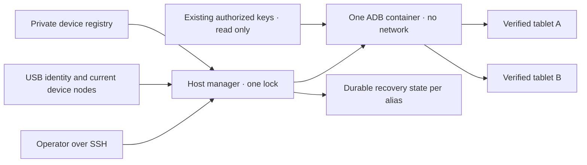

# Gedeelde Android-USB-beheerder

<!-- language-navigation:start -->
<p dir="ltr">
<a href="android-usb-manager.md" lang="en" dir="ltr">English</a> · <a href="android-usb-manager.ar.md" lang="ar" dir="rtl">العربية</a> · <a href="android-usb-manager.bn.md" lang="bn" dir="ltr">বাংলা</a> · <a href="android-usb-manager.cs.md" lang="cs" dir="ltr">Čeština</a> · <a href="android-usb-manager.de.md" lang="de" dir="ltr">Deutsch</a> · <a href="android-usb-manager.es.md" lang="es" dir="ltr">Español</a> · <a href="android-usb-manager.fa.md" lang="fa" dir="rtl">فارسی</a> · <a href="android-usb-manager.fr.md" lang="fr" dir="ltr">Français</a><br>
<a href="android-usb-manager.he.md" lang="he" dir="rtl">עברית</a> · <a href="android-usb-manager.hi.md" lang="hi" dir="ltr">हिन्दी</a> · <a href="android-usb-manager.id.md" lang="id" dir="ltr">Bahasa Indonesia</a> · <a href="android-usb-manager.it.md" lang="it" dir="ltr">Italiano</a> · <a href="android-usb-manager.ja.md" lang="ja" dir="ltr">日本語</a> · <a href="android-usb-manager.ko.md" lang="ko" dir="ltr">한국어</a> · <a href="android-usb-manager.nl.md" lang="nl" dir="ltr">Nederlands</a> · <a href="android-usb-manager.pl.md" lang="pl" dir="ltr">Polski</a><br>
<a href="android-usb-manager.pt.md" lang="pt" dir="ltr">Português</a> · <a href="android-usb-manager.ru.md" lang="ru" dir="ltr">Русский</a> · <a href="android-usb-manager.th.md" lang="th" dir="ltr">ไทย</a> · <a href="android-usb-manager.tr.md" lang="tr" dir="ltr">Türkçe</a> · <a href="android-usb-manager.uk.md" lang="uk" dir="ltr">Українська</a> · <a href="android-usb-manager.vi.md" lang="vi" dir="ltr">Tiếng Việt</a> · <a href="android-usb-manager.zh-Hans.md" lang="zh-Hans" dir="ltr">简体中文</a> · <a href="android-usb-manager.zh-Hant.md" lang="zh-Hant" dir="ltr">繁體中文</a>
</p>
<!-- language-navigation:end -->

De gedeelde beheerder vervangt ADB-containers per tablet door één ADB-server met een expliciet apparaatregister. Een hostdienst beheert USB-hotplug en herstelt op geselecteerde tablets OTT na een nieuwe Android-start. Normale weergave en het externe OTT-protocol blijven onafhankelijk werken.

## Het implementatiepakket ophalen

Download `ottplay-control-server-deployment.tar.gz` en `release-manifest.json` uit dezelfde [release](https://github.com/open-ott-play/ottplay-control-server/releases). Controleer de SHA-256 van het archief tegen de manifestvermelding en pak het uit in een nieuwe directory:

```sh
mkdir ott-android-release
tar -xzf ottplay-control-server-deployment.tar.gz -C ott-android-release
cd ott-android-release
python3 -B tools/android_usb_manager_remote.py --help
```

Het archief behoudt `tools/`, `deploy/` en `docs/`, inclusief alle zes hieronder genoemde gedeelde en oudere USB-scripts. Volg de hostindeling en inrichtingsstappen van deze handleiding; alleen uitpakken installeert geen dienst. Houd beheerder, supervisor en transactieadapter op dezelfde releaserevisie. Het transport-Dockerfile is een bouwrecept; het OCI-releasebestand van de control-server is niet het USB-transportimage.

Oudere implementatiearchieven, waaronder `v0.1.5-beta.6`, missen `tools/`. Gebruik daarvoor het bijbehorende bronarchief of een nieuwere release met het volledige pakket. Meng geen scripts van verschillende versies.

De implementatie bestaat uit:

- [`tools/android_usb_manager.py`](../tools/android_usb_manager.py): register, transportcontrole, containerafstemming en geserialiseerde opdrachten.
- [`tools/android_usb_supervisor.py`](../tools/android_usb_supervisor.py): bestaand beleid voor opstarten, schermvergrendeling en voorgrondherstel.
- [`tools/android_usb_manager_remote.py`](../tools/android_usb_manager_remote.py): SSH-opdrachtwrapper met behoud van binaire uitvoer.
- [`tools/android_usb_legacy_redirect.py`](../tools/android_usb_legacy_redirect.py): optionele doorverwijzing voor een al geïnstalleerd opdrachtpad per tablet.
- [`tools/android_usb_remote.py`](../tools/android_usb_remote.py): oudere SSH-wrapper voor bestaande aanroepers per tablet.
- [`tools/android_usb_transaction.py`](../tools/android_usb_transaction.py): atomaire bestandsoverdracht, APK-voorbereiding en CDP-bewerkingen voor vertrouwde onderhoudshulpmiddelen.
- [`deploy/android-usb-manager`](../deploy/android-usb-manager): voorbeeldconfiguratie, systemd-dienst, Synology-DSM-opstartscript en een [recept voor het transportimage](../deploy/android-usb-manager/README.md).




## Isolatie en identiteit

De container draait ADB op de voorgrond in plaats van een inactief `sleep`-proces met toevallig een ADB-daemon op de achtergrond. ADB luistert uitsluitend op de loopback van de container. De container gebruikt `--network none`, geen gepubliceerde poorten, een alleen-lezen rootbestandssysteem, verwijderde capabilities, no-new-privileges en een begrensde beschrijfbare `/tmp`. Hij heeft geen Docker-socket en geen brede mount van `/dev` of `/dev/bus/usb`. Het image moet met SHA-256 worden vastgezet.

De beheerder stelt 256 MiB containergeheugen, 256 MiB voor geheugen en swap samen en CPU-shares van 128 in. Gelijke geheugen-/swaplimieten staan geen extra swap toe. CPU-shares verlagen de relatieve prioriteit bij concurrentie zonder een harde CPU-quota. Er is geen harde PID-limiet omdat de doelkernel van DSM die controller niet ondersteunt. `/tmp` heeft een tmpfs-plafond van 256 MiB, wordt naar behoefte toegewezen en telt mee binnen dezelfde geheugenlimiet; het is geen extra geheugen. APK-voorbereiding accepteert hoogstens 128 MiB en schrijft in blokken van 1 MiB om geen tweede volledig APK in de Python-heap van de container te bewaren. Het verzoek aan hostzijde buffert zijn inhoud nog steeds.

Docker en de hostbeheerder bewaken het ADB-voorgrondproces. De container schakelt geërfde image-healthchecks expliciet uit: een controle van de heartbeat of configuratie van een andere beheerder beschrijft dit proces niet. Middelen en healthchecks horen bij de afstemming; afwijkingen vervangen de eigen container onder het beheerderslot.

De voorgrondopdracht is `adb -L tcp:5037 nodaemon server`. ADB 29 weigert een expliciete hostnaam in het luisterargument (`tcp:127.0.0.1:5037`); weglaten bindt loopback omdat `-a` niet actief is. De client houdt `ADB_SERVER_SOCKET=tcp:127.0.0.1:5037` expliciet. Deze compatibiliteitssyntaxis publiceert geen poort en activeert geen netwerk-ADB op tablets.

Alleen de actuele apparaatnodes die uniek passen bij ingeschakelde registervermeldingen worden met lees-/schrijfrechten gekoppeld. Synology-USB-nodes kunnen van root zijn met modus `0600`; daarom draait ADB als root binnen de beperkte container. Hostnodes worden niet voor iedereen beschrijfbaar gemaakt. De hostbeheerder heeft ook rootrechten nodig om nodes te inspecteren, Docker te beheren en privéstaat te bewaren. Containerisolatie maakt deze hostbevoegdheid niet onbevoorrecht.

Het register identificeert een apparaat via USB-serienummer en product, optioneel USB-leverancier-/product-ID's, en daarna Android-model, SDK en `android_id`. De beheerder vergelijkt het huidige USB-pad met de ADB-transportinventaris en voert opdrachten uit met het gecontroleerde unieke serienummer. ADB kan numerieke transport-ID's na een herstart hergebruiken; die worden daarom nooit voor opdrachtadressering gebruikt. Dubbele serienummers leiden tot weigering in plaats van willekeurige transportkeuze. Een afwijkend, ontbrekend, niet-geautoriseerd of dubbelzinnig apparaat mag geen opdracht ontvangen.

Ingeschakelde vermeldingen moeten unieke USB-serienummers hebben. Sommige goedkope tablets delen de tijdelijke waarde `0123456789ABCDEF`; verschillende modelnamen maken gelijktijdige registratie niet veilig. Houd conflicterende apparaten uitgeschakeld totdat een afzonderlijke beoordeelde strategie voor fysieke identiteit is ingevoerd. Geef hetzelfde serienummer geen andere naam en neem dan aan dat het een ander transport aanduidt.

Consolidatie geeft één ADB-proces toegang tot alle gekoppelde tablets. Een herstart of hotplug-afstemming kan bewerkingen op die tablets onderbreken. Opdrachten en afstemming gebruiken één hostslot, `/var/lib/ott-android-manager/manager.lock`, om concurrerende wijzigingen te voorkomen. Serverbrede en transportwijzigende opdrachten zoals `kill-server`, `tcpip`, `connect` en `root` worden via het algemene ADB-pad geweigerd.

## Privéconfiguratie en sleutels

Begin met [`config.example.json`](../deploy/android-usb-manager/config.example.json). De identiteiten en image-digest met uitsluitend nullen zijn opzettelijk fictief; beide voorbeeldapparaten staan uit. Het voorbeeld is geen uitvoerbare implementatie.

Gebruik de volgende hostindeling:

```text
/usr/local/etc/ott-android-manager/
  android_usb_manager.py
  android_usb_supervisor.py
  android_usb_transaction.py
  config.json
  ott-android-manager.service
  adb-keys/
    adbkey
    adbkey.pub
    vendor/
      additional-authorized.adb_key
/var/lib/ott-android-manager/
  manager.lock
  captures/
  <alias>/state.json
```

Beheerder, supervisor en transactieadapter moeten uit dezelfde beoordeelde revisie komen. Houd configuratie en sleutels buiten Git en releasearchieven. Geef privédirectory's `0700`, configuratie en privésleutels `0600`, en maak root eigenaar van bron- en dienstbestanden. De sleuteldirectory wordt alleen-lezen gemount. `adbkey` en `adbkey.pub` moeten al bestaan; `vendor/` moet bestaan, ook als die leeg is. Extra al geautoriseerde privésleutels kunnen in `vendor/`, aangeleverd via `ADB_VENDOR_KEYS`. Noem ieder privébestand `<source>.adb_key`: ADB 29 negeert andere bestandsnamen stil bij het doorzoeken. Een bijbehorend `<source>.adb_key.pub` is optioneel. De beheerder weigert onbekende namen voordat de container wordt gewijzigd.

Bewaar bestaande geautoriseerde sleutels voordat u containers buiten gebruik stelt. Vergelijk publieke sleutelvingerafdrukken om duplicaten te vinden; druk geen privésleutels af. Vervang bestaande sleutels niet door nieuwe alleen om containers samen te voegen: dat kan bevestiging vereisen op losgekoppelde tablets.

Elk ingeschakeld apparaat vereist een volledige identiteit die bij begeleide inrichting is vastgelegd. Een OTT-apparaat-UUID, MAC-adres of geschatte waarde bewijst geen Android-`android_id`. Ontbreekt dat veld in het bewijs, houd dan `"enabled": false`; uitgeschakelde vermeldingen mogen onvolledige beschrijvende metadata bevatten en worden nooit gekoppeld of bestuurd.

`recover_on_boot` is afzonderlijk beleid. Laat dit false voor een tablet die alleen onderhoudsopdrachten moet aanbieden. Bij inschakeling moet `package` de toepassing zijn waarvan het voorgrondstarten daadwerkelijk op dit apparaat is getest.

## Wat automatisch herstel doet

Het standaardinterval is vijf seconden na iedere afgeronde ronde, geen garantie op volledig herstel binnen vijf seconden. Trage USB-bewerkingen verlengen het interval. De standaardopdrachttime-out is 60 seconden en er zijn maximaal drie herstelpogingen per Android-start.

Bij de eerste waarneming registreert de beheerder de huidige start zonder de tablet te wekken of ontgrendelen. Bij een latere nieuwe start met herstel ingeschakeld:

1. Wacht hij op `sys.boot_completed=1` en controleert hij de identiteit.
2. Vereist hij expliciet bewijs dat de schermvergrendeling niet met PIN, wachtwoord of patroon is beveiligd.
3. Wekt hij het scherm en verwijdert zo nodig een gewone veegvergrendeling.
4. Start hij het ingestelde pakket en controleert de hervatte/gefocusseerde activiteit.
5. Controleert hij start en vergrendeling opnieuw en bewaart pas daarna een geslaagd controlepunt.

Onbekende of beveiligde vergrendeling stopt het herstel. De oudere Fire-implementatie vereist de met shellrechten beveiligde test beschreven in [USB-herstel](android-usb-recovery.md#read-only-keyguard-probe-on-older-firmware).

Een al afgeronde start retourneert `same_boot_no_action`. Gewoon scherm-uit wekt niets. Deze beheerder bewaakt geen videodecodering, herstart geen vastgelopen stream en dwingt niet voortdurend de voorgrond af. Dat zijn andere beleidsregels van de speler of een afzonderlijk beoordeelde watchdog.

## Opdrachten

Op de USB-host:

```sh
sudo -n /usr/bin/python3 -B /usr/local/etc/ott-android-manager/android_usb_manager.py \
  --config /usr/local/etc/ott-android-manager/config.json status
```

Vanaf een andere computer met een bestaande SSH-hostalias:

```sh
python3 tools/android_usb_manager_remote.py --host tablet-host status
python3 tools/android_usb_manager_remote.py --host tablet-host status lobby
python3 tools/android_usb_manager_remote.py --host tablet-host wake lobby
python3 tools/android_usb_manager_remote.py --host tablet-host recover lobby
python3 tools/android_usb_manager_remote.py --host tablet-host reboot lobby
python3 tools/android_usb_manager_remote.py --host tablet-host swipe lobby 400 600 400 100 --duration 500
python3 tools/android_usb_manager_remote.py --host tablet-host screenshot lobby lobby-check.png
python3 tools/android_usb_manager_remote.py --host tablet-host adb lobby -- shell getprop ro.product.model
python3 tools/android_usb_manager_remote.py --host tablet-host adb lobby -- exec-out screencap -p > lobby.png
```

`status` inspecteert zonder de container te maken, herstarten of herconfigureren. `tick` voert één afstemmings-/herstelronde uit en kan apparaatstatus wijzigen; `run` herhaalt die rondes en is voor de dienst bedoeld.

De wrapper gebruikt SSH zonder PTY, citeert elk argument voor de shell, geeft de procesexitstatus door en zet ADB-uitvoer niet om in JSON. Controleer de exitstatus voordat u een omgeleide schermafbeelding geldig acht. `screenshot` accepteert alleen een eenvoudige PNG-bestandsnaam zoals `lobby-check.png` en slaat op onder `<state_dir>/captures/` op de USB-host. De naam moet voldoen aan `[A-Za-z0-9][A-Za-z0-9_-]{0,119}\.png`; paden, extra punten en impliciete extensies worden geweigerd. Het valideert PNG en maakt een nieuw bestand uitsluitend voor de eigenaar; symlinks en bestaande namen worden vóór de opname geweigerd. Het voorbeeld `adb ... exec-out` streamt juist bytes naar de computer van de bediener. `swipe` gebruikt de actuele schermgeometrie en weigert beveiligde of onbekende vergrendeling; de coördinaten zijn voorbeelden, geen universeel ontgrendelgebaar. ADB-bestandspaden verwijzen naar container-/apparaatnaamruimten: de wrapper uploadt niet automatisch een APK van uw laptop. Voorbereiding en daaropvolgende installatie moeten de hieronder beschreven atomaire transactieadapter gebruiken.

`adb <alias> -- <arguments>` is een beheerdersinterface voor onderhoud, geen beperkte publieke API. Een toegestane `shell`-opdracht kan de tablet wijzigen. Gebruik identiteitscontrole en slot; bied geen onbeperkte SSH- of Docker-toegang aan via een webendpoint.

## Opstartdienst en migratie

De [systemd-sjabloon](../deploy/android-usb-manager/ott-android-manager.service) draait de beheerder continu en herstart een beëindigd proces na tien seconden. De [DSM-wrapper](../deploy/android-usb-manager/S99ott-android-manager.sh) controleert bestanden, installeert/activeert de unit en start die. Starten wordt geweigerd zolang de oude `ott-k8a-recovery.service` actief of ingeschakeld is. Pas op andere distributies Docker-afhankelijkheid en paden aan de dienstbeheerder aan.

Voer een gecontroleerde overdracht uit:

1. Leg containerconfiguratie, vingerafdrukken van geautoriseerde sleutels en herstelstatus vast. Maak back-ups van privébestanden met toegang alleen voor de eigenaar.
2. Installeer nieuwe bron, beoordeeld image, sleutels en register. Houd nog niet ingerichte apparaten uitgeschakeld. Start geen tweede supervisor voor dezelfde tablet.
3. Stop en deactiveer de oude hosthersteldienst en neem de DSM-opstartwrapper buiten gebruik. Bewaar bestanden om terug te kunnen. Alleen de dienst stoppen verwijdert de ADB-container niet.
4. Kopieer het gevalideerde oude controlepunt naar het juiste nieuwe `<alias>/state.json`. Behoud de startidentiteit; wis de status niet als gewone migratiesnelweg.
5. Stop oude ADB-containers voordat de gedeelde server start, zodat geen twee servers dezelfde USB-interface opeisen.
6. Installeer de nieuwe DSM-wrapper als uitvoerbaar bestand van root onder `/usr/local/etc/rc.d/`, voer `start` uit en inspecteer dienst/status.
7. Migreer aanroepers, controleer gewone opdrachten en behouden herstelbeleid, en verwijder daarna alleen oude containers waarvan alle afhankelijkheden zijn uitgefaseerd.

Oudere helpers verbergen vaak afhankelijkheden achter onschuldige namen. Controleer `bootstrap.py`, `reconnect.py`, CDP-adapters en shellaliassen. Bootstrap kan sleutels uit een oude container kopiëren. Een reconnect-script kan `OLD` instellen via een geïmporteerde helper en later stoppen of verwijderen; verandert u daar alleen de naam in de gedeelde naam, dan kan het de gedeelde server onbedoeld stoppen. Verwijder automatisch containerbeheer uit clients in plaats van alleen namen te wijzigen.

Leid echte ADB-opdrachten per alias door de beheerder. Een compatibiliteitsadapter die `docker exec` nodig heeft voor bestandsvoorbereiding of een lokale CDP-client moet hetzelfde hostslot voor de volledige transactie vasthouden. Start binnen het vergrendelde gedeelte geen tweede proces dat dat slot verkrijgt; gebruik een compatibel pad binnen het proces of organiseer de transactie eenmaal. Wijs tijdelijke doorstuurpoorten toe en verwijder ze na gebruik.

Installeer `android_usb_transaction.py` naast beheerder en supervisor. Het accepteert één JSON-verzoek via standaardinvoer, met `--config` naar hetzelfde privéregister, en retourneert ruwe bewerkingsuitvoer via standaarduitvoer. Ondersteunde verzoeken:

- `pull`: `alias` en een absoluut `device_path`; retourneert de bytes van één regulier bestand tot 128 MiB. Directory's en apparaatbestanden worden geweigerd. Een harde groottebeperking van het doelbestand stopt ook een bron die tijdens overdracht groeit.
- `staged_adb`: `alias`, base64-`data` en `arguments`, bijvoorbeeld `["install", "-r", "@staged"]` of `["push", "@staged", "/sdcard/example.json"]`.
- `cdp`: `alias`, toepassings-`package`, optioneel `expected_model`, vertrouwde Python-client-`source` met `__OTT_CDP_PORT__`, en diens JSON-`request`.

Elk verzoek controleert het apparaat en houdt één beheerderslot vast gedurende voorbereiding, gebruik en opruimen. Bestanden krijgen unieke tijdelijke namen; ze worden exclusief met modus `0600` gereserveerd voordat opruimen wordt ingeschakeld. APK-installaties behouden het door ADB's pakketargumentparser vereiste achtervoegsel `.apk`. Een naamconflict laat het bestaande bestand ongemoeid. De schrijver opent alleen zijn lege reguliere reservering en volgt geen symlinks. Aanvullende Docker-opdrachten richten zich op de waargenomen container-ID. CDP vindt precies één toepassingsproces en debugsocket, reserveert `tcp:0`, vervangt de toegewezen poort in de clientbron en verwijdert bij afronding of fout alleen die doorsturing. Afstemming kan de server tussen die stappen niet herstarten.

De gemigreerde a1-helper houdt `copy_in`-gegevens in threadlokaal geheugen tot de volgende `adb install` of `adb push` in hetzelfde proces. Dat paar vormt één hosttransactie; alleen `copy_in` maakt geen gedeeld containerbestand meer. Home Plan en speler-CDP-helpers gebruiken hetzelfde mechanisme. Verzoeken kunnen privétoepassingsgegevens en vertrouwde uitvoerbare code bevatten: stuur ze uitsluitend over het bestaande beheerders-SSH-kanaal, bied de adapter nooit publiek aan en log geen payloads.

ADB-doorstuurpoorten horen bij de gedeelde server, niet bij een individuele tablet. Gebruik dynamische CDP-poorten of verschillende poorten per alias voor handmatige sessies. De beheerder dwingt `--no-rebind` af bij aanmaak, staat hergebruik van identieke koppelingen toe en weigert het overschrijven of verwijderen van koppelingen van andere aliassen. `forward --list` is gefilterd op de gekozen alias; `forward --remove-all` wordt geweigerd.

Na back-up van het oude script kan de optionele legacy-doorverwijzing worden geïnstalleerd op `/usr/local/etc/ott-k8a-recovery/android_usb_supervisor.py` om bestaande handmatige ingangen te behouden. Ze accepteert alleen het bekende oude configuratiepad, vereist exacte overeenkomst van serienummer/model/SDK/Android-ID met één ingeschakelde nieuwe registervermelding en vervangt haar proces door de nieuwe beheerder. Ze importeert of draait de oude supervisor niet. `run` wordt expliciet geweigerd: oude dienst en opstartwrapper moeten uitgeschakeld/buiten gebruik blijven, ook met handmatige compatibiliteit.

Om terug te gaan stopt en deactiveert u de nieuwe hostdienst, neemt de opstartwrapper buiten gebruik en stopt de container. Herstel oude sleutel-/statuskopieën en de oude dienst. Controleer voor hervatting dat elk USB-apparaat precies één beheerder heeft.

## Release-spelers zonder CDP

Een productie-APK kan WebView-debugging bewust uitschakelen. Dan meldt de adapter `Application debugging socket is unavailable`; een werkende ADB-verbinding maakt die socket niet. De beheerder activeert geen debugging, wijzigt geen spelerinstellingen en vervangt geen APK.

Gebruik voor een speler die al met de OTT-controller verbonden is diens ondersteunde alleen-lezen diagnose. Vervang `lobby` door de ingestelde OTT-alias:

```sh
ott -t 20 lobby debug -j
ott -t 20 lobby inspect -j
```

De opdrachten retourneren waarnemingen van de speler, inclusief beschikbare runtime- en mediastatus. Ze geven geen willekeurige JavaScript-evaluatie, directe DOM-inspectie of CDP-verbinding. Beide zijn geverifieerd op de verbonden API-22-release-speler zonder CDP-socket; beschikbaarheid elders hangt van de ondersteunde mogelijkheden af.

## Acceptatie en beperkingen

Leg resultaten vast bij de werkelijk geïnstalleerde bron, image en hardware. Bij aanvang van deze consolidatie had alleen **k8a** fysiek bewijs voor het oudere herstelbeleid. De oude supervisor herstelde na een echte tabletherstart en liet gewone slaap ongemoeid; dat bewijst geen acceptatie van de nieuwe gedeelde implementatie. Andere opgeslagen tabletidentiteiten waren onvolledig en moeten uitgeschakeld blijven tot begeleide validatie.

Vereiste acceptatie van de gedeelde beheerder:

- Een bestaande geautoriseerde USB-identiteit verschijnt via de gedeelde server.
- Onbekende, ontbrekende, dubbele en uitgeschakelde apparaten krijgen geen actie.
- Een alleen-lezen opdracht en binaire schermafbeelding gebruiken het bedoelde transport.
- Herstel na een nieuwe start slaagt op een apparaat met dat beleid ingeschakeld.
- Normaal scherm-uit blijft slapen.
- USB-herenumeratie herstelt alleen de verwachte apparaatkoppeling.
- Herstart van de hostdienst bewaart status en voorkomt dubbel herstel.
- Een echte hostherstart herstelt dienst en eigendomsverdeling.
- Elke gemigreerde lokale helper werkt zonder oude containers opnieuw te maken.

Vermeld niet uitgevoerde controles expliciet. Een draaiende dienst of geslaagde voorgrondstart bewijst geen streamweergave, compatibiliteit van alle tablets of onbeheerd herstel na een NAS-herstart.
