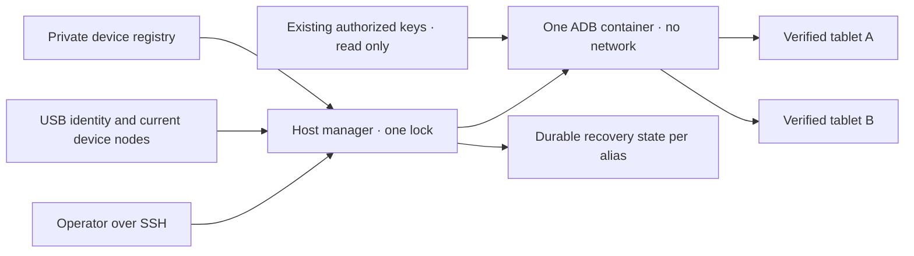

# Współdzielony menedżer Android USB

<!-- language-navigation:start -->
<p dir="ltr">
<a href="android-usb-manager.md" lang="en" dir="ltr">English</a> · <a href="android-usb-manager.ar.md" lang="ar" dir="rtl">العربية</a> · <a href="android-usb-manager.bn.md" lang="bn" dir="ltr">বাংলা</a> · <a href="android-usb-manager.cs.md" lang="cs" dir="ltr">Čeština</a> · <a href="android-usb-manager.de.md" lang="de" dir="ltr">Deutsch</a> · <a href="android-usb-manager.es.md" lang="es" dir="ltr">Español</a> · <a href="android-usb-manager.fa.md" lang="fa" dir="rtl">فارسی</a> · <a href="android-usb-manager.fr.md" lang="fr" dir="ltr">Français</a><br>
<a href="android-usb-manager.he.md" lang="he" dir="rtl">עברית</a> · <a href="android-usb-manager.hi.md" lang="hi" dir="ltr">हिन्दी</a> · <a href="android-usb-manager.id.md" lang="id" dir="ltr">Bahasa Indonesia</a> · <a href="android-usb-manager.it.md" lang="it" dir="ltr">Italiano</a> · <a href="android-usb-manager.ja.md" lang="ja" dir="ltr">日本語</a> · <a href="android-usb-manager.ko.md" lang="ko" dir="ltr">한국어</a> · <a href="android-usb-manager.nl.md" lang="nl" dir="ltr">Nederlands</a> · <a href="android-usb-manager.pl.md" lang="pl" dir="ltr">Polski</a><br>
<a href="android-usb-manager.pt.md" lang="pt" dir="ltr">Português</a> · <a href="android-usb-manager.ru.md" lang="ru" dir="ltr">Русский</a> · <a href="android-usb-manager.th.md" lang="th" dir="ltr">ไทย</a> · <a href="android-usb-manager.tr.md" lang="tr" dir="ltr">Türkçe</a> · <a href="android-usb-manager.uk.md" lang="uk" dir="ltr">Українська</a> · <a href="android-usb-manager.vi.md" lang="vi" dir="ltr">Tiếng Việt</a> · <a href="android-usb-manager.zh-Hans.md" lang="zh-Hans" dir="ltr">简体中文</a> · <a href="android-usb-manager.zh-Hant.md" lang="zh-Hant" dir="ltr">繁體中文</a>
</p>
<!-- language-navigation:end -->

Współdzielony menedżer zastępuje kontenery ADB poszczególnych tabletów jednym serwerem ADB i jawnym rejestrem urządzeń. Usługa hosta zarządza podłączaniem USB i dla wybranych tabletów przywraca OTT po nowym uruchomieniu Androida. Zwykłe odtwarzanie i zdalny protokół OTT działają nadal niezależnie.

## Pobranie pakietu wdrożeniowego

Pobierz `ottplay-control-server-deployment.tar.gz` i `release-manifest.json` z tego samego [wydania](https://github.com/open-ott-play/ottplay-control-server/releases). Sprawdź SHA-256 archiwum względem wpisu manifestu i rozpakuj do nowego katalogu:

```sh
mkdir ott-android-release
tar -xzf ottplay-control-server-deployment.tar.gz -C ott-android-release
cd ott-android-release
python3 -B tools/android_usb_manager_remote.py --help
```

Archiwum zachowuje `tools/`, `deploy/` i `docs/`, w tym wszystkie sześć wymienionych niżej wspólnych i starszych skryptów USB. Wykonaj opisane tu rozmieszczenie plików i przygotowanie hosta; samo rozpakowanie nie instaluje usługi. Menedżer, supervisor i adapter transakcji muszą pochodzić z tej samej rewizji wydania. Transportowy Dockerfile jest przepisem budowy; artefakt OCI control-servera nie jest obrazem transportu USB.

Starsze archiwa wdrożeniowe, w tym `v0.1.5-beta.6`, pomijają `tools/`. Użyj dla nich odpowiadającego archiwum źródeł lub nowszego wydania z pełnym pakietem. Nie mieszaj skryptów różnych wersji.

Implementacja składa się z:

- [`tools/android_usb_manager.py`](../tools/android_usb_manager.py): rejestr, weryfikacja transportu, uzgadnianie kontenerów i serializowane polecenia.
- [`tools/android_usb_supervisor.py`](../tools/android_usb_supervisor.py): dotychczasowa polityka rozruchu, blokady ekranu i odzyskiwania pierwszego planu.
- [`tools/android_usb_manager_remote.py`](../tools/android_usb_manager_remote.py): wrapper SSH zachowujący wyjście binarne.
- [`tools/android_usb_legacy_redirect.py`](../tools/android_usb_legacy_redirect.py): opcjonalne przekierowanie zainstalowanej już ścieżki poleceń pojedynczego tabletu.
- [`tools/android_usb_remote.py`](../tools/android_usb_remote.py): starszy wrapper SSH zachowany dla istniejących klientów tabletów.
- [`tools/android_usb_transaction.py`](../tools/android_usb_transaction.py): atomowy transfer plików, przygotowanie APK i operacje CDP dla zaufanych narzędzi utrzymaniowych.
- [`deploy/android-usb-manager`](../deploy/android-usb-manager): przykładowa konfiguracja, usługa systemd, skrypt startowy Synology DSM i [przepis obrazu transportowego](../deploy/android-usb-manager/README.md).




## Izolacja i tożsamość

Kontener uruchamia ADB na pierwszym planie zamiast bezczynnego procesu `sleep` z demonem ADB działającym w tle. ADB nasłuchuje wyłącznie na loopbacku kontenera. Kontener używa `--network none`, nie publikuje portów, ma główny system plików tylko do odczytu, usunięte wszystkie capabilities, no-new-privileges i ograniczony zapisywalny `/tmp`. Nie ma socketu Docker ani szerokiego montowania `/dev` czy `/dev/bus/usb`. Obraz musi być przypięty przez SHA-256.

Menedżer narzuca 256 MiB pamięci kontenera, 256 MiB łącznie pamięci i swapu oraz CPU shares 128. Równe limity pamięci/swapu nie pozwalają na dodatkowy swap. CPU shares obniża względny priorytet przy konkurencji bez sztywnej kwoty CPU. Brak sztywnego limitu PID, ponieważ docelowe jądro DSM nie obsługuje tego kontrolera. `/tmp` ma pułap tmpfs 256 MiB, przydzielany według potrzeb i rozliczany w tym samym limicie pamięci, nie dodatkowo. Przygotowanie APK przyjmuje najwyżej 128 MiB i zapisuje bloki po 1 MiB, aby nie trzymać drugiego pełnego APK w stercie Pythona kontenera. Żądanie po stronie hosta nadal buforuje zawartość.

Docker i menedżer hosta nadzorują proces ADB na pierwszym planie. Kontener jawnie wyłącza kontrole zdrowia odziedziczone z obrazu: test heartbeat lub konfiguracji innego menedżera nie opisuje tego procesu. Ustawienia zasobów i kontroli należą do uzgadniania; rozbieżność powoduje wymianę własnego kontenera pod blokadą menedżera.

Polecenie pierwszoplanowe to `adb -L tcp:5037 nodaemon server`. ADB 29 odrzuca jawną nazwę hosta w argumencie nasłuchu (`tcp:127.0.0.1:5037`); jej pominięcie wiąże loopback, bo `-a` nie jest włączone. Klient zachowuje jawne `ADB_SERVER_SOCKET=tcp:127.0.0.1:5037`. Ta składnia zgodności nie publikuje portu ani nie włącza sieciowego ADB na tabletach.

Mapowane są tylko bieżące węzły jednoznacznie odpowiadające włączonym wpisom, z prawami odczytu/zapisu. Węzły USB Synology mogą należeć do root i mieć tryb `0600`, więc ADB działa jako root wewnątrz ograniczonego kontenera. Węzły hosta nie stają się zapisywalne dla wszystkich. Menedżer hosta także potrzebuje uprawnień root do badania węzłów, obsługi Dockera i zachowania prywatnego stanu. Izolacja kontenera nie usuwa tych uprawnień hosta.

Rejestr identyfikuje urządzenie przez numer seryjny USB i produkt, opcjonalnie identyfikatory USB producenta/produktu, potem model Androida, SDK i `android_id`. Menedżer porównuje bieżącą ścieżkę USB z inwentarzem transportów ADB i wysyła polecenia przy użyciu zweryfikowanego unikatowego numeru. ADB może ponownie użyć numerycznych identyfikatorów transportu po restarcie, więc nigdy nie służą one adresowaniu poleceń. Duplikaty numerów wywołują odmowę zamiast arbitralnego wyboru. Niezgodne, nieobecne, nieautoryzowane lub niejednoznaczne urządzenie nie może dostać polecenia.

Włączone wpisy wymagają unikatowych numerów USB. Niektóre tanie tablety dzielą zastępczy `0123456789ABCDEF`; różne nazwy modeli nie czynią jednoczesnej rejestracji bezpieczną. Pozostaw urządzenia konfliktowe wyłączone do wdrożenia osobnej, sprawdzonej strategii fizycznej identyfikacji. Zmiana etykiety tego samego numeru nie oznacza innego transportu.

Konsolidacja daje jednemu procesowi ADB dostęp do wszystkich mapowanych tabletów. Restart lub uzgadnianie hotplug mogą przerywać ich operacje. Polecenia i uzgadnianie używają wspólnej blokady hosta `/var/lib/ott-android-manager/manager.lock`, zapobiegając konkurencyjnym zmianom. Ogólna ścieżka ADB odrzuca polecenia globalne i zmieniające transport, takie jak `kill-server`, `tcpip`, `connect` i `root`.

## Prywatna konfiguracja i klucze

Zacznij od [`config.example.json`](../deploy/android-usb-manager/config.example.json). Tożsamości i digest obrazu z samych zer są celowo fikcyjne; oba przykładowe urządzenia wyłączono. Przykład nie jest uruchamialnym wdrożeniem.

Użyj następującego układu hosta:

```text
/usr/local/etc/ott-android-manager/
  android_usb_manager.py
  android_usb_supervisor.py
  android_usb_transaction.py
  config.json
  ott-android-manager.service
  adb-keys/
    adbkey
    adbkey.pub
    vendor/
      additional-authorized.adb_key
/var/lib/ott-android-manager/
  manager.lock
  captures/
  <alias>/state.json
```

Menedżer, supervisor i adapter transakcji muszą pochodzić z tej samej sprawdzonej rewizji. Trzymaj konfigurację i klucze poza Git i archiwami wydań. Prywatnym katalogom nadaj `0700`, konfiguracji i prywatnym kluczom `0600`; właścicielem źródeł i plików usługi powinien być root. Katalog kluczy montowany jest tylko do odczytu. `adbkey` i `adbkey.pub` muszą już istnieć; `vendor/` musi istnieć nawet pusty. Dodatkowe wcześniej autoryzowane klucze prywatne można umieścić w `vendor/`, przekazywanym przez `ADB_VENDOR_KEYS`. Nazwij każdy prywatny plik `<source>.adb_key`: ADB 29 po cichu pomija inne nazwy podczas skanowania. Towarzyszący `<source>.adb_key.pub` jest opcjonalny. Menedżer odrzuca nieznane nazwy przed zmianą kontenera.

Zachowaj istniejące autoryzowane klucze przed wycofaniem kontenera. Duplikaty rozpoznawaj przez odciski kluczy publicznych; nie wypisuj prywatnych. Nie zastępuj klucza nowym jedynie dla konsolidacji: może to wymagać potwierdzenia na odłączonych tabletach.

Każde włączone urządzenie musi mieć pełną tożsamość zapisaną podczas nadzorowanego przygotowania. UUID OTT, MAC lub zgadywana wartość nie dowodzą Android `android_id`. Jeśli brak tego pola w protokole, zachowaj `"enabled": false`; wyłączone wpisy mogą mieć niepełne metadane opisowe i nigdy nie są mapowane ani sterowane.

`recover_on_boot` stanowi niezależną politykę. Pozostaw false dla tabletu udostępniającego wyłącznie utrzymanie. Po włączeniu `package` musi wskazywać aplikację, której start na pierwszym planie rzeczywiście sprawdzono na tym urządzeniu.

## Działanie automatycznej naprawy

Domyślny interwał wynosi pięć sekund po każdym zakończonym przebiegu, nie gwarantuje całego odzyskania w pięć sekund. Powolne operacje USB go wydłużają. Domyślny timeout polecenia to 60 sekund, a limit wynosi trzy próby na uruchomienie Androida.

Przy pierwszej obserwacji menedżer zapisuje bieżący rozruch bez budzenia lub odblokowywania tabletu. Przy kolejnym nowym rozruchu i włączonym odzyskiwaniu:

1. Czeka na `sys.boot_completed=1` i sprawdza tożsamość.
2. Wymaga jednoznacznego dowodu, że blokada nie jest chroniona PIN-em, hasłem ani wzorem.
3. Budzi ekran i w razie potrzeby usuwa zwykłą blokadę przesunięciem.
4. Uruchamia skonfigurowany pakiet i sprawdza wznowioną/aktywną activity.
5. Ponownie sprawdza rozruch i blokadę, a dopiero potem zapisuje pomyślny checkpoint.

Nieznana lub zabezpieczona blokada zatrzymuje odzyskiwanie. Starsze wdrożenie Fire wymaga sondy chronionej uprawnieniem shell opisanej w [odzyskiwaniu USB](android-usb-recovery.md#read-only-keyguard-probe-on-older-firmware).

Obsłużony rozruch zwraca `same_boot_no_action`. Zwykłe wygaszenie ekranu nie wywołuje budzenia. Menedżer nie monitoruje dekodowania wideo, nie restartuje zawieszonego strumienia ani nie wymusza stale pierwszego planu. To osobne polityki odtwarzacza lub oddzielnie sprawdzonego watchdoga.

## Polecenia

Na hoście USB:

```sh
sudo -n /usr/bin/python3 -B /usr/local/etc/ott-android-manager/android_usb_manager.py \
  --config /usr/local/etc/ott-android-manager/config.json status
```

Z innego komputera przy użyciu istniejącego aliasu SSH:

```sh
python3 tools/android_usb_manager_remote.py --host tablet-host status
python3 tools/android_usb_manager_remote.py --host tablet-host status lobby
python3 tools/android_usb_manager_remote.py --host tablet-host wake lobby
python3 tools/android_usb_manager_remote.py --host tablet-host recover lobby
python3 tools/android_usb_manager_remote.py --host tablet-host reboot lobby
python3 tools/android_usb_manager_remote.py --host tablet-host swipe lobby 400 600 400 100 --duration 500
python3 tools/android_usb_manager_remote.py --host tablet-host screenshot lobby lobby-check.png
python3 tools/android_usb_manager_remote.py --host tablet-host adb lobby -- shell getprop ro.product.model
python3 tools/android_usb_manager_remote.py --host tablet-host adb lobby -- exec-out screencap -p > lobby.png
```

`status` bada bez tworzenia, restartowania lub rekonfigurowania kontenera. `tick` wykonuje jeden przebieg uzgadniania/odzyskiwania i może zmienić stan urządzenia; `run` powtarza przebiegi i służy usłudze.

Wrapper używa SSH bez PTY, cytuje osobno argumenty dla powłoki, przekazuje kod wyjścia i nie zamienia wyjścia ADB na JSON. Sprawdź kod wyjścia przed uznaniem przekierowanego zrzutu za poprawny. `screenshot` akceptuje tylko prostą nazwę PNG, np. `lobby-check.png`, i zapisuje ją w `<state_dir>/captures/` na hoście USB. Nazwa musi pasować do `[A-Za-z0-9][A-Za-z0-9_-]{0,119}\.png`; ścieżki, dodatkowe kropki i domyślne rozszerzenia są niedozwolone. Sprawdza PNG i tworzy nowy plik tylko dla właściciela, odrzucając symlinki i istniejące nazwy przed przechwyceniem. Natomiast `adb ... exec-out` przesyła bajty do pliku na komputerze operatora. `swipe` używa aktualnej geometrii i odrzuca zabezpieczoną lub nieznaną blokadę; współrzędne to przykład, nie uniwersalny gest. Ścieżki ADB dotyczą przestrzeni kontenera/urządzenia: wrapper nie wysyła automatycznie APK z laptopa. Przygotowanie i późniejsza instalacja muszą używać opisanego niżej adaptera atomowego.

`adb <alias> -- <arguments>` to administracyjny interfejs utrzymania, nie ograniczone publiczne API. Dozwolone polecenie `shell` może zmieniać tablet. Używaj kontroli tożsamości i blokady; nie udostępniaj nieograniczonego SSH lub Dockera przez endpoint WWW.

## Usługa startowa i migracja

[Szablon systemd](../deploy/android-usb-manager/ott-android-manager.service) uruchamia menedżera stale i ponawia zakończony proces po dziesięciu sekundach. [Wrapper DSM](../deploy/android-usb-manager/S99ott-android-manager.sh) sprawdza pliki, instaluje/włącza jednostkę i ją uruchamia. Odmawia startu, jeśli starszy `ott-k8a-recovery.service` jest aktywny lub włączony. W innych dystrybucjach dostosuj zależność Docker i ścieżki do menedżera usług.

Przeprowadź kontrolowane przekazanie:

1. Zapisz konfigurację kontenerów, odciski autoryzowanych kluczy i stan odzyskiwania. Zrób prywatne kopie dostępne tylko właścicielowi.
2. Zainstaluj nowe źródła, sprawdzony obraz, klucze i rejestr. Nieprzygotowane urządzenia pozostaw wyłączone. Nie uruchamiaj drugiego supervisora tego samego tabletu.
3. Zatrzymaj i wyłącz starą usługę odzyskiwania oraz wycofaj jej wrapper DSM. Zachowaj pliki do cofnięcia zmian. Samo zatrzymanie usługi nie usuwa jej kontenera ADB.
4. Skopiuj zweryfikowany stary checkpoint do odpowiadającego nowego `<alias>/state.json`. Zachowaj tożsamość rozruchu; nie zeruj stanu jako zwykłego skrótu migracyjnego.
5. Zatrzymaj stare kontenery ADB przed wspólnym serwerem, by dwa serwery nie konkurowały o ten sam interfejs USB.
6. Zainstaluj nowy wykonywalny wrapper DSM należący do root w `/usr/local/etc/rc.d/`, uruchom `start` i zbadaj usługę/stan.
7. Przenieś klientów, sprawdź zwykłe polecenia i zachowaną politykę, potem usuń tylko stare kontenery, których zależności wycofano.

Starsze narzędzia często ukrywają zależności pod niewinną nazwą. Zbadaj `bootstrap.py`, `reconnect.py`, adaptery CDP i aliasy powłoki. Bootstrap może kopiować klucze ze starego kontenera. Reconnect może ustawić `OLD` z importowanego modułu, a potem go zatrzymać lub usunąć; zamiana w nim nazwy na współdzieloną może niechcący zatrzymać wspólny serwer. Usuń automatyczne zarządzanie kontenerami z klientów zamiast zmieniać samą nazwę.

Kieruj rzeczywiste polecenia ADB przez menedżera według aliasu. Adapter zgodności wymagający `docker exec` do przygotowania plików lub lokalnego klienta CDP musi utrzymywać wspólną blokadę przez całą transakcję. Nie zagnieżdżaj drugiego procesu zdobywającego tę blokadę w zablokowanej sekcji; użyj zgodnej ścieżki wewnątrz procesu lub zorganizuj transakcję raz. Przydzielaj tymczasowe porty przekierowania i usuwaj po użyciu.

Zainstaluj `android_usb_transaction.py` obok menedżera i supervisora. Przyjmuje jedno żądanie JSON na standardowym wejściu, z `--config` wskazującym ten sam prywatny rejestr, i zwraca surowe wyjście operacji. Obsługuje:

- `pull`: `alias` i bezwzględny `device_path`; zwraca bajty jednego zwykłego pliku do 128 MiB. Odrzuca katalogi i pliki urządzeń. Twardy limit wielkości pliku docelowego zatrzymuje także źródło rosnące podczas transferu.
- `staged_adb`: `alias`, base64 `data` i `arguments`, np. `["install", "-r", "@staged"]` lub `["push", "@staged", "/sdcard/example.json"]`.
- `cdp`: `alias`, `package` aplikacji, opcjonalne `expected_model`, zaufany klient Python w `source` zawierający `__OTT_CDP_PORT__` oraz jego JSON `request`.

Każde żądanie sprawdza urządzenie i utrzymuje jedną blokadę podczas przygotowania, użycia i sprzątania. Operacje plikowe używają unikatowych nazw tymczasowych; pliki rezerwuje się wyłącznie z trybem `0600` przed uzbrojeniem sprzątania. Instalacje APK zachowują rozszerzenie `.apk` wymagane parserem argumentu pakietu ADB. Kolizja pozostawia istniejący plik nietknięty. Zapis otwiera tylko własną pustą rezerwację zwykłego pliku, nie śledząc symlinków. Pomocnicze polecenia Docker używają zaobserwowanego ID kontenera. CDP ustala dokładnie jeden proces aplikacji i jego socket debugowania, przydziela `tcp:0`, wstawia port do źródeł klienta i usuwa tylko to przekierowanie po sukcesie lub błędzie. Uzgadnianie nie może zrestartować serwera między krokami.

Przeniesiony adapter a1 przechowuje dane `copy_in` w pamięci lokalnej wątku do następnego `adb install` lub `adb push` w tym samym procesie. Para staje się jedną transakcją hosta; samo `copy_in` nie tworzy już wspólnego pliku kontenera. Home Plan i narzędzia CDP odtwarzacza używają tego samego mechanizmu. Żądania mogą zawierać prywatne dane aplikacji i zaufany kod wykonywalny: wysyłaj wyłącznie istniejącym administracyjnym kanałem SSH; nie wystawiaj adaptera publicznie ani nie loguj treści.

Porty przekierowania ADB należą do wspólnego serwera, nie jednego tabletu. Używaj dynamicznych portów CDP lub różnych portów per alias w sesjach ręcznych. Menedżer wymusza `--no-rebind` podczas tworzenia, pozwala ponownie użyć identycznego mapowania i odrzuca nadpisanie lub usunięcie przekierowania innego aliasu. `forward --list` filtruje wybrany alias; `forward --remove-all` jest odrzucane.

Po skopiowaniu starego skryptu opcjonalny adapter przekierowania można zainstalować w `/usr/local/etc/ott-k8a-recovery/android_usb_supervisor.py`, zachowując stare wejścia ręczne. Akceptuje tylko znaną starą ścieżkę konfiguracji, wymaga dokładnej zgodności numeru/modelu/SDK/Android ID z jednym włączonym nowym wpisem i zastępuje swój proces nowym menedżerem. Nie importuje ani nie uruchamia starego supervisora. `run` jawnie odrzuca: stara usługa i jej wrapper muszą pozostać wyłączone/wycofane nawet z ręczną zgodnością.

Aby cofnąć migrację, zatrzymaj i wyłącz nową usługę, wycofaj wrapper i zatrzymaj kontener. Odtwórz stare kopie kluczy/stanu i starą usługę. Przed wznowieniem sprawdź, że każde urządzenie USB ma tylko jednego menedżera.

## Wydane odtwarzacze bez CDP

Produkcyjny APK może celowo wyłączyć debugowanie WebView. Adapter zgłasza wtedy `Application debugging socket is unavailable`; sprawne ADB nie tworzy takiego socketu. Menedżer nie włącza debugowania, nie zmienia ustawień odtwarzacza ani nie zastępuje APK.

Dla odtwarzacza już połączonego z kontrolerem OTT używaj obsługiwanej diagnostyki tylko do odczytu. Zastąp `lobby` jego skonfigurowanym aliasem OTT:

```sh
ott -t 20 lobby debug -j
ott -t 20 lobby inspect -j
```

Polecenia zwracają obserwacje odtwarzacza, w tym dostępny stan runtime i mediów. Nie zapewniają dowolnego wykonania JavaScript, bezpośredniej inspekcji DOM ani połączenia CDP. Oba sprawdzono na połączonym wydanym odtwarzaczu API 22 bez socketu CDP; na innych dostępność zależy od ich możliwości.

## Odbiór i ograniczenia

Zapisuj wyniki względem rzeczywiście zainstalowanych źródeł, obrazu i sprzętu. Na początku konsolidacji tylko **k8a** miał fizyczne dowody starszej polityki. Jego stary supervisor odzyskiwał po rzeczywistym restarcie tabletu i nie naruszał zwykłego uśpienia; nie potwierdza to nowej współdzielonej implementacji. Inne zapisane tożsamości były niepełne i muszą pozostać wyłączone do nadzorowanej weryfikacji.

Wymagany odbiór wspólnego menedżera:

- Istniejąca autoryzowana tożsamość USB pojawia się przez wspólny serwer.
- Urządzenia nieznane, nieobecne, zduplikowane i wyłączone nie dostają działań.
- Polecenie tylko do odczytu i binarny zrzut używają zamierzonego transportu.
- Odzyskiwanie po nowym rozruchu działa na urządzeniu z włączoną polityką.
- Zwykłe wygaszenie ekranu pozostaje uśpione.
- Ponowna enumeracja USB odtwarza tylko oczekiwane mapowanie.
- Restart usługi zachowuje stan i zapobiega podwójnemu odzyskiwaniu.
- Rzeczywisty restart hosta odtwarza usługę i podział własności.
- Każde przeniesione lokalne narzędzie działa bez tworzenia starych kontenerów.

Jawnie zgłaszaj niewykonane kontrole. Działająca usługa lub pomyślny start na pierwszym planie nie dowodzą odtwarzania, zgodności wszystkich tabletów ani bezobsługowego odzyskania po restarcie NAS.
