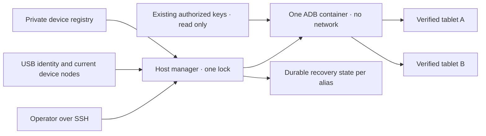

# Gerenciador USB Android compartilhado

<!-- language-navigation:start -->
<p dir="ltr">
<a href="android-usb-manager.md" lang="en" dir="ltr">English</a> · <a href="android-usb-manager.ar.md" lang="ar" dir="rtl">العربية</a> · <a href="android-usb-manager.bn.md" lang="bn" dir="ltr">বাংলা</a> · <a href="android-usb-manager.cs.md" lang="cs" dir="ltr">Čeština</a> · <a href="android-usb-manager.de.md" lang="de" dir="ltr">Deutsch</a> · <a href="android-usb-manager.es.md" lang="es" dir="ltr">Español</a> · <a href="android-usb-manager.fa.md" lang="fa" dir="rtl">فارسی</a> · <a href="android-usb-manager.fr.md" lang="fr" dir="ltr">Français</a><br>
<a href="android-usb-manager.he.md" lang="he" dir="rtl">עברית</a> · <a href="android-usb-manager.hi.md" lang="hi" dir="ltr">हिन्दी</a> · <a href="android-usb-manager.id.md" lang="id" dir="ltr">Bahasa Indonesia</a> · <a href="android-usb-manager.it.md" lang="it" dir="ltr">Italiano</a> · <a href="android-usb-manager.ja.md" lang="ja" dir="ltr">日本語</a> · <a href="android-usb-manager.ko.md" lang="ko" dir="ltr">한국어</a> · <a href="android-usb-manager.nl.md" lang="nl" dir="ltr">Nederlands</a> · <a href="android-usb-manager.pl.md" lang="pl" dir="ltr">Polski</a><br>
<a href="android-usb-manager.pt.md" lang="pt" dir="ltr">Português</a> · <a href="android-usb-manager.ru.md" lang="ru" dir="ltr">Русский</a> · <a href="android-usb-manager.th.md" lang="th" dir="ltr">ไทย</a> · <a href="android-usb-manager.tr.md" lang="tr" dir="ltr">Türkçe</a> · <a href="android-usb-manager.uk.md" lang="uk" dir="ltr">Українська</a> · <a href="android-usb-manager.vi.md" lang="vi" dir="ltr">Tiếng Việt</a> · <a href="android-usb-manager.zh-Hans.md" lang="zh-Hans" dir="ltr">简体中文</a> · <a href="android-usb-manager.zh-Hant.md" lang="zh-Hant" dir="ltr">繁體中文</a>
</p>
<!-- language-navigation:end -->

O gerenciador compartilhado substitui contêineres ADB por tablet por um servidor ADB e um registro explícito de dispositivos. Um serviço no host gerencia conexões USB e, nos tablets selecionados, restaura o OTT após uma nova inicialização Android. A reprodução normal e o protocolo OTT remoto continuam independentes.

## Obter o pacote de implantação

Baixe `ottplay-control-server-deployment.tar.gz` e `release-manifest.json` da mesma [versão](https://github.com/open-ott-play/ottplay-control-server/releases). Verifique o SHA-256 do arquivo contra a entrada correspondente no manifesto e extraia em um diretório novo:

```sh
mkdir ott-android-release
tar -xzf ottplay-control-server-deployment.tar.gz -C ott-android-release
cd ott-android-release
python3 -B tools/android_usb_manager_remote.py --help
```

O arquivo preserva `tools/`, `deploy/` e `docs/`, incluindo os seis scripts USB compartilhados e legados listados abaixo. Siga a estrutura do host e as etapas de provisionamento deste guia; apenas extrair não instala um serviço. Mantenha gerenciador, supervisor e adaptador de transações na mesma revisão de lançamento. O Dockerfile de transporte é uma receita de construção; o artefato OCI do control-server não é a imagem de transporte USB.

Arquivos de implantação antigos, incluindo `v0.1.5-beta.6`, omitem `tools/`. Para eles, use o arquivo de código-fonte correspondente ou uma versão mais recente com o pacote completo. Não misture scripts de versões diferentes.

A implementação contém:

- [`tools/android_usb_manager.py`](../tools/android_usb_manager.py): registro, verificação do transporte, reconciliação de contêineres e comandos serializados.
- [`tools/android_usb_supervisor.py`](../tools/android_usb_supervisor.py): política existente de inicialização, bloqueio de tela e recuperação do primeiro plano.
- [`tools/android_usb_manager_remote.py`](../tools/android_usb_manager_remote.py): wrapper SSH com saída que preserva dados binários.
- [`tools/android_usb_legacy_redirect.py`](../tools/android_usb_legacy_redirect.py): redirecionamento opcional de caminho de comando por tablet já instalado.
- [`tools/android_usb_remote.py`](../tools/android_usb_remote.py): wrapper SSH legado, preservado para chamadores existentes por tablet.
- [`tools/android_usb_transaction.py`](../tools/android_usb_transaction.py): transferência atômica de arquivos, preparação de APK e operações CDP para auxiliares de manutenção confiáveis.
- [`deploy/android-usb-manager`](../deploy/android-usb-manager): configuração de exemplo, serviço systemd, script de inicialização Synology DSM e [receita da imagem de transporte](../deploy/android-usb-manager/README.md).




## Isolamento e identidade

O contêiner executa ADB em primeiro plano, em vez de um processo `sleep` ocioso acompanhado por um daemon ADB em segundo plano. ADB escuta apenas no loopback do contêiner. O contêiner usa `--network none`, nenhuma porta publicada, sistema raiz somente leitura, todas as capabilities removidas, no-new-privileges e `/tmp` gravável limitado. Não possui socket Docker nem montagem ampla de `/dev` ou `/dev/bus/usb`. A imagem deve ser fixada por SHA-256.

O gerenciador impõe 256 MiB de memória, 256 MiB de memória e swap combinados e CPU shares de 128. Limites iguais de memória/swap não permitem swap adicional. CPU shares diminui a prioridade relativa sob concorrência sem impor cota rígida de CPU. Não há limite rígido de PID porque o kernel DSM de destino não suporta esse controlador. `/tmp` tem teto tmpfs de 256 MiB, alocado sob demanda e contabilizado no mesmo limite de memória, sem memória adicional. A preparação de APK aceita até 128 MiB e grava blocos de 1 MiB para evitar outro APK inteiro no heap Python do contêiner. A requisição no host ainda mantém seu conteúdo em buffer.

Docker e gerenciador do host supervisionam o ADB em primeiro plano. O contêiner desativa explicitamente verificações de saúde herdadas da imagem: testar heartbeat ou configuração de outro gerenciador não descreve esse processo. Recursos e verificações de saúde fazem parte da reconciliação; desvios substituem o contêiner pertencente ao gerenciador sob seu bloqueio.

O comando de primeiro plano é `adb -L tcp:5037 nodaemon server`. ADB 29 rejeita um hostname explícito no argumento de escuta (`tcp:127.0.0.1:5037`); omiti-lo vincula ao loopback porque `-a` não está ativo. O cliente mantém explícito `ADB_SERVER_SOCKET=tcp:127.0.0.1:5037`. Essa sintaxe compatível não publica a porta nem ativa ADB de rede em tablets.

Somente os nós atuais correspondentes de forma única a entradas habilitadas são mapeados com permissão de leitura/gravação. Nós USB Synology podem pertencer a root com modo `0600`; por isso ADB executa como root dentro do contêiner restrito. Os nós do host não ficam graváveis por todos. O gerenciador no host também precisa de autoridade root para inspecionar nós, administrar Docker e preservar estado privado. O isolamento do contêiner não elimina esses privilégios no host.

O registro identifica cada dispositivo por serial USB e produto, opcionalmente IDs USB de fabricante/produto, e depois modelo Android, SDK e `android_id`. O gerenciador cruza o caminho USB atual com o inventário de transportes ADB e executa comandos usando o serial único verificado. ADB pode reutilizar IDs numéricos de transporte após reiniciar; eles nunca são usados para despachar comandos. Seriais duplicados causam recusa, não seleção arbitrária. Dispositivos divergentes, ausentes, não autorizados ou ambíguos não devem receber comandos.

Entradas habilitadas precisam de seriais USB únicos. Alguns tablets baratos compartilham o marcador `0123456789ABCDEF`; nomes de modelo não tornam seguro o registro simultâneo. Mantenha os dispositivos conflitantes desabilitados até implementar uma estratégia separada e revisada de identidade física. Não renomeie o mesmo serial presumindo que ele identifica outro transporte.

A consolidação dá a um processo ADB acesso a todos os tablets mapeados. Reiniciar ou reconciliar hotplug pode interromper operações entre eles. Comandos e reconciliação usam um bloqueio no host, `/var/lib/ott-android-manager/manager.lock`, para evitar alterações concorrentes. O caminho ADB genérico rejeita comandos globais ou que mudam transportes, como `kill-server`, `tcpip`, `connect` e `root`.

## Configuração privada e chaves

Comece com [`config.example.json`](../deploy/android-usb-manager/config.example.json). Identidades e digest da imagem só com zeros são deliberadamente fictícios; os dois dispositivos de exemplo estão desabilitados. Não é uma implantação executável.

Use esta estrutura no host:

```text
/usr/local/etc/ott-android-manager/
  android_usb_manager.py
  android_usb_supervisor.py
  android_usb_transaction.py
  config.json
  ott-android-manager.service
  adb-keys/
    adbkey
    adbkey.pub
    vendor/
      additional-authorized.adb_key
/var/lib/ott-android-manager/
  manager.lock
  captures/
  <alias>/state.json
```

Gerenciador, supervisor e adaptador devem vir da mesma revisão examinada. Mantenha configuração e chaves fora de Git e arquivos de lançamento. Diretórios privados devem usar `0700`, configuração e chaves privadas `0600`, e fontes/arquivos de serviço devem pertencer a root. O diretório de chaves é montado somente leitura. `adbkey` e `adbkey.pub` precisam existir; `vendor/` deve existir mesmo vazio. Chaves privadas adicionais previamente autorizadas podem ir em `vendor/`, fornecido por `ADB_VENDOR_KEYS`. Nomeie cada arquivo privado `<source>.adb_key`: ADB 29 ignora silenciosamente outros nomes ao examinar o diretório. Um acompanhante `<source>.adb_key.pub` é opcional. O gerenciador rejeita nomes desconhecidos antes de alterar o contêiner.

Preserve as chaves autorizadas antes de desativar qualquer contêiner. Compare impressões digitais de chaves públicas para identificar duplicatas; não imprima chaves privadas. Não substitua uma chave existente por outra recém-gerada apenas para consolidar contêineres: isso pode exigir confirmação em tablets desconectados.

Cada dispositivo habilitado precisa de identidade completa capturada durante provisionamento acompanhado. UUID OTT, endereço MAC ou valor presumido não provam o `android_id` Android. Se o comprovante não tiver esse campo, mantenha `"enabled": false`; entradas desabilitadas podem conter metadados descritivos incompletos e nunca são mapeadas nem controladas.

`recover_on_boot` é uma política independente. Deixe false para um tablet que deve oferecer apenas manutenção. Quando habilitada, `package` deve indicar o aplicativo cujo lançamento em primeiro plano foi realmente testado naquele dispositivo.

## O que a recuperação automática faz

O intervalo padrão é cinco segundos após cada passagem concluída, não garantia de recuperação completa em cinco segundos. Operações USB lentas aumentam o intervalo. O timeout padrão de comando é 60 segundos e o limite é três tentativas por inicialização Android.

Na primeira observação, o gerenciador registra a inicialização atual sem acordar nem desbloquear o tablet. Em uma inicialização nova posterior com recuperação habilitada:

1. Espera `sys.boot_completed=1` e verifica a identidade.
2. Exige evidência explícita de que o bloqueio não usa PIN, senha ou padrão.
3. Acorda a tela e descarta um bloqueio comum por deslize se necessário.
4. Abre o pacote configurado e verifica a atividade retomada/focada.
5. Verifica novamente inicialização/bloqueio e só então salva um checkpoint de sucesso.

Bloqueio desconhecido ou protegido interrompe a recuperação. A implantação Fire legada exige a sonda protegida por permissão shell descrita em [recuperação USB](android-usb-recovery.md#read-only-keyguard-probe-on-older-firmware).

Uma inicialização já concluída retorna `same_boot_no_action`. Apagar a tela normalmente não dispara um despertar. O gerenciador não monitora decodificação de vídeo, reinicia streams travados nem força continuamente o primeiro plano. Essas são outras políticas do player ou de um watchdog revisado separadamente.

## Comandos

No host USB:

```sh
sudo -n /usr/bin/python3 -B /usr/local/etc/ott-android-manager/android_usb_manager.py \
  --config /usr/local/etc/ott-android-manager/config.json status
```

De outro computador usando um alias SSH existente:

```sh
python3 tools/android_usb_manager_remote.py --host tablet-host status
python3 tools/android_usb_manager_remote.py --host tablet-host status lobby
python3 tools/android_usb_manager_remote.py --host tablet-host wake lobby
python3 tools/android_usb_manager_remote.py --host tablet-host recover lobby
python3 tools/android_usb_manager_remote.py --host tablet-host reboot lobby
python3 tools/android_usb_manager_remote.py --host tablet-host swipe lobby 400 600 400 100 --duration 500
python3 tools/android_usb_manager_remote.py --host tablet-host screenshot lobby lobby-check.png
python3 tools/android_usb_manager_remote.py --host tablet-host adb lobby -- shell getprop ro.product.model
python3 tools/android_usb_manager_remote.py --host tablet-host adb lobby -- exec-out screencap -p > lobby.png
```

`status` inspeciona sem criar, reiniciar ou reconfigurar o contêiner. `tick` realiza uma passagem de reconciliação/recuperação e pode mudar o estado do dispositivo; `run` repete as passagens e destina-se ao serviço.

O wrapper usa SSH sem PTY, protege individualmente argumentos para o shell, transmite o status de saída e não transforma saída ADB em JSON. Verifique o status antes de considerar válida uma captura redirecionada. `screenshot` aceita apenas um nome PNG simples, como `lobby-check.png`, e salva em `<state_dir>/captures/` no host USB. O nome deve corresponder a `[A-Za-z0-9][A-Za-z0-9_-]{0,119}\.png`; caminhos, pontos extras e extensões implícitas são recusados. Valida o PNG e cria arquivo novo exclusivo do proprietário, rejeitando links simbólicos e nomes existentes antes da captura. Já `adb ... exec-out` transmite bytes para um arquivo no computador do operador. `swipe` usa a geometria atual da tela e rejeita bloqueio protegido ou desconhecido; as coordenadas são exemplos, não gesto universal. Caminhos ADB pertencem aos namespaces do contêiner/dispositivo: o wrapper não envia automaticamente um APK do notebook. Preparação e instalação seguinte precisam usar o adaptador atômico abaixo.

`adb <alias> -- <arguments>` é interface administrativa de manutenção, não API pública restrita. Um comando `shell` permitido pode alterar o tablet. Use verificação de identidade e bloqueio; não exponha SSH ou Docker irrestrito por endpoint web.

## Serviço de inicialização e migração

O [modelo systemd](../deploy/android-usb-manager/ott-android-manager.service) executa continuamente e reinicia um processo encerrado após dez segundos. O [wrapper DSM](../deploy/android-usb-manager/S99ott-android-manager.sh) verifica arquivos, instala/habilita a unidade e a inicia. Recusa iniciar enquanto `ott-k8a-recovery.service` estiver ativo ou habilitado. Em outra distribuição, adapte dependência Docker e caminhos ao gerenciador de serviços.

Faça uma transferência controlada:

1. Registre configuração dos contêineres, impressões das chaves autorizadas e estado de recuperação. Faça backup de arquivos privados com acesso exclusivo do proprietário.
2. Instale novas fontes, imagem revisada, chaves e registro. Deixe dispositivos não provisionados desabilitados. Não inicie um segundo supervisor para o mesmo tablet.
3. Pare e desabilite o serviço antigo de recuperação e retire seu wrapper de inicialização DSM. Preserve arquivos para reversão. Parar o serviço sozinho não remove seu contêiner ADB.
4. Copie o checkpoint antigo validado para o novo `<alias>/state.json` correspondente. Preserve a identidade de inicialização; não zere estado como atalho rotineiro de migração.
5. Pare os contêineres ADB antigos antes do servidor compartilhado para impedir disputa pela mesma interface USB.
6. Instale o novo wrapper DSM executável e pertencente a root sob `/usr/local/etc/rc.d/`, execute `start` e inspecione serviço/status.
7. Migre chamadores, verifique comandos comuns e política preservada; depois remova apenas contêineres antigos cujas dependências foram retiradas.

Auxiliares legados escondem dependências sob nomes inocentes. Audite `bootstrap.py`, `reconnect.py`, adaptadores CDP e aliases shell. Um bootstrap pode copiar chaves de contêiner antigo. Um reconnect pode definir `OLD` a partir de auxiliar importado e depois pará-lo ou removê-lo; trocar esse auxiliar para o nome compartilhado pode parar acidentalmente o servidor comum. Remova essa administração automática dos clientes em vez de mudar só o nome.

Encaminhe comandos ADB reais pelo gerenciador usando alias. Um adaptador compatível que precisa de `docker exec` para preparar arquivos ou cliente CDP local deve manter o mesmo bloqueio durante toda a transação. Não aninhe um segundo processo adquirindo esse bloqueio na seção já bloqueada; use um caminho compatível no mesmo processo ou organize a transação uma única vez. Atribua portas temporárias de encaminhamento e remova-as depois.

Instale `android_usb_transaction.py` ao lado do gerenciador e supervisor. Aceita uma requisição JSON pela entrada padrão, com `--config` apontando ao mesmo registro privado, e retorna saída bruta pela saída padrão. Requisições suportadas:

- `pull`: `alias` e `device_path` absoluto; retorna bytes de um arquivo regular de até 128 MiB. Diretórios e arquivos de dispositivo são recusados. Um limite rígido no arquivo de destino também interrompe uma origem que cresce durante a transferência.
- `staged_adb`: `alias`, `data` em base64 e `arguments`, como `["install", "-r", "@staged"]` ou `["push", "@staged", "/sdcard/example.json"]`.
- `cdp`: `alias`, `package` do aplicativo, `expected_model` opcional, cliente Python confiável em `source` contendo `__OTT_CDP_PORT__`, e sua `request` JSON.

Cada requisição verifica o dispositivo e mantém um bloqueio durante preparação, uso e limpeza. Operações usam nomes temporários únicos; arquivos são reservados exclusivamente com modo `0600` antes de armar a limpeza. Instalações APK preservam o sufixo `.apk` exigido pelo parser de argumentos de pacote ADB. Colisão de nome deixa o arquivo existente intacto. O gravador abre apenas sua reserva vazia regular, sem seguir links simbólicos. Comandos Docker auxiliares usam o ID observado do contêiner. CDP resolve exatamente um processo e seu socket de depuração, aloca `tcp:0`, substitui a porta no código cliente e remove somente esse encaminhamento ao concluir ou falhar. A reconciliação não pode reiniciar o servidor entre esses passos.

O auxiliar a1 migrado mantém dados `copy_in` em memória local da thread até o próximo `adb install` ou `adb push` no mesmo processo. O par torna-se uma transação host; `copy_in` sozinho não cria mais arquivo compartilhado no contêiner. Auxiliares CDP de Home Plan e do player usam o mesmo mecanismo. Requisições podem conter dados privados e código executável confiável: envie apenas pelo canal SSH administrativo existente, nunca publique o adaptador nem registre seus payloads.

Portas de encaminhamento ADB pertencem ao servidor compartilhado, não a um tablet. Use portas CDP dinâmicas ou distintas por alias em sessões manuais. O gerenciador força `--no-rebind` na criação, permite reutilizar mapeamento idêntico e rejeita sobrescrever ou remover encaminhamento de outro alias. `forward --list` é filtrado pelo alias selecionado; `forward --remove-all` é recusado.

Depois de salvar o script antigo, o redirecionamento legado opcional pode ser instalado em `/usr/local/etc/ott-k8a-recovery/android_usb_supervisor.py` para preservar comandos manuais antigos. Aceita apenas o caminho antigo conhecido, exige correspondência exata de serial/modelo/SDK/Android ID com uma única entrada nova habilitada e substitui seu processo pelo novo gerenciador. Não importa nem executa o supervisor antigo. `run` é explicitamente recusado: serviço e wrapper antigos devem continuar desabilitados/retirados, mesmo com compatibilidade manual.

Para reverter, pare e desabilite o novo serviço, retire seu wrapper e pare seu contêiner. Restaure cópias antigas de chaves/estado e o serviço anterior. Antes de retomar, confirme que apenas um gerenciador possui cada dispositivo USB.

## Players de produção sem CDP

Um APK de produção pode desativar intencionalmente a depuração WebView. Nesse caso o adaptador informa `Application debugging socket is unavailable`; uma conexão ADB funcionando não cria esse socket. O gerenciador não ativa depuração, altera configurações do player nem substitui APK.

Para um player conectado ao controlador OTT, use os diagnósticos suportados somente leitura. Troque `lobby` pelo alias OTT configurado:

```sh
ott -t 20 lobby debug -j
ott -t 20 lobby inspect -j
```

Esses comandos retornam observações do player, incluindo estado disponível de runtime e mídia. Não oferecem avaliação JavaScript arbitrária, inspeção DOM direta nem conexão CDP. Ambos foram verificados no player de produção API 22 conectado sem socket CDP; em outros players dependem das capacidades suportadas.

## Aceitação e limites

Registre resultados contra fontes, imagem e hardware realmente instalados. No início desta consolidação, somente **k8a** tinha evidência física da política legada. Seu supervisor antigo recuperava após reinicialização real e não interferia no sono normal; isso não comprova aceitação da implementação compartilhada nova. Outras identidades salvas estavam incompletas e devem continuar desabilitadas até validação acompanhada.

Aceitação necessária do gerenciador compartilhado:

- A identidade USB autorizada existente aparece pelo servidor compartilhado.
- Dispositivos desconhecidos, ausentes, duplicados e desabilitados não recebem ações.
- Um comando somente leitura e uma captura binária usam o transporte pretendido.
- A recuperação após nova inicialização funciona em dispositivo com a política habilitada.
- O apagar normal da tela permanece dormindo.
- A reenumeração USB restaura apenas o mapeamento esperado.
- Reiniciar o serviço preserva estado e evita recuperação duplicada.
- Uma reinicialização real do host restaura serviço e distribuição de controle.
- Cada auxiliar local migrado funciona sem recriar contêineres antigos.

Informe explicitamente os testes não executados. Um serviço ativo ou lançamento em primeiro plano bem-sucedido não prova reprodução do stream, compatibilidade de todos os tablets nem recuperação autônoma após reiniciar o NAS.
