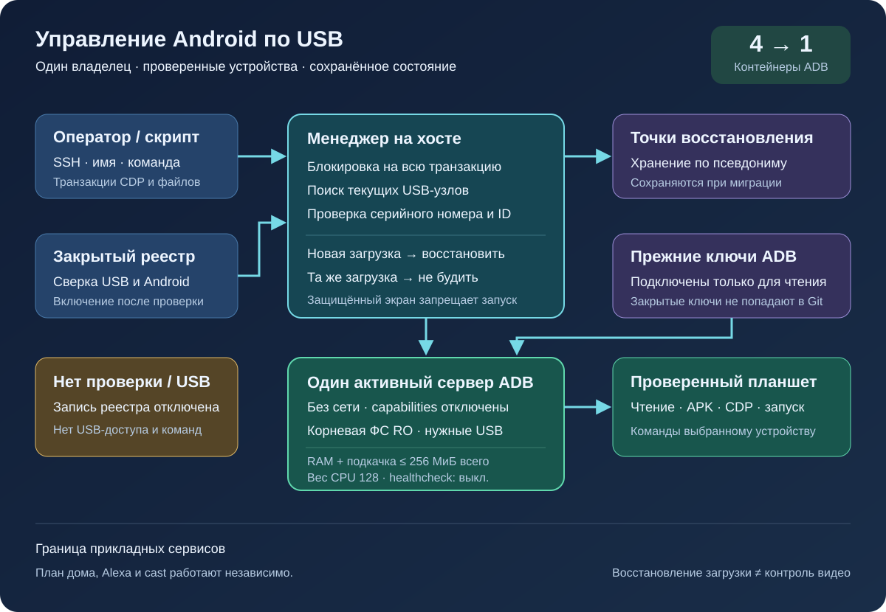
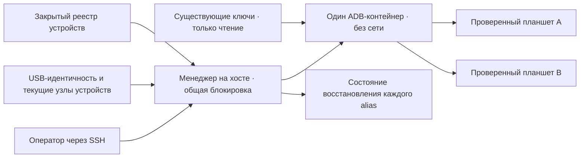

# Общий менеджер Android по USB

[English](android-usb-manager.md) · [Русский](android-usb-manager.ru.md)

Менеджер заменяет отдельные ADB-контейнеры для планшетов одним сервером ADB
и явным реестром устройств. Служба на USB-хосте отслеживает переподключения
и для выбранных планшетов восстанавливает OTT после новой загрузки Android.
Обычное воспроизведение и протокол удалённого управления OTT работают независимо.

## Получение пакета развёртывания

Скачайте `ottplay-control-server-deployment.tar.gz` и `release-manifest.json`
из одного [релиза](https://github.com/open-ott-play/ottplay-control-server/releases).
Сверьте SHA-256 архива с его записью в манифесте и распакуйте в новый каталог:

```sh
mkdir ott-android-release
tar -xzf ottplay-control-server-deployment.tar.gz -C ott-android-release
cd ott-android-release
python3 -B tools/android_usb_manager_remote.py --help
```

Архив сохраняет структуру `tools/`, `deploy/` и `docs/` и содержит все шесть
перечисленных ниже скриптов общего и прежнего USB-менеджеров. Дальше выполните
подготовку и размещение файлов по этому руководству; распаковка сама по себе
не устанавливает службу. Менеджер, supervisor и адаптер транзакций должны быть
из одной версии и находиться рядом. Dockerfile транспорта — рецепт сборки;
OCI-образ сервера управления из релиза не является образом USB-транспорта.

В прежних архивах развёртывания, включая `v0.1.5-beta.6`, каталога `tools/`
нет. Для этих версий используйте архив исходников того же тега либо выберите
новый релиз с полным пакетом развёртывания. Не смешивайте скрипты разных версий.

В состав решения входят:

- [`tools/android_usb_manager.py`](../tools/android_usb_manager.py):
  реестр, проверка устройства, настройка контейнера и последовательное выполнение
  операций под общей блокировкой.
- [`tools/android_usb_supervisor.py`](../tools/android_usb_supervisor.py):
  существующая логика восстановления после загрузки, проверки блокировки экрана
  и запуска приложения на переднем плане.
- [`tools/android_usb_manager_remote.py`](../tools/android_usb_manager_remote.py):
  обёртка SSH, сохраняющая бинарный вывод.
- [`tools/android_usb_legacy_redirect.py`](../tools/android_usb_legacy_redirect.py):
  необязательный адаптер для ранее установленных команд отдельного планшета.
- [`tools/android_usb_remote.py`](../tools/android_usb_remote.py):
  прежняя SSH-обёртка для совместимости с уже настроенными командами планшетов.
- [`tools/android_usb_transaction.py`](../tools/android_usb_transaction.py):
  передача файлов, подготовка APK и операции CDP как неделимые транзакции
  для доверенных инструментов обслуживания.
- [`deploy/android-usb-manager`](../deploy/android-usb-manager):
  пример конфигурации, служба systemd, загрузочный скрипт Synology DSM
  и [рецепт образа транспорта](../deploy/android-usb-manager/README.ru.md).





## Изоляция и проверка устройства

ADB работает основным процессом контейнера. Порт прослушивается только
на loopback-интерфейсе внутри контейнера. Используются `--network none`,
корневая файловая система только для чтения, сброс всех Linux capabilities,
`no-new-privileges` и ограниченный writable-каталог `/tmp`.
Опубликованных портов, Docker socket и общего доступа к `/dev` либо
`/dev/bus/usb` нет. Образ должен быть закреплён по SHA-256.

Менеджер задаёт лимит памяти контейнера 256 МиБ, суммарный лимит памяти
и swap 256 МиБ и CPU shares 128. При равных лимитах памяти и swap
дополнительный swap недоступен. CPU shares снижают относительный приоритет
при конкуренции за процессор, но не вводят жёсткую квоту CPU.
Жёсткого лимита PID нет: ядро целевой DSM не поддерживает этот контроллер.
Размер tmpfs `/tmp` ограничен 256 МиБ и выделяется по мере записи из того же
лимита памяти контейнера; это не дополнительные 256 МиБ.
Подготовка APK принимает до 128 МиБ и пишет блоками по 1 МиБ, чтобы не держать
в памяти Python внутри контейнера вторую полную копию файла.
Запрос на стороне хоста по-прежнему буферизует содержимое.

За основным процессом ADB следят Docker и менеджер на хосте.
Унаследованные из образа health checks явно отключаются: проверка heartbeat
или конфигурации другого менеджера не описывает работу этого процесса.
Лимиты ресурсов и настройки health check входят в проверку конфигурации;
при расхождении менеджер пересоздаёт свой контейнер под общей блокировкой.

Команда запуска: `adb -L tcp:5037 nodaemon server`.
В ADB 29 адрес прослушивания с именем хоста, включая
`tcp:127.0.0.1:5037`, вызывает ошибку. Без `-a` запись `tcp:5037`
по умолчанию означает loopback. Клиентский адрес остаётся явным:
`ADB_SERVER_SOCKET=tcp:127.0.0.1:5037`. Этот вариант совместимости
не публикует порт и не включает сетевой ADB на планшетах.

В контейнер передаются с правами чтения и записи только текущие USB-узлы,
однозначно соответствующие включённым записям реестра. На Synology такие узлы
могут принадлежать root и иметь режим `0600`, поэтому ADB внутри ограниченного
контейнера запускается от root. Права USB-узлов на хосте не открываются всем
пользователям. Самому менеджеру на хосте также нужны полномочия root для
работы с Docker, узлами устройств и закрытым состоянием. Изоляция контейнера
не отменяет этих полномочий хостовой службы.

Устройство проверяется по USB serial и product, при наличии — по
vendor/product ID, затем по Android model, SDK и `android_id`.
Менеджер сопоставляет текущий USB-путь со списком транспортов ADB и отправляет
команды по проверенному уникальному serial. Числовой transport ID после
рестарта ADB может перейти другому устройству, поэтому для отправки команд
он не используется. При дубликатах serial операция отклоняется.
Отсутствующее, неавторизованное, неоднозначное устройство или устройство
с несовпадающей идентичностью не должно получать команды.

Включённые записи должны иметь разные USB serial. Некоторые недорогие
планшеты используют одинаковое значение `0123456789ABCDEF`; разные названия
моделей не делают их одновременную регистрацию безопасной.
Оставляйте конфликтующие записи выключенными, пока не реализован и проверен
отдельный способ физической идентификации. Переименование alias не меняет
серийный номер USB.

Общий процесс ADB получает доступ ко всем переданным планшетам.
Рестарт контейнера или изменение USB mappings может прервать операции
с несколькими устройствами. Команды и перенастройка контейнера используют
одну блокировку на хосте:
`/var/lib/ott-android-manager/manager.lock`.
Общие команды сервера и команды смены транспорта, включая `kill-server`,
`tcpip`, `connect` и `root`, через обычный интерфейс `adb` отклоняются.

## Закрытая конфигурация и ключи

Используйте [`config.example.json`](../deploy/android-usb-manager/config.example.json)
как образец структуры. В нём указаны вымышленные идентификаторы и нулевой
digest образа; оба примера устройств выключены. Без замены значений
это не рабочая конфигурация.

Рекомендуемая структура на USB-хосте:

```text
/usr/local/etc/ott-android-manager/
  android_usb_manager.py
  android_usb_supervisor.py
  android_usb_transaction.py
  config.json
  ott-android-manager.service
  adb-keys/
    adbkey
    adbkey.pub
    vendor/
      additional-authorized.adb_key
/var/lib/ott-android-manager/
  manager.lock
  captures/
  <alias>/state.json
```

Менеджер, supervisor и адаптер транзакций должны происходить из одной проверенной ревизии.
Храните конфигурацию и ключи вне Git и архивов выпуска. Закрытым каталогам
задайте `0700`, конфигурации и приватным ключам — `0600`; исходники
и служебные файлы должны принадлежать root. Каталог ключей подключается
только для чтения.

Файлы `adbkey` и `adbkey.pub` должны существовать заранее.
Каталог `vendor/` обязателен, даже если он пуст.
В него можно поместить дополнительные ранее авторизованные приватные ключи;
каталог передаётся через `ADB_VENDOR_KEYS`. Приватные файлы называйте
`<source>.adb_key`: ADB 29 игнорирует другие имена при обходе каталога.
Парный `<source>.adb_key.pub` необязателен. Менеджер отклоняет неподдерживаемые
имена до изменения контейнера.

Сохраните действующие ключи перед выводом старых контейнеров из эксплуатации.
Для поиска дубликатов сравнивайте отпечатки публичных ключей, не выводя
приватные ключи. Генерация нового ключа ради объединения контейнеров может
потребовать нового подтверждения на планшетах, которые сейчас недоступны.

Для каждой включённой записи нужна полная идентичность, снятая при проверке
реального устройства. UUID устройства в OTT, MAC-адрес и предположение
не заменяют Android `android_id`. Если этого поля нет в сохранённых
результатах настройки, оставьте `"enabled": false`.
Выключенная запись может содержать неполные справочные сведения; её USB-узел
не передаётся контейнеру и команды на неё не отправляются.

`recover_on_boot` — отдельная настройка. Оставляйте её `false`, если
планшету нужны только команды обслуживания. Для автоматического
восстановления укажите в `package` приложение, запуск которого
на переднем плане уже проверен на этом устройстве.

## Что делает автоматическое восстановление

По умолчанию между завершением одного прохода и началом следующего проходит
пять секунд. Это не гарантия восстановления за пять секунд: медленные
USB-операции увеличивают интервал. Таймаут команды по умолчанию составляет
60 секунд, число попыток восстановления — три на одну загрузку Android.

При первом обнаружении менеджер запоминает текущую загрузку, не пробуждая
и не разблокируя планшет. При последующей новой загрузке с включённым
восстановлением он:

1. Ждёт `sys.boot_completed=1` и проверяет идентичность устройства.
2. Требует явного подтверждения, что экран не защищён PIN-кодом, паролем
   или графическим ключом.
3. Пробуждает экран и при необходимости закрывает обычную блокировку свайпом.
4. Запускает заданный пакет и проверяет активность на переднем плане.
5. Повторно проверяет загрузку и блокировку экрана, затем сохраняет
   успешное состояние.

Неизвестное или защищённое состояние блокировки останавливает восстановление.
Для старых Fire требуется защищённый разрешением shell диагностический
компонент из [руководства по USB-восстановлению (EN)](android-usb-recovery.md#read-only-keyguard-probe-on-older-firmware).

Для уже обработанной загрузки возвращается `same_boot_no_action`.
Обычное выключение экрана не вызывает пробуждения.
Менеджер не следит за декодированием видео, не перезапускает зависший поток
и не возвращает приложение на передний план постоянно.
Эти задачи относятся к плееру или отдельно проверенной службе наблюдения.

## Команды

На USB-хосте:

```sh
sudo -n /usr/bin/python3 -B /usr/local/etc/ott-android-manager/android_usb_manager.py \
  --config /usr/local/etc/ott-android-manager/config.json status
```

С другого компьютера через существующий SSH alias:

```sh
python3 tools/android_usb_manager_remote.py --host tablet-host status
python3 tools/android_usb_manager_remote.py --host tablet-host status lobby
python3 tools/android_usb_manager_remote.py --host tablet-host wake lobby
python3 tools/android_usb_manager_remote.py --host tablet-host recover lobby
python3 tools/android_usb_manager_remote.py --host tablet-host reboot lobby
python3 tools/android_usb_manager_remote.py --host tablet-host swipe lobby 400 600 400 100 --duration 500
python3 tools/android_usb_manager_remote.py --host tablet-host screenshot lobby lobby-check.png
python3 tools/android_usb_manager_remote.py --host tablet-host adb lobby -- shell getprop ro.product.model
python3 tools/android_usb_manager_remote.py --host tablet-host adb lobby -- exec-out screencap -p > lobby.png
```

`status` проверяет состояние без создания, рестарта или перенастройки
контейнера. `tick` выполняет один проход настройки и восстановления,
который может изменить состояние планшета. `run` повторяет эти проходы
и предназначен для службы.

Обёртка подключается по SSH без PTY, экранирует отдельные аргументы,
сохраняет код завершения процесса и не преобразует вывод ADB в JSON.
Проверяйте код завершения, прежде чем считать перенаправленный скриншот
успешным. Команда `screenshot` принимает только имя PNG-файла, например
`lobby-check.png`, и сохраняет его в `<state_dir>/captures/` на USB-хосте.
Имя должно соответствовать `[A-Za-z0-9][A-Za-z0-9_-]{0,119}\.png`;
пути и дополнительные точки запрещены, расширение не добавляется автоматически.
Команда проверяет PNG и создаёт новый файл с доступом только владельцу.
Символические ссылки и существующие имена отклоняются до получения снимка.
Пример `adb ... exec-out` сохраняет бинарный поток в файл на компьютере
оператора. `swipe` проверяет текущую геометрию экрана и отклоняет жест
при защищённой или неизвестной блокировке. Координаты выше приведены
для примера и не подходят всем экранам.

Пути файлов в ADB относятся к контейнеру и устройству. Обёртка
не загружает APK с ноутбука автоматически. Передачу файла и последующую
установку нужно выполнять через описанный ниже транзакционный адаптер.

`adb <alias> -- <arguments>` — административный интерфейс обслуживания,
а не ограниченный публичный API. Разрешённая команда `shell` может менять
состояние планшета. Используйте проверку устройства и общую блокировку;
не предоставляйте неограниченный SSH или Docker через веб-интерфейс.

## Служба автозапуска и переход

[Шаблон systemd](../deploy/android-usb-manager/ott-android-manager.service)
запускает менеджер постоянно и перезапускает завершившийся процесс
через десять секунд. [Обёртка DSM](../deploy/android-usb-manager/S99ott-android-manager.sh)
проверяет файлы установки, устанавливает и включает службу, затем запускает её.
Она отказывается запускаться, если старая `ott-k8a-recovery.service`
активна или включена. Для другой системы адаптируйте зависимость от Docker
и пути к её менеджеру служб.

Переход выполняйте последовательно:

1. Сохраните конфигурацию старых контейнеров, отпечатки действующих ключей
   и состояние восстановления. Закрытые резервные копии должны быть доступны
   только владельцу.
2. Установите новый код, проверенный образ, ключи и реестр.
   Неподготовленные устройства оставьте выключенными.
   Не запускайте два supervisor для одного планшета.
3. Остановите и отключите старую хостовую службу восстановления,
   выведите её загрузочный скрипт DSM из автозапуска.
   Сохраните файлы для отката. Остановка службы сама по себе
   не удаляет её ADB-контейнер.
4. Перенесите проверенное старое состояние в соответствующий
   `<alias>/state.json`. Сохраните идентификатор загрузки.
   Не сбрасывайте состояние как обычный способ миграции.
5. Остановите старые ADB-контейнеры перед запуском общего сервера,
   чтобы два сервера не конкурировали за USB-интерфейс.
6. Установите новую исполняемую обёртку DSM с владельцем root
   в `/usr/local/etc/rc.d/`, выполните её действие `start`,
   проверьте службу и `status`.
7. Переведите вызывающие программы, проверьте обычные команды
   и сохранённую политику восстановления. Затем удаляйте только те старые
   контейнеры, от которых больше нет зависимостей.

Проверьте также `bootstrap.py`, `reconnect.py`, адаптеры CDP и shell aliases.
Название вспомогательного скрипта не показывает все его зависимости:
bootstrap может копировать ключи из старого контейнера, а reconnect —
получать `OLD` из импортируемого модуля и затем останавливать или удалять
этот контейнер. После простой замены имени на общее такое действие
может остановить новый сервер. Удалите из клиентов автоматическое управление
контейнерами, а не только замените имена.

Направляйте команды ADB через менеджер с указанием alias.
Если совместимому адаптеру нужен `docker exec` для подготовки файла
или локального клиента CDP, он должен держать общую хостовую блокировку
на протяжении всей операции. Не запускайте внутри этой секции
второй процесс, ожидающий ту же блокировку: используйте совместимый
вызов внутри текущего процесса либо оформите всю операцию одной транзакцией.
Для временных перенаправлений портов предусматривайте удаление после работы.

### Атомарные операции с файлами и CDP

Установите `android_usb_transaction.py` рядом с менеджером и supervisor.
Он принимает один JSON-запрос через стандартный ввод.
`--config` должен указывать на тот же закрытый реестр.
Результат операции возвращается в стандартный вывод без преобразования.
Поддерживаются:

- `pull`: `alias` и абсолютный `device_path`; результат — байты одного обычного
  файла размером до 128 МиБ. Каталоги и файлы устройств отклоняются.
  Жёсткий лимит размера принимаемого файла также останавливает передачу,
  если источник растёт во время чтения.
- `staged_adb`: `alias`, поле `data` с данными в base64 и `arguments`,
  например `["install", "-r", "@staged"]` либо
  `["push", "@staged", "/sdcard/example.json"]`.
- `cdp`: `alias`, пакет приложения `package`, необязательный
  `expected_model`, доверенный Python-код клиента в `source`
  с маркером `__OTT_CDP_PORT__` и его JSON-запрос `request`.

Каждый запрос проверяет устройство и удерживает одну блокировку менеджера
на этапах подготовки, выполнения и очистки. Файлы получают уникальные
временные имена и резервируются без перезаписи с режимом `0600` до включения
очистки. При установке APK сохраняется расширение `.apk`, необходимое ADB
для распознавания аргумента пакета. При совпадении имени существующий файл
сохраняется. Запись данных
открывает только пустой обычный зарезервированный файл, не следуя symlink.
Вспомогательные команды Docker обращаются к установленному ID контейнера.
CDP находит ровно один процесс приложения и его отладочный сокет,
выделяет порт через `tcp:0`, подставляет его в код клиента
и удаляет только это перенаправление после завершения или ошибки.
Перенастройка контейнера не может перезапустить сервер между этими этапами.

В перенесённом адаптере a1 вызов `copy_in` хранит данные в памяти
текущего потока до следующего `adb install` или `adb push`
в том же процессе. Эта пара становится одной транзакцией на хосте;
сам по себе `copy_in` больше не создаёт общий файл в контейнере.
Адаптеры CDP для Home Plan и плеера используют тот же механизм.
Запрос может содержать закрытые данные приложения и доверенный исполняемый
код. Передавайте его только по существующему административному SSH-каналу,
не публикуйте адаптер как веб-сервис и не записывайте содержимое запросов
в журналы.

Порты ADB forwarding принадлежат общему серверу, а не отдельному планшету.
Используйте автоматически выделяемые порты CDP либо разные порты
для ручных сеансов каждого alias. При создании forwarding менеджер
добавляет `--no-rebind`, разрешает повторное использование полностью
совпадающего перенаправления и запрещает перезаписывать или удалять
перенаправление другого alias. `forward --list` показывает только записи
выбранного alias; `forward --remove-all` запрещён.

### Совместимость со старыми командами и откат

После резервного копирования старого скрипта можно установить адаптер
перенаправления по адресу
`/usr/local/etc/ott-k8a-recovery/android_usb_supervisor.py`.
Он сохраняет старые ручные команды, принимает только известный старый
путь конфигурации, проверяет точное совпадение serial/model/SDK/Android ID
с одной включённой записью нового реестра и заменяет свой процесс
новым менеджером. Старый supervisor при этом не импортируется
и не запускается. Команда `run` отклоняется: старая служба
и её загрузочный скрипт должны оставаться отключёнными даже при наличии
ручной совместимости.

Для отката остановите и отключите новую хостовую службу, выведите её
скрипт из автозапуска и остановите её контейнер.
Восстановите старые копии ключей, состояния и службы.
Перед возобновлением работы убедитесь, что каждым USB-устройством
управляет только один менеджер.

## Релизные плееры без CDP

В релизном APK отладка WebView может быть намеренно отключена. В этом случае
адаптер транзакций сообщает `Application debugging socket is unavailable`;
работающее соединение ADB не создаёт такой сокет. Менеджер не включает
отладку, не меняет настройки плеера и не заменяет APK.

Для плеера, уже подключённого к контроллеру OTT, используйте штатную
диагностику без изменения состояния. Замените `lobby` на его alias в OTT:

```sh
ott -t 20 lobby debug -j
ott -t 20 lobby inspect -j
```

Команды возвращают сведения, сообщённые самим плеером, включая доступное
состояние среды выполнения и воспроизведения. Они не дают произвольного
выполнения JavaScript, прямого исследования DOM или подключения CDP.
Обе команды проверены на подключённом релизном плеере с API 22 при
отсутствующем сокете CDP; доступность на другом плеере зависит от
поддерживаемых им возможностей.

## Приёмка и ограничения

Фиксируйте результаты для конкретной установленной ревизии,
образа и оборудования. На начало объединения только для **k8a**
существовали физические проверки старой политики восстановления:
старый supervisor запускал приложение после реальной перезагрузки планшета
и не мешал обычному сну. Эти результаты не подтверждают приёмку новой
общей реализации. Сохранённые идентификаторы остальных планшетов
были неполными; такие записи должны оставаться выключенными
до проверки реального устройства.

Для приёмки общего менеджера необходимо проверить:

- Появление ранее авторизованного USB-устройства через общий сервер.
- Отсутствие команд на неизвестных, отсутствующих, выключенных
  и неоднозначных устройствах.
- Выполнение команды чтения и получение бинарного скриншота
  именно с выбранного планшета.
- Восстановление после новой загрузки на устройстве,
  для которого эта политика включена.
- Сохранение сна после обычного выключения экрана.
- Возврат ожидаемого USB mapping после переподключения.
- Сохранение состояния после рестарта хостовой службы
  без повторного восстановления той же загрузки.
- Восстановление службы и владения USB после реальной перезагрузки хоста.
- Работу каждого перенесённого локального адаптера
  без повторного создания старых контейнеров.

Явно отмечайте невыполненные проверки. Запущенная служба или успешное
открытие приложения не доказывают воспроизведение потока,
совместимость всех планшетов или автоматическое восстановление
после перезагрузки NAS.
