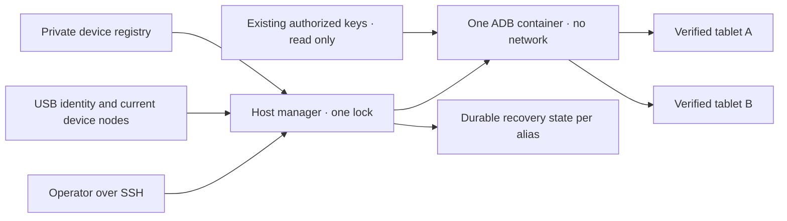

# ตัวจัดการ Android USB แบบใช้ร่วมกัน

<!-- language-navigation:start -->
<p dir="ltr">
<a href="android-usb-manager.md" lang="en" dir="ltr">English</a> · <a href="android-usb-manager.ar.md" lang="ar" dir="rtl">العربية</a> · <a href="android-usb-manager.bn.md" lang="bn" dir="ltr">বাংলা</a> · <a href="android-usb-manager.cs.md" lang="cs" dir="ltr">Čeština</a> · <a href="android-usb-manager.de.md" lang="de" dir="ltr">Deutsch</a> · <a href="android-usb-manager.es.md" lang="es" dir="ltr">Español</a> · <a href="android-usb-manager.fa.md" lang="fa" dir="rtl">فارسی</a> · <a href="android-usb-manager.fr.md" lang="fr" dir="ltr">Français</a><br>
<a href="android-usb-manager.he.md" lang="he" dir="rtl">עברית</a> · <a href="android-usb-manager.hi.md" lang="hi" dir="ltr">हिन्दी</a> · <a href="android-usb-manager.id.md" lang="id" dir="ltr">Bahasa Indonesia</a> · <a href="android-usb-manager.it.md" lang="it" dir="ltr">Italiano</a> · <a href="android-usb-manager.ja.md" lang="ja" dir="ltr">日本語</a> · <a href="android-usb-manager.ko.md" lang="ko" dir="ltr">한국어</a> · <a href="android-usb-manager.nl.md" lang="nl" dir="ltr">Nederlands</a> · <a href="android-usb-manager.pl.md" lang="pl" dir="ltr">Polski</a><br>
<a href="android-usb-manager.pt.md" lang="pt" dir="ltr">Português</a> · <a href="android-usb-manager.ru.md" lang="ru" dir="ltr">Русский</a> · <a href="android-usb-manager.th.md" lang="th" dir="ltr">ไทย</a> · <a href="android-usb-manager.tr.md" lang="tr" dir="ltr">Türkçe</a> · <a href="android-usb-manager.uk.md" lang="uk" dir="ltr">Українська</a> · <a href="android-usb-manager.vi.md" lang="vi" dir="ltr">Tiếng Việt</a> · <a href="android-usb-manager.zh-Hans.md" lang="zh-Hans" dir="ltr">简体中文</a> · <a href="android-usb-manager.zh-Hant.md" lang="zh-Hant" dir="ltr">繁體中文</a>
</p>
<!-- language-navigation:end -->

ตัวจัดการร่วมแทนที่คอนเทนเนอร์ ADB แยกแต่ละแท็บเล็ตด้วยเซิร์ฟเวอร์ ADB เดียวและทะเบียนอุปกรณ์ที่ระบุชัด บริการบนโฮสต์ดูแลการเสียบถอด USB และกู้ OTT หลัง Android บูตใหม่สำหรับแท็บเล็ตที่เลือก การเล่นตามปกติและโปรโตคอล OTT ระยะไกลยังทำงานแยกกัน

## รับแพ็กเกจติดตั้ง

ดาวน์โหลด `ottplay-control-server-deployment.tar.gz` และ `release-manifest.json` จาก [รุ่นเดียวกัน](https://github.com/open-ott-play/ottplay-control-server/releases) ตรวจ SHA-256 ของไฟล์กับรายการใน manifest แล้วแตกลงไดเรกทอรีใหม่:

```sh
mkdir ott-android-release
tar -xzf ottplay-control-server-deployment.tar.gz -C ott-android-release
cd ott-android-release
python3 -B tools/android_usb_manager_remote.py --help
```

แพ็กเกจเก็บโครงสร้าง `tools/`, `deploy/` และ `docs/` รวมทั้งสคริปต์ USB ร่วมและรุ่นเก่าทั้งหกรายการด้านล่าง ทำตามโครงสร้างโฮสต์และขั้นตอนจัดเตรียมในคู่มือนี้ การแตกไฟล์อย่างเดียวไม่ติดตั้งบริการ ตัวจัดการ supervisor และอะแดปเตอร์ธุรกรรมต้องมาจากรีวิชันรุ่นเดียวกัน Dockerfile ของ transport เป็นสูตรสร้างอิมเมจ ส่วนไฟล์ OCI ของ control-server ไม่ใช่อิมเมจ transport USB

แพ็กเกจติดตั้งเก่า รวมถึง `v0.1.5-beta.6` ไม่มี `tools/` ให้ใช้ซอร์สแพ็กเกจที่ตรงรุ่นหรือรุ่นใหม่กว่าที่มีชุดติดตั้งครบ อย่าผสมสคริปต์คนละรุ่น

ส่วนประกอบมีดังนี้:

- [`tools/android_usb_manager.py`](../tools/android_usb_manager.py): ทะเบียน ตรวจ transport ปรับคอนเทนเนอร์ให้ตรงสถานะ และจัดลำดับคำสั่ง
- [`tools/android_usb_supervisor.py`](../tools/android_usb_supervisor.py): นโยบายบูต ล็อกหน้าจอ และกู้แอปด้านหน้าที่มีอยู่
- [`tools/android_usb_manager_remote.py`](../tools/android_usb_manager_remote.py): ตัวห่อคำสั่ง SSH ที่คงข้อมูลไบนารี
- [`tools/android_usb_legacy_redirect.py`](../tools/android_usb_legacy_redirect.py): ทางเลือกเปลี่ยนเส้นทางคำสั่งต่อแท็บเล็ตที่ติดตั้งไว้แล้ว
- [`tools/android_usb_remote.py`](../tools/android_usb_remote.py): ตัวห่อ SSH เก่า เก็บไว้สำหรับผู้เรียกต่อแท็บเล็ตเดิม
- [`tools/android_usb_transaction.py`](../tools/android_usb_transaction.py): โอนไฟล์แบบอะตอม เตรียม APK และทำงาน CDP สำหรับเครื่องมือบำรุงรักษาที่เชื่อถือได้
- [`deploy/android-usb-manager`](../deploy/android-usb-manager): ตัวอย่างตั้งค่า บริการ systemd สคริปต์บูต Synology DSM และ [สูตรอิมเมจ transport](../deploy/android-usb-manager/README.md)




## การแยกและการระบุตัวตน

คอนเทนเนอร์รัน ADB เป็นโปรเซสด้านหน้า แทนโปรเซส `sleep` ที่ว่างอยู่พร้อม ADB daemon ด้านหลัง ADB รับฟังเฉพาะ loopback ในคอนเทนเนอร์ ใช้ `--network none` ไม่เผยแพร่พอร์ต ระบบไฟล์รากอ่านอย่างเดียว ตัด capability ทั้งหมด ใช้ no-new-privileges และ `/tmp` ที่เขียนได้แต่จำกัดขนาด ไม่มี Docker socket หรือการเมานต์ `/dev` หรือ `/dev/bus/usb` อย่างกว้างขวาง ต้องตรึงอิมเมจด้วย SHA-256

ตัวจัดการบังคับหน่วยความจำ 256 MiB หน่วยความจำรวม swap 256 MiB และ CPU shares 128 ขีดจำกัดหน่วยความจำ/swap เท่ากันจึงไม่ให้ swap เพิ่ม CPU shares ลดลำดับความสำคัญสัมพัทธ์เมื่อแย่งทรัพยากรโดยไม่กำหนดโควตา CPU ตายตัว ไม่มีขีดจำกัด PID ตายตัวเพราะเคอร์เนล DSM เป้าหมายไม่รองรับตัวควบคุมนั้น `/tmp` เป็น tmpfs เพดาน 256 MiB จัดสรรตามใช้และนับรวมในขีดจำกัดหน่วยความจำเดียวกัน ไม่ใช่หน่วยความจำเพิ่ม การเตรียม APK รับสูงสุด 128 MiB และเขียนทีละ 1 MiB เพื่อไม่เก็บ APK เต็มอีกชุดใน Python heap ของคอนเทนเนอร์ คำขอฝั่งโฮสต์ยังบัฟเฟอร์ข้อมูลทั้งหมด

Docker และตัวจัดการโฮสต์เฝ้าโปรเซส ADB ด้านหน้า คอนเทนเนอร์ปิด health check ที่สืบทอดจากอิมเมจอย่างชัดเจน เพราะการตรวจ heartbeat หรือค่าของตัวจัดการอื่นไม่อธิบายโปรเซสนี้ การตั้งค่าทรัพยากรและ health check อยู่ในการปรับสถานะ หากต่างจากที่กำหนดจะเปลี่ยนคอนเทนเนอร์ของตนภายใต้ล็อกตัวจัดการ

คำสั่งด้านหน้าคือ `adb -L tcp:5037 nodaemon server` ADB 29 ปฏิเสธชื่อโฮสต์ชัดเจนในอาร์กิวเมนต์รับฟัง (`tcp:127.0.0.1:5037`) เมื่อไม่ระบุชื่อจะผูก loopback เพราะไม่ได้เปิด `-a` ฝั่งไคลเอนต์ยังระบุ `ADB_SERVER_SOCKET=tcp:127.0.0.1:5037` ชัดเจน รูปแบบเพื่อความเข้ากันได้นี้ไม่เผยพอร์ตหรือเปิด ADB เครือข่ายบนแท็บเล็ต

แมปเฉพาะโหนดอุปกรณ์ปัจจุบันที่ตรงกับรายการเปิดใช้งานเพียงรายการเดียว พร้อมสิทธิ์อ่าน/เขียน โหนด USB Synology อาจเป็นของ root และโหมด `0600` จึงรัน ADB เป็น root ในคอนเทนเนอร์ที่จำกัด ไม่เปลี่ยนโหนดโฮสต์ให้ทุกคนเขียนได้ ตัวจัดการโฮสต์เองก็ต้องมี root เพื่อตรวจโหนด จัดการ Docker และรักษาสถานะส่วนตัว การแยกคอนเทนเนอร์ไม่ได้ทำให้สิทธิ์โฮสต์นี้หมดความเป็นสิทธิ์พิเศษ

ทะเบียนระบุอุปกรณ์จาก serial USB และผลิตภัณฑ์ อาจเพิ่ม USB vendor/product ID แล้วตรวจรุ่น Android, SDK และ `android_id` ตัวจัดการเทียบเส้นทาง USB ปัจจุบันกับรายการ transport ADB แล้วใช้ serial เฉพาะที่ตรวจแล้วส่งคำสั่ง ADB อาจนำหมายเลข transport ID มาใช้ซ้ำหลังรีสตาร์ต จึงไม่ใช้หมายเลขนั้นส่งคำสั่งเลย serial ซ้ำจะถูกปฏิเสธ ไม่เลือก transport ตามอำเภอใจ อุปกรณ์ไม่ตรง สูญหาย ไม่ได้รับอนุญาต หรือคลุมเครือต้องไม่ได้รับคำสั่ง

รายการเปิดใช้งานต้องมี serial USB ไม่ซ้ำ แท็บเล็ตราคาถูกบางรุ่นใช้ค่าตัวอย่าง `0123456789ABCDEF` ร่วมกัน ชื่อรุ่นต่างกันไม่ทำให้ลงทะเบียนพร้อมกันปลอดภัย ปิดอุปกรณ์ขัดแย้งไว้จนกว่าจะมีกลยุทธ์ระบุตัวตนทางกายภาพแยกที่ผ่านการตรวจ อย่าเปลี่ยนป้ายของ serial เดิมแล้วถือว่าเป็น transport ใหม่

การรวมให้ ADB โปรเซสเดียวเข้าถึงแท็บเล็ตทั้งหมดที่แมป การรีสตาร์ตหรือปรับ hotplug อาจขัดจังหวะการทำงานข้ามแท็บเล็ต คำสั่งและการปรับสถานะใช้ล็อกโฮสต์เดียว `/var/lib/ott-android-manager/manager.lock` ป้องกันการแก้แข่งกัน เส้นทาง ADB ทั่วไปปฏิเสธคำสั่งทั้งเซิร์ฟเวอร์หรือเปลี่ยน transport เช่น `kill-server`, `tcpip`, `connect` และ `root`

## การตั้งค่าส่วนตัวและกุญแจ

เริ่มด้วย [`config.example.json`](../deploy/android-usb-manager/config.example.json) ตัวตนและ digest อิมเมจที่เป็นศูนย์ทั้งหมดเป็นข้อมูลสมมุติโดยตั้งใจ อุปกรณ์ตัวอย่างทั้งสองปิดอยู่ ตัวอย่างนี้ไม่ใช่ชุดติดตั้งที่รันได้ทันที

ใช้โครงสร้างโฮสต์ดังนี้:

```text
/usr/local/etc/ott-android-manager/
  android_usb_manager.py
  android_usb_supervisor.py
  android_usb_transaction.py
  config.json
  ott-android-manager.service
  adb-keys/
    adbkey
    adbkey.pub
    vendor/
      additional-authorized.adb_key
/var/lib/ott-android-manager/
  manager.lock
  captures/
  <alias>/state.json
```

ตัวจัดการ supervisor และอะแดปเตอร์ธุรกรรมต้องมาจากรีวิชันเดียวที่ตรวจแล้ว เก็บค่าตั้งและกุญแจนอก Git และแพ็กเกจรุ่น ตั้งไดเรกทอรีส่วนตัวเป็น `0700` ค่าตั้งและกุญแจส่วนตัวเป็น `0600` และไฟล์ซอร์ส/บริการเป็นของ root ไดเรกทอรีกุญแจเมานต์แบบอ่านอย่างเดียว `adbkey` และ `adbkey.pub` ต้องมีอยู่แล้ว และต้องมี `vendor/` แม้ว่าง กุญแจส่วนตัวอื่นที่เคยอนุญาตแล้วใส่ใน `vendor/` ซึ่งส่งผ่าน `ADB_VENDOR_KEYS` ตั้งชื่อไฟล์ส่วนตัวเป็น `<source>.adb_key` เพราะ ADB 29 จะข้ามชื่ออื่นเงียบ ๆ ขณะสแกน ไฟล์คู่ `<source>.adb_key.pub` เป็นทางเลือก ตัวจัดการปฏิเสธชื่อที่ไม่รู้จักก่อนเปลี่ยนคอนเทนเนอร์

เก็บกุญแจที่อนุญาตอยู่ก่อนเลิกใช้คอนเทนเนอร์ เทียบลายนิ้วมือกุญแจสาธารณะเพื่อหาซ้ำ อย่าพิมพ์กุญแจส่วนตัว อย่าเปลี่ยนกุญแจเดิมเป็นกุญแจใหม่เพียงเพื่อรวมคอนเทนเนอร์ เพราะอาจต้องยืนยันบนแท็บเล็ตที่ไม่ได้เชื่อมต่อ

อุปกรณ์เปิดใช้งานทุกตัวต้องมีตัวตนครบที่เก็บระหว่างจัดเตรียมโดยมีผู้ดูแล UUID ของ OTT, MAC หรือค่าที่เดาไม่ใช่หลักฐานของ Android `android_id` หากบันทึกขาดช่องนี้ให้คง `"enabled": false` รายการปิดอาจมีข้อมูลบรรยายไม่ครบและจะไม่ถูกแมปหรือควบคุม

`recover_on_boot` เป็นนโยบายอิสระ คง false สำหรับแท็บเล็ตที่ให้เฉพาะคำสั่งบำรุงรักษา หากเปิด `package` ต้องเป็นแอปที่ทดสอบการเปิดด้านหน้าบนอุปกรณ์นั้นจริงแล้ว

## การกู้คืนอัตโนมัติทำอะไร

ช่วงเริ่มต้นคือห้าวินาทีหลังแต่ละรอบเสร็จ ไม่ใช่รับประกันว่ากู้ครบในห้าวินาที USB ที่ช้าทำให้ช่วงยาวขึ้น timeout คำสั่งเริ่มต้น 60 วินาที จำกัดสามครั้งต่อการบูต Android

เมื่อเห็นครั้งแรก ตัวจัดการบันทึกบูตปัจจุบันโดยไม่ปลุกหรือปลดล็อก เมื่อมีบูตใหม่ภายหลังและเปิดกู้คืน จะ:

1. รอ `sys.boot_completed=1` และตรวจตัวตน
2. ต้องมีหลักฐานชัดว่าล็อกไม่ได้ป้องกันด้วย PIN รหัสผ่าน หรือรูปแบบ
3. ปลุกหน้าจอและปิดล็อกแบบปัดธรรมดาหากจำเป็น
4. เปิดแพ็กเกจที่ตั้งและตรวจ activity ที่กลับมาทำงาน/มีโฟกัส
5. ตรวจบูตและล็อกอีกครั้ง แล้วจึงเก็บ checkpoint สำเร็จ

ล็อกที่ไม่ทราบหรือมีการป้องกันจะหยุดการกู้คืน ระบบ Fire เก่าต้องใช้โพรบที่ป้องกันด้วยสิทธิ์ shell ตาม [การกู้คืน USB](android-usb-recovery.md#read-only-keyguard-probe-on-older-firmware)

บูตที่ทำเสร็จแล้วคืน `same_boot_no_action` การดับหน้าจอปกติไม่กระตุ้นการปลุก ตัวจัดการไม่ตรวจการถอดรหัสวิดีโอ ไม่รีสตาร์ตสตรีมค้าง และไม่บังคับแอปอยู่ด้านหน้าตลอด นั่นเป็นนโยบายอื่นของ player หรือ watchdog ที่ตรวจแยก

## คำสั่ง

บนโฮสต์ USB:

```sh
sudo -n /usr/bin/python3 -B /usr/local/etc/ott-android-manager/android_usb_manager.py \
  --config /usr/local/etc/ott-android-manager/config.json status
```

จากคอมพิวเตอร์อื่นด้วย alias โฮสต์ SSH ที่มีอยู่:

```sh
python3 tools/android_usb_manager_remote.py --host tablet-host status
python3 tools/android_usb_manager_remote.py --host tablet-host status lobby
python3 tools/android_usb_manager_remote.py --host tablet-host wake lobby
python3 tools/android_usb_manager_remote.py --host tablet-host recover lobby
python3 tools/android_usb_manager_remote.py --host tablet-host reboot lobby
python3 tools/android_usb_manager_remote.py --host tablet-host swipe lobby 400 600 400 100 --duration 500
python3 tools/android_usb_manager_remote.py --host tablet-host screenshot lobby lobby-check.png
python3 tools/android_usb_manager_remote.py --host tablet-host adb lobby -- shell getprop ro.product.model
python3 tools/android_usb_manager_remote.py --host tablet-host adb lobby -- exec-out screencap -p > lobby.png
```

`status` ตรวจโดยไม่สร้าง รีสตาร์ต หรือตั้งคอนเทนเนอร์ใหม่ `tick` ทำหนึ่งรอบปรับสถานะ/กู้คืนและอาจเปลี่ยนสถานะอุปกรณ์ ส่วน `run` ทำซ้ำสำหรับบริการ

ตัวห่อใช้ SSH ไม่มี PTY quote อาร์กิวเมนต์แต่ละตัวสำหรับ shell ส่งต่อสถานะออก และไม่แปลงผล ADB เป็น JSON ตรวจสถานะออกก่อนถือว่าภาพที่เปลี่ยนเส้นทางถูกต้อง `screenshot` รับเฉพาะชื่อ PNG เปล่า เช่น `lobby-check.png` และบันทึกใน `<state_dir>/captures/` บนโฮสต์ USB ชื่อต้องตรง `[A-Za-z0-9][A-Za-z0-9_-]{0,119}\.png` ไม่รับเส้นทาง จุดเพิ่ม หรือสกุลโดยนัย ตรวจ PNG และสร้างไฟล์ใหม่ที่เข้าถึงได้เฉพาะเจ้าของ โดยปฏิเสธ symlink และชื่อที่มีอยู่ก่อนจับภาพ ส่วน `adb ... exec-out` ส่งไบต์ไปไฟล์บนคอมพิวเตอร์ผู้ใช้ `swipe` ใช้ขนาดจอปัจจุบันและปฏิเสธล็อกป้องกัน/ไม่ทราบ พิกัดเป็นตัวอย่าง ไม่ใช่ท่าปลดล็อกสากล เส้นทาง ADB อยู่ใน namespace คอนเทนเนอร์/อุปกรณ์ ตัวห่อไม่อัปโหลด APK จากแล็ปท็อปอัตโนมัติ ต้องเตรียมไฟล์และติดตั้งผ่านอะแดปเตอร์อะตอมด้านล่าง

`adb <alias> -- <arguments>` เป็นช่องบำรุงรักษาผู้ดูแล ไม่ใช่ API สาธารณะแบบจำกัด คำสั่ง `shell` ที่อนุญาตอาจเปลี่ยนแท็บเล็ต ใช้การตรวจตัวตนและล็อก อย่าเปิด SSH หรือ Docker ไม่จำกัดผ่านเว็บ endpoint

## บริการบูตและการย้าย

[เทมเพลต systemd](../deploy/android-usb-manager/ott-android-manager.service) รันต่อเนื่องและเริ่มโปรเซสที่จบใหม่หลังสิบวินาที [ตัวห่อ DSM](../deploy/android-usb-manager/S99ott-android-manager.sh) ตรวจไฟล์ ติดตั้ง/เปิด unit แล้วเริ่ม หาก `ott-k8a-recovery.service` เก่าทำงานหรือเปิดใช้งานจะปฏิเสธเริ่ม สำหรับดิสโทรอื่นให้ปรับ dependency Docker และเส้นทางเข้ากับตัวจัดการบริการ

ส่งมอบแบบควบคุม:

1. บันทึกค่าคอนเทนเนอร์ ลายนิ้วมือกุญแจที่อนุญาต และสถานะกู้คืน สำรองไฟล์ส่วนตัวด้วยสิทธิ์เจ้าของเท่านั้น
2. ติดตั้งซอร์สใหม่ อิมเมจที่ตรวจ กุญแจ และทะเบียน คงอุปกรณ์ยังไม่เตรียมเป็นปิด อย่าเริ่ม supervisor ตัวที่สองสำหรับแท็บเล็ตเดียว
3. หยุดและปิดบริการกู้คืนเก่า เลิกใช้ตัวห่อบูต DSM เก็บไฟล์สำหรับย้อนกลับ การหยุดบริการอย่างเดียวไม่ลบคอนเทนเนอร์ ADB
4. คัดลอก checkpoint เก่าที่ตรวจแล้วไป `<alias>/state.json` ใหม่ที่ตรง เก็บตัวตนการบูต อย่ารีเซ็ตสถานะเป็นทางลัดย้ายตามปกติ
5. หยุดคอนเทนเนอร์ ADB เก่าก่อนเริ่มเซิร์ฟเวอร์ร่วม เพื่อไม่ให้สองเซิร์ฟเวอร์แย่ง USB เดียวกัน
6. ติดตั้งตัวห่อ DSM ใหม่เป็นไฟล์ executable ของ root ใต้ `/usr/local/etc/rc.d/` รัน `start` และตรวจบริการ/สถานะ
7. ย้ายผู้เรียก ตรวจคำสั่งปกติและนโยบายเดิม แล้วลบเฉพาะคอนเทนเนอร์เก่าที่เลิกใช้ dependency หมดแล้ว

เครื่องมือเก่ามักซ่อน dependency หลังชื่อธรรมดา ตรวจ `bootstrap.py`, `reconnect.py`, อะแดปเตอร์ CDP และ alias shell โดย bootstrap อาจคัดลอกกุญแจจากคอนเทนเนอร์เก่า reconnect อาจนำ `OLD` จาก helper ที่ import แล้วหยุดหรือลบภายหลัง หากเปลี่ยน helper ให้ใช้ชื่อร่วมเฉย ๆ อาจหยุดเซิร์ฟเวอร์ร่วมโดยไม่ตั้งใจ ต้องเอาการจัดการคอนเทนเนอร์อัตโนมัติออกจากไคลเอนต์ ไม่ใช่แค่เปลี่ยนชื่อ

ส่งคำสั่ง ADB จริงผ่านตัวจัดการด้วย alias อะแดปเตอร์ที่ต้องใช้ `docker exec` เพื่อเตรียมไฟล์หรือไคลเอนต์ CDP ในเครื่องต้องถือโฮสต์ล็อกเดียวกันตลอดธุรกรรม อย่าซ้อนโปรเซสที่สองซึ่งขอล็อกนั้นในส่วนที่ล็อกแล้ว ให้เรียกเส้นทางที่เข้ากันในโปรเซสเดียวหรือจัดธุรกรรมครั้งเดียว จัดพอร์ตส่งต่อชั่วคราวและลบหลังใช้

ติดตั้ง `android_usb_transaction.py` ข้างตัวจัดการและ supervisor รับ JSON หนึ่งคำขอทาง stdin โดย `--config` ชี้ทะเบียนส่วนตัวเดียวกัน แล้วคืนผลดิบทาง stdout คำขอที่รองรับ:

- `pull`: `alias` และ `device_path` แบบเต็ม คืนไบต์ไฟล์ปกติหนึ่งไฟล์สูงสุด 128 MiB ปฏิเสธไดเรกทอรีและไฟล์อุปกรณ์ ขีดจำกัดขนาดไฟล์ปลายทางแบบแข็งยังหยุดต้นทางที่โตระหว่างส่ง
- `staged_adb`: `alias`, `data` base64 และ `arguments` เช่น `["install", "-r", "@staged"]` หรือ `["push", "@staged", "/sdcard/example.json"]`
- `cdp`: `alias`, `package` แอป, `expected_model` ทางเลือก, `source` ของไคลเอนต์ Python ที่เชื่อถือได้ซึ่งมี `__OTT_CDP_PORT__` และ JSON `request`

ทุกคำขอตรวจอุปกรณ์และถือหนึ่งล็อกตลอดเตรียม ใช้ และล้าง ไฟล์ใช้ชื่อชั่วคราวไม่ซ้ำ จองเฉพาะด้วยโหมด `0600` ก่อนเปิดการล้าง การติดตั้ง APK เก็บท้าย `.apk` ที่ parser อาร์กิวเมนต์แพ็กเกจ ADB ต้องการ ชื่อชนกันไม่แตะไฟล์เดิม ตัวเขียนเปิดเฉพาะไฟล์ปกติว่างที่ตนจอง ไม่ตาม symlink คำสั่ง Docker เสริมระบุ ID คอนเทนเนอร์ที่ตรวจพบ CDP หาโปรเซสแอปและ socket debug อย่างละหนึ่ง จัดสรร `tcp:0` แทนพอร์ตในซอร์สไคลเอนต์ และลบเฉพาะ forwarding นั้นเมื่อจบหรือล้มเหลว การปรับสถานะไม่สามารถรีสตาร์ตเซิร์ฟเวอร์คั่นขั้นตอนเหล่านี้

helper a1 ที่ย้ายแล้วเก็บข้อมูล `copy_in` ในหน่วยความจำเฉพาะ thread จนถึง `adb install` หรือ `adb push` ถัดไปในโปรเซสเดียว คู่นี้เป็นธุรกรรมโฮสต์เดียว `copy_in` ลำพังไม่สร้างไฟล์คอนเทนเนอร์ร่วมอีก เครื่องมือ CDP ของ Home Plan และ player ใช้กลไกเดียวกัน คำขออาจมีข้อมูลแอปส่วนตัวและโค้ด executable ที่ไว้ใจ ส่งเฉพาะช่อง SSH ผู้ดูแลที่มีอยู่ ห้ามเปิดอะแดปเตอร์สาธารณะหรือบันทึก payload

พอร์ตส่งต่อ ADB เป็นของเซิร์ฟเวอร์ร่วม ไม่ใช่แต่ละแท็บเล็ต ใช้พอร์ต CDP จัดอัตโนมัติหรือพอร์ตต่างกันต่อ alias ในเซสชันมือ ตัวจัดการบังคับ `--no-rebind` ขณะสร้าง ยอมใช้แมปเดิมที่เหมือนทุกอย่าง และปฏิเสธเขียนทับหรือลบของ alias อื่น `forward --list` กรองเฉพาะ alias ที่เลือก และปฏิเสธ `forward --remove-all`

หลังสำรองสคริปต์เก่า อาจติดตั้ง redirect เก่าที่ `/usr/local/etc/ott-k8a-recovery/android_usb_supervisor.py` เพื่อคงทางเข้าคำสั่งมือ รับเฉพาะพาธตั้งค่าเก่าที่รู้จัก ต้องตรง serial/model/SDK/Android ID กับรายการใหม่ที่เปิดเพียงรายการเดียว แล้วแทนโปรเซสตัวเองด้วยตัวจัดการใหม่ ไม่ import หรือรัน supervisor เก่า ปฏิเสธ `run` ชัดเจน บริการและตัวห่อเก่าต้องปิด/เลิกใช้แม้ติดตั้งความเข้ากันได้แบบมือแล้ว

การย้อนกลับให้หยุดและปิดบริการใหม่ เลิกใช้ตัวห่อบูต และหยุดคอนเทนเนอร์ คืนสำเนากุญแจ/สถานะและบริการเก่า ก่อนทำงานต่อยืนยันว่ามีตัวจัดการเดียวเป็นเจ้าของ USB แต่ละอุปกรณ์

## Player รุ่นใช้งานจริงที่ไม่มี CDP

APK ใช้งานจริงอาจปิด WebView debugging โดยตั้งใจ อะแดปเตอร์จะรายงาน `Application debugging socket is unavailable` การเชื่อมต่อ ADB ที่ทำงานไม่ได้สร้าง socket นี้ ตัวจัดการไม่เปิด debug ไม่เปลี่ยนค่าของ player และไม่แทน APK

สำหรับ player ที่เชื่อมกับตัวควบคุม OTT แล้ว ใช้การวินิจฉัยอ่านอย่างเดียวที่รองรับ แทน `lobby` ด้วย alias OTT ที่ตั้ง:

```sh
ott -t 20 lobby debug -j
ott -t 20 lobby inspect -j
```

คำสั่งคืนข้อสังเกตจาก player รวมสถานะ runtime และสื่อที่มี ไม่ให้ประเมิน JavaScript ตามใจ ตรวจ DOM โดยตรง หรือเชื่อม CDP ทั้งสองคำสั่งทดสอบแล้วบน player รุ่นใช้งานจริง API 22 ที่เชื่อมอยู่แต่ไม่มี CDP socket เครื่องอื่นขึ้นกับความสามารถที่รองรับ

## การตรวจรับและข้อจำกัด

บันทึกผลตามซอร์ส/อิมเมจและฮาร์ดแวร์ที่ติดตั้งจริง ตอนเริ่มรวมมีเพียง **k8a** ที่มีหลักฐานอุปกรณ์จริงของนโยบายเก่า supervisor เก่ากู้หลังรีบูตแท็บเล็ตจริงและไม่รบกวนการหลับปกติ แต่ยังไม่ใช่การตรวจรับระบบร่วมใหม่ ตัวตนแท็บเล็ตอื่นที่บันทึกไม่ครบต้องปิดต่อจนตรวจโดยมีผู้ดูแล

การตรวจรับที่ต้องทำ:

- ตัวตน USB ที่อนุญาตอยู่ปรากฏผ่านเซิร์ฟเวอร์ร่วม
- อุปกรณ์ไม่รู้จัก ขาดหาย ซ้ำ และปิดไม่ได้รับการกระทำ
- คำสั่งอ่านอย่างเดียวและภาพไบนารีใช้ transport ที่ตั้งใจ
- การกู้หลังบูตใหม่สำเร็จบนอุปกรณ์ที่เปิดนโยบาย
- การดับหน้าจอปกติคงหลับ
- USB enumerate ใหม่คืนเฉพาะแมปที่คาด
- รีสตาร์ตบริการโฮสต์คงสถานะและไม่กู้ซ้ำ
- รีบูตโฮสต์จริงคืนบริการและการแบ่งเจ้าของ
- helper ในเครื่องทุกตัวที่ย้ายทำงานโดยไม่สร้างคอนเทนเนอร์เก่าใหม่

ระบุการตรวจที่ยังไม่ทำอย่างชัดเจน บริการทำงานหรือเปิดแอปด้านหน้าสำเร็จไม่ได้พิสูจน์การเล่นสตรีม ความเข้ากันได้ทุกแท็บเล็ต หรือการกู้อัตโนมัติหลัง NAS รีบูต
