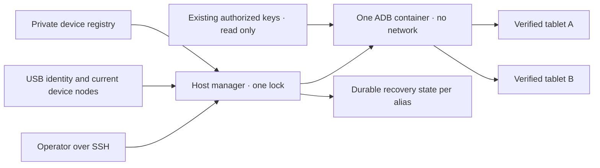

# Paylaşılan Android USB yöneticisi

<!-- language-navigation:start -->
<p dir="ltr">
<a href="android-usb-manager.md" lang="en" dir="ltr">English</a> · <a href="android-usb-manager.ar.md" lang="ar" dir="rtl">العربية</a> · <a href="android-usb-manager.bn.md" lang="bn" dir="ltr">বাংলা</a> · <a href="android-usb-manager.cs.md" lang="cs" dir="ltr">Čeština</a> · <a href="android-usb-manager.de.md" lang="de" dir="ltr">Deutsch</a> · <a href="android-usb-manager.es.md" lang="es" dir="ltr">Español</a> · <a href="android-usb-manager.fa.md" lang="fa" dir="rtl">فارسی</a> · <a href="android-usb-manager.fr.md" lang="fr" dir="ltr">Français</a><br>
<a href="android-usb-manager.he.md" lang="he" dir="rtl">עברית</a> · <a href="android-usb-manager.hi.md" lang="hi" dir="ltr">हिन्दी</a> · <a href="android-usb-manager.id.md" lang="id" dir="ltr">Bahasa Indonesia</a> · <a href="android-usb-manager.it.md" lang="it" dir="ltr">Italiano</a> · <a href="android-usb-manager.ja.md" lang="ja" dir="ltr">日本語</a> · <a href="android-usb-manager.ko.md" lang="ko" dir="ltr">한국어</a> · <a href="android-usb-manager.nl.md" lang="nl" dir="ltr">Nederlands</a> · <a href="android-usb-manager.pl.md" lang="pl" dir="ltr">Polski</a><br>
<a href="android-usb-manager.pt.md" lang="pt" dir="ltr">Português</a> · <a href="android-usb-manager.ru.md" lang="ru" dir="ltr">Русский</a> · <a href="android-usb-manager.th.md" lang="th" dir="ltr">ไทย</a> · <a href="android-usb-manager.tr.md" lang="tr" dir="ltr">Türkçe</a> · <a href="android-usb-manager.uk.md" lang="uk" dir="ltr">Українська</a> · <a href="android-usb-manager.vi.md" lang="vi" dir="ltr">Tiếng Việt</a> · <a href="android-usb-manager.zh-Hans.md" lang="zh-Hans" dir="ltr">简体中文</a> · <a href="android-usb-manager.zh-Hant.md" lang="zh-Hant" dir="ltr">繁體中文</a>
</p>
<!-- language-navigation:end -->

Paylaşılan yönetici, tablet başına ADB kapsayıcılarının yerine tek ADB sunucusu ve açık bir cihaz kaydı getirir. Ana makine hizmeti USB takılıp çıkarılmasını yönetir ve seçilen tabletlerde yeni Android açılışından sonra OTT'yi geri getirir. Normal oynatma ve uzak OTT protokolü bağımsız çalışmayı sürdürür.

## Dağıtım paketini edinme

`ottplay-control-server-deployment.tar.gz` ve `release-manifest.json` dosyalarını aynı [sürümden](https://github.com/open-ott-play/ottplay-control-server/releases) indirin. Arşivin SHA-256 değerini manifest kaydıyla karşılaştırın, sonra yeni dizine açın:

```sh
mkdir ott-android-release
tar -xzf ottplay-control-server-deployment.tar.gz -C ott-android-release
cd ott-android-release
python3 -B tools/android_usb_manager_remote.py --help
```

Arşiv `tools/`, `deploy/` ve `docs/` yapısını, aşağıdaki altı paylaşılan ve eski USB betiğiyle birlikte korur. Bu kılavuzdaki ana makine düzenini ve hazırlama adımlarını uygulayın; yalnızca açmak hizmet kurmaz. Yönetici, gözetmen ve işlem bağdaştırıcısını aynı sürüm revizyonunda tutun. Aktarım Dockerfile'ı bir derleme tarifidir; control-server OCI sürüm varlığı USB aktarım imajı değildir.

`v0.1.5-beta.6` dahil eski dağıtım arşivleri `tools/` içermez. Bunlarda eşleşen kaynak arşivini ya da tam paket içeren yeni sürümü kullanın. Farklı sürümlerin betiklerini karıştırmayın.

Uygulama şu parçalardan oluşur:

- [`tools/android_usb_manager.py`](../tools/android_usb_manager.py): kayıt, aktarım doğrulaması, kapsayıcı uzlaştırması ve sıraya konan komutlar.
- [`tools/android_usb_supervisor.py`](../tools/android_usb_supervisor.py): mevcut açılış, ekran kilidi ve ön plana getirme ilkesi.
- [`tools/android_usb_manager_remote.py`](../tools/android_usb_manager_remote.py): ikili çıktıyı koruyan SSH komut sarmalayıcısı.
- [`tools/android_usb_legacy_redirect.py`](../tools/android_usb_legacy_redirect.py): kurulu tablet başına komut yolu için isteğe bağlı yönlendirme.
- [`tools/android_usb_remote.py`](../tools/android_usb_remote.py): mevcut tablet başına çağıranlar için korunan eski SSH sarmalayıcısı.
- [`tools/android_usb_transaction.py`](../tools/android_usb_transaction.py): güvenilen bakım yardımcıları için atomik dosya aktarımı, APK hazırlama ve CDP işlemleri.
- [`deploy/android-usb-manager`](../deploy/android-usb-manager): örnek yapılandırma, systemd hizmeti, Synology DSM açılış betiği ve [aktarım imajı tarifi](../deploy/android-usb-manager/README.md).




## Yalıtım ve kimlik

Kapsayıcı, arka planda ADB daemon'ı barındıran boş bir `sleep` işlemi yerine ADB'yi ön planda çalıştırır. ADB yalnızca kapsayıcı loopback'ini dinler. Kapsayıcı `--network none`, yayımlanmamış portlar, salt okunur kök dosya sistemi, kaldırılmış tüm yetenekler, no-new-privileges ve sınırlı yazılabilir `/tmp` kullanır. Docker soketi veya geniş `/dev` ya da `/dev/bus/usb` bağlantısı yoktur. İmaj SHA-256 ile sabitlenmelidir.

Yönetici kapsayıcı belleğini 256 MiB, bellek ve takas toplamını 256 MiB ve CPU shares değerini 128 yapar. Eşit bellek/takas sınırları ek takasa izin vermez. CPU shares, çekişme sırasında kesin CPU kotası koymadan göreli önceliği azaltır. Hedef DSM çekirdeği ilgili denetleyiciyi desteklemediğinden kesin PID sınırı yoktur. `/tmp`, talebe göre ayrılan ve aynı bellek sınırına sayılan 256 MiB tmpfs tavanıdır; ek bellek değildir. APK hazırlama en çok 128 MiB kabul eder, kapsayıcı Python yığınında ikinci tam APK tutmamak için 1 MiB parçalarla yazar. Ana makinedeki istek hâlâ yükünü tamponlar.

Ön plandaki ADB'yi Docker ve ana makine yöneticisi gözetir. Kapsayıcı, imajdan gelen sağlık kontrollerini açıkça kapatır: başka yöneticinin kalp atışını veya yapılandırmasını kontrol etmek bu işlemi tanımlamaz. Kaynak ve sağlık kontrolü ayarları uzlaştırmaya dahildir; sapma olduğunda yönetici kilidi altında sahip olunan kapsayıcı değiştirilir.

Ön plan komutu `adb -L tcp:5037 nodaemon server` kullanır. ADB 29, dinleme bağımsız değişkeninde açık ana makine adını (`tcp:127.0.0.1:5037`) reddeder; ad atlandığında `-a` etkin olmadığından loopback'e bağlanır. İstemci tarafında `ADB_SERVER_SOCKET=tcp:127.0.0.1:5037` açık kalır. Bu uyumluluk sözdizimi port yayımlamaz veya tabletlerde ağ ADB'sini etkinleştirmez.

Yalnızca etkin kayıtlarla benzersiz eşleşen güncel cihaz düğümleri okuma/yazma izniyle eşlenir. Synology USB düğümleri root sahibi ve `0600` kipinde olabilir; bu nedenle ADB sınırlı kapsayıcı içinde root çalışır. Ana makine düğümlerini herkese yazılabilir yapmaz. Ana makine yöneticisi de düğümleri incelemek, Docker'ı yönetmek ve özel durumu korumak için root ister. Kapsayıcı yalıtımı bu ana makine yetkisini ayrıcalıksız yapmaz.

Kayıt cihazı USB seri numarası ve ürün, isteğe bağlı USB üretici/ürün kimlikleri, sonra Android model, SDK ve `android_id` ile tanımlar. Yönetici güncel USB yolunu ADB aktarım envanteriyle eşleştirir ve komutları doğrulanmış benzersiz seriyle yürütür. ADB yeniden başlayınca sayısal aktarım kimliklerini tekrar kullanabilir; komut gönderiminde bunlar asla kullanılmaz. Yinelenen seriler rastgele aktarım seçmek yerine reddedilir. Eşleşmeyen, eksik, yetkisiz veya belirsiz cihaza komut gitmemelidir.

Etkin kayıtların USB serileri benzersiz olmalıdır. Bazı ucuz tabletler `0123456789ABCDEF` yer tutucusunu paylaşır; model adları birlikte kaydı güvenli yapmaz. Ayrı ve gözden geçirilmiş fiziksel kimlik stratejisi uygulanana kadar çakışan cihazları kapalı tutun. Aynı seriyi yeniden etiketleyip başka aktarımı tanımladığını varsaymayın.

Birleştirme tek ADB işlemine eşlenen tüm tabletlere erişim verir. Yeniden başlatma veya hotplug uzlaştırması bu tabletlerin işlemlerini kesebilir. Komutlar ve uzlaştırma, yarışan değişiklikleri önlemek için `/var/lib/ott-android-manager/manager.lock` ana makine kilidini paylaşır. `kill-server`, `tcpip`, `connect` ve `root` gibi sunucu genelini veya aktarımı değiştiren komutlar genel ADB yolunda reddedilir.

## Özel yapılandırma ve anahtarlar

[`config.example.json`](../deploy/android-usb-manager/config.example.json) ile başlayın. Kimlikleri ve tümü sıfır imaj özeti bilerek kurgusaldır; iki örnek cihaz da kapalıdır. Örnek çalıştırılabilir dağıtım değildir.

Şu ana makine düzenini kullanın:

```text
/usr/local/etc/ott-android-manager/
  android_usb_manager.py
  android_usb_supervisor.py
  android_usb_transaction.py
  config.json
  ott-android-manager.service
  adb-keys/
    adbkey
    adbkey.pub
    vendor/
      additional-authorized.adb_key
/var/lib/ott-android-manager/
  manager.lock
  captures/
  <alias>/state.json
```

Yönetici, gözetmen ve işlem bağdaştırıcısı aynı incelenmiş revizyondan gelmelidir. Yapılandırma ve anahtarları Git ve sürüm arşivleri dışında tutun. Özel dizinleri `0700`, yapılandırma ve özel anahtarları `0600` yapın; kaynak/hizmet dosyaları root'a ait olsun. Anahtar dizini salt okunur bağlanır. `adbkey` ve `adbkey.pub` önceden bulunmalı; `vendor/` boş olsa da var olmalıdır. Ek, önceden yetkilendirilmiş özel anahtarlar `ADB_VENDOR_KEYS` ile sunulan `vendor/` içine konabilir. Her özel dosyaya `<source>.adb_key` adını verin: ADB 29 bu dizini tararken başka adları sessizce yok sayar. Eşleşen `<source>.adb_key.pub` isteğe bağlıdır. Yönetici kapsayıcıyı değiştirmeden önce tanınmayan adları reddeder.

Kapsayıcıyı emekliye ayırmadan önce mevcut yetkili anahtarları koruyun. Yinelenenleri açık anahtar parmak izleriyle bulun; özel anahtarları yazdırmayın. Sırf kapsayıcıları birleştirmek için mevcut anahtarı yenisiyle değiştirmeyin: bağlı olmayan tabletlerde onay gerektirebilir.

Her etkin cihaz, gözetimli hazırlamada kaydedilmiş tam kimlik gerektirir. OTT cihaz UUID'si, MAC adresi veya tahmin edilen değer Android `android_id` kanıtı değildir. Kayıtta bu alan eksikse `"enabled": false` tutun; kapalı kayıtlar eksik açıklayıcı metadata içerebilir ve asla eşlenmez veya yönetilmez.

`recover_on_boot` bağımsız ilkedir. Yalnız bakım komutları sunacak tablette false bırakın. Etkinse `package`, ön planda başlatılması o cihazda gerçekten test edilmiş uygulama olmalıdır.

## Otomatik kurtarma ne yapar

Varsayılan aralık her tamamlanan turdan sonra beş saniyedir; uçtan uca beş saniyelik kurtarma garantisi değildir. Yavaş USB işlemleri aralığı uzatır. Varsayılan komut zaman aşımı 60 saniye, sınır Android açılışı başına üç denemedir.

İlk gözlemde yönetici tableti uyandırmadan veya kilidini açmadan mevcut açılışı kaydeder. Sonraki yeni açılışta kurtarma etkinse:

1. `sys.boot_completed=1` bekler ve kimliği doğrular.
2. Kilidin PIN, parola veya desenle korunmadığına açık kanıt ister.
3. Ekranı uyandırır ve gerekirse sıradan kaydırma kilidini kaldırır.
4. Yapılandırılmış paketi açıp sürdürülen/odaklanmış activity'yi denetler.
5. Açılışı ve kilidi yeniden kontrol eder; ancak sonra başarılı kontrol noktası yazar.

Bilinmeyen veya korunan kilit durumu kurtarmayı durdurur. Eski Fire dağıtımı, [USB kurtarma](android-usb-recovery.md#read-only-keyguard-probe-on-older-firmware) belgesindeki shell izniyle korunan sondaya ihtiyaç duyar.

Tamamlanmış açılış `same_boot_no_action` döndürür. Normal ekran kapanması uyandırmaz. Yönetici video çözmeyi izlemez, takılan akışı yeniden başlatmaz veya uygulamayı sürekli ön planda tutmaz. Bunlar oynatıcıya ya da ayrı incelenmiş watchdog'a ait başka ilkelerdir.

## Komutlar

USB ana makinesinde:

```sh
sudo -n /usr/bin/python3 -B /usr/local/etc/ott-android-manager/android_usb_manager.py \
  --config /usr/local/etc/ott-android-manager/config.json status
```

Mevcut SSH ana makine takma adıyla başka bilgisayardan:

```sh
python3 tools/android_usb_manager_remote.py --host tablet-host status
python3 tools/android_usb_manager_remote.py --host tablet-host status lobby
python3 tools/android_usb_manager_remote.py --host tablet-host wake lobby
python3 tools/android_usb_manager_remote.py --host tablet-host recover lobby
python3 tools/android_usb_manager_remote.py --host tablet-host reboot lobby
python3 tools/android_usb_manager_remote.py --host tablet-host swipe lobby 400 600 400 100 --duration 500
python3 tools/android_usb_manager_remote.py --host tablet-host screenshot lobby lobby-check.png
python3 tools/android_usb_manager_remote.py --host tablet-host adb lobby -- shell getprop ro.product.model
python3 tools/android_usb_manager_remote.py --host tablet-host adb lobby -- exec-out screencap -p > lobby.png
```

`status` kapsayıcı yaratmadan, yeniden başlatmadan veya yapılandırmadan inceler. `tick` bir uzlaştırma/kurtarma turu yapar ve cihaz durumunu değiştirebilir; `run` turları tekrarlar ve hizmet içindir.

Sarmalayıcı PTY olmadan SSH kullanır, bağımsız değişkenleri shell için tek tek alıntılar, çıkış durumunu geçirir ve ADB çıktısını JSON'a dönüştürmez. Yönlendirilmiş ekran görüntüsünü geçerli saymadan önce çıkış durumunu kontrol edin. `screenshot` yalnız `lobby-check.png` gibi yalın PNG adı kabul eder ve USB ana makinesinde `<state_dir>/captures/` altına kaydeder. Ad `[A-Za-z0-9][A-Za-z0-9_-]{0,119}\.png` ile eşleşmelidir; yollar, ek noktalar ve örtük uzantılar kabul edilmez. PNG doğrulanır ve yalnız sahibine açık yeni dosya oluşturulur; sembolik bağlar ve mevcut adlar çekimden önce reddedilir. `adb ... exec-out` örneği ise baytları operatör bilgisayarındaki dosyaya aktarır. `swipe` güncel ekran geometrisini kullanır, korunan veya bilinmeyen kilidi reddeder; koordinatlar evrensel kilit açma hareketi değil örnektir. ADB yolları kapsayıcı/cihaz ad alanındadır: sarmalayıcı dizüstünden APK'yi kendiliğinden yüklemez. Dosya hazırlama ve ardından kurulum aşağıdaki atomik bağdaştırıcıyı kullanmalıdır.

`adb <alias> -- <arguments>` kısıtlı genel API değil, yönetici bakım arayüzüdür. İzin verilen `shell` komutu tableti değiştirebilir. Kimlik kontrollerini ve kilidi kullanın; sınırsız SSH veya Docker erişimini web uç noktasıyla açmayın.

## Açılış hizmeti ve geçiş

[systemd şablonu](../deploy/android-usb-manager/ott-android-manager.service) yöneticiyi sürekli çalıştırır ve biten işlemi on saniye sonra yeniden başlatır. [DSM sarmalayıcısı](../deploy/android-usb-manager/S99ott-android-manager.sh) dosyaları kontrol eder, birimi kurup etkinleştirir ve başlatır. Eski `ott-k8a-recovery.service` aktif veya etkinse başlatmayı reddeder. Başka dağıtımda Docker bağımlılığını ve yolları hizmet yöneticisine uyarlayın.

Kontrollü devir yapın:

1. Eski kapsayıcı yapılandırmasını, yetkili anahtar parmak izlerini ve kurtarma durumunu kaydedin. Özel dosyaları yalnız sahibine açık izinlerle yedekleyin.
2. Yeni kaynakları, incelenmiş imajı, anahtarları ve kaydı kurun. Hazırlanmamış cihazlar kapalı kalsın. Aynı tablet için ikinci gözetmen başlatmayın.
3. Eski kurtarma hizmetini durdurup devre dışı bırakın ve DSM açılış sarmalayıcısını emekliye ayırın. Geri dönüş için dosyaları koruyun. Hizmeti durdurmak ADB kapsayıcısını kaldırmaz.
4. Doğrulanan eski kontrol noktasını eşleşen yeni `<alias>/state.json` içine kopyalayın. Açılış kimliğini koruyun; sıradan geçiş kestirmesi olarak durumu sıfırlamayın.
5. Aynı USB arayüzü için yarışmamaları için ortak sunucudan önce eski ADB kapsayıcılarını durdurun.
6. Yeni DSM sarmalayıcısını root sahibi yürütülebilir olarak `/usr/local/etc/rc.d/` altına kurun; `start` çalıştırıp hizmet/durumu inceleyin.
7. Çağıranları taşıyın, normal komutları ve korunan kurtarma ilkesini doğrulayın; yalnız bağımlılıkları kaldırılmış eski kapsayıcıları silin.

Eski yardımcılar zararsız adlar altında bağımlılık saklar. `bootstrap.py`, `reconnect.py`, CDP bağdaştırıcıları ve shell takma adlarını denetleyin. Bootstrap eski kapsayıcıdan anahtar kopyalayabilir. Reconnect, içe aktarılan yardımcıdan `OLD` alıp daha sonra durdurabilir veya silebilir; yardımcıyı yeni ortak ada çevirmek yanlışlıkla ortak sunucuyu durdurabilir. Yalnız adı değiştirmek yerine istemcilerden otomatik kapsayıcı yönetimini kaldırın.

Gerçek ADB komutlarını takma adla yönetici üzerinden gönderin. Dosya hazırlama veya yerel CDP istemcisi için `docker exec` isteyen uyumluluk bağdaştırıcısı tüm işlem boyunca aynı ana makine kilidini tutmalıdır. Kilitli bölümde aynı kilidi alan ikinci işlem başlatmayın; uyumlu işlem içi yol kullanın veya işlemi bir kez düzenleyin. Geçici yönlendirme portları atayıp kullanımdan sonra kaldırın.

`android_usb_transaction.py` dosyasını yönetici ve gözetmenin yanına kurun. Standart girişten tek JSON isteği alır; `--config` aynı özel kaydı gösterir ve standart çıktıya ham işlem çıktısı döner. Desteklenen istekler:

- `pull`: `alias` ve mutlak `device_path`; en çok 128 MiB normal dosyanın baytlarını döndürür. Dizinler ve cihaz dosyaları reddedilir. Kesin hedef dosya boyut sınırı, aktarım sırasında büyüyen kaynağı da durdurur.
- `staged_adb`: `alias`, base64 `data` ve `arguments`; örneğin `["install", "-r", "@staged"]` veya `["push", "@staged", "/sdcard/example.json"]`.
- `cdp`: `alias`, uygulama `package`, isteğe bağlı `expected_model`, `__OTT_CDP_PORT__` içeren güvenilen Python istemci `source` ve JSON `request`.

Her istek cihazı doğrular; hazırlama, kullanım ve temizleme boyunca tek kilidi tutar. Dosyalar benzersiz geçici ad kullanır; temizleme devreye girmeden özel olarak `0600` kipinde ayrılır. APK kurulumu, ADB paket bağımsız değişken ayrıştırıcısının istediği `.apk` uzantısını korur. Ad çakışması mevcut dosyayı değiştirmez. Yazıcı sembolik bağ izlemeden yalnız kendi boş normal rezervasyonunu açar. Yardımcı Docker komutları gözlemlenen kapsayıcı kimliğini hedefler. CDP tam bir uygulama işlemi ve hata ayıklama soketini çözer, `tcp:0` ayırır, atanan portu istemci kaynağına koyar ve tamamlanmada veya hatada yalnız bu yönlendirmeyi kaldırır. Uzlaştırma bu adımlar arasında sunucuyu yeniden başlatamaz.

Taşınmış a1 yardımcısı, `copy_in` verisini aynı işlemde sonraki `adb install` veya `adb push` gelene kadar iş parçacığına yerel bellekte tutar. Bu çift tek ana makine işlemi olur; yalnız `copy_in` artık ortak kapsayıcı dosyası yaratmaz. Home Plan ve oynatıcı CDP yardımcıları aynı mekanizmayı kullanır. İstekler özel uygulama verisi ve güvenilen yürütülebilir kod içerebilir: yalnız mevcut yönetici SSH kanalıyla gönderin, bağdaştırıcıyı asla genel uç noktaya açmayın veya yükleri günlüğe yazmayın.

ADB yönlendirme portları tek tablete değil ortak sunucuya aittir. Dinamik CDP portları veya elle oturumlarda takma ad başına farklı port kullanın. Yönetici oluştururken `--no-rebind` zorlar, aynı eşlemeyi yeniden kullanmaya izin verir, başka takma adın yönlendirmesini ezmeyi/silmeyi reddeder. `forward --list` seçilen takma ada süzülür; `forward --remove-all` reddedilir.

Eski betiği yedekledikten sonra isteğe bağlı eski yönlendirme `/usr/local/etc/ott-k8a-recovery/android_usb_supervisor.py` konumuna kurulup eski elle komut girişleri korunabilir. Yalnız bilinen eski yapılandırma yolunu kabul eder, seri/model/SDK/Android ID'nin tam bir etkin yeni kayıtla eşleşmesini ister ve kendi işlemini yeni yöneticiyle değiştirir. Eski gözetmeni içe aktarmaz veya çalıştırmaz. `run` açıkça reddedilir: elle uyumluluk kurulsa bile eski hizmet ve açılış sarmalayıcısı kapalı/emekli kalmalıdır.

Geri dönüşte yeni hizmeti durdurup kapatın, açılış sarmalayıcısını kaldırın ve kapsayıcıyı durdurun. Eski anahtar/durum yedeklerini ve hizmeti geri getirin. Devam etmeden her USB cihazına tek yöneticinin sahip olduğunu doğrulayın.

## CDP'siz sürüm oynatıcıları

Üretim APK'sı WebView hata ayıklamayı bilerek kapatabilir. Bu durumda bağdaştırıcı `Application debugging socket is unavailable` bildirir; çalışan ADB bağlantısı bu soketi yaratmaz. Yönetici hata ayıklamayı açmaz, oynatıcı ayarlarını değiştirmez veya APK'yi değiştirmez.

OTT denetleyicisine bağlı oynatıcıda desteklenen salt okunur tanılamayı kullanın. `lobby` yerine yapılandırılmış OTT takma adını koyun:

```sh
ott -t 20 lobby debug -j
ott -t 20 lobby inspect -j
```

Komutlar kullanılabilir çalışma zamanı ve medya durumu dahil oynatıcının gözlemlerini döndürür. Keyfi JavaScript değerlendirmesi, doğrudan DOM incelemesi veya CDP bağlantısı vermez. İkisi de CDP soketi olmayan bağlı API 22 sürüm oynatıcısında doğrulandı; başka oynatıcıdaki kullanılabilirlik desteklediği yeteneklere bağlıdır.

## Kabul ve sınırlar

Sonuçları gerçekten kurulu kaynak/imaj ve donanımla ilişkilendirerek kaydedin. Birleştirme başında yalnız **k8a** eski kurtarma ilkesi için fiziksel kanıta sahipti. Eski gözetmeni gerçek tablet yeniden başlatmasından sonra kurtarıyor ve normal uykuyu bozmuyordu; bunlar yeni ortak uygulamanın kabulünü kanıtlamaz. Diğer kayıtlı tablet kimlikleri eksikti ve gözetimli doğrulamaya kadar kapalı kalmalıdır.

Ortak yönetici için gereken kabul kontrolleri:

- Mevcut yetkili USB kimliği ortak sunucudan görünür.
- Bilinmeyen, eksik, yinelenen ve kapalı cihazlar işlem almaz.
- Salt okunur komut ve ikili ekran görüntüsü doğru aktarımı kullanır.
- İlkenin açık olduğu cihazda yeni açılıştan kurtarma başarılıdır.
- Normal ekran kapanması uykuda kalır.
- USB yeniden numaralandırması yalnız beklenen eşlemeyi geri getirir.
- Hizmet yeniden başlatması durumu korur, çift kurtarmayı önler.
- Gerçek ana makine yeniden başlatması hizmeti ve sahiplik düzenini geri getirir.
- Her taşınmış yerel yardımcı eski kapsayıcıları yaratmadan çalışır.

Yapılmayan kontrolleri açıkça bildirin. Çalışan hizmet veya başarılı ön plan açılışı; akış oynatmayı, her tabletin uyumunu ya da NAS yeniden başladıktan sonra gözetimsiz kurtarmayı kanıtlamaz.
