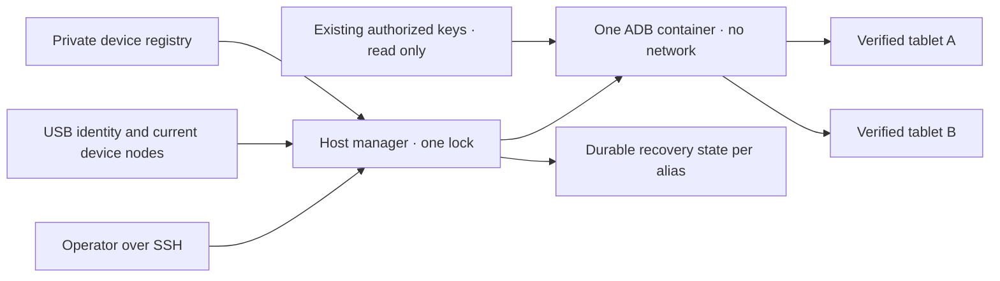

# Спільний менеджер Android USB

<!-- language-navigation:start -->
<p dir="ltr">
<a href="android-usb-manager.md" lang="en" dir="ltr">English</a> · <a href="android-usb-manager.ar.md" lang="ar" dir="rtl">العربية</a> · <a href="android-usb-manager.bn.md" lang="bn" dir="ltr">বাংলা</a> · <a href="android-usb-manager.cs.md" lang="cs" dir="ltr">Čeština</a> · <a href="android-usb-manager.de.md" lang="de" dir="ltr">Deutsch</a> · <a href="android-usb-manager.es.md" lang="es" dir="ltr">Español</a> · <a href="android-usb-manager.fa.md" lang="fa" dir="rtl">فارسی</a> · <a href="android-usb-manager.fr.md" lang="fr" dir="ltr">Français</a><br>
<a href="android-usb-manager.he.md" lang="he" dir="rtl">עברית</a> · <a href="android-usb-manager.hi.md" lang="hi" dir="ltr">हिन्दी</a> · <a href="android-usb-manager.id.md" lang="id" dir="ltr">Bahasa Indonesia</a> · <a href="android-usb-manager.it.md" lang="it" dir="ltr">Italiano</a> · <a href="android-usb-manager.ja.md" lang="ja" dir="ltr">日本語</a> · <a href="android-usb-manager.ko.md" lang="ko" dir="ltr">한국어</a> · <a href="android-usb-manager.nl.md" lang="nl" dir="ltr">Nederlands</a> · <a href="android-usb-manager.pl.md" lang="pl" dir="ltr">Polski</a><br>
<a href="android-usb-manager.pt.md" lang="pt" dir="ltr">Português</a> · <a href="android-usb-manager.ru.md" lang="ru" dir="ltr">Русский</a> · <a href="android-usb-manager.th.md" lang="th" dir="ltr">ไทย</a> · <a href="android-usb-manager.tr.md" lang="tr" dir="ltr">Türkçe</a> · <a href="android-usb-manager.uk.md" lang="uk" dir="ltr">Українська</a> · <a href="android-usb-manager.vi.md" lang="vi" dir="ltr">Tiếng Việt</a> · <a href="android-usb-manager.zh-Hans.md" lang="zh-Hans" dir="ltr">简体中文</a> · <a href="android-usb-manager.zh-Hant.md" lang="zh-Hant" dir="ltr">繁體中文</a>
</p>
<!-- language-navigation:end -->

Спільний менеджер замінює окремі ADB-контейнери планшетів одним сервером ADB і явним реєстром пристроїв. Хостова служба керує підключенням USB та на вибраних планшетах відновлює OTT після нового запуску Android. Звичайне відтворення й віддалений протокол OTT продовжують працювати незалежно.

## Отримання пакета розгортання

Завантажте `ottplay-control-server-deployment.tar.gz` і `release-manifest.json` з одного [випуску](https://github.com/open-ott-play/ottplay-control-server/releases). Звірте SHA-256 архіву з відповідним записом маніфесту й розпакуйте в новий каталог:

```sh
mkdir ott-android-release
tar -xzf ottplay-control-server-deployment.tar.gz -C ott-android-release
cd ott-android-release
python3 -B tools/android_usb_manager_remote.py --help
```

Архів зберігає `tools/`, `deploy/` і `docs/`, включно з усіма шістьма переліченими нижче спільними та застарілими USB-скриптами. Дотримуйтеся структури хоста й кроків підготовки цього посібника; саме розпакування не встановлює службу. Менеджер, supervisor і адаптер транзакцій мають бути з однієї ревізії випуску. Транспортний Dockerfile — рецепт складання; OCI-артефакт випуску control-server не є образом USB-транспорту.

Старі архіви розгортання, зокрема `v0.1.5-beta.6`, не містять `tools/`. Для них беріть відповідний архів джерел або новіший випуск із повним пакетом. Не змішуйте скрипти різних версій.

Реалізація складається з:

- [`tools/android_usb_manager.py`](../tools/android_usb_manager.py): реєстр, перевірка транспорту, узгодження контейнерів і послідовне виконання команд.
- [`tools/android_usb_supervisor.py`](../tools/android_usb_supervisor.py): наявна політика запуску, блокування й відновлення переднього плану.
- [`tools/android_usb_manager_remote.py`](../tools/android_usb_manager_remote.py): SSH-обгортка зі збереженням двійкового виводу.
- [`tools/android_usb_legacy_redirect.py`](../tools/android_usb_legacy_redirect.py): необов'язкове перенаправлення вже встановленого шляху команд окремого планшета.
- [`tools/android_usb_remote.py`](../tools/android_usb_remote.py): стара SSH-обгортка для наявних окремих клієнтів планшетів.
- [`tools/android_usb_transaction.py`](../tools/android_usb_transaction.py): атомарне передавання файлів, підготовка APK та операції CDP для довірених сервісних помічників.
- [`deploy/android-usb-manager`](../deploy/android-usb-manager): приклад конфігурації, служба systemd, стартовий скрипт Synology DSM та [рецепт транспортного образу](../deploy/android-usb-manager/README.md).




## Ізоляція та ідентичність

Контейнер запускає ADB на передньому плані, а не бездіяльний процес `sleep` із демоном ADB у фоні. ADB слухає лише loopback контейнера. Використовуються `--network none`, відсутність опублікованих портів, коренева файлова система лише для читання, видалення всіх capabilities, no-new-privileges та обмежений записуваний `/tmp`. Немає Docker socket чи широкого монтування `/dev` або `/dev/bus/usb`. Образ необхідно закріпити за SHA-256.

Менеджер установлює 256 MiB пам'яті контейнера, 256 MiB сумарно пам'яті й swap та CPU shares 128. Однакові ліміти пам'яті/swap не дозволяють додаткового swap. CPU shares знижують відносний пріоритет за конкуренції без жорсткої квоти CPU. Жорсткого ліміту PID немає, бо ядро цільової DSM не підтримує цей контролер. `/tmp` — tmpfs зі стелею 256 MiB, виділяється на вимогу й ураховується в тому самому ліміті пам'яті, а не додається до нього. Підготовка APK приймає до 128 MiB і пише блоками 1 MiB, щоб не тримати ще одну повну копію APK у купі Python контейнера. Запит на хості й надалі буферизує вміст.

За процесом ADB стежать Docker і хостовий менеджер. Контейнер явно вимикає успадковані перевірки здоров'я образу: перевірка heartbeat чи конфігурації іншого менеджера не описує цей процес. Параметри ресурсів і перевірок входять до узгодження; розбіжність спричиняє заміну власного контейнера під блокуванням менеджера.

Команда переднього плану — `adb -L tcp:5037 nodaemon server`. ADB 29 відхиляє явне ім'я хоста в аргументі слухача (`tcp:127.0.0.1:5037`); без нього прив'язується loopback, бо `-a` не ввімкнено. Клієнтський `ADB_SERVER_SOCKET=tcp:127.0.0.1:5037` залишається явним. Такий сумісний синтаксис не публікує порт і не вмикає мережевий ADB на планшетах.

З правами читання/запису передаються лише поточні вузли, які однозначно відповідають увімкненим записам. USB-вузли Synology можуть належати root і мати режим `0600`, тому ADB працює як root усередині обмеженого контейнера. Вузли хоста не стають записуваними для всіх. Хостовому менеджеру теж потрібні повноваження root для перевірки вузлів, Docker і збереження приватного стану. Ізоляція контейнера не скасовує цих повноважень хоста.

Реєстр ідентифікує пристрій за USB-серійним номером і продуктом, необов'язково USB ID виробника/продукту, а далі моделлю Android, SDK та `android_id`. Менеджер зіставляє поточний USB-шлях з інвентарем транспортів ADB, потім виконує команди за перевіреним унікальним серійним номером. ADB може повторно використовувати числові ID транспорту після рестарту; ними ніколи не адресують команди. Дублікати серійних номерів спричиняють відмову, а не довільний вибір. Невідповідний, відсутній, неавторизований чи неоднозначний пристрій не повинен отримувати команди.

Увімкнені записи мають унікальні USB-серійні номери. Деякі дешеві планшети спільно використовують заглушку `0123456789ABCDEF`; різні моделі не роблять одночасну реєстрацію безпечною. Залишайте конфліктні пристрої вимкненими до реалізації окремо перевіреної стратегії фізичної ідентифікації. Перейменування того самого серійного номера не позначає інший транспорт.

Об'єднання дає одному ADB-процесу доступ до всіх підключених планшетів. Рестарт чи узгодження hotplug можуть переривати операції на них. Команди й узгодження використовують спільне блокування хоста `/var/lib/ott-android-manager/manager.lock`, щоб уникати конкурентних змін. Загальний шлях ADB відхиляє глобальні та транспортні команди, як-от `kill-server`, `tcpip`, `connect` і `root`.

## Приватна конфігурація та ключі

Почніть із [`config.example.json`](../deploy/android-usb-manager/config.example.json). Ідентичності й digest образу з нулів навмисно вигадані; обидва приклади пристроїв вимкнені. Приклад не є працездатним розгортанням.

Використовуйте структуру хоста:

```text
/usr/local/etc/ott-android-manager/
  android_usb_manager.py
  android_usb_supervisor.py
  android_usb_transaction.py
  config.json
  ott-android-manager.service
  adb-keys/
    adbkey
    adbkey.pub
    vendor/
      additional-authorized.adb_key
/var/lib/ott-android-manager/
  manager.lock
  captures/
  <alias>/state.json
```

Менеджер, supervisor і адаптер мають походити з однієї перевіреної ревізії. Конфігурацію й ключі тримайте поза Git та архівами випусків. Приватним каталогам призначте `0700`, конфігурації й приватним ключам `0600`, а джерелам і службовим файлам власника root. Каталог ключів монтується лише для читання. `adbkey` і `adbkey.pub` мають уже існувати; `vendor/` потрібен навіть порожній. Додаткові раніше авторизовані приватні ключі можна покласти до `vendor/`, що передається через `ADB_VENDOR_KEYS`. Називайте приватний файл `<source>.adb_key`: ADB 29 мовчки ігнорує інші назви під час сканування. Парний `<source>.adb_key.pub` необов'язковий. Менеджер відхиляє невідомі назви до зміни контейнера.

Збережіть наявні авторизовані ключі перед виведенням контейнерів з роботи. Порівнюйте відбитки публічних ключів для пошуку дублікатів; приватні ключі не виводьте. Не замінюйте наявний ключ новим лише для об'єднання: це може вимагати підтвердження на від'єднаних планшетах.

Кожен увімкнений пристрій потребує повної ідентичності, записаної під час підготовки з участю людини. UUID пристрою OTT, MAC чи здогад не доводять Android `android_id`. Якщо поле відсутнє у свідченні, залиште `"enabled": false`; вимкнені записи можуть мати неповні описові метадані й ніколи не передаються та не керуються.

`recover_on_boot` — незалежна політика. Залиште false на планшеті лише для обслуговування. Якщо ввімкнено, `package` має вказувати застосунок, запуск якого на передньому плані реально перевірили на цьому пристрої.

## Дія автоматичного відновлення

Типовий інтервал — п'ять секунд після кожного завершеного проходу, а не гарантія повного відновлення за п'ять секунд. Повільні USB-операції подовжують інтервал. Типовий таймаут команди — 60 секунд, ліміт — три спроби на запуск Android.

За першого спостереження менеджер записує поточний запуск, не будячи й не розблоковуючи планшет. За наступного нового запуску з увімкненим відновленням він:

1. Чекає `sys.boot_completed=1` і перевіряє ідентичність.
2. Вимагає явного доказу, що блокування не захищене PIN, паролем чи графічним ключем.
3. Будить дисплей і за потреби прибирає звичайний свайп-блокувальник.
4. Запускає заданий пакет і перевіряє відновлену/фокусовану activity.
5. Знову перевіряє запуск і блокування й лише тоді записує успішну контрольну точку.

Невідомий або захищений стан блокування зупиняє відновлення. Старе розгортання Fire потребує захищеної shell-дозволом проби з [відновлення USB](android-usb-recovery.md#read-only-keyguard-probe-on-older-firmware).

Уже завершений запуск повертає `same_boot_no_action`. Звичайне вимкнення екрана не будить пристрій. Менеджер не стежить за декодуванням відео, не перезапускає завислий потік і не нав'язує постійно передній план. Це інші політики програвача чи окремо перевіреного watchdog.

## Команди

На USB-хості:

```sh
sudo -n /usr/bin/python3 -B /usr/local/etc/ott-android-manager/android_usb_manager.py \
  --config /usr/local/etc/ott-android-manager/config.json status
```

З іншого комп'ютера через наявний SSH-псевдонім хоста:

```sh
python3 tools/android_usb_manager_remote.py --host tablet-host status
python3 tools/android_usb_manager_remote.py --host tablet-host status lobby
python3 tools/android_usb_manager_remote.py --host tablet-host wake lobby
python3 tools/android_usb_manager_remote.py --host tablet-host recover lobby
python3 tools/android_usb_manager_remote.py --host tablet-host reboot lobby
python3 tools/android_usb_manager_remote.py --host tablet-host swipe lobby 400 600 400 100 --duration 500
python3 tools/android_usb_manager_remote.py --host tablet-host screenshot lobby lobby-check.png
python3 tools/android_usb_manager_remote.py --host tablet-host adb lobby -- shell getprop ro.product.model
python3 tools/android_usb_manager_remote.py --host tablet-host adb lobby -- exec-out screencap -p > lobby.png
```

`status` перевіряє без створення, рестарту чи переналаштування контейнера. `tick` виконує один прохід узгодження/відновлення й може змінювати стан; `run` повторює проходи та призначений службі.

Обгортка використовує SSH без PTY, екранує аргументи shell окремо, передає код завершення й не перетворює ADB-вивід на JSON. Перевірте код завершення, перш ніж вважати перенаправлений знімок чинним. `screenshot` приймає лише просту PNG-назву, як `lobby-check.png`, і зберігає в `<state_dir>/captures/` на USB-хості. Назва має відповідати `[A-Za-z0-9][A-Za-z0-9_-]{0,119}\.png`; шляхи, додаткові крапки та неявні розширення відхиляються. Команда перевіряє PNG і створює новий файл лише для власника, відхиляючи symlink і наявні назви до захоплення. Натомість `adb ... exec-out` передає байти у файл на комп'ютері оператора. `swipe` використовує актуальну геометрію екрана й відхиляє захищене або невідоме блокування; координати є прикладами, не універсальним жестом. Шляхи ADB належать просторам контейнера/пристрою: обгортка сама не завантажує APK з ноутбука. Підготовка файлу й подальше встановлення мають використовувати атомарний адаптер нижче.

`adb <alias> -- <arguments>` — адміністративний сервісний інтерфейс, а не обмежений публічний API. Дозволена команда `shell` може змінювати планшет. Використовуйте ідентифікацію й блокування; не виставляйте необмежений SSH чи Docker через вебкінцеву точку.

## Автозапуск і міграція

[Шаблон systemd](../deploy/android-usb-manager/ott-android-manager.service) запускає менеджер постійно й відновлює завершений процес через десять секунд. [Обгортка DSM](../deploy/android-usb-manager/S99ott-android-manager.sh) перевіряє файли, встановлює/вмикає unit і запускає його. Вона відмовляє, поки старий `ott-k8a-recovery.service` активний або ввімкнений. Для іншого дистрибутива пристосуйте залежність Docker і шляхи до його менеджера служб.

Виконайте контрольоване передавання:

1. Запишіть конфігурацію контейнерів, відбитки авторизованих ключів і стан відновлення. Резервні приватні файли мають бути доступні лише власнику.
2. Установіть нові джерела, перевірений образ, ключі й реєстр. Непідготовлені пристрої залиште вимкненими. Не запускайте другий supervisor того самого планшета.
3. Зупиніть і вимкніть стару службу відновлення та виведіть її DSM-обгортку з автозапуску. Файли збережіть для відкоту. Саме зупинення служби не видаляє її ADB-контейнер.
4. Скопіюйте перевірену стару контрольну точку до відповідного нового `<alias>/state.json`. Збережіть ідентичність запуску; не скидайте стан як звичайне спрощення міграції.
5. Зупиніть старі ADB-контейнери перед спільним сервером, щоб два сервери не змагалися за USB-інтерфейс.
6. Установіть нову виконувану DSM-обгортку з власником root до `/usr/local/etc/rc.d/`, виконайте `start` і перевірте службу/стан.
7. Переведіть клієнтів, перевірте звичайні команди й збережену політику; лише потім видаліть старі контейнери, чиї залежності виведено з роботи.

Старі помічники часто приховують залежності за невинними назвами. Перевірте `bootstrap.py`, `reconnect.py`, CDP-адаптери й shell-псевдоніми. Bootstrap може копіювати ключі зі старого контейнера. Reconnect може отримати `OLD` з імпортованого модуля й потім зупинити або видалити його; проста заміна на спільне ім'я здатна випадково зупинити новий сервер. Приберіть автоматичне керування контейнерами з клієнтів замість самої заміни назви.

Справжні ADB-команди направляйте через менеджер за псевдонімом. Адаптер сумісності, якому потрібен `docker exec` для файлів або локального CDP-клієнта, має тримати те саме блокування впродовж усієї транзакції. Усередині заблокованої секції не запускайте другий процес, який бере це блокування; використовуйте сумісний внутрішньопроцесний шлях або оформте транзакцію один раз. Виділяйте тимчасові порти перенаправлення й прибирайте після використання.

Установіть `android_usb_transaction.py` поруч із менеджером і supervisor. Він приймає один JSON-запит через стандартний ввід, `--config` вказує на той самий приватний реєстр, а стандартний вивід повертає сирий результат. Підтримуються:

- `pull`: `alias` та абсолютний `device_path`; повертає байти одного звичайного файлу до 128 MiB. Каталоги й файли пристроїв відхиляються. Жорсткий ліміт цільового файлу також зупиняє джерело, що зростає під час передачі.
- `staged_adb`: `alias`, base64 `data` й `arguments`, наприклад `["install", "-r", "@staged"]` або `["push", "@staged", "/sdcard/example.json"]`.
- `cdp`: `alias`, пакет застосунку `package`, необов'язковий `expected_model`, довірений Python-клієнт у `source` з `__OTT_CDP_PORT__` і його JSON `request`.

Кожен запит перевіряє пристрій і тримає одне блокування під час підготовки, роботи й очищення. Файли мають унікальні тимчасові назви, резервуються виключно з режимом `0600` до ввімкнення очищення. Встановлення APK зберігає суфікс `.apk`, необхідний парсеру пакетних аргументів ADB. Колізія назви не змінює наявний файл. Записувач відкриває лише власний порожній звичайний зарезервований файл, не слідуючи symlink. Допоміжні Docker-команди адресують встановлений ID контейнера. CDP визначає рівно один процес застосунку та його налагоджувальний сокет, виділяє `tcp:0`, підставляє порт у джерело клієнта й прибирає лише це перенаправлення після успіху або помилки. Узгодження не може перезапустити сервер між кроками.

Перенесений помічник a1 тримає дані `copy_in` у пам'яті потоку до наступного `adb install` чи `adb push` у тому самому процесі. Пара стає однією хостовою транзакцією; сам `copy_in` більше не створює спільного файлу контейнера. Home Plan і CDP-помічники програвача використовують той самий механізм. Запити можуть містити приватні дані застосунків та довірений виконуваний код: передавайте їх лише наявним адміністративним SSH-каналом, ніколи не публікуйте адаптер і не журналюйте вміст запитів.

Порти ADB forwarding належать спільному серверу, не окремому планшету. Використовуйте динамічні CDP-порти або різні порти для псевдонімів ручних сеансів. Менеджер примусово додає `--no-rebind`, дозволяє повторне використання однакового відображення й відхиляє перезапис або видалення чужого перенаправлення. `forward --list` відфільтровано за вибраним псевдонімом; `forward --remove-all` відхиляється.

Після резервування старого скрипту необов'язкове перенаправлення можна встановити до `/usr/local/etc/ott-k8a-recovery/android_usb_supervisor.py`, зберігаючи старі ручні входи. Воно приймає лише відомий старий шлях конфігурації, вимагає точної відповідності serial/model/SDK/Android ID одному ввімкненому новому запису й замінює свій процес новим менеджером. Старий supervisor не імпортується й не запускається. `run` явно відхиляється: стара служба та стартова обгортка мають залишатися вимкненими/виведеними навіть за ручної сумісності.

Для відкоту зупиніть і вимкніть нову службу, виведіть стартову обгортку та зупиніть контейнер. Відновіть старі копії ключів/стану й стару службу. Перед продовженням перевірте, що кожним USB-пристроєм володіє лише один менеджер.

## Релізні програвачі без CDP

Виробничий APK може навмисно вимикати налагодження WebView. Тоді адаптер повідомляє `Application debugging socket is unavailable`; працездатний ADB не створює цього сокета. Менеджер не вмикає налагодження, не змінює налаштування програвача й не замінює APK.

Для програвача, вже підключеного до OTT-контролера, використовуйте підтримувану діагностику лише для читання. Замініть `lobby` його заданим OTT-псевдонімом:

```sh
ott -t 20 lobby debug -j
ott -t 20 lobby inspect -j
```

Команди повертають спостереження програвача, зокрема доступний стан виконання й медіа. Вони не дають довільного виконання JavaScript, прямого огляду DOM чи CDP-підключення. Обидві перевірено на підключеному релізному програвачі API 22 без CDP-сокета; доступність на іншому залежить від його можливостей.

## Приймання та обмеження

Фіксуйте результати щодо реально встановлених джерел, образу й обладнання. На початку об'єднання лише **k8a** мав фізичні докази старої політики. Його старий supervisor відновлював після справжнього рестарту планшета й не заважав звичайному сну; це не підтверджує приймання нової спільної реалізації. Інші збережені ідентичності були неповними й мають залишатися вимкненими до перевірки з участю людини.

Необхідне приймання спільного менеджера:

- Наявна авторизована USB-ідентичність з'являється через спільний сервер.
- Невідомі, відсутні, дубльовані й вимкнені пристрої не отримують дій.
- Команда лише для читання й двійковий знімок використовують потрібний транспорт.
- Відновлення після нового запуску успішне на пристрої з увімкненою політикою.
- Звичайне вимкнення екрана залишається сном.
- Повторна USB-нумерація відновлює лише очікуване відображення.
- Рестарт служби зберігає стан і не допускає подвійного відновлення.
- Справжній рестарт хоста відновлює службу й розподіл володіння.
- Кожен перенесений локальний помічник працює без відтворення старих контейнерів.

Явно зазначайте невиконані перевірки. Запущена служба чи успішний передній план не доводять відтворення потоку, сумісності кожного планшета або автономного відновлення після рестарту NAS.
