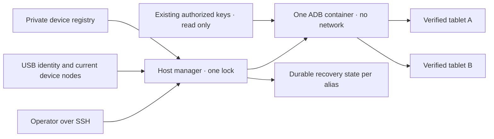

# Trình quản lý USB Android dùng chung

<!-- language-navigation:start -->
<p dir="ltr">
<a href="android-usb-manager.md" lang="en" dir="ltr">English</a> · <a href="android-usb-manager.ar.md" lang="ar" dir="rtl">العربية</a> · <a href="android-usb-manager.bn.md" lang="bn" dir="ltr">বাংলা</a> · <a href="android-usb-manager.cs.md" lang="cs" dir="ltr">Čeština</a> · <a href="android-usb-manager.de.md" lang="de" dir="ltr">Deutsch</a> · <a href="android-usb-manager.es.md" lang="es" dir="ltr">Español</a> · <a href="android-usb-manager.fa.md" lang="fa" dir="rtl">فارسی</a> · <a href="android-usb-manager.fr.md" lang="fr" dir="ltr">Français</a><br>
<a href="android-usb-manager.he.md" lang="he" dir="rtl">עברית</a> · <a href="android-usb-manager.hi.md" lang="hi" dir="ltr">हिन्दी</a> · <a href="android-usb-manager.id.md" lang="id" dir="ltr">Bahasa Indonesia</a> · <a href="android-usb-manager.it.md" lang="it" dir="ltr">Italiano</a> · <a href="android-usb-manager.ja.md" lang="ja" dir="ltr">日本語</a> · <a href="android-usb-manager.ko.md" lang="ko" dir="ltr">한국어</a> · <a href="android-usb-manager.nl.md" lang="nl" dir="ltr">Nederlands</a> · <a href="android-usb-manager.pl.md" lang="pl" dir="ltr">Polski</a><br>
<a href="android-usb-manager.pt.md" lang="pt" dir="ltr">Português</a> · <a href="android-usb-manager.ru.md" lang="ru" dir="ltr">Русский</a> · <a href="android-usb-manager.th.md" lang="th" dir="ltr">ไทย</a> · <a href="android-usb-manager.tr.md" lang="tr" dir="ltr">Türkçe</a> · <a href="android-usb-manager.uk.md" lang="uk" dir="ltr">Українська</a> · <a href="android-usb-manager.vi.md" lang="vi" dir="ltr">Tiếng Việt</a> · <a href="android-usb-manager.zh-Hans.md" lang="zh-Hans" dir="ltr">简体中文</a> · <a href="android-usb-manager.zh-Hant.md" lang="zh-Hant" dir="ltr">繁體中文</a>
</p>
<!-- language-navigation:end -->

Trình quản lý chung thay các container ADB riêng cho từng máy tính bảng bằng một máy chủ ADB và sổ đăng ký thiết bị tường minh. Dịch vụ trên máy chủ quản lý cắm/rút USB và khôi phục OTT sau lần khởi động Android mới trên các máy được chọn. Phát nội dung thông thường và giao thức OTT từ xa tiếp tục hoạt động độc lập.

## Lấy gói triển khai

Tải `ottplay-control-server-deployment.tar.gz` và `release-manifest.json` từ cùng một [bản phát hành](https://github.com/open-ott-play/ottplay-control-server/releases). So sánh SHA-256 của gói với mục tương ứng trong manifest rồi giải nén vào thư mục mới:

```sh
mkdir ott-android-release
tar -xzf ottplay-control-server-deployment.tar.gz -C ott-android-release
cd ott-android-release
python3 -B tools/android_usb_manager_remote.py --help
```

Gói giữ nguyên `tools/`, `deploy/` và `docs/`, gồm cả sáu script USB chung và cũ liệt kê bên dưới. Làm theo bố trí máy chủ và các bước cấp cấu hình trong hướng dẫn; giải nén đơn thuần không cài dịch vụ. Giữ trình quản lý, supervisor và bộ chuyển tiếp giao dịch ở cùng một revision phát hành. Dockerfile vận chuyển là công thức dựng; tệp OCI phát hành của control-server không phải ảnh vận chuyển USB.

Các gói triển khai cũ, gồm `v0.1.5-beta.6`, không chứa `tools/`. Với chúng, dùng gói mã nguồn tương ứng hoặc bản mới hơn có gói triển khai đầy đủ. Không trộn script của các phiên bản.

Các thành phần gồm:

- [`tools/android_usb_manager.py`](../tools/android_usb_manager.py): sổ đăng ký, xác minh đường truyền, đồng bộ container và tuần tự hóa lệnh.
- [`tools/android_usb_supervisor.py`](../tools/android_usb_supervisor.py): chính sách hiện có về khởi động, khóa màn hình và khôi phục tiền cảnh.
- [`tools/android_usb_manager_remote.py`](../tools/android_usb_manager_remote.py): lớp bọc lệnh SSH giữ nguyên đầu ra nhị phân.
- [`tools/android_usb_legacy_redirect.py`](../tools/android_usb_legacy_redirect.py): chuyển hướng tùy chọn cho đường dẫn lệnh riêng từng máy đã cài.
- [`tools/android_usb_remote.py`](../tools/android_usb_remote.py): lớp bọc SSH cũ, giữ cho các bên gọi riêng từng máy hiện có.
- [`tools/android_usb_transaction.py`](../tools/android_usb_transaction.py): truyền tệp nguyên tử, chuẩn bị APK và thao tác CDP cho công cụ bảo trì tin cậy.
- [`deploy/android-usb-manager`](../deploy/android-usb-manager): cấu hình mẫu, dịch vụ systemd, script khởi động Synology DSM và [công thức ảnh vận chuyển](../deploy/android-usb-manager/README.md).




## Cách ly và định danh

Container chạy ADB ở tiền cảnh thay cho tiến trình `sleep` nhàn rỗi kèm daemon ADB nền. ADB chỉ lắng nghe trên loopback trong container. Container dùng `--network none`, không công bố cổng, hệ tệp gốc chỉ đọc, bỏ mọi capability, no-new-privileges và `/tmp` ghi được có giới hạn. Không có socket Docker hay mount rộng `/dev` hoặc `/dev/bus/usb`. Ảnh phải được ghim bằng SHA-256.

Trình quản lý áp dụng 256 MiB bộ nhớ, tổng bộ nhớ và swap 256 MiB cùng CPU shares 128. Giới hạn bộ nhớ/swap bằng nhau không cho phép swap bổ sung. CPU shares giảm ưu tiên tương đối khi tranh chấp nhưng không đặt hạn mức CPU cứng. Không có giới hạn PID cứng vì kernel DSM đích không hỗ trợ bộ điều khiển đó. `/tmp` là tmpfs trần 256 MiB, cấp phát theo nhu cầu và tính trong cùng giới hạn bộ nhớ, không phải phần bổ sung. Chuẩn bị APK chấp nhận tối đa 128 MiB, ghi theo khối 1 MiB để không giữ thêm một APK đầy đủ trong heap Python của container. Yêu cầu phía máy chủ vẫn đệm toàn bộ tải dữ liệu.

Docker và trình quản lý máy chủ giám sát ADB tiền cảnh. Container chủ động tắt health check kế thừa từ ảnh: kiểm tra heartbeat hay cấu hình của trình quản lý khác không mô tả tiến trình này. Thiết lập tài nguyên và health check thuộc quá trình đồng bộ; sai lệch khiến container do trình quản lý sở hữu bị thay dưới khóa chung.

Lệnh tiền cảnh là `adb -L tcp:5037 nodaemon server`. ADB 29 từ chối hostname tường minh trong đối số lắng nghe (`tcp:127.0.0.1:5037`); bỏ hostname sẽ gắn loopback vì không bật `-a`. Phía client vẫn giữ rõ `ADB_SERVER_SOCKET=tcp:127.0.0.1:5037`. Cú pháp tương thích này không công bố cổng hay bật ADB qua mạng trên máy tính bảng.

Chỉ các nút thiết bị hiện tại khớp duy nhất với mục đã bật được ánh xạ, với quyền đọc/ghi. Nút USB Synology có thể thuộc root và mang chế độ `0600`; vì vậy ADB chạy root bên trong container bị hạn chế. Không biến nút trên máy chủ thành ghi được với mọi người. Trình quản lý máy chủ cũng cần root để kiểm tra nút, quản lý Docker và giữ trạng thái riêng tư. Cách ly container không loại bỏ quyền máy chủ đó.

Sổ đăng ký định danh qua số sê-ri và sản phẩm USB, tùy chọn ID nhà sản xuất/sản phẩm USB, rồi mẫu Android, SDK và `android_id`. Trình quản lý đối chiếu đường dẫn USB hiện tại với danh sách đường truyền ADB, sau đó dùng sê-ri duy nhất đã xác minh để chạy lệnh. ADB có thể tái sử dụng ID đường truyền dạng số sau khi khởi động lại nên không bao giờ dùng chúng để gửi lệnh. Sê-ri trùng gây từ chối, không chọn tùy tiện. Thiết bị không khớp, vắng mặt, chưa được cấp quyền hoặc mơ hồ không được nhận lệnh.

Các mục bật phải có sê-ri USB duy nhất. Một số máy giá rẻ dùng chung giá trị giữ chỗ `0123456789ABCDEF`; tên mẫu khác nhau không làm đăng ký đồng thời trở nên an toàn. Giữ các thiết bị xung đột ở trạng thái tắt đến khi triển khai chiến lược định danh vật lý riêng đã được xem xét. Đổi nhãn cùng một sê-ri không có nghĩa là đường truyền khác.

Hợp nhất cho một tiến trình ADB truy cập mọi máy đã ánh xạ. Khởi động lại hoặc đồng bộ hotplug có thể ngắt thao tác trên chúng. Lệnh và đồng bộ dùng chung khóa máy chủ `/var/lib/ott-android-manager/manager.lock` để ngăn thay đổi cạnh tranh. Đường lệnh ADB chung từ chối lệnh toàn máy chủ hoặc đổi đường truyền như `kill-server`, `tcpip`, `connect` và `root`.

## Cấu hình riêng tư và khóa

Bắt đầu bằng [`config.example.json`](../deploy/android-usb-manager/config.example.json). Định danh và digest ảnh toàn số không được cố ý làm giả; cả hai thiết bị mẫu đều tắt. Mẫu không phải một triển khai chạy được.

Dùng bố trí máy chủ sau:

```text
/usr/local/etc/ott-android-manager/
  android_usb_manager.py
  android_usb_supervisor.py
  android_usb_transaction.py
  config.json
  ott-android-manager.service
  adb-keys/
    adbkey
    adbkey.pub
    vendor/
      additional-authorized.adb_key
/var/lib/ott-android-manager/
  manager.lock
  captures/
  <alias>/state.json
```

Trình quản lý, supervisor và bộ giao dịch phải cùng revision đã được rà soát. Giữ cấu hình và khóa ngoài Git cùng gói phát hành. Thư mục riêng tư dùng `0700`, cấu hình và khóa riêng dùng `0600`; tệp nguồn/dịch vụ thuộc root. Thư mục khóa được mount chỉ đọc. `adbkey` và `adbkey.pub` phải có sẵn; `vendor/` phải tồn tại kể cả rỗng. Khóa riêng bổ sung đã cấp quyền trước đó có thể đặt trong `vendor/`, cung cấp qua `ADB_VENDOR_KEYS`. Đặt tên mỗi tệp riêng là `<source>.adb_key`: ADB 29 âm thầm bỏ qua tên khác khi quét. Tệp đi kèm `<source>.adb_key.pub` là tùy chọn. Trình quản lý từ chối tên không nhận biết trước khi đổi container.

Giữ các khóa đã được cấp quyền trước khi loại bỏ container. So sánh vân tay khóa công khai để nhận ra bản trùng; không in khóa riêng. Không thay khóa đang có bằng khóa mới chỉ để hợp nhất container: điều đó có thể đòi xác nhận trên máy tính bảng đang ngắt kết nối.

Mỗi thiết bị bật cần định danh đầy đủ thu thập khi chuẩn bị có người giám sát. UUID OTT, địa chỉ MAC hoặc giá trị đoán không chứng minh `android_id` Android. Nếu biên nhận thiếu trường này, giữ `"enabled": false`; mục tắt có thể chứa siêu dữ liệu mô tả chưa đầy đủ và không bao giờ được ánh xạ hay điều khiển.

`recover_on_boot` là chính sách độc lập. Để false cho máy chỉ cần lệnh bảo trì. Nếu bật, `package` phải là ứng dụng đã thực sự được thử khởi chạy tiền cảnh trên thiết bị đó.

## Khôi phục tự động làm gì

Khoảng mặc định là năm giây sau mỗi vòng đã hoàn tất, không phải bảo đảm khôi phục toàn bộ trong năm giây. Thao tác USB chậm kéo dài khoảng này. Thời gian chờ lệnh mặc định 60 giây, giới hạn ba lần khôi phục cho mỗi lần Android khởi động.

Lần quan sát đầu, trình quản lý ghi nhận lần khởi động hiện tại mà không đánh thức hay mở khóa máy. Khi có lần khởi động mới sau đó và đã bật khôi phục, nó:

1. Chờ `sys.boot_completed=1` và kiểm tra định danh.
2. Yêu cầu bằng chứng rõ ràng rằng khóa màn hình không được bảo vệ bằng PIN, mật khẩu hoặc hình vẽ.
3. Đánh thức màn hình và bỏ khóa vuốt thông thường nếu cần.
4. Chạy gói đã cấu hình, kiểm tra activity được tiếp tục/có tiêu điểm.
5. Kiểm tra lại khởi động/khóa, rồi mới lưu checkpoint thành công.

Khóa không rõ hoặc được bảo vệ sẽ dừng khôi phục. Triển khai Fire cũ cần phép dò bảo vệ bằng quyền shell trong [khôi phục USB](android-usb-recovery.md#read-only-keyguard-probe-on-older-firmware).

Lần khởi động đã xử lý trả về `same_boot_no_action`. Tắt màn hình thông thường không kích hoạt đánh thức. Trình quản lý không theo dõi giải mã video, khởi động lại luồng kẹt hay liên tục ép ứng dụng lên trước. Đó là chính sách khác của trình phát hoặc watchdog được xem xét riêng.

## Lệnh

Trên máy chủ USB:

```sh
sudo -n /usr/bin/python3 -B /usr/local/etc/ott-android-manager/android_usb_manager.py \
  --config /usr/local/etc/ott-android-manager/config.json status
```

Từ máy khác qua bí danh SSH máy chủ hiện có:

```sh
python3 tools/android_usb_manager_remote.py --host tablet-host status
python3 tools/android_usb_manager_remote.py --host tablet-host status lobby
python3 tools/android_usb_manager_remote.py --host tablet-host wake lobby
python3 tools/android_usb_manager_remote.py --host tablet-host recover lobby
python3 tools/android_usb_manager_remote.py --host tablet-host reboot lobby
python3 tools/android_usb_manager_remote.py --host tablet-host swipe lobby 400 600 400 100 --duration 500
python3 tools/android_usb_manager_remote.py --host tablet-host screenshot lobby lobby-check.png
python3 tools/android_usb_manager_remote.py --host tablet-host adb lobby -- shell getprop ro.product.model
python3 tools/android_usb_manager_remote.py --host tablet-host adb lobby -- exec-out screencap -p > lobby.png
```

`status` kiểm tra mà không tạo, khởi động lại hoặc cấu hình lại container. `tick` chạy một vòng đồng bộ/khôi phục và có thể đổi trạng thái thiết bị; `run` lặp các vòng cho dịch vụ.

Lớp bọc dùng SSH không PTY, trích dẫn riêng từng đối số cho shell, chuyển tiếp mã thoát và không biến đầu ra ADB thành JSON. Kiểm tra mã thoát trước khi xem ảnh chụp được chuyển hướng là hợp lệ. `screenshot` chỉ chấp nhận tên PNG đơn như `lobby-check.png`, lưu vào `<state_dir>/captures/` trên máy chủ USB. Tên phải khớp `[A-Za-z0-9][A-Za-z0-9_-]{0,119}\.png`; từ chối đường dẫn, dấu chấm thêm và đuôi ngầm định. Nó xác thực PNG và tạo tệp mới chỉ chủ sở hữu truy cập, từ chối symlink và tên có sẵn trước khi chụp. Ngược lại, `adb ... exec-out` truyền byte về tệp trên máy người vận hành. `swipe` dùng hình học màn hình hiện tại và từ chối khóa bảo vệ/không rõ; tọa độ là ví dụ, không phải cử chỉ mở khóa chung. Đường dẫn ADB thuộc không gian tên container/thiết bị: lớp bọc không tự tải APK từ laptop. Chuẩn bị tệp và cài sau đó phải dùng bộ giao dịch nguyên tử dưới đây.

`adb <alias> -- <arguments>` là giao diện bảo trì quản trị, không phải API công khai hạn chế. Lệnh `shell` được phép có thể thay đổi máy. Dùng kiểm tra định danh và khóa; không phơi SSH hoặc Docker không hạn chế qua endpoint web.

## Dịch vụ khởi động và chuyển đổi

[Mẫu systemd](../deploy/android-usb-manager/ott-android-manager.service) chạy liên tục và khởi động lại tiến trình đã thoát sau mười giây. [Lớp bọc DSM](../deploy/android-usb-manager/S99ott-android-manager.sh) kiểm tra tệp, cài/bật unit rồi chạy. Nó từ chối khởi chạy khi `ott-k8a-recovery.service` cũ còn chạy hoặc được bật. Với bản phân phối khác, sửa phụ thuộc Docker và đường dẫn theo trình quản lý dịch vụ của nó.

Thực hiện bàn giao có kiểm soát:

1. Ghi cấu hình container, vân tay khóa được cấp quyền và trạng thái khôi phục. Sao lưu tệp riêng tư với quyền chỉ chủ sở hữu.
2. Cài nguồn mới, ảnh đã rà soát, khóa và sổ đăng ký. Giữ thiết bị chưa chuẩn bị ở trạng thái tắt. Không chạy supervisor thứ hai cho cùng máy.
3. Dừng và tắt dịch vụ khôi phục cũ, loại lớp bọc khởi động DSM khỏi sử dụng. Giữ tệp để quay lui. Chỉ dừng dịch vụ không xóa container ADB của nó.
4. Chép checkpoint cũ đã xác thực vào `<alias>/state.json` mới tương ứng. Giữ định danh lần khởi động; không đặt lại trạng thái như đường tắt thông thường.
5. Dừng container ADB cũ trước máy chủ chung để hai máy chủ không tranh cùng giao diện USB.
6. Cài lớp bọc DSM mới có quyền thực thi, thuộc root dưới `/usr/local/etc/rc.d/`, chạy `start`, kiểm tra dịch vụ/trạng thái.
7. Chuyển các bên gọi, kiểm tra lệnh thông thường và chính sách được giữ; sau đó chỉ xóa container cũ đã hết phụ thuộc.

Công cụ cũ thường giấu phụ thuộc sau tên vô hại. Rà soát `bootstrap.py`, `reconnect.py`, bộ CDP và bí danh shell. Bootstrap có thể chép khóa từ container cũ. Reconnect có thể lấy `OLD` từ công cụ được import rồi dừng/xóa nó; đổi tên công cụ sang tên chung có thể vô tình dừng máy chủ chung. Xóa việc tự quản lý container khỏi client thay vì chỉ đổi tên.

Gửi lệnh ADB thật qua trình quản lý theo bí danh. Bộ tương thích cần `docker exec` để chuẩn bị tệp hoặc client CDP cục bộ phải giữ cùng khóa suốt giao dịch. Không lồng một tiến trình khác lấy khóa đó bên trong phần đã khóa; dùng đường gọi tương thích trong cùng tiến trình hoặc tổ chức giao dịch một lần. Cấp cổng chuyển tiếp tạm và xóa sau sử dụng.

Cài `android_usb_transaction.py` cạnh trình quản lý và supervisor. Nó nhận một yêu cầu JSON qua đầu vào chuẩn, `--config` trỏ cùng sổ riêng tư, rồi trả đầu ra thao tác nguyên gốc qua đầu ra chuẩn. Các yêu cầu hỗ trợ:

- `pull`: `alias` và `device_path` tuyệt đối; trả byte của một tệp thường tối đa 128 MiB. Từ chối thư mục và tệp thiết bị. Giới hạn cứng tệp đích cũng chặn nguồn đang tăng trong khi truyền.
- `staged_adb`: `alias`, `data` base64 và `arguments`, như `["install", "-r", "@staged"]` hoặc `["push", "@staged", "/sdcard/example.json"]`.
- `cdp`: `alias`, `package` ứng dụng, `expected_model` tùy chọn, client Python tin cậy trong `source` chứa `__OTT_CDP_PORT__` và `request` JSON của nó.

Mỗi yêu cầu xác minh thiết bị và giữ một khóa qua chuẩn bị, sử dụng, dọn dẹp. Thao tác tệp dùng tên tạm duy nhất; tệp được giữ chỗ độc quyền với `0600` trước khi kích hoạt dọn dẹp. Cài APK giữ đuôi `.apk` mà bộ phân tích đối số gói ADB yêu cầu. Trùng tên không đổi tệp có sẵn. Bộ ghi chỉ mở tệp thường rỗng do mình giữ chỗ, không theo symlink. Lệnh Docker phụ trợ dùng ID container đã quan sát. CDP xác định đúng một tiến trình ứng dụng và socket gỡ lỗi, cấp `tcp:0`, thay cổng được cấp trong nguồn client và chỉ xóa chuyển tiếp đó khi hoàn thành hoặc lỗi. Đồng bộ không thể khởi động lại máy chủ giữa các bước.

Bộ tương thích a1 đã chuyển giữ dữ liệu `copy_in` trong bộ nhớ cục bộ luồng đến `adb install` hoặc `adb push` kế tiếp trong cùng tiến trình. Cặp đó thành một giao dịch máy chủ; riêng `copy_in` không còn tạo tệp chung trong container. Home Plan và công cụ CDP trình phát dùng cùng cơ chế. Yêu cầu có thể chứa dữ liệu ứng dụng riêng tư và mã thực thi tin cậy: chỉ gửi qua kênh SSH quản trị hiện có, không công khai bộ này hoặc ghi payload vào nhật ký.

Cổng chuyển tiếp ADB thuộc máy chủ chung, không thuộc từng máy tính bảng. Dùng cổng CDP động hoặc cổng khác nhau theo bí danh cho phiên thủ công. Trình quản lý ép `--no-rebind` khi tạo, cho tái sử dụng ánh xạ giống hệt, từ chối ghi đè/xóa chuyển tiếp bí danh khác. `forward --list` lọc theo bí danh đã chọn; `forward --remove-all` bị từ chối.

Sau khi sao lưu script cũ, có thể cài chuyển hướng cũ tùy chọn tại `/usr/local/etc/ott-k8a-recovery/android_usb_supervisor.py` để giữ điểm vào lệnh thủ công. Nó chỉ chấp nhận đường cấu hình cũ đã biết, đòi serial/model/SDK/Android ID khớp chính xác một mục mới đang bật và thay tiến trình của nó bằng trình quản lý mới. Nó không import hay chạy supervisor cũ. Từ chối rõ `run`: dịch vụ và lớp bọc cũ phải tiếp tục tắt/loại bỏ dù có tương thích thủ công.

Để quay lui, dừng và tắt dịch vụ mới, loại lớp bọc khởi động, dừng container. Khôi phục bản chụp khóa/trạng thái và dịch vụ cũ. Trước khi tiếp tục, xác nhận chỉ một trình quản lý sở hữu mỗi thiết bị USB.

## Trình phát phát hành không có CDP

APK sản xuất có thể cố ý tắt gỡ lỗi WebView. Khi đó bộ giao dịch báo `Application debugging socket is unavailable`; ADB hoạt động không tạo socket này. Trình quản lý không bật gỡ lỗi, đổi thiết lập trình phát hay thay APK.

Với trình phát đã nối bộ điều khiển OTT, dùng chẩn đoán chỉ đọc được hỗ trợ. Thay `lobby` bằng bí danh OTT đã cấu hình:

```sh
ott -t 20 lobby debug -j
ott -t 20 lobby inspect -j
```

Lệnh trả quan sát từ trình phát, gồm trạng thái runtime và media có sẵn. Không cung cấp thực thi JavaScript tùy ý, kiểm tra DOM trực tiếp hay kết nối CDP. Cả hai đã xác minh trên trình phát phát hành API 22 đang nối nhưng không có socket CDP; ở trình phát khác phụ thuộc khả năng được hỗ trợ.

## Nghiệm thu và giới hạn

Ghi kết quả theo đúng nguồn/ảnh và phần cứng đang cài. Lúc bắt đầu hợp nhất, chỉ **k8a** có bằng chứng vật lý cho chính sách khôi phục cũ. Supervisor cũ khôi phục sau lần khởi động lại thật và để yên giấc ngủ thường; điều đó không nghiệm thu triển khai chung mới. Các định danh khác lưu chưa đầy đủ, phải tiếp tục tắt đến khi xác thực có người giám sát.

Nghiệm thu bắt buộc cho trình quản lý chung:

- Định danh USB được cấp quyền hiện có xuất hiện qua máy chủ chung.
- Thiết bị không rõ, vắng, trùng và tắt không nhận hành động.
- Lệnh chỉ đọc và ảnh chụp nhị phân dùng đúng đường truyền.
- Khôi phục lần khởi động mới thành công trên máy bật chính sách.
- Tắt màn hình thông thường vẫn ngủ.
- Liệt kê lại USB chỉ khôi phục ánh xạ dự kiến.
- Khởi động lại dịch vụ giữ trạng thái, tránh khôi phục hai lần.
- Khởi động lại máy chủ thật khôi phục dịch vụ và phân quyền sở hữu.
- Mỗi công cụ cục bộ đã chuyển hoạt động mà không tạo lại container cũ.

Ghi rõ kiểm tra chưa thực hiện. Dịch vụ đang chạy hoặc mở tiền cảnh thành công không chứng minh phát luồng, tương thích mọi máy tính bảng hay tự khôi phục sau khi NAS khởi động lại.
