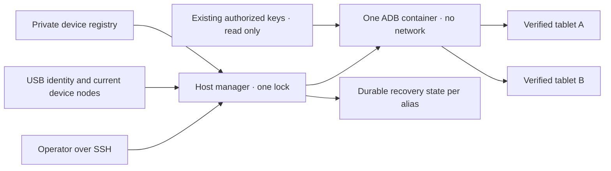

# 共享 Android USB 管理器

<!-- language-navigation:start -->
<p dir="ltr">
<a href="android-usb-manager.md" lang="en" dir="ltr">English</a> · <a href="android-usb-manager.ar.md" lang="ar" dir="rtl">العربية</a> · <a href="android-usb-manager.bn.md" lang="bn" dir="ltr">বাংলা</a> · <a href="android-usb-manager.cs.md" lang="cs" dir="ltr">Čeština</a> · <a href="android-usb-manager.de.md" lang="de" dir="ltr">Deutsch</a> · <a href="android-usb-manager.es.md" lang="es" dir="ltr">Español</a> · <a href="android-usb-manager.fa.md" lang="fa" dir="rtl">فارسی</a> · <a href="android-usb-manager.fr.md" lang="fr" dir="ltr">Français</a><br>
<a href="android-usb-manager.he.md" lang="he" dir="rtl">עברית</a> · <a href="android-usb-manager.hi.md" lang="hi" dir="ltr">हिन्दी</a> · <a href="android-usb-manager.id.md" lang="id" dir="ltr">Bahasa Indonesia</a> · <a href="android-usb-manager.it.md" lang="it" dir="ltr">Italiano</a> · <a href="android-usb-manager.ja.md" lang="ja" dir="ltr">日本語</a> · <a href="android-usb-manager.ko.md" lang="ko" dir="ltr">한국어</a> · <a href="android-usb-manager.nl.md" lang="nl" dir="ltr">Nederlands</a> · <a href="android-usb-manager.pl.md" lang="pl" dir="ltr">Polski</a><br>
<a href="android-usb-manager.pt.md" lang="pt" dir="ltr">Português</a> · <a href="android-usb-manager.ru.md" lang="ru" dir="ltr">Русский</a> · <a href="android-usb-manager.th.md" lang="th" dir="ltr">ไทย</a> · <a href="android-usb-manager.tr.md" lang="tr" dir="ltr">Türkçe</a> · <a href="android-usb-manager.uk.md" lang="uk" dir="ltr">Українська</a> · <a href="android-usb-manager.vi.md" lang="vi" dir="ltr">Tiếng Việt</a> · <a href="android-usb-manager.zh-Hans.md" lang="zh-Hans" dir="ltr">简体中文</a> · <a href="android-usb-manager.zh-Hant.md" lang="zh-Hant" dir="ltr">繁體中文</a>
</p>
<!-- language-navigation:end -->

共享管理器用一个 ADB 服务器和明确的设备注册表，取代每台平板各自的 ADB 容器。主机服务管理 USB 热插拔，并在选定平板重新启动 Android 后恢复 OTT。正常播放和远程 OTT 协议继续独立运行。

## 获取部署包

从同一[发行版](https://github.com/open-ott-play/ottplay-control-server/releases)下载 `ottplay-control-server-deployment.tar.gz` 和 `release-manifest.json`。将压缩包的 SHA-256 与清单中的相应条目核对，然后解压到新目录：

```sh
mkdir ott-android-release
tar -xzf ottplay-control-server-deployment.tar.gz -C ott-android-release
cd ott-android-release
python3 -B tools/android_usb_manager_remote.py --help
```

压缩包保留 `tools/`、`deploy/` 和 `docs/`，包含下列全部六个共享及旧版 USB 脚本。请遵循本指南的主机目录结构和配置步骤；仅解压不会安装服务。管理器、监督程序和事务适配器必须来自同一发行修订版。传输 Dockerfile 是构建配方；control-server 的 OCI 发行附件不是 USB 传输镜像。

包括 `v0.1.5-beta.6` 在内的旧部署包缺少 `tools/`。这些版本应使用对应的源码压缩包，或选用包含完整部署包的新版本。不要混用不同版本的脚本。

实现包含：

- [`tools/android_usb_manager.py`](../tools/android_usb_manager.py)：注册表、传输验证、容器状态协调和串行执行命令。
- [`tools/android_usb_supervisor.py`](../tools/android_usb_supervisor.py)：现有的启动、锁屏和前台恢复策略。
- [`tools/android_usb_manager_remote.py`](../tools/android_usb_manager_remote.py)：保留二进制输出的 SSH 命令封装。
- [`tools/android_usb_legacy_redirect.py`](../tools/android_usb_legacy_redirect.py)：为已安装的单平板命令路径提供可选重定向。
- [`tools/android_usb_remote.py`](../tools/android_usb_remote.py)：为现有单平板调用方保留的旧 SSH 封装。
- [`tools/android_usb_transaction.py`](../tools/android_usb_transaction.py)：供可信维护工具使用的原子文件传输、APK 暂存和 CDP 操作。
- [`deploy/android-usb-manager`](../deploy/android-usb-manager)：配置示例、systemd 服务、Synology DSM 启动脚本和[传输镜像配方](../deploy/android-usb-manager/README.md)。




## 隔离与身份

容器直接在前台运行 ADB，而不是运行一个空闲的 `sleep` 进程并附带后台 ADB 守护进程。ADB 只监听容器回环接口。容器使用 `--network none`、无发布端口、只读根文件系统、移除全部 capabilities、no-new-privileges，以及有容量限制的可写 `/tmp`。它不拥有 Docker socket，也不广泛挂载 `/dev` 或 `/dev/bus/usb`。镜像必须按 SHA-256 固定。

管理器强制容器内存为 256 MiB、内存加交换区总量为 256 MiB，CPU shares 为 128。内存与总量限制相等，因此没有额外交换区。CPU shares 在资源竞争时降低相对优先级，但不设置硬性 CPU 配额。目标 DSM 内核不支持相应控制器，因此没有 PID 硬限制。`/tmp` 是上限 256 MiB 的 tmpfs，按需分配并计入同一内存限额，不是额外内存。APK 暂存最多接受 128 MiB，按 1 MiB 分块写入，避免容器 Python 堆中再保留一份完整 APK。主机端请求仍会缓存其负载。

Docker 和主机管理器监督前台 ADB 进程。容器明确禁用镜像继承的健康检查：检查另一管理器的心跳或配置不能反映本进程。资源和健康检查参数属于状态协调的一部分，偏离配置会触发在管理器锁内替换其所属容器。

前台命令为 `adb -L tcp:5037 nodaemon server`。ADB 29 拒绝监听参数中的显式主机名（`tcp:127.0.0.1:5037`）；不写主机名时，因为未启用 `-a`，会绑定回环接口。客户端仍显式使用 `ADB_SERVER_SOCKET=tcp:127.0.0.1:5037`。此兼容语法不发布端口，也不在平板上启用网络 ADB。

只有与已启用条目唯一匹配的当前设备节点会映射入容器，并授予设备读写权限。Synology USB 节点可能归 root 所有、权限为 `0600`，因此此部署在受限容器内以 root 运行 ADB。它不会将主机节点改成所有人可写。主机管理器同样需要 root 权限来检查节点、管理 Docker 和保存私有状态。容器隔离并不会让这些主机权限变成无特权权限。

注册表先根据 USB 序列号和产品识别设备，可选校验 USB 厂商/产品 ID，再校验 Android 型号、SDK 和 `android_id`。管理器将当前 USB 路径与 ADB 传输清单对应，再通过已验证的唯一序列号执行命令。ADB 重启后可能复用数字传输 ID，因此绝不用这些 ID 分派命令。重复序列号会导致拒绝，而非任意挑选传输。身份不匹配、缺失、未授权或有歧义的设备不得接收命令。

已启用条目的 USB 序列号必须唯一。一些廉价平板共用占位序列号 `0123456789ABCDEF`；型号不同不能使同时注册变得安全。在实施经过审查的独立物理身份方案之前，保持冲突设备禁用。不要为同一序列号换标签后就认为它指向另一传输。

合并后，一个 ADB 进程能够访问全部映射平板。重启或热插拔协调可能中断这些平板的操作。命令和协调共用主机锁 `/var/lib/ott-android-manager/manager.lock`，防止并发修改。通用 ADB 命令路径拒绝 `kill-server`、`tcpip`、`connect`、`root` 等全服务器或改变传输的命令。

## 私有配置与密钥

以 [`config.example.json`](../deploy/android-usb-manager/config.example.json) 为起点。其中身份信息和全零镜像摘要均有意虚构，两个示例设备都已禁用。该示例不能直接运行部署。

采用以下主机目录结构：

```text
/usr/local/etc/ott-android-manager/
  android_usb_manager.py
  android_usb_supervisor.py
  android_usb_transaction.py
  config.json
  ott-android-manager.service
  adb-keys/
    adbkey
    adbkey.pub
    vendor/
      additional-authorized.adb_key
/var/lib/ott-android-manager/
  manager.lock
  captures/
  <alias>/state.json
```

管理器、监督程序和事务适配器必须来自同一经过审查的修订版。配置和密钥应放在 Git 与发行压缩包之外。私有目录设为 `0700`，配置和私钥设为 `0600`，源码与服务文件归 root 所有。密钥目录只读挂载。`adbkey` 和 `adbkey.pub` 必须预先存在；`vendor/` 即使为空也必须存在。其他此前已授权的私钥可放入 `vendor/`，通过 `ADB_VENDOR_KEYS` 提供。每个私钥文件必须命名为 `<source>.adb_key`：ADB 29 扫描该目录时会静默忽略其他名称。匹配的 `<source>.adb_key.pub` 公钥文件可选。管理器会在修改容器前拒绝未识别的文件名。

停用任何容器前先保存现有已授权密钥。通过比较公钥指纹识别重复项，不要打印私钥。不要仅为合并容器而将现有密钥换成新生成的密钥，否则可能需要在未连接的平板上重新确认。

每个启用的设备都需要在有人值守的配置过程中采集完整身份。OTT 设备 UUID、MAC 地址或猜测值都不是 Android `android_id` 的证据。若记录缺少该字段，保持 `"enabled": false`；禁用条目可以含不完整的描述元数据，永不映射或控制。

`recover_on_boot` 是独立策略。对只需提供维护命令的平板，应保持 false。启用时，`package` 必须是已经在该设备上实际验证过前台启动的应用。

## 自动恢复的行为

默认间隔为每轮结束后五秒，并非保证五秒内完成全部恢复。缓慢的 USB 操作会延长间隔。默认命令超时为 60 秒，每次 Android 启动最多尝试恢复三次。

首次观察时，管理器记录当前启动，不唤醒或解锁平板。在之后的新启动且恢复已启用时，它会：

1. 等待 `sys.boot_completed=1` 并验证设备身份。
2. 要求明确证据证明锁屏未由 PIN、密码或图案保护。
3. 唤醒屏幕，必要时解除普通滑动锁屏。
4. 启动配置的包，检查已恢复/获焦的 activity。
5. 再次检查启动和锁屏状态，之后才保存成功检查点。

未知或受保护的锁屏状态会停止恢复。旧 Fire 部署需要[USB 恢复](android-usb-recovery.md#read-only-keyguard-probe-on-older-firmware)中描述、由 shell 权限保护的探针。

已完成的启动返回 `same_boot_no_action`。普通息屏不会触发唤醒。该管理器不监控视频解码，不重启卡住的流，也不持续强制应用前台。这些是播放器或另行审查的 watchdog 所负责的不同策略。

## 命令

在 USB 主机上：

```sh
sudo -n /usr/bin/python3 -B /usr/local/etc/ott-android-manager/android_usb_manager.py \
  --config /usr/local/etc/ott-android-manager/config.json status
```

从另一台电脑，通过现有 SSH 主机别名：

```sh
python3 tools/android_usb_manager_remote.py --host tablet-host status
python3 tools/android_usb_manager_remote.py --host tablet-host status lobby
python3 tools/android_usb_manager_remote.py --host tablet-host wake lobby
python3 tools/android_usb_manager_remote.py --host tablet-host recover lobby
python3 tools/android_usb_manager_remote.py --host tablet-host reboot lobby
python3 tools/android_usb_manager_remote.py --host tablet-host swipe lobby 400 600 400 100 --duration 500
python3 tools/android_usb_manager_remote.py --host tablet-host screenshot lobby lobby-check.png
python3 tools/android_usb_manager_remote.py --host tablet-host adb lobby -- shell getprop ro.product.model
python3 tools/android_usb_manager_remote.py --host tablet-host adb lobby -- exec-out screencap -p > lobby.png
```

`status` 仅检查，不创建、重启或重新配置容器。`tick` 执行一轮协调/恢复，可能改变设备状态；`run` 重复执行这些轮次，供服务使用。

封装使用不分配 PTY 的 SSH，对每个参数单独进行 shell 引用，传递进程退出状态，不把 ADB 输出转换为 JSON。在认定重定向的截图有效之前，应检查退出状态。`screenshot` 只接受 `lobby-check.png` 这样的纯 PNG 文件名，并保存到 USB 主机上的 `<state_dir>/captures/`。名称必须符合 `[A-Za-z0-9][A-Za-z0-9_-]{0,119}\.png`；不接受路径、额外句点或隐含扩展名。命令验证 PNG，创建仅所有者可访问的新文件，并在截图前拒绝符号链接和已存在名称。相比之下，`adb ... exec-out` 示例将字节流写入操作员电脑上的文件。`swipe` 使用当前屏幕几何参数，拒绝受保护或未知锁屏；上面的坐标只是示例，不是通用解锁手势。ADB 文件路径位于容器/设备命名空间：封装不会自动从笔记本上传 APK。文件暂存及随后安装必须使用下述原子事务适配器。

`adb <alias> -- <arguments>` 是管理员维护接口，不是受限的公共 API。获准的 `shell` 命令可以修改平板。使用身份检查与锁，不要通过 Web 端点暴露无限制的 SSH 或 Docker 访问。

## 启动服务与迁移

[systemd 模板](../deploy/android-usb-manager/ott-android-manager.service)持续运行管理器，并在进程退出十秒后重启。[DSM 封装](../deploy/android-usb-manager/S99ott-android-manager.sh)检查部署文件，安装/启用单元并启动。旧 `ott-k8a-recovery.service` 处于运行或启用状态时，它拒绝启动。其他发行版应按其服务管理器调整 Docker 依赖与路径。

执行受控移交：

1. 记录现有容器配置、已授权密钥指纹和恢复状态。以仅所有者可访问权限备份私有文件。
2. 安装新源码、经过审查的镜像、密钥和注册表。未完成配置的设备保持禁用。不要为同一平板启动第二个监督程序。
3. 停止并禁用旧主机恢复服务，撤下其 DSM 启动封装。保留文件供回滚。仅停止服务不会移除其 ADB 容器。
4. 将已验证的旧恢复检查点复制到对应的新 `<alias>/state.json`。保留启动身份，不要将重置状态作为常规迁移捷径。
5. 启动共享服务器前停止旧 ADB 容器，避免两个服务器争用同一 USB 接口。
6. 将新 DSM 封装以 root 所有、可执行形式安装在 `/usr/local/etc/rc.d/`，运行 `start`，检查服务及状态。
7. 迁移调用方，验证普通命令和保留的恢复策略，然后只移除已没有依赖的旧容器。

旧工具常在无害的名称背后隐藏依赖。审计 `bootstrap.py`、`reconnect.py`、CDP 适配器及 shell 别名。Bootstrap 可能从旧容器复制密钥。Reconnect 脚本可能从导入的辅助模块取得 `OLD`，随后停止或移除它；只把该模块改成共享名称，可能意外停止共享服务器。应从客户端删除这种自动容器管理，而不是仅改名称。

实际 ADB 命令应按别名经过管理器。为文件暂存或本地 CDP 客户端而需要 `docker exec` 的兼容适配器，必须在完整暂存/命令事务期间持有同一主机锁。不要在已锁定区间内启动另一个获取此锁的进程；应使用兼容的进程内调用，或一次组织完整事务。分配临时转发端口，用完后删除。

将 `android_usb_transaction.py` 安装在管理器与监督程序旁。它通过标准输入接收一个 JSON 请求，`--config` 指向同一私有注册表，通过标准输出返回原始操作结果。支持的请求如下：

- `pull`：`alias` 和绝对 `device_path`；返回一个普通文件的字节，最多 128 MiB。拒绝目录和设备文件。目标文件的硬性大小限制也能停止传输中不断增长的源。
- `staged_adb`：`alias`、base64 `data` 和 `arguments`，例如 `["install", "-r", "@staged"]` 或 `["push", "@staged", "/sdcard/example.json"]`。
- `cdp`：`alias`、应用 `package`、可选 `expected_model`、包含 `__OTT_CDP_PORT__` 的可信 Python 客户端 `source`，以及其 JSON `request`。

每个请求都验证设备，并在准备、使用和清理全过程持有一个管理器锁。文件操作使用唯一临时名称；在启用清理逻辑前，以 `0600` 独占预留文件。APK 安装保留 ADB 包参数解析器所需的 `.apk` 后缀。名称冲突不触碰已有文件。暂存写入器只打开自己预留的空普通文件，不跟随符号链接。辅助 Docker 命令指向已观察到的容器 ID。CDP 精确找到一个应用进程及其调试 socket，分配 `tcp:0`，把分配端口代入客户端源码，在完成或失败时仅删除本次转发。协调过程无法在这些步骤间重启服务器。

迁移后的 a1 兼容工具将 `copy_in` 数据存在线程本地内存中，直到同一进程下一次执行 `adb install` 或 `adb push`。这对操作构成一个主机事务；单独 `copy_in` 不再创建共享容器文件。Home Plan 和播放器 CDP 工具使用同一机制。请求可能含应用私有数据和可信可执行代码：仅通过现有管理员 SSH 通道传输，绝不能将适配器公开为端点或记录其负载。

ADB 转发端口属于共享服务器，不属于单个平板。使用动态分配的 CDP 端口，或为手工会话中每个别名指定不同端口。管理器在创建转发时强制 `--no-rebind`，允许重用完全相同的映射，拒绝覆盖或删除另一别名的转发。`forward --list` 按所选别名过滤；拒绝 `forward --remove-all`。

备份旧脚本后，可将可选旧版重定向器安装到 `/usr/local/etc/ott-k8a-recovery/android_usb_supervisor.py`，保留原有手工命令入口。它只接受已知旧配置路径，要求序列号/型号/SDK/Android ID 与一个已启用的新注册表条目完全匹配，并用新管理器替换自身进程。它不会导入或执行旧监督程序。明确拒绝 `run`：即使安装了手工兼容功能，旧服务及其启动封装也必须保持禁用/撤下。

回滚时，停止并禁用新主机服务，撤下启动封装并停止其容器。恢复旧密钥/状态快照和旧服务。恢复运行前确认每个 USB 设备仅由一个管理器拥有。

## 不支持 CDP 的发行版播放器

生产 APK 可能有意关闭 WebView 调试。此时事务适配器报告 `Application debugging socket is unavailable`；正常工作的 ADB 连接不会凭空创建该 socket。管理器不会启用调试、修改播放器设置或替换 APK。

对于已连接 OTT 控制器的播放器，使用它所支持的只读诊断。将 `lobby` 替换为已配置的 OTT 别名：

```sh
ott -t 20 lobby debug -j
ott -t 20 lobby inspect -j
```

这些命令返回播放器报告的观察数据，包括可用运行时与媒体状态。它们不提供任意 JavaScript 求值、直接 DOM 检查或 CDP 连接。两条命令都已在已连接、无 CDP socket 的 API 22 发行版播放器上验证；其他播放器是否可用取决于其能力。

## 验收与限制

根据实际安装的源码/镜像及硬件记录结果。此次合并开始时，只有 **k8a** 具备旧恢复策略的实机证据。旧监督程序能在平板真正重启后恢复，且不打扰普通睡眠；这些测试不能证明新共享实现已经通过验收。其他保存的平板身份不完整，必须保持禁用，直到有人值守验证。

共享管理器必须完成的验收：

- 现有已授权 USB 身份通过共享服务器出现。
- 未知、缺失、重复和禁用设备不接收任何操作。
- 只读命令和二进制截图使用预期传输。
- 启用相应策略的设备能在新启动后成功恢复。
- 普通息屏保持睡眠。
- USB 重新枚举仅恢复预期设备映射。
- 主机服务重启保留状态并避免重复恢复。
- 主机真正重启后恢复服务和所有权关系。
- 每个已迁移本地工具均能工作，且不重新创建旧容器。

明确报告未执行的检查。服务正在运行或成功启动前台应用，都不能证明流播放、全部平板的兼容性或 NAS 重启后的无人值守恢复。
