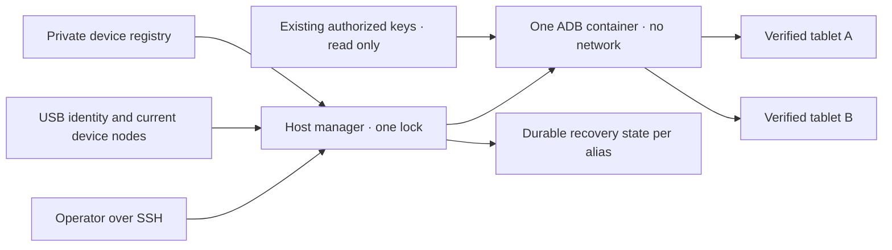

# 共享 Android USB 管理器

<!-- language-navigation:start -->
<p dir="ltr">
<a href="android-usb-manager.md" lang="en" dir="ltr">English</a> · <a href="android-usb-manager.ar.md" lang="ar" dir="rtl">العربية</a> · <a href="android-usb-manager.bn.md" lang="bn" dir="ltr">বাংলা</a> · <a href="android-usb-manager.cs.md" lang="cs" dir="ltr">Čeština</a> · <a href="android-usb-manager.de.md" lang="de" dir="ltr">Deutsch</a> · <a href="android-usb-manager.es.md" lang="es" dir="ltr">Español</a> · <a href="android-usb-manager.fa.md" lang="fa" dir="rtl">فارسی</a> · <a href="android-usb-manager.fr.md" lang="fr" dir="ltr">Français</a><br>
<a href="android-usb-manager.he.md" lang="he" dir="rtl">עברית</a> · <a href="android-usb-manager.hi.md" lang="hi" dir="ltr">हिन्दी</a> · <a href="android-usb-manager.id.md" lang="id" dir="ltr">Bahasa Indonesia</a> · <a href="android-usb-manager.it.md" lang="it" dir="ltr">Italiano</a> · <a href="android-usb-manager.ja.md" lang="ja" dir="ltr">日本語</a> · <a href="android-usb-manager.ko.md" lang="ko" dir="ltr">한국어</a> · <a href="android-usb-manager.nl.md" lang="nl" dir="ltr">Nederlands</a> · <a href="android-usb-manager.pl.md" lang="pl" dir="ltr">Polski</a><br>
<a href="android-usb-manager.pt.md" lang="pt" dir="ltr">Português</a> · <a href="android-usb-manager.ru.md" lang="ru" dir="ltr">Русский</a> · <a href="android-usb-manager.th.md" lang="th" dir="ltr">ไทย</a> · <a href="android-usb-manager.tr.md" lang="tr" dir="ltr">Türkçe</a> · <a href="android-usb-manager.uk.md" lang="uk" dir="ltr">Українська</a> · <a href="android-usb-manager.vi.md" lang="vi" dir="ltr">Tiếng Việt</a> · <a href="android-usb-manager.zh-Hans.md" lang="zh-Hans" dir="ltr">简体中文</a> · <a href="android-usb-manager.zh-Hant.md" lang="zh-Hant" dir="ltr">繁體中文</a>
</p>
<!-- language-navigation:end -->

共享管理器用一個 ADB 伺服器和明確的裝置登錄表，取代每臺平板各自的 ADB 容器。主機服務管理 USB 熱插拔，並在選定平板重新啟動 Android 後恢復 OTT。正常播放和遠端 OTT 通訊協定繼續獨立執行。

## 獲取部署包

從同一[發行版](https://github.com/open-ott-play/ottplay-control-server/releases)下載 `ottplay-control-server-deployment.tar.gz` 和 `release-manifest.json`。將壓縮包的 SHA-256 與清單中的相應條目核對，然後解壓到新目錄：

```sh
mkdir ott-android-release
tar -xzf ottplay-control-server-deployment.tar.gz -C ott-android-release
cd ott-android-release
python3 -B tools/android_usb_manager_remote.py --help
```

壓縮包保留 `tools/`、`deploy/` 和 `docs/`，包含下列全部六個共享及舊版 USB 指令碼。請遵循本指南的主機目錄結構和設定步驟；僅解壓不會安裝服務。管理器、監督程式和交易介接程式必須來自同一發行修訂版。傳輸 Dockerfile 是建置配方；control-server 的 OCI 發行附件不是 USB 傳輸映像。

包括 `v0.1.5-beta.6` 在內的舊部署包缺少 `tools/`。這些版本應使用對應的原始碼壓縮包，或選用包含完整部署包的新版本。不要混用不同版本的指令碼。

實現包含：

- [`tools/android_usb_manager.py`](../tools/android_usb_manager.py)：登錄表、傳輸驗證、容器狀態協調和依序執行命令。
- [`tools/android_usb_supervisor.py`](../tools/android_usb_supervisor.py)：現有的啟動、鎖定畫面和前景恢復策略。
- [`tools/android_usb_manager_remote.py`](../tools/android_usb_manager_remote.py)：保留二進位輸出的 SSH 命令封裝。
- [`tools/android_usb_legacy_redirect.py`](../tools/android_usb_legacy_redirect.py)：為已安裝的單平板命令路徑提供選用重新導向。
- [`tools/android_usb_remote.py`](../tools/android_usb_remote.py)：為現有單平板呼叫方保留的舊 SSH 封裝。
- [`tools/android_usb_transaction.py`](../tools/android_usb_transaction.py)：供可信維護工具使用的原子檔案傳輸、APK 暫存和 CDP 操作。
- [`deploy/android-usb-manager`](../deploy/android-usb-manager)：設定示例、systemd 服務、Synology DSM 啟動指令碼和[傳輸映像配方](../deploy/android-usb-manager/README.md)。




## 隔離與身分

容器直接在前景執行 ADB，而不是執行一個空閒的 `sleep` 程序並附帶背景 ADB 常駐程序。ADB 只監聽容器迴環介面。容器使用 `--network none`、無發佈埠、唯讀根檔案系統、移除全部 capabilities、no-new-privileges，以及有容量限制的可寫 `/tmp`。它不擁有 Docker socket，也不廣泛掛載 `/dev` 或 `/dev/bus/usb`。映像必須按 SHA-256 固定。

管理器強制容器記憶體為 256 MiB、記憶體加交換區總量為 256 MiB，CPU shares 為 128。記憶體與總量限制相等，因此沒有額外交換區。CPU shares 在資源競爭時降低相對優先順序，但不設定硬性 CPU 配額。目標 DSM 核心不支援相應控制器，因此沒有 PID 硬限制。`/tmp` 是上限 256 MiB 的 tmpfs，按需分配並計入同一記憶體限額，不是額外記憶體。APK 暫存最多接受 128 MiB，按 1 MiB 分塊寫入，避免容器 Python 堆中再保留一份完整 APK。主機端請求仍會快取其負載。

Docker 和主機管理器監督前景 ADB 程序。容器明確禁用映像繼承的健康檢查：檢查另一管理器的心跳或設定不能反映本程序。資源和健康檢查引數屬於狀態協調的一部分，偏離設定會觸發在管理器鎖內替換其所屬容器。

前景命令為 `adb -L tcp:5037 nodaemon server`。ADB 29 拒絕監聽引數中的顯式主機名（`tcp:127.0.0.1:5037`）；不寫主機名時，因為未啟用 `-a`，會繫結迴環介面。客戶端仍顯式使用 `ADB_SERVER_SOCKET=tcp:127.0.0.1:5037`。此相容語法不發佈埠，也不在平板上啟用網路 ADB。

只有與已啟用條目唯一匹配的當前裝置節點會對映入容器，並授予裝置讀寫許可權。Synology USB 節點可能歸 root 所有、許可權為 `0600`，因此此部署在受限容器內以 root 執行 ADB。它不會將主機節點改成所有人可寫。主機管理器同樣需要 root 許可權來檢查節點、管理 Docker 和儲存私有狀態。容器隔離並不會讓這些主機許可權變成無特權許可權。

登錄表先根據 USB 序列號和產品識別裝置，選用校驗 USB 廠商/產品 ID，再校驗 Android 型號、SDK 和 `android_id`。管理器將當前 USB 路徑與 ADB 傳輸清單對應，再透過已驗證的唯一序列號執行命令。ADB 重啟後可能複用數字傳輸 ID，因此絕不用這些 ID 分派命令。重複序列號會導致拒絕，而非任意挑選傳輸。身分不匹配、缺失、未授權或有歧義的裝置不得接收命令。

已啟用條目的 USB 序列號必須唯一。一些廉價平板共用佔位序列號 `0123456789ABCDEF`；型號不同不能使同時註冊變得安全。在實施經過審查的獨立物理身分方案之前，保持衝突裝置禁用。不要為同一序列號換標籤後就認為它指向另一傳輸。

合併後，一個 ADB 程序能夠訪問全部對映平板。重啟或熱插拔協調可能中斷這些平板的操作。命令和協調共用主機鎖 `/var/lib/ott-android-manager/manager.lock`，防止併發修改。通用 ADB 命令路徑拒絕 `kill-server`、`tcpip`、`connect`、`root` 等全伺服器或改變傳輸的命令。

## 私有設定與金鑰

以 [`config.example.json`](../deploy/android-usb-manager/config.example.json) 為起點。其中身分資訊和全零映像摘要均有意虛構，兩個示例裝置都已禁用。該示例不能直接執行部署。

採用以下主機目錄結構：

```text
/usr/local/etc/ott-android-manager/
  android_usb_manager.py
  android_usb_supervisor.py
  android_usb_transaction.py
  config.json
  ott-android-manager.service
  adb-keys/
    adbkey
    adbkey.pub
    vendor/
      additional-authorized.adb_key
/var/lib/ott-android-manager/
  manager.lock
  captures/
  <alias>/state.json
```

管理器、監督程式和交易介接程式必須來自同一經過審查的修訂版。設定和金鑰應放在 Git 與發行壓縮包之外。私有目錄設為 `0700`，設定和私鑰設為 `0600`，原始碼與服務檔案歸 root 所有。金鑰目錄唯讀掛載。`adbkey` 和 `adbkey.pub` 必須預先存在；`vendor/` 即使為空也必須存在。其他此前已授權的私鑰可放入 `vendor/`，透過 `ADB_VENDOR_KEYS` 提供。每個私鑰檔案必須命名為 `<source>.adb_key`：ADB 29 掃描該目錄時會靜默忽略其他名稱。匹配的 `<source>.adb_key.pub` 公鑰檔案選用。管理器會在修改容器前拒絕未識別的檔名。

停用任何容器前先儲存現有已授權金鑰。透過比較公鑰指紋識別重複項，不要列印私鑰。不要僅為合併容器而將現有金鑰換成新生成的金鑰，否則可能需要在未連線的平板上重新確認。

每個啟用的裝置都需要在有人值守的設定過程中採集完整身分。OTT 裝置 UUID、MAC 地址或猜測值都不是 Android `android_id` 的證據。若記錄缺少該欄位，保持 `"enabled": false`；禁用條目可以含不完整的描述後設資料，永不對映或控制。

`recover_on_boot` 是獨立策略。對只需提供維護命令的平板，應保持 false。啟用時，`package` 必須是已經在該裝置上實際驗證過前景啟動的應用。

## 自動恢復的行為

預設間隔為每輪結束後五秒，並非保證五秒內完成全部恢復。緩慢的 USB 操作會延長間隔。預設命令超時為 60 秒，每次 Android 啟動最多嘗試恢復三次。

首次觀察時，管理器記錄當前啟動，不喚醒或解鎖平板。在之後的新啟動且恢復已啟用時，它會：

1. 等待 `sys.boot_completed=1` 並驗證裝置身分。
2. 要求明確證據證明鎖定畫面未由 PIN、密碼或圖案保護。
3. 喚醒螢幕，必要時解除普通滑動鎖定畫面。
4. 啟動設定的包，檢查已恢復/獲焦的 activity。
5. 再次檢查啟動和鎖定畫面狀態，之後才儲存成功檢查點。

未知或受保護的鎖定畫面狀態會停止恢復。舊 Fire 部署需要[USB 恢復](android-usb-recovery.md#read-only-keyguard-probe-on-older-firmware)中描述、由 shell 許可權保護的探針。

已完成的啟動返回 `same_boot_no_action`。普通息屏不會觸發喚醒。該管理器不監控影片解碼，不重啟卡住的流，也不持續強制應用前景。這些是播放器或另行審查的 watchdog 所負責的不同策略。

## 命令

在 USB 主機上：

```sh
sudo -n /usr/bin/python3 -B /usr/local/etc/ott-android-manager/android_usb_manager.py \
  --config /usr/local/etc/ott-android-manager/config.json status
```

從另一臺電腦，透過現有 SSH 主機別名：

```sh
python3 tools/android_usb_manager_remote.py --host tablet-host status
python3 tools/android_usb_manager_remote.py --host tablet-host status lobby
python3 tools/android_usb_manager_remote.py --host tablet-host wake lobby
python3 tools/android_usb_manager_remote.py --host tablet-host recover lobby
python3 tools/android_usb_manager_remote.py --host tablet-host reboot lobby
python3 tools/android_usb_manager_remote.py --host tablet-host swipe lobby 400 600 400 100 --duration 500
python3 tools/android_usb_manager_remote.py --host tablet-host screenshot lobby lobby-check.png
python3 tools/android_usb_manager_remote.py --host tablet-host adb lobby -- shell getprop ro.product.model
python3 tools/android_usb_manager_remote.py --host tablet-host adb lobby -- exec-out screencap -p > lobby.png
```

`status` 僅檢查，不建立、重啟或重新設定容器。`tick` 執行一輪協調/恢復，可能改變裝置狀態；`run` 重複執行這些輪次，供服務使用。

封裝使用不分配 PTY 的 SSH，對每個引數單獨進行 shell 引用，傳遞程序退出狀態，不把 ADB 輸出轉換為 JSON。在認定重新導向的截圖有效之前，應檢查退出狀態。`screenshot` 只接受 `lobby-check.png` 這樣的純 PNG 檔名，並儲存到 USB 主機上的 `<state_dir>/captures/`。名稱必須符合 `[A-Za-z0-9][A-Za-z0-9_-]{0,119}\.png`；不接受路徑、額外句點或隱含副檔名。命令驗證 PNG，建立僅所有者可訪問的新檔案，並在截圖前拒絕符號連結和已存在名稱。相比之下，`adb ... exec-out` 示例將位元組流寫入操作員電腦上的檔案。`swipe` 使用當前螢幕幾何引數，拒絕受保護或未知鎖定畫面；上面的座標只是示例，不是通用解鎖手勢。ADB 檔案路徑位於容器/裝置名稱空間：封裝不會自動從筆記本上傳 APK。檔案暫存及隨後安裝必須使用下述原子交易介接程式。

`adb <alias> -- <arguments>` 是管理員維護介面，不是受限的公共 API。獲准的 `shell` 命令可以修改平板。使用身分檢查與鎖，不要透過 Web 端點暴露無限制的 SSH 或 Docker 訪問。

## 啟動服務與遷移

[systemd 模板](../deploy/android-usb-manager/ott-android-manager.service)持續執行管理器，並在程序退出十秒後重啟。[DSM 封裝](../deploy/android-usb-manager/S99ott-android-manager.sh)檢查部署檔案，安裝/啟用單元並啟動。舊 `ott-k8a-recovery.service` 處於執行或啟用狀態時，它拒絕啟動。其他發行版應按其服務管理器調整 Docker 依賴與路徑。

執行受控移交：

1. 記錄現有容器設定、已授權金鑰指紋和恢復狀態。以僅所有者可訪問許可權備份私有檔案。
2. 安裝新原始碼、經過審查的映像、金鑰和登錄表。未完成設定的裝置保持禁用。不要為同一平板啟動第二個監督程式。
3. 停止並禁用舊主機恢復服務，撤下其 DSM 啟動封裝。保留檔案供回滾。僅停止服務不會移除其 ADB 容器。
4. 將已驗證的舊恢復檢查點複製到對應的新 `<alias>/state.json`。保留啟動身分，不要將重置狀態作為常規遷移捷徑。
5. 啟動共享伺服器前停止舊 ADB 容器，避免兩個伺服器爭用同一 USB 介面。
6. 將新 DSM 封裝以 root 所有、可執行形式安裝在 `/usr/local/etc/rc.d/`，執行 `start`，檢查服務及狀態。
7. 遷移呼叫方，驗證普通命令和保留的恢復策略，然後只移除已沒有依賴的舊容器。

舊工具常在無害的名稱背後隱藏依賴。審計 `bootstrap.py`、`reconnect.py`、CDP 介接程式及 shell 別名。Bootstrap 可能從舊容器複製金鑰。Reconnect 指令碼可能從匯入的輔助模組取得 `OLD`，隨後停止或移除它；只把該模組改成共享名稱，可能意外停止共享伺服器。應從客戶端刪除這種自動容器管理，而不是僅改名稱。

實際 ADB 命令應按別名經過管理器。為檔案暫存或本地 CDP 客戶端而需要 `docker exec` 的相容介接程式，必須在完整暫存/命令交易期間持有同一主機鎖。不要在已鎖定區間內啟動另一個獲取此鎖的程序；應使用相容的程序內呼叫，或一次組織完整交易。分配臨時轉發埠，用完後刪除。

將 `android_usb_transaction.py` 安裝在管理器與監督程式旁。它透過標準輸入接收一個 JSON 請求，`--config` 指向同一私有登錄表，透過標準輸出返回原始操作結果。支援的請求如下：

- `pull`：`alias` 和絕對 `device_path`；返回一個普通檔案的位元組，最多 128 MiB。拒絕目錄和裝置檔案。目標檔案的硬性大小限制也能停止傳輸中不斷增長的源。
- `staged_adb`：`alias`、base64 `data` 和 `arguments`，例如 `["install", "-r", "@staged"]` 或 `["push", "@staged", "/sdcard/example.json"]`。
- `cdp`：`alias`、應用 `package`、選用 `expected_model`、包含 `__OTT_CDP_PORT__` 的可信 Python 客戶端 `source`，以及其 JSON `request`。

每個請求都驗證裝置，並在準備、使用和清理全過程持有一個管理器鎖。檔案操作使用唯一臨時名稱；在啟用清理邏輯前，以 `0600` 獨佔預留檔案。APK 安裝保留 ADB 包引數解析器所需的 `.apk` 字尾。名稱衝突不觸碰已有檔案。暫存寫入器只開啟自己預留的空普通檔案，不跟隨符號連結。輔助 Docker 命令指向已觀察到的容器 ID。CDP 精確找到一個應用程序及其除錯 socket，分配 `tcp:0`，把分配埠代入客戶端原始碼，在完成或失敗時僅刪除本次轉發。協調過程無法在這些步驟間重啟伺服器。

遷移後的 a1 相容工具將 `copy_in` 資料存線上程本地記憶體中，直到同一程序下一次執行 `adb install` 或 `adb push`。這對操作構成一個主機交易；單獨 `copy_in` 不再建立共享容器檔案。Home Plan 和播放器 CDP 工具使用同一機制。請求可能含應用私有資料和可信可執行程式碼：僅透過現有管理員 SSH 通道傳輸，絕不能將介接程式公開為端點或記錄其負載。

ADB 轉發埠屬於共享伺服器，不屬於單個平板。使用動態分配的 CDP 埠，或為手工會話中每個別名指定不同埠。管理器在建立轉發時強制 `--no-rebind`，允許重用完全相同的對映，拒絕覆蓋或刪除另一別名的轉發。`forward --list` 按所選別名過濾；拒絕 `forward --remove-all`。

備份舊指令碼後，可將選用舊版重新導向器安裝到 `/usr/local/etc/ott-k8a-recovery/android_usb_supervisor.py`，保留原有手工命令入口。它只接受已知舊設定路徑，要求序列號/型號/SDK/Android ID 與一個已啟用的新登錄表條目完全匹配，並用新管理器替換自身程序。它不會匯入或執行舊監督程式。明確拒絕 `run`：即使安裝了手工相容功能，舊服務及其啟動封裝也必須保持禁用/撤下。

回滾時，停止並禁用新主機服務，撤下啟動封裝並停止其容器。恢復舊金鑰/狀態快照和舊服務。恢復執行前確認每個 USB 裝置僅由一個管理器擁有。

## 不支援 CDP 的發行版播放器

生產 APK 可能有意關閉 WebView 除錯。此時交易介接程式報告 `Application debugging socket is unavailable`；正常工作的 ADB 連線不會憑空建立該 socket。管理器不會啟用除錯、修改播放器設定或替換 APK。

對於已連線 OTT 控制器的播放器，使用它所支援的唯讀診斷。將 `lobby` 替換為已設定的 OTT 別名：

```sh
ott -t 20 lobby debug -j
ott -t 20 lobby inspect -j
```

這些命令返回播放器報告的觀察資料，包括可用執行時與媒體狀態。它們不提供任意 JavaScript 求值、直接 DOM 檢查或 CDP 連線。兩條命令都已在已連線、無 CDP socket 的 API 22 發行版播放器上驗證；其他播放器是否可用取決於其能力。

## 驗收與限制

根據實際安裝的原始碼/映像及硬體記錄結果。此次合併開始時，只有 **k8a** 具備舊恢復策略的實機證據。舊監督程式能在平板真正重啟後恢復，且不打擾普通睡眠；這些測試不能證明新共享實現已經透過驗收。其他儲存的平板身分不完整，必須保持禁用，直到有人值守驗證。

共享管理器必須完成的驗收：

- 現有已授權 USB 身分透過共享伺服器出現。
- 未知、缺失、重複和禁用裝置不接收任何操作。
- 唯讀命令和二進位截圖使用預期傳輸。
- 啟用相應策略的裝置能在新啟動後成功恢復。
- 普通息屏保持睡眠。
- USB 重新列舉僅恢復預期裝置對映。
- 主機服務重啟保留狀態並避免重複恢復。
- 主機真正重啟後恢復服務和所有權關係。
- 每個已遷移本地工具均能工作，且不重新建立舊容器。

明確報告未執行的檢查。服務正在執行或成功啟動前景應用，都不能證明流播放、全部平板的相容性或 NAS 重啟後的無人值守恢復。
