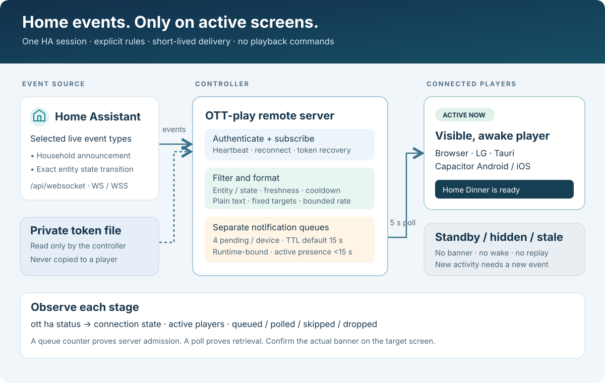
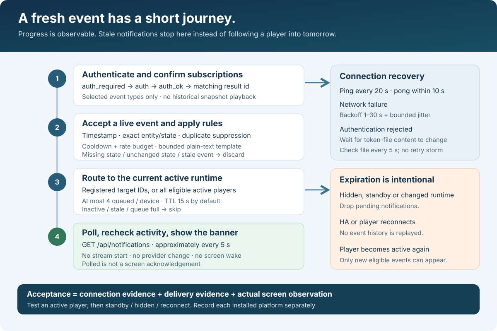
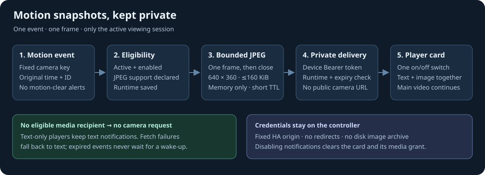

# Home Assistant events on active players

[Русский](home-assistant.ru.md) · [CLI](cli.md) · [Deployment](deployment.md) · [API](api.md)

The optional Home Assistant bridge turns selected live HA events into short
plain-text banners on connected, active OTT-play players. One controller opens
an outbound WebSocket connection to HA. Players keep their own device tokens;
the HA long-lived access token stays on the controller.

Install controller and player revisions containing this feature. Updating the
controller alone does not add notification polling to an older player. Browser,
LG webOS, Tauri and Capacitor use the shared player integration; native packages
must actually contain that updated player code. This guide describes the
implementation and its acceptance procedure, not a claim that every physical
device has been tested.



## What is delivered

- Rules subscribe to explicit HA event types. `state_changed` rules additionally
  require exact entity IDs and can filter the previous and next states.
- A rule can address exact registered controller device IDs. Omitting `targets`
  or using `[]` selects all eligible active players. CLI aliases such as `l` or
  `t1` are not automatically resolved in server configuration; obtain IDs with
  `ott devices` and compare them with the CLI's saved player mapping.
- Updated players poll the separate `GET /api/notifications` channel about every
  five seconds. Notification delivery does not occupy the playback command queue.
- Standby, hidden/background and otherwise inactive players do not display the
  banners. Activity uses document visibility, completed startup and standby
  state. Android additionally uses native activity/screen signals. A notification
  never issues `go`, starts a stream,
  changes provider, or wakes the display.
- Notifications are temporary, bounded and expire. They are not replayed after
  returning from standby or after restarting the controller. Do not use them as
  the sole destination for alarms that must be acknowledged.

To disable HA banners and camera media for just one player, use
`ott f notifications off`; restore future delivery with `ott f notifications on`.
Replace `f` with its CLI alias. This saved preference does not change other
players' preferences or the shared bridge configuration. Follow the
[per-player readback and delivery checks](notification-preferences.md#disable-or-enable-one-player-and-verify-delivery)
to verify both the saved value and the controller's individual recipient state.

## 1. Create and store the HA token

In Home Assistant, open your user profile → **Security → Long-lived access
tokens** and create a token for the OTT-play controller. HA shows the new token
once. Use a dedicated HA account whose permissions allow the selected event
subscriptions. A token inherits its account permissions; it is not a separately
scoped, read-only credential. Most custom event subscriptions require an HA
administrator. See the official [token documentation](https://contributors.home-assistant.io/core/internals/auth-api/#long-lived-access-tokens)
and [event subscription permissions](https://contributors.home-assistant.io/core/internals/websocket-api/#subscribe-to-events).

Save the token as the only text in a private file, outside the repository and
release directory. The following interactive example does not put it in shell
history or a command argument and refuses to overwrite an existing file:

```sh
python3 - <<'PY'
import getpass, os
from pathlib import Path
directory = Path.home() / ".config" / "ottplay-control-server"
directory.mkdir(mode=0o700, parents=True, exist_ok=True)
token = getpass.getpass("Home Assistant long-lived token: ").strip()
if not 32 <= len(token) <= 4096 or any(not '!' <= c <= '~' for c in token):
    raise SystemExit("Expected a 32–4096 character ASCII token without whitespace")
path = directory / "ha-token"
fd = os.open(path, os.O_WRONLY | os.O_CREAT | os.O_EXCL, 0o600)
with os.fdopen(fd, "w") as output:
    output.write(token + "\n")
print("Token file created:", path)
PY
```

The process running the controller must be able to read the file. Use an
absolute `token_file` path; `~` and environment variables inside JSON are not
expanded. Do not put the token in `url`, `config.json`, a player, a screenshot,
the CLI command line, or an issue report. An ordinary source/config validation
does not prove that this credential can authenticate against the running HA.

## 2. Configure rules

Create a private server configuration using `init` if this is a new installation.
For an existing installation, add the `home_assistant` object below to its
existing JSON object. Preserve its device registrations and credentials. Replace
the example URL, token path, entity IDs and target IDs with your own values.

```json
{
  "home_assistant": {
    "enabled": true,
    "url": "https://ha.example.net",
    "token_file": "/absolute/private/path/ha-token",
    "max_per_minute": 30,
    "event_max_age_seconds": 30,
    "rules": [
      {
        "id": "household-announcement",
        "event_type": "ottplay_notification",
        "title": "{{title}}",
        "message": "{{message}}",
        "severity": "info",
        "duration_ms": 5000,
        "ttl_seconds": 15,
        "cooldown_seconds": 5
      },
      {
        "id": "front-door-open",
        "event_type": "state_changed",
        "entity_ids": ["binary_sensor.front_door"],
        "from": ["off"],
        "to": ["on"],
        "title": "Front door",
        "message": "{{name}} is open",
        "severity": "warning",
        "duration_ms": 7000,
        "ttl_seconds": 15,
        "cooldown_seconds": 60,
        "targets": ["living-room", "kitchen"]
      }
    ]
  }
}
```

This is a configuration fragment, not a complete server configuration.
`url` is the HA HTTP(S) base URL, without credentials, query or fragment; the
bridge derives its WebSocket endpoint by appending `api/websocket`. A reverse
proxy prefix is supported, for example `https://example.net/ha/`. The proxy must
forward WebSocket upgrades at `/ha/api/websocket`. TLS certificates must be
trusted by the controller. A successful HA web login in a browser does not prove
that the controller's network and certificate trust are configured correctly.

### Rule fields and limits

- `enabled`: absent/false leaves the bridge off.
- `rules`: 1–64 rules when enabled. `id` must be unique; `id` and `event_type`
  contain 1–128 ASCII letters, digits, `_`, `.`, `:`, or `-`.
- `entity_ids`: required only for `state_changed`, 1–128 unique exact IDs.
  There is no entity wildcard. Custom event rules cannot use entity/state filters.
- `from`, `to`: optional exact state arrays, at most 16 unique entries each.
  Omitting an array leaves that side unconstrained. Attribute-only changes and
  entity creation/removal do not become ordinary state-change banners.
- `title`, `message`: required nonblank templates; at most 120 and 512 UTF-16
  code units respectively (most emoji use two). Supported substitutions are `{{entity_id}}`,
  `{{name}}`, `{{old_state}}`, `{{state}}`, `{{event_type}}`, `{{title}}` and
  `{{message}}`. These are simple substitutions, not Jinja expressions, scripts
  or HTML. Custom event text comes from `event_data.title` and
  `event_data.message`; state events use the entity's state and friendly name.
  Missing fields produce empty strings; a blank rendered title/message skips the
  notification. Rendered text is bounded again and control/format characters are removed.
- `severity`: `info` (default), `warning`, or `critical`.
- `duration_ms`: requested display duration, 1,000–15,000; default 5,000.
- `ttl_seconds`: delivery lifetime, 1–60; default 15. A longer display duration
  does not keep a notification waiting indefinitely for an offline player.
- `cooldown_seconds`: 1–86,400; default 60, per rule and entity. Custom event rules
  share one cooldown per rule. Choose a short nonzero cooldown for household
  announcements and a longer one for chatty sensors.
- `targets`: unique registered device IDs. Empty means all eligible players.
- `max_per_minute`: 1–120; default 30. `event_max_age_seconds`: 1–300; default 30.
  Events without a timestamp, older than this limit, or more than five seconds
  in the future are rejected. Keep controller and HA clocks synchronized.

Zero selects the documented default for numeric fields with defaults; it does
not disable rate limits or expiration. For expressions, numerical thresholds,
time windows, or custom wording, create an HA automation that emits the custom
event rather than broadening the controller into an automation engine.

### Household recipe: motion, occupancy, lights and outlets

Find the actual entity IDs and raw state values in HA's **Developer tools →
States**. The UI may label a binary sensor “Detected” or “Occupied” while its
raw state is `on`. Select motion and occupancy sensors by their meaning, not just
by the `binary_sensor` domain. Motion clearing means no current motion detected;
it does not necessarily mean that a room is empty. Use a dedicated occupancy
sensor for the room-occupied / room-clear announcements. Motion detection
notifies; the motion transition to `off` is intentionally ignored.

Add the following entries to `home_assistant.rules`, replacing the example IDs.
This fragment intentionally names only two selected lights and two selected
outlets. A `switch` can also control an unrelated relay, camera privacy mode or
another appliance; only include switches you have confirmed are power outlets.
Omitted `targets` sends each message to all eligible active players. Add exact
registered device IDs to each rule to restrict rooms.

```json
{
  "rules": [
    {
      "id": "motion-detected", "event_type": "state_changed",
      "entity_ids": ["binary_sensor.hall_motion"],
      "from": ["off"], "to": ["on"],
      "title": "Motion", "message": "{{name}}",
      "cooldown_seconds": 10
    },
    {
      "id": "room-occupied", "event_type": "state_changed",
      "entity_ids": ["binary_sensor.living_room_occupancy"],
      "from": ["off"], "to": ["on"],
      "title": "Room occupancy", "message": "{{name}}: occupied",
      "cooldown_seconds": 10
    },
    {
      "id": "room-clear", "event_type": "state_changed",
      "entity_ids": ["binary_sensor.living_room_occupancy"],
      "from": ["on"], "to": ["off"],
      "title": "Room occupancy", "message": "{{name}}: clear",
      "cooldown_seconds": 10
    },
    {
      "id": "lights-on", "event_type": "state_changed",
      "entity_ids": ["light.living_room", "light.hall"],
      "from": ["off"], "to": ["on"],
      "title": "Lights", "message": "{{name}}: switched on",
      "cooldown_seconds": 2
    },
    {
      "id": "lights-off", "event_type": "state_changed",
      "entity_ids": ["light.living_room", "light.hall"],
      "from": ["on"], "to": ["off"],
      "title": "Lights", "message": "{{name}}: switched off",
      "cooldown_seconds": 2
    },
    {
      "id": "outlets-on", "event_type": "state_changed",
      "entity_ids": ["switch.desk_outlet", "switch.floor_lamp_outlet"],
      "from": ["off"], "to": ["on"],
      "title": "Power outlets", "message": "{{name}}: switched on",
      "cooldown_seconds": 2
    },
    {
      "id": "outlets-off", "event_type": "state_changed",
      "entity_ids": ["switch.desk_outlet", "switch.floor_lamp_outlet"],
      "from": ["on"], "to": ["off"],
      "title": "Power outlets", "message": "{{name}}: switched off",
      "cooldown_seconds": 2
    }
  ]
}
```

Occupancy, light and outlet on/off rules have different IDs so an on notification cannot suppress the
following off notification through the same rule cooldown. Global rate limits,
queue bounds, activity checks and repeated same-direction cooldown still apply.
Explicit `from` and `to` exclude `unknown` / `unavailable` transitions and sensor
startup: reconnecting a light does not announce “switched on” from an unknown
state. Changes in brightness alone are silent because the raw state stays `on`.
Remove any overlapping rule for the same entity and transition if you do not want
two banners. These are reported state changes; they do not identify who or what
caused the change.

## 3. Install, validate and start

Use a release that includes the bridge, or build the checked-out implementation
with the Go toolchain selected by `go.mod`:

```sh
go build -trimpath -o ./ottplay-control-server ./cmd/ottplay-control-server
./ottplay-control-server version
# New installation only; init refuses to overwrite an existing configuration:
./ottplay-control-server init --config "$HOME/.config/ottplay-control-server/config.json" --device-id living-room
# Edit the existing/new configuration as described above, then:
./ottplay-control-server validate --config "$HOME/.config/ottplay-control-server/config.json"
./ottplay-control-server serve --config "$HOME/.config/ottplay-control-server/config.json"
```

For an installed service, validate with its new executable before restarting the
service. Configuration rules are read at startup. `ott PLAYER restart` reloads
that player; it does not reload controller configuration. Follow the platform
[service installation and restart instructions](deployment.md).

Keep the CLI modules from the same source revision together. After configuring
the administrator CLI connection, inspect the bridge with:

```sh
ott ha status
ott ha status -j
ott devices
ott living-room
```

In the last command, `living-room` must be a CLI player alias configured on that
computer. Use your actual alias, for example `ott l`. The controller device
ID in a rule can differ from this alias. Enable Remote control on each player,
and update/reload its frontend. Packaged Tauri/Capacitor apps require installation
of a package containing the updated frontend, not just a page refresh.

### Docker Compose

The included image runs as UID/GID `65532`. Arrange file ownership or an ACL so
that this user can read the private config and token without making them world
readable. Add this override beside `deploy/compose.yml`:

```yaml
# compose.ha.yml
services:
  control-server:
    volumes:
      - type: bind
        source: ${CONTROL_SERVER_HA_TOKEN:?Set an absolute token file path}
        target: /run/secrets/ha-token
        read_only: true
```

Use `"token_file": "/run/secrets/ha-token"` in the mounted server configuration.
Set `CONTROL_SERVER_VERSION` to an exact published tag containing the feature:

```sh
export CONTROL_SERVER_VERSION='REPLACE_WITH_PUBLISHED_TAG'
export CONTROL_SERVER_CONFIG='/absolute/private/path/config.json'
export CONTROL_SERVER_HA_TOKEN='/absolute/private/path/ha-token'
docker compose -f deploy/compose.yml -f compose.ha.yml run --rm --no-deps control-server validate --config /etc/ottplay-control-server/config.json
docker compose -f deploy/compose.yml -f compose.ha.yml up -d
docker compose -f deploy/compose.yml -f compose.ha.yml logs --tail=50 control-server
```

This mounts the token separately; it never bakes it into an image. A bind-mounted
individual file can retain its old inode after atomic replacement on the host;
recreate the container when rotating that file.

### Helm / k3s

The chart mounts **all keys** of `existingSecret` under
`/etc/ottplay-control-server`, with group-readable `0440` files and group `65532`.
No additional volume is needed. Set
`"token_file": "/etc/ottplay-control-server/ha-token"` in `config.json`, then
create a dedicated Secret containing the complete configuration and token:

```sh
kubectl create namespace ottplay --dry-run=client -o yaml | kubectl apply -f -
kubectl -n ottplay create secret generic ottplay-control-server-ha \
  --from-file=config.json=/absolute/private/path/config.json \
  --from-file=ha-token=/absolute/private/path/ha-token
helm upgrade --install ottplay-control-server ./charts/ottplay-control-server \
  --namespace ottplay \
  --set existingSecret=ottplay-control-server-ha \
  --set-string image.tag=REPLACE_WITH_PUBLISHED_TAG
kubectl -n ottplay rollout status deployment/ottplay-control-server
kubectl -n ottplay logs deployment/ottplay-control-server --tail=50
```

For an existing deployment, use its actual namespace, release name, image pin and
complete settings. Do not replace an existing Secret using an incomplete example.
Keep one controller replica: event/notification state is local to that process.
Permit outbound DNS and HA WebSocket traffic from the pod. The player's ability
to reach HA is irrelevant; the controller needs that route.

## 4. Emit a household announcement

In HA, a script can emit a custom event without changing any device state:

```yaml
# Paste as a new script in Home Assistant's YAML editor.
alias: OTT-play banner test
mode: single
sequence:
  - event: ottplay_notification
    event_data:
      title: "Home"
      message: "Dinner is ready"
```

Run the script while an updated, connected player is active. Alternatively, use
**Developer tools → Events** to fire `ottplay_notification` with this event data:

```yaml
title: "Home"
message: "Dinner is ready"
```

The rule owns targets, severity and duration. Extra event data is not an
instruction to execute commands, change routing, open a URL or play media.
See HA's official [manual event action](https://www.home-assistant.io/actions/event/).

For a real automation, translate the condition into the same event:

```yaml
alias: Announce completed laundry on OTT-play
triggers:
  - trigger: state
    entity_id: sensor.washing_machine_status
    from: "running"
    to: "finished"
actions:
  - event: ottplay_notification
    event_data:
      title: "Laundry"
      message: "The washing machine has finished"
mode: single
```

Replace the sample entity and its state strings with the exact values reported
by your HA installation. The separate `front-door-open` rule demonstrates direct
`state_changed` delivery without a custom automation. Enable only one of two
rules that describe the same event if duplicate announcements are unwanted.

## Delivery, activity and observable evidence



`GET /api/home-assistant/status` is an authenticated, read-only controller
endpoint, available to the administrator and authorized command operators.
`ott ha status` uses the configured CLI credential. It reports the bridge
connection and delivery counters without returning the HA token or event bodies.
Public `/healthz` and `/readyz` only establish that the controller is running.

The response contains `version: 1`, `bridge`, `players` and, for administrators,
`delivery`. Each player row has `device_id`, `active`, `pending` and, after its
first poll, `last_poll_at`. Command operators need the existing `status` action;
they see only authorized devices and the bridge's `enabled`, `state` and optional
`last_error_code`. Global bridge and `delivery` counters are administrator-only.

The bridge states are `disabled`, `connecting`, `authenticating`, `subscribing`,
`connected`, `reconnecting`, `auth_failed`, `token_error`, `configuration_error`
and `stopped`. Inspect `last_error_code` when present. Its counters are
`reconnects`, `events_received`, `events_matched`, `events_dropped`,
`notifications_queued` and `notifications_skipped`, plus `last_event_at` after an
event is received. `events_matched` counts events matching at least one rule,
even when cooldown suppresses delivery. One event may queue notifications for
several players, so event and notification counts are not interchangeable.
Administrator `delivery` counters are `queued`, `polled`, `skipped`, `dropped`.

The controller keeps at most four pending notifications per device. Active
presence expires after 15 seconds without a poll. Each queue item is bound to
the current player runtime; a runtime change, inactive report or expired
presence discards old entries before presence is refreshed. These queues and
counters are in memory; the durable command journal does not retain banners.

The bridge uses the same authenticated WebSocket pattern as Inverter Desktop:
wait for `auth_ok` and matching subscription acknowledgements, then consume
events. It does not fetch historical states. It sends an application ping every
20 seconds and requires its corresponding pong within 10 seconds. Handshake
operations time out after 15 seconds. Temporary failures use a 1–30 second
backoff with up to 25% jitter; authentication rejection waits for token-file
content to change, checking every five seconds instead of retrying that token.
This connection is independent of any HA/Frigate MQTT broker connection.

Interpret evidence in stages:

1. **Connected/subscribed:** HA accepted authentication and the subscriptions.
   This does not establish that a matching event happened.
2. **Matched/queued:** a fresh event passed a rule and had an eligible target.
   This is controller admission, not a display receipt.
3. **Polled:** a player fetched a notification. A later visibility/lifecycle
   change or transport interruption can still prevent it appearing.
4. **Displayed:** confirm on the actual screen or supported screenshot adapter.
   This version does not provide an end-to-end display acknowledgement.

Browser visibility cannot infer whether someone is looking at the screen or
whether an external monitor has been switched off. Android uses native screen
and Activity signals. Tauri, iOS and LG use document visibility and standby;
this does not prove their physical display is on. A stale/missing activity report is not
permission to wake a player. Network delivery is best effort: polling can lose
an already-consumed response, and expired messages are deliberately dropped.
The shared overlay shows at most three text-only banners, marks severity with
color, never moves focus and offers no clickable actions. It also works within
strict kiosk policy. Its visibility above a platform's native video surface
still needs verification on that actual device.

Notification polling is detected through the endpoint after ordinary remote
polling starts; there is no dedicated `caps` flag for this initial integration.
Use recent activity in `ott ha status` and the real test event instead of looking
for a capability name that the player does not advertise.

## Acceptance runbook

### Repeatable local integration check

The repository includes `scripts/smoke_home_assistant.cjs`. It builds a real
controller and a local fake HA WebSocket server, loads the production player
bundle in headless Chromium and checks the CLI's public status. It uses fixture
credentials and blocks external browser requests; no real HA or device is
needed. Prepare a checkout of the matching player revision first:

```sh
# In the ottplay-foss checkout:
npm ci
npm run build
npx playwright install chromium
# In the ottplay-control-server checkout:
node scripts/smoke_home_assistant.cjs /absolute/path/to/ottplay-foss
```

The test requires Node.js, Python 3.12 or newer for the CLI, the Go toolchain from `go.mod`, the player checkout's
Playwright installation and its built `dist/index.html` / `dist/player.js`.
It checks literal text rendering, clearing in standby, skipping inactive
delivery, no old notification after wake, a fresh post-wake notification and
the CLI's sanitized delivery counts. It does not establish native-video overlay
visibility or actual physical-device behavior. Record a successful execution
separately from the following live acceptance.

### Live HA and installed players

The bridge is opt-in: this change does not fill in a household HA address or
credential. Supply both privately before a live test. Nothing needs to be
extracted from Desktop's encrypted credential store; Desktop supplies the
connection-pattern reference, not a copied credential. An unconfigured local
controller should report `disabled`.

1. Record controller version, CLI source revision and actual installed player
   build. Check `ott ha status` and `ott devices` before changing anything.
2. Open one updated active player. Run the harmless test script once. Confirm
   the banner is visible and playback/provider/volume remain unchanged.
3. Wait longer than the rule cooldown, then test a rule with a single exact
   device ID. Confirm another active player does not show that event.
4. Put the target into `ott l standby`, fire a new test event, then run
   `ott l go`. The test banner must not appear after waking. Repeat with the
   browser tab hidden and with native app background/screen-off where supported.
5. Interrupt the controller-to-HA connection. Confirm the bridge reports the
   failure and reconnects when the route returns. Events from the outage must
   not be replayed. Fire a new event to test the new connection.
6. Run the same checks on each installed platform. Record observed results;
   shared code and simulated tests are not physical-device acceptance.

## Troubleshooting and recovery

**`ott ha status` is unknown, or the status URL returns 404.** Check which CLI
launcher and server binary are running. Upgrade both to revisions containing the
bridge; the native release archive does not install the Python CLI. Keep its
sibling modules together. A player update is separately required for banners.

**Bridge disabled.** Verify `home_assistant.enabled` in the configuration used by
the actual service. Validate, then restart that service. Editing a different
checkout or running `ott l restart` does not change the controller's configuration.

**Token file unavailable / authentication rejected.** Check the absolute mounted
path, container UID/GID and read permission. Verify the token is still valid for
the intended HA account. `auth_failed` means HA rejected authentication;
`reconnecting` with `subscription_rejected` means authentication succeeded but a
subscription was refused. Check the account's permissions for the configured
event types. A working browser session or HA MQTT connection is not this
WebSocket authentication. Never paste the token into logs or a support request.

**Connecting/reconnecting or TLS error.** From the controller host/pod, verify
DNS, VPN routing, HA port, trusted certificate chain and reverse-proxy WebSocket
upgrade support. Use the final HA URL; do not depend on an HTTP redirect to
another host. The bridge uses a direct connection and does not inherit
`HTTP_PROXY` / `HTTPS_PROXY`; provide a working direct route or a configured
reverse-proxy HA URL. Keep certificate verification enabled.

**Connected, but no match.** Check the exact event type, entity ID and state
strings; `on` differs from `open`. Check rule cooldown/global rate limit, clock
skew and event age. An attribute update without a state transition is silent.
Use the custom test script to separate connection problems from entity rules.

**Matched, but nothing visible.** Check target device IDs, recent activity and
the player's installed build. Leave standby, bring the tab/app to the
foreground, and fire a new event after cooldown. Old events are not a valid wake
test. Check CORS/network access to `/api/notifications`; seeing playback commands
work does not prove that an older player contains notification polling.

**Repeated banners / too much noise.** Look for overlapping rules or multiple
controller instances, then narrow entity/state filters and increase cooldown.
Do not disable expiry to compensate for inactive players.

### Rotate or revoke the token

Create a replacement HA token, place it in the private file without exposing its
contents, and restart the controller to switch the active WebSocket session.
For a bind-mounted file, recreate the container; for Kubernetes, update the
existing Secret securely and roll out the deployment. A normal reconnect also
reads the current token file, but replacing the file alone does not reauthenticate
an already established connection. Validate `ott ha status`, then emit a new test
event before revoking the old token in HA. If the old token is compromised,
revoke it immediately and accept the temporary outage during replacement.

If the bridge is already in `auth_failed`, replacing the rejected token file
allows a new authentication attempt within the five-second file-check interval.
An unreadable file is retried on that interval too. A configuration URL or rule
change still needs a controller restart.

### Disable or roll back

Set `home_assistant.enabled` to `false` and restart the controller. This leaves
ordinary remote commands and player registrations intact. To remove integration
access completely, also revoke its HA token and remove the private token mount.
Before installing a controller version that predates this configuration field,
remove the `home_assistant` object from that version's configuration and validate
with that executable. Keep a private backup of the known-working configuration.

### Useful support evidence

Provide versions, redacted rule IDs/types, status counters, target device ID and
activity state, UTC event time and whether the screen visibly showed the test.
Exclude HA credentials, administrator/device tokens, raw household event payloads
and private configuration files. Clearly distinguish simulated checks, controller
delivery evidence and a physical-screen observation.

## Private camera motion snapshots



An optional camera rule adds **one still JPEG** to the motion banner. It does
not start another video player, a live camera stream, or camera audio. The
existing main video continues. A single per-player notification preference
controls the whole card, including text and imagery; turning it off clears
current cards and revokes pending media access. Ordinary remote control stays
available. Older players keep the text path. Use `title: "Motion"` with
`message: "{{name}}"` for a compact card: the title already identifies motion.

Add a camera allowlist to the existing `home_assistant` object and append one
rule per camera key to its `rules` array. This fragment does not replace the
existing URL, token file, devices or other rules:

```json
{
  "cameras": {
    "garage": {
      "entity_id": "camera.garage_camera_notifications",
      "label": "Garage"
    }
  },
  "rules": [
    {
      "id": "garage-camera-motion",
      "event_type": "cisco_motion_snapshot_requested",
      "camera_key": "garage",
      "title": "Motion",
      "message": "{{name}}",
      "severity": "info",
      "duration_ms": 7000,
      "ttl_seconds": 30,
      "cooldown_seconds": 60,
      "targets": ["living-room"]
    }
  ]
}
```

Use the same approved HA notification-camera entity as the existing mobile
notification. The Cisco integration's existing event contains `camera_key`,
`event_id` and `event_at` (a finite number or strict decimal numeric string);
no additional HA action is required when that producer
is already installed. The ID is the original HA context plus camera suffix,
not a Frigate event ID. `event_at` is the original trigger's Unix timestamp.
The original event may be at most 90 seconds old, allowing notification-camera
warm-up; the outer event still obeys `event_max_age_seconds` (normally 30).
Neither timestamp may be more than five seconds in the future. Re-emitting an
ID with a newer timestamp does not bypass deduplication.

There are at most 16 fixed camera keys and one rule per key; combine recipient
IDs in that rule. Events cannot supply camera URLs, credentials or arbitrary
entity IDs. Only motion-detected producers fire this event: do not add a
motion-clear/off rule. Remove overlapping generic motion rules for the same
camera if they would produce a second text card. Occupancy, light and outlet
off rules may remain.

The controller checks active, enabled recipients and negotiated `jpeg-v1`
support before requesting a frame. With no eligible media recipients it makes
**no camera request**; eligible text-only players receive just text. It checks
eligibility again when a queued fetch starts and before delivery. Two workers
and four pending jobs bound camera work; saturation or acquisition failure
falls back to text. Camera rules default to a 30-second notification TTL
(ordinary text rules default to 15 seconds), allowing cold camera startup without
extending an admitted event. The camera request has a 15-second overall/header limit and a shorter bound
when the original notification deadline is nearer. It reads the first complete
JPEG from `/api/camera_proxy_stream/<configured entity>`, then closes it. No
redirect, environment proxy, cookie session or insecure TLS fallback is used.

The source is limited to 2 MiB and 16 megapixels. The controller strips metadata
and resizes to at most 640×360, encoding a JPEG no larger than 160 KiB. A shared
in-memory store is limited to 32 frames / 4 MiB; timers delete expired entries
even with no subsequent request. The image expires with the original notification
deadline, additionally capped at 90 seconds from the original event; fetching
and repeated reads never extend it. Images never enter the
command journal, a disk archive, diagnostics, or the published player site.
A source camera may itself return cached imagery: the frame is not proof of
capture at the instant motion occurred.

Updated clients first use the legacy notification poll, then negotiate
`enabled=true|false` and `media=jpeg-v1` only after server capabilities advertise
them. A media descriptor contains an opaque ID, JPEG type, width, height and
byte count. `GET /api/notifications/media?id=<id>&runtime=<runtime>` requires the
same device Bearer token as polling; the authenticated device, original runtime,
current active/enabled state and expiry must all match. The response is bounded
JSON containing JPEG base64, with `Cache-Control: no-store`. There is no public
camera URL and no HA credential in a client. A new runtime, disable, stale
presence or removal revokes that device's grants. An already-running network
request can finish during a transition; the player's generation check prevents
its result from appearing.

For troubleshooting, inspect `ott ha status` and the credential-free
`camera_acquired`, `camera_failed`, and `camera_skipped` counters. A counter or
successful media GET does not prove physical display. If text works but images
do not, check the camera key/entity, HA permission to read that camera, native
transport support, negotiated JPEG support and the short deadline. Never paste
base64 images, HA tokens or a private configuration into an issue. Validate the
configuration, restart the controller, and test a new real motion event. For
rollback to an older controller, remove `cameras` and camera rules before its
configuration validation; preserve the non-camera rules and registrations.

See [notification preferences](notification-preferences.md) for the single
per-player switch and grouped `ott t1,t2 notifications off` commands.
