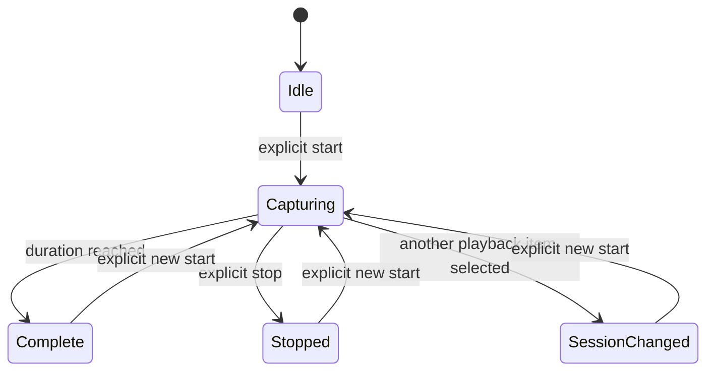

# Native playback diagnostics

`ott PLAYER debug --native-playback` reads a bounded snapshot from a supported
native playback backend. Use it when a native player remains on a loading screen,
stops advancing, or reports playback without a visible picture.

```sh
ott l debug --native-playback
ott -t 20 lg2 debug --native-playback --json
ott l,lg2 debug --native-playback
```

The request uses the player's existing remote-control connection. It does not
start playback, query the media source, change settings, start a capture, or
restart the player. Group requests run independently using the ordinary
[parallel group dispatcher](cli.md#saved-player-groups).

Install matching CLI, controller, and player versions. The player must advertise
`native_playback_diagnostics: {"version": 1}`. Without a supported marker, the CLI
stops after capability discovery and sends no native-playback inspection request.
A CLI update alone cannot add measurements to an older player. The initial
producer is the native webOS player; other backends need their own advertised
implementation.

This command is separate from `--lane native`, which addresses a bound Android
maintenance agent. Ordinary `debug`, `debug --engine`, existing inspection
sections, and saved diagnostic bundles retain their existing behavior.

## Bounded native capture

Native players can separately advertise `native_playback_capture` version 1.
This capability enables an in-memory diagnostic ring through the existing
remote-control connection. It does not require the passive snapshot capability;
a player that only advertises capture still cannot serve `debug --native-playback`.
The CLI, controller and player must all support the capture protocol.

Capture reports include the player's reported build version and, when available,
its separate Git `build_sha`. Text shows up to 12 SHA characters; JSON retains
the full reported value. A source-archive build may report `unknown`, displayed as
"build SHA not reported". These fields identify the reporting build; they do not
attest to its source or confirm physical playback.

```sh
ott l_ debug capture start
ott l_ debug capture start --duration 60
ott l_ debug capture status
ott --json l_ debug capture read
ott l_ debug capture stop
ott l_,lg2 debug capture start --duration 10
```

`start` defaults to 30 seconds and accepts an integer from 5 through 60 seconds.
The player samples approximately once per second and retains at most 64 records.
Start acknowledges promptly; the CLI does not wait for the recording duration.
The command timeout covers capability discovery and acknowledgement, while the
player owns the capture timer. An active capture rejects another start with
`capture_busy`; it is not restarted or extended automatically.

`status` discovers the current or most recent capture without creating one.
`read` and `stop` first discover its opaque ID, then address that exact capture.
If another capture replaces it between those requests, the operation fails with
`capture_not_found` instead of acting on the replacement. When discovery reports
idle, the CLI reports that no capture is available and sends no read or stop.
Read is non-destructive: it returns the retained ring, including a completed one.



Completion, stop and playback selection changes retain the captured records until
the next start or application exit. Stopping an already completed or interrupted
capture preserves its terminal state. An internal rebuffer or reopen retains the
capture; individual native counters may reset, so a decrease is not proof of a
measurement error. A new application runtime invalidates old capture requests.

Capture contains only bounded numeric measurements and fixed status codes.
It excludes media names, URLs, hosts, credentials, filesystem paths, playback
position or duration, window IDs and raw native event strings. The opaque capture
ID is the only capture identity exposed. Nullable measurements mean unavailable.
A zero counter does not establish successful playback. `callback_error_code` is
the last reported numeric error code, not an error counter. Callback and frame-related counters do not by
themselves prove a visible picture or audible sound on the television.

Newer players include a closed, all-or-none priming extension. `prime_pending`
and `prime_kind` (`none`, `fresh`, `rebuffer`, `resume`) distinguish a clock
waiting for startup/recovery from ordinary feed throttling. The numeric
`prime_required_runway_ms`, `prime_accepted_video_ms`, `prime_accepted_audio_ms`,
`prime_queued_video_ms` and `prime_queued_audio_ms` report the latest priming
evaluation, bounded to 24 hours. `prime_external_lease` and
`prime_audio_expected` are booleans. Queued media is not the same as media
accepted by the decoder. Once `prime_pending` is false, these numeric values
remain the last priming snapshot rather than live buffer measurements.
The required-runway field describes the observed acquisition window used for
Fresh/Resume; internal rebuffer additionally checks its current recovery debt
and completed acquisitions. `prime_external_lease` can also represent a completed
Fresh feed whose evidence is owned by the held clock. During Fresh startup,
validated access units still resident in that exact loader can cover runway
beyond the bounded queues; the queue measurements themselves do not include
those unpushed access units.
The updated controller and CLI accept both legacy records and this complete
extension; partial groups, unknown fields and free text remain rejected. Update
both before capturing from a player that supplies the extension.
The extension's closed fields and bounds are specified in
[`native-playback-priming-v1.json`](../contracts/native-playback-priming-v1.json);
the original version-1 capture fixture remains unchanged.

The player keeps the ring in memory. The CLI prints a validated report and creates
no output file automatically. The controller retains its ordinary bounded RPC
result in memory; its durable journal records request identity and outcome, not
capture records. Start and stop are reported as diagnostic mutations
(`read_only: false`); status, read and the existing passive snapshot remain
read-only. None of these operations starts, seeks or restarts media playback.

If start or stop loses its acknowledgement, the CLI reports an unknown outcome
and does not replay it or issue an automatic cleanup command. Use an explicit
`debug capture status` to reconcile before another change. Group requests remain
independent and parallel: inspect each player's result rather than assuming one
member's success applies to the entire group.

### Capture troubleshooting and access

- **Controller unsupported:** update the controller. Capture uses a dedicated
  capability probe, so an older relay rejects it before any capture is queued.
- **Player unsupported:** update or enable the matching native player. An
  advertised passive snapshot alone does not imply capture support.
- **No active playback:** start playback normally, then request a capture.
- **Capture busy:** inspect the current capture, or explicitly stop it before
  starting another. A failed start does not discard the existing ring.
- **Capture not found or runtime mismatch:** request status again. Another start,
  application restart or completed replacement may have invalidated the identity.
- **Invalid response:** keep the rejected result as a protocol failure. Do not
  interpret rejected or malformed measurements as a successful capture.

Command-scoped operators need `capabilities` plus the appropriate action:
`native_playback_diagnostics.start`, `native_playback_diagnostics.status`,
`native_playback_diagnostics.read` or `native_playback_diagnostics.stop`.
Read and stop also require `native_playback_diagnostics.status` for discovery.
A family-wide wildcard is not accepted. Existing administrator credentials retain their normal access;
no new per-player consent window is introduced.

The exact synthetic wire examples and numeric limits are in
[`native-playback-capture-v1.json`](../contracts/native-playback-capture-v1.json).
They are contract tests, not observations from a physical television. The existing
[`native-playback-v1.json`](../contracts/native-playback-v1.json) remains the
separate passive snapshot contract.

## Reading the last failure from live status

Use `status --details` to read the extended failure report from a supported
native player:

```sh
ott l status --details
ott -t 20 --json lg2 status --details
ott l,lg2 status --details
```

The command first checks capabilities, then requests version 3 only when the
player advertises `playback_failure_versions: [2,3]`. These are two read-only
RPCs within the command's timeout; capability discovery is not repeated after
the status reply. An unsupported player gets a clear error without sending the
versioned status request. The readable output adds failure details; `--json`
preserves the returned fields for scripts. Neither form starts or changes
playback.

When the player reports `preplay`, the readable details also show preparation
phase, last failure, attempt generation and phase elapsed time. For example,
`inspect_failed` means media inspection returned an error before playback was
admitted; `playback_failure` may still be `null`. An elapsed time near 15 seconds
does not by itself establish a network timeout. Keep the original playback
request's terminal error when diagnosing the cause.

Ordinary `ott l`, `ott l status` and `ott --json l status` keep the default
request unchanged. On a player supporting version negotiation, its default
failure format remains version 2. Diagnostic API clients can explicitly request
version 3 using this RPC body:

```json
{"action":"status","params":{"playback_failure_version":3}}
```

An explicit integer `2` also selects the previous format. Other values and
additional status parameters are rejected. Both controller and player must
support negotiation; do not send the parameter to older components. Ordinary
CLI status never silently opts an older player into a new format.

This is separate from `debug --native-playback` and from the controller's
`state` / `history` records. The controller and JSON CLI preserve this additive
field, including versions they do not interpret. The ordinary plain-text status
summary omits it unless `--details` was requested. Availability depends on the
installed player build.

Version 1 supplies `play_generation` and a fixed failure `code`. Version 2 adds
`context` with `demux_exit` and `pipeline_error`. Version 3 adds
`context.io_failure`, either `null` or one of these fixed branches:

- `source_io`: a `transport` code; `none` means no transport detail, not success.
- `hls`: an `exit` code and an `outcome` of `null`, `deadline`, `transport`,
  `server_state`, `refused` or `inconclusive`. Readable details display these
  closed codes; missing, null or unknown outcomes display `Not reported`.
- `auto_fallback`: `outcome: "refused"`.
- `audio_decode`: `outcome: "inconclusive"` after an observed decode error.
- `unclassified`: `outcome: "inconclusive"`.

`playback_failure: null` means no saved failure; it does not prove playback.
`context: null` means no native details owned by that failure, while
`io_failure: null` means native details exist without an attributed I/O cause.
A zero `pipeline_error` is not a health check. The player captures the first
failure for an accepted playback attempt before cleanup; a new attempt clears
it. Compare `play_generation` only within the same player runtime. It is a
different identifier from the internal native load epoch.

Live native webOS status also accepts generated current-content IDs consisting
of a profile prefix and a colon-separated 16-character lowercase hexadecimal
suffix, up to 145 characters total. This prevents valid current playback from
disappearing from the CLI summary. Retained `state` / `history` validation is
unchanged. Neither an ID nor an accepted request confirms a visible picture.

## Optional callback evidence in status

When the player supplies `video_evidence` version 1, `status --details` also shows
its window-present permission, position-callback count and latest raw sink
report. This uses the same status response: there is no extra request, capability
probe or controller upgrade for this additive field. Ordinary text status stays
unchanged; JSON status preserves the object, including versions it cannot render.
An unsupported or malformed object does not remove the existing playback status.

For example, a supported reply can add these two lines:

```text
Video evidence: window present permission=allowed; position callbacks=12.
Sink raw report: type=49; callbacks=3; firmware major=5; raw=0.
```

Window-present permission is the application's permission to draw its UI, not
TV power or proof of a visible picture. Position callbacks and sink-report
callbacks count handler arrivals, not decoded or displayed frames. The sink's
raw value is a signed 64-bit decimal string; zero is an observed value, while
`sink_report: null` means no report. Firmware major zero means unknown and uses
the player's older callback mapping. `native: null` means no current owned native
sample is available, including during replacement or teardown.

These counters reset for each physical native load. Position callbacks can wrap
at 32 bits; the sink callback count saturates. No physical-load identifier is
exposed in this object, so two samples cannot establish a reliable counter delta
or frame rate. Neither increasing counters nor window-present permission confirms
the picture or sound on the television.

## Reading the measurements

The phase describes the native playback pipeline. Counters and event ages belong
to the reported `native_epoch`, which identifies one native load. A new load
resets the scope; an in-place seek retains its totals. Compare counters only
within the same player runtime and native epoch.

The snapshot distinguishes demuxed units, submitted audio/video units, video
position events, and actual sink display reports. A position callback is not a
displayed frame. A display report containing zero frames is an observed report
without frame progress. Submitted units do not establish decoding, display, or
audible output. Some firmware exposes a display-report event without a verified
interpretation of its frame count. In that case the report count can be known
while displayed frames remain `NOT OBSERVED`.

The initial producer has no verified firmware/library combination for interpreting
the reported frame count, so it leaves displayed frames unavailable in production.
It can still report actual display callbacks and their ages. Positive frame counts
in the shared fixtures exercise the model; they are not evidence of TV support.

`NOT OBSERVED` means the measurement is unavailable or has not been observed.
JSON represents it as `null`. A measured zero remains zero. Demux, hardware
decode, and audio-presentation counters remain unavailable in this protocol
version; network traffic and submitted units do not substitute for them.

Event ages are monotonic elapsed milliseconds measured by the player. A snapshot
read does not refresh an event's age. Compare those ages directly; do not subtract
the host's wall clock from a device timestamp. An absent age is not evidence of
recent progress.

An increasing displayed-frame count is a native sink observation for that load.
It does not verify the physical screen, image contents, a newly requested seek
target, or audible sound. The diagnostic report keeps physical-display
verification false.

The pending-command summary contains only a fixed stage and its age since local
admission. The inspection request itself is excluded. Errors use fixed codes;
there are no raw decoder messages, content titles, paths, media URLs, tokens, or
window identifiers in this snapshot.

Pending stages are `admitted`, `waiting_catalog`, and `resolving_source`.
They describe an outstanding local request. Native hardware startup is represented
by the pipeline phase, such as `opening` or `buffering`, rather than by an invented
pending-command stage. A completed request does not prove a physical effect.

## Troubleshooting

- **Unsupported:** update the player and controller as well as the CLI. Do not
  interpret a missing capability as a broken decoder.
- **Request timeout:** the command channel or application may be unresponsive.
  No response does not identify which decoding or display stage failed. The CLI
  does not retry the request as a repair or restart.
- **Submitted units increase, display remains NOT OBSERVED:** input reached the
  submission boundary, but the backend has not supplied display evidence.
- **Position events increase, displayed frames do not:** the playback clock is
  active; that alone does not prove new video frames were displayed.
- **Display reports increase with zero frames:** the sink is reporting without
  reporting frame progress. Keep the report count separate from the frame count.
- **Epoch changed between reads:** start a new comparison. A lower counter in a
  different epoch is a new load, not proof of lost frames.
- **Old display totals after seeking:** totals cover the entire native load.
  They do not confirm that the new seek target has been displayed.

## Wire compatibility

The optional capability enables action `inspect` with the exact parameters
`{"version":1,"runtime":"CURRENT_RUNTIME","section":"native_playback"}`.
Responses bind the same version, runtime, and section. The complete inner response
is limited to 4096 bytes. Fields, stages, error codes, and integer ranges are
allowlisted by the controller and CLI before the result is exposed.
The [shared fixtures](../contracts/native-playback-v1.json) include unavailable
measurements, position events without display, zero-frame reports, load resets,
and bounded failures. They are synthetic examples, not device test results.

The optional marker does not extend legacy `inspect.sections`, `debug_versions`,
`debug_attempts`, `debug.native`, or continuous state/presence messages. Earlier
clients can continue using their existing operations.

Version 1 has these fixed bounds and meanings:

- The runtime is 1–96 ASCII letters, digits, underscores, dots, or hyphens. The
  envelope must match the requested runtime, including negative replies.
- `data.version` is `1`; `scope` is `native_load`; `native_epoch` is `null` or an
  integer from 1 through 4294967295. Without an epoch, counters and event ages
  are all `null`.
- `phase` is one of `idle`, `resolving`, `opening`, `buffering`, `playing`,
  `paused`, `seeking`, `stopping`, `error`, `standby`, or `unknown`.
- Counter and age values are `null` or integers from 0 through 9007199254740991.
  Overflow is unavailable, rather than a wrapped or estimated measurement.
- The fixed counters are `video_demuxed_units`, `audio_demuxed_units`,
  `video_submitted_units`, `audio_submitted_units`, `video_position_events`,
  `video_displayed_reports`, `video_displayed_frames`, `video_decoded_frames`,
  `audio_decoded_frames`, and `audio_presented_frames`. The two demux counters,
  two decoded-frame counters, and audio-presented counter are strictly `null`
  in version 1.
- `ages_ms` contains `video_submission`, `audio_submission`,
  `video_position_event`, and `video_displayed_report`.
- `pending_command` is `null` or contains exactly `stage` and nullable `age_ms`.
  Its three stages are described above.
- `last_error` is `null` outside an observed current terminal failure. Otherwise
  it contains only `code`: `media_source`, `playback_interrupted`, `tv_pipeline`,
  `load_timeout`, `release_timeout`, `resolve_failed`, or `unspecified`.

A negative envelope contains `error` instead of `data`: `invalid_request`,
`runtime_mismatch`, `unsupported`, or `unavailable`. A reply from a different
runtime is rejected even when it reports `runtime_mismatch`; it cannot close the
requested runtime's inspection.
