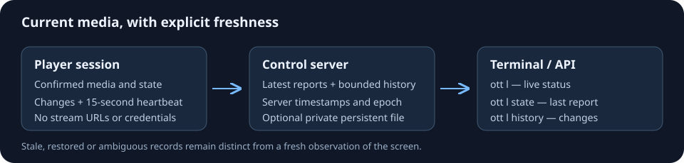

# Current playback and retained player reports

Connected players report their current playback automatically. No separate
diagnostics capture or notification permission is needed. The report describes
media owned by the playback session, not the highlighted catalogue row, a
requested next video, or a kiosk target.



## Commands

```sh
ott l                              # live status, controls and current media
ott l status                       # same live status
ott l state                        # last report retained by the controller
ott l history                      # recent reported playback changes
ott l history --limit 64            # up to 64 retained changes
ott -j l state                     # machine-readable retained state
ott -j l history --limit 10
ott tt state                       # saved groups also work
```

Ordinary status still contacts the player. Updated players include the same
safe playback projection in that response. A missing field on an older player
means **Not reported**, not stopped. Malformed additive playback metadata does
not hide otherwise valid status and capabilities. Upgrade the CLI, controller
and player to use the complete flow.

`state` and `history` read the controller directly without sending a player
command, including while the player is offline. Their output is a **last
report**, with server receipt time and age, not a new observation of the screen.
Stored capabilities are never used to advertise currently available controls.
Neither command resumes, seeks, switches media or retries a failed operation.

Reports include provider, content kind, playback state, title, optional channel
number and safe media identifier, position, duration and volume when available.
Position is the last reported sample, not an extrapolated clock. Stop, end and
standby clear active media. Pause retains the title. Loading does not confirm
that the requested video has started.

## Freshness and history

An initial report follows discovery of reporting support. Playback changes are
coalesced and a heartbeat is sent every 15 seconds. The player keeps one report
in flight and the newest pending state. Controller address, credential or epoch
changes invalidate queued reports from the previous connection.

- Reports become stale after 45 seconds without a new accepted sequence.
- Up to four runtime records are retained per device. More than one fresh
  runtime makes the device ambiguous and `current` null; the controller does
  not silently choose whichever tab's HTTP request arrived last.
- History contains connection/reconnection and semantic playback changes,
  not every position tick or identical heartbeat. Retention is 24 hours and
  at most 64 events per device.
- Command polling is separate connection evidence. A recent poll cannot make
  old media metadata fresh. An offline observation does not establish whether
  the physical device is powered off.
- Restored disk records remain stale until a new report is accepted. Every
  controller process has a new epoch; old queued requests cannot revive them.
- Rotation or revocation invalidates state from the previous device credential
  generation, including statically configured credentials.

Each physical player should use its own credential. If a report is ambiguous,
inspect the runtime records and remove the duplicate connection. After an
ordinary reload, the previous runtime can remain fresh for up to 45 seconds;
live status and the individual retained records remain separately identifiable.

## Durable storage

Reporting and bounded retention work in memory by default. To preserve the
last known media and history across controller restarts, add this field to
the private controller configuration:

```json
"player_state": {
  "path": "/var/lib/ottplay-control/private/player-state.json"
}
```

Use one process and one writer. The service account must be able to write the
private parent directory. Keep this file separate from the command journal,
device registry and their lock files. The store has an 8 MiB limit. Private
atomic replacement prevents partial files; a post-replacement directory-sync
failure may leave the new complete snapshot installed. The command
journal continues to hold outcome metadata, not viewing history or media URLs.

For Docker, mount a persistent private directory. For Helm, the existing
`journalExistingClaim` setting mounts a separately provisioned PVC at
`/var/lib/ottplay-control`; the same mount can hold a distinct player-state file.
The chart does not create or delete the claim. Follow the
[deployment guide](deployment.md) to validate configuration, preserve unrelated
Secret fields, restart the controller and check readiness.

Responses report `storage: "memory"` or `"persistent"`. Persistent storage
commits semantic state/history changes. Position-only heartbeats refresh the
in-memory record and are not individually fsynced. A retained position can
therefore be older after restart, which is why restored records remain stale.
Keep private backups only if viewing history is needed.

## API

ACK-capable command polling advertises the additive `player_state` object:

```json
{
  "version": 1,
  "controller_epoch": "0123456789abcdef0123456789abcdef",
  "report_path": "/api/player-state",
  "heartbeat_ms": 15000,
  "stale_after_ms": 45000,
  "max_body_bytes": 4096
}
```

A missing or invalid advertisement disables publishing, preserving compatibility
with older controllers. Reports use ordinary device authentication and the
existing hosted transport where required, independently of command ACKs.

`POST /api/player-state` accepts at most 4 KiB. Every field is required;
unavailable optional values are explicit JSON nulls:

```json
{
  "version": 1,
  "controller_epoch": "0123456789abcdef0123456789abcdef",
  "runtime": "page-example",
  "sequence": 1,
  "player": {"version": "1.1.62", "platform": "browser", "standby": false},
  "playback": {
    "state": "playing", "kind": "vod", "title": "Example episode",
    "provider": "plex", "media_id": "12345", "channel_number": null,
    "position": 100.5, "duration": 500, "volume": 50
  }
}
```

States: `unknown`, `idle`, `loading`, `playing`, `paused`, `buffering`, `ended`,
`error`, `standby`. Kinds: `none`, `live`, `archive`, `vod`, `unknown`.
`player.standby` must agree with the state. Idle, ended and standby require null
title, media ID and channel number. Title is limited to 256 UTF-8 bytes and
provider to 64. Media IDs allow only 1–128 ASCII letters, digits, underscores,
hyphens and dots. Raw URLs, paths, credentials, artwork and errors are excluded.
Channel numbers are positive integers; positions/durations are finite,
nonnegative seconds within JavaScript's safe integer range; volume is 0–100.

Sequences are positive safe integers. A new heartbeat uses a new sequence;
retrying the same sequence requires the identical payload and does not refresh
age or history. Older or conflicting sequences are rejected. The receipt has
`version`, `controller_epoch`, `runtime`, `sequence`, original server
`received_at`, `duplicate`, and `storage`.

`GET /api/player-state?device_id=ID&limit=0` returns retained state. History limit
defaults to zero and accepts 0–64. Administrators can read configured devices;
restricted operators require `status` permission and access to that device.

The response includes `version`, `controller_epoch`, `device_id`, `server_time`,
`storage`, `stale_after_ms`, `retention_seconds`, `connection`, `ambiguous`,
`current`, `latest`, `runtimes`, `history`, and `history_truncated`. `current` is
the uniquely fresh runtime or null; `latest` includes stale records. Each row
has `runtime`, `sequence`, `received_at`, `age_ms`, `stale`, `restored`, `player`,
and `playback`. History events have `event` (`connected`, `reconnected`, or
`changed`), `received_at`, `runtime`, `sequence`, `player`, and `playback`.
Server timestamps use RFC 3339. Player wall clocks do not determine freshness.

## Troubleshooting

- **Not reported:** confirm the running player contains the new projection.
  Publishing a website or updating the CLI does not reload an open TV session.
- **No retained report:** check the poll advertisement and hosted transport
  route. An older controller intentionally receives no reporting traffic.
- **Stale/restored:** inspect the player connection and last server receipt
  time. Replaying an identical request must not make old data fresh.
- **Ambiguous:** identify duplicate runtime/credential use. Give independent
  players separate credentials and wait for inactive reports to become stale.
- **403:** check ordinary credential role and operator `status`/device scope.
- **409:** check epoch and sequence. Drop queued reports after an epoch or
  connection change; never relabel old media as a new observation.
- **Storage failure:** inspect private path, volume, ownership and free space.
  Preserve the existing state file for recovery rather than silently replacing
  damaged history with an empty file.
