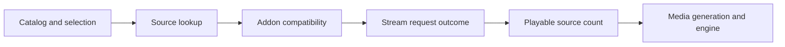

# Provider lookup diagnostics

Use a provider report when a movie list opens but selecting a movie shows
`Unsupported source` or `Failed to load`. Decoder diagnostics alone cannot
explain an error that occurs before a stream reaches the player.

```sh
ott -t 45 t1 doctor --provider
ott -t 45 -j t1 doctor --provider
ott -t 60 t1 doctor --provider --out ./t1-provider-case
ott report verify ./t1-provider-case --json
```

`debug --provider` is an alias for the same combined report. The command reads
the provider snapshot, interface/media state and the available engine
diagnostics within one timeout. It does not select a provider or movie, fetch
an addon, start playback, enable logging, or change a setting. A saved report
uses a new private directory and refuses to overwrite existing evidence.

```sh
ott -t 60 t1 debug --provider --out ./t1-provider-second-case
ott -t 60 t1,t2 doctor --provider --out ./provider-case
ott -t 60 t1 bundle --out ./t1-complete-case
```

The group command writes separate `provider-case.t1` and `provider-case.t2`
directories. Each target has its own timeout and result. Bundles include
provider evidence when the player advertises it; a missing or failed optional
observation does not discard the other evidence.

## What the report explains

The initial producer covers Torrent/Stremio movie discovery. It reports:

- The running page identity and when the snapshot was collected.
- The catalog view, loaded count, selection index, loading state and pagination.
- The current or last source lookup: its local sequence, age, state, movie ID
  namespace, configured addon count, skipped/failed addons and source counts.
- Up to sixteen request outcomes, linked to that lookup and an addon slot:
  manifest or stream stage, HTTP status when available, duration, age and
  response byte count when available.
- Separately collected media generation, handle, phase and attached engine,
  where the existing inspection capabilities provide them.

JSON addon slots are zero-based positions in the configuration; the readable
summary numbers them from one. They are not addon names or stable identities
across configuration changes. The report omits movie titles
and IDs, addon addresses, tokens, private configuration, response bodies and
arbitrary exception text. A skipped addon count does not identify which
compatibility rule rejected it.



These are stages to inspect, not proof that every stage ran successfully.
For example, an HTTP `400` stream request means the addon rejected that request.
It does not establish why the addon rejected it. `http_error` with zero playable
sources must not be treated as a successful empty search. An `ok` response with
zero playable sources is a different observation; unsupported source counts
can explain why returned sources did not become playable entries.

If the lookup failed and media remains `none` with no handle or engine, this
is consistent with a failure before decoder attachment. Check the lookup age
and runtime before relating those observations. Changing codecs or restarting a
stream is not supported by that evidence. If sources exist and a media handle
is present, inspect the decoder/engine observations next. The report does not
perform repairs automatically.

## Freshness and limits

The provider, interface and debug observations are sequential. A matching
runtime identifies the same page, not an atomic view of one movie selection.
A runtime mismatch prevents joining them as one playback attempt. Lookup and
request ages refer to the producer's retained attempt; reading the report does
not make an older attempt current. Missing or inconsistent observations remain
unknown rather than becoming evidence of success.

Request retention is bounded. `requestsDropped` identifies omitted request
records; only the current or last lookup is exposed. This is not a persistent
history of all provider activity. Save a report while the failure is visible.
The existing `state`/`history` commands retain playback reports, not this
provider request trace.

`observed` means data was collected, not that a stream is playable or a physical
screen is displaying it. A timeout or an unsupported producer is incomplete
evidence. Increase `-t` if collection runs out of time; the CLI never retries a
playback action as part of diagnosis.

## Compatibility and troubleshooting

The player advertises `provider_diagnostics: {"version": 1}` separately from
the existing inspection sections. The safe snapshot is carried in
`status.diagnostics.provider`; existing controller status transport can relay
it without a new controller release. Install the complete updated CLI and an
updated player. Earlier players remain usable but cannot supply this report.

- **Unsupported/missing producer:** check `ott t1 caps` and update the running
  player, not just the files on disk. No hidden provider request is attempted.
- **Invalid response:** the snapshot violates the agreed schema or correlation
  rules. Partial evidence is preserved; raw rejected data is not exported.
- **Runtime mismatch:** the page restarted during collection. Collect again
  once it is stable; do not combine old and new page observations.
- **HTTP error:** use the addon slot, stage and status to investigate the addon
  configuration privately. The status alone does not establish a root cause.
- **Skipped addons:** the current movie namespace or movie support was
  incompatible. Check the addon's advertised capabilities separately.
- **Empty sources:** distinguish an empty successful response, failed requests
  and unsupported returned sources before changing player settings.
- **Request timeout:** inspect the retained partial report. An unresponsive
  provider snapshot does not prove that the page or device crashed.

See the [workbench guide](workbench.md) for media/engine evidence and offline
report verification, and [Torrent settings](player-settings.md#torrent-metadata-and-stream-addons)
for private addon configuration.
