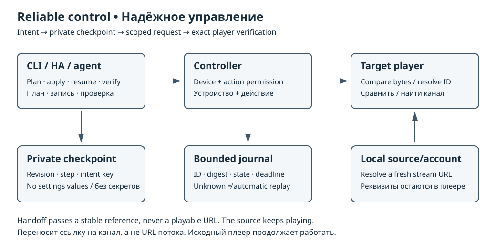

<div lang="vi" dir="ltr">

# Điều khiển đáng tin cậy và chuyển tiếp phát

<!-- language-navigation:start -->
<p dir="ltr">
<a href="reliable-control.md" lang="en" dir="ltr">English</a> · <a href="reliable-control.ar.md" lang="ar" dir="rtl">العربية</a> · <a href="reliable-control.bn.md" lang="bn" dir="ltr">বাংলা</a> · <a href="reliable-control.cs.md" lang="cs" dir="ltr">Čeština</a> · <a href="reliable-control.de.md" lang="de" dir="ltr">Deutsch</a> · <a href="reliable-control.es.md" lang="es" dir="ltr">Español</a> · <a href="reliable-control.fa.md" lang="fa" dir="rtl">فارسی</a> · <a href="reliable-control.fr.md" lang="fr" dir="ltr">Français</a><br>
<a href="reliable-control.he.md" lang="he" dir="rtl">עברית</a> · <a href="reliable-control.hi.md" lang="hi" dir="ltr">हिन्दी</a> · <a href="reliable-control.id.md" lang="id" dir="ltr">Bahasa Indonesia</a> · <a href="reliable-control.it.md" lang="it" dir="ltr">Italiano</a> · <a href="reliable-control.ja.md" lang="ja" dir="ltr">日本語</a> · <a href="reliable-control.ko.md" lang="ko" dir="ltr">한국어</a> · <a href="reliable-control.nl.md" lang="nl" dir="ltr">Nederlands</a> · <a href="reliable-control.pl.md" lang="pl" dir="ltr">Polski</a><br>
<a href="reliable-control.pt.md" lang="pt" dir="ltr">Português</a> · <a href="reliable-control.ru.md" lang="ru" dir="ltr">Русский</a> · <a href="reliable-control.th.md" lang="th" dir="ltr">ไทย</a> · <a href="reliable-control.tr.md" lang="tr" dir="ltr">Türkçe</a> · <a href="reliable-control.uk.md" lang="uk" dir="ltr">Українська</a> · <a href="reliable-control.vi.md" lang="vi" dir="ltr">Tiếng Việt</a> · <a href="reliable-control.zh-Hans.md" lang="zh-Hans" dir="ltr">简体中文</a> · <a href="reliable-control.zh-Hant.md" lang="zh-Hant" dir="ltr">繁體中文</a>
</p>
<!-- language-navigation:end -->

[Mục lục tài liệu](wiki/Home.md)

Các tính năng này yêu cầu bộ điều khiển và CLI từ phiên bản chứa hướng dẫn này. So sánh chính xác cài đặt và chuyển tiếp cũng yêu cầu trình phát đã cập nhật. Các bản phát hành lưu trữ cũ và phiên bản CLI cũ trong hướng dẫn cài đặt không tự có các tính năng này. Cài đặt **toàn bộ tệp `cli/*.py` cùng nhau**, bao gồm `preset_session.py`; giữ nguyên cấu hình riêng tư.



## Bật lưu kết quả bền vững có giới hạn

Thêm khối tùy chọn này vào cấu hình máy chủ riêng tư, rồi xác thực và khởi động lại máy chủ. Chọn đường dẫn tuyệt đối trên hệ thống tệp cục bộ bền vững mà tài khoản dịch vụ có quyền ghi. Trên Unix, thư mục phải riêng tư (0700); các tệp nhật ký và khóa hiện có phải là tệp thông thường riêng tư (0600). Trên Windows, giới hạn ACL thư mục cho tài khoản dịch vụ. Mỗi nhật ký chỉ thuộc về một tiến trình.

```json
"journal": {
  "path": "/var/lib/ottplay-control/private/operations.json",
  "max_records": 1024,
  "retention_seconds": 86400
}
```

Máy chủ tạo thư mục còn thiếu với chế độ 0700. Giới hạn là 1–4096 bản ghi, 60–86400 giây và 4 MiB trên đĩa. Thời gian lưu phải bao phủ `command_ttl_seconds`. Nhật ký đầy sẽ từ chối thao tác mới có khóa thay vì loại bỏ bản ghi còn hiệu lực. Tệp hỏng, thư mục Unix không an toàn, tiến trình ghi khác hoặc ghi bền vững thất bại đều dẫn đến từ chối an toàn. Mặc định vẫn dùng đường xử lý lệnh hiện có trong bộ nhớ.

Đơn vị systemd đi kèm tạo `/var/lib/ottplay-control` với chế độ 0700. Với Compose, chuẩn bị thư mục máy chủ thuộc UID 65532, đặt `CONTROL_SERVER_STATE` thành đường dẫn tuyệt đối của thư mục và kết hợp `deploy/compose.yml` với `deploy/compose.journal.yml`. Tệp sau chỉ thêm điểm gắn trạng thái có thể ghi; hệ thống tệp gốc vẫn chỉ đọc. Với Helm, chuẩn bị riêng một yêu cầu dung lượng lưu trữ bền vững và đặt `journalExistingClaim=CLAIM_NAME`. Yêu cầu được gắn tại `/var/lib/ottplay-control`; dùng thư mục con riêng tư nêu trên. Chart giữ một bản sao, `Recreate` và `fsGroupChangePolicy: OnRootMismatch`, để gắn lại không mở rộng đệ quy quyền của các thư mục riêng tư đã tạo. Xác minh trình điều khiển lưu trữ đã chọn hỗ trợ ngữ nghĩa quyền sở hữu này. Chart không tạo/xóa yêu cầu, và bật điểm gắn không bật nhật ký: cấu hình máy chủ riêng tư vẫn điều khiển việc đó.

Với `POST /api/requests`, thêm `idempotency_key` bên cạnh `action` và `params`. Các POST lệnh cũ chấp nhận `Idempotency-Key` thay thế. Khóa chứa 16–80 chữ cái ASCII, chữ số, dấu gạch dưới hoặc gạch nối; tạo khóa ngẫu nhiên mới cho mỗi ý định. Cùng chủ sở hữu/khóa, thiết bị, hành động và nội dung JSON đã chuẩn hóa sẽ trả lại ID ban đầu mà không xếp hàng lại. Đổi nội dung trả về 409. Khóa có phạm vi theo ID người vận hành (hoặc quản trị viên), không phải thiết bị. Sau khi hết thời gian lưu, khóa có thể được chấp nhận như ý định mới: máy khách không được thử lại ý định cũ ngoài khoảng này.

`GET /api/operations?device_id=DEVICE` báo nhật ký có bật hay không, giới hạn và TTL lệnh. Thêm `&key=KEY` để đọc thao tác:

- `pending`: đã chấp nhận; chưa có phản hồi được lưu.
- `responded`: đã nhận phản hồi hợp lệ từ trình phát; `result_status` là `ok`, `rejected` hoặc `unsupported`. Nội dung kết quả ban đầu vẫn hết hạn bình thường.
- `acknowledged`: một bên tiêu thụ cũ đã xác nhận lệnh. Điều này không chứng minh việc phát có hiển thị hay thay đổi cài đặt đã được lưu.
- `unknown`: hết hạn hoặc máy chủ khởi động lại trước khi lưu phản hồi. Máy chủ **không bao giờ thực hiện lại** lệnh này sau khi khởi động lại.

POST lặp lại có khóa trả về `status: retained`, ID ban đầu và trạng thái. POST mới thông thường giữ `status: queued`. Bản ghi nhật ký chỉ chứa chủ sở hữu, thiết bị, hành động, ID ngẫu nhiên, giá trị băm nội dung, trạng thái và thời hạn. Không chứa nội dung lệnh, URL nhà cung cấp, token, ảnh chụp màn hình hay nội dung phản hồi. Lệnh đang chờ không được lưu bền vững. Đây là khử trùng lặp và theo dõi kết quả có giới hạn, không phải thực thi đúng một lần, hàng đợi công việc bền vững hay tính sẵn sàng cao nhiều máy chủ.

## Lập kế hoạch, áp dụng, tiếp tục và xác minh Local/Home

Hành vi hiện có của `ott PLAYER load PRESET` được giữ nguyên. Với quy trình mới:

```sh
ott tv load Local plan
ott tv load Local apply
ott tv load Local resume
ott tv load Local verify
```

`plan` hoạt động ngoại tuyến: xác thực cấu hình đặt sẵn cục bộ và liệt kê các vị trí cài đặt cùng hồ sơ hoạt động mong muốn mà không in nội dung. Nó không kiểm tra trình phát. `verify` so sánh chính xác chỉ đọc và kiểm tra hồ sơ M3U đã chọn. Nó trả mã khác không nếu có khác biệt hoặc không hỗ trợ so sánh.

`apply` yêu cầu nhật ký máy chủ. Nó tạo điểm kiểm tra riêng tư và so sánh mọi nhà cung cấp đã cấu hình trước lần thay đổi đầu tiên. Mỗi lần lưu so sánh byte đã lưu với giá trị dự kiến qua `settings_compare`; nếu khớp thì bỏ qua ghi. Xác minh cuối bao gồm Plex, mọi vị trí M3U, vị trí Stalker tùy chọn và hồ sơ M3U đã chọn. So sánh trả về giá trị boolean, không bao giờ trả bí mật đã lưu.

Điểm kiểm tra mặc định nằm dưới `~/.config/ottplay-control/checkpoints/`. Dùng `--checkpoint /absolute/private/path/session.json` sau chế độ để chọn tệp khác. Điểm kiểm tra chứa thiết bị, tên cấu hình đặt sẵn, mã băm phiên bản máy chủ/cấu hình, tên bước hoàn tất và một khóa thao tác ngẫu nhiên đang chờ cùng thời hạn. Không chứa giá trị cài đặt. Tệp được thay thế nguyên tử sau fsync và khóa chống các CLI ghi đồng thời. Giữ cấu hình đặt sẵn cục bộ tương ứng sẵn dùng. Trên Unix, thư mục phải riêng tư (0700), với tệp thông thường ở 0600. Trên Windows, giới hạn ACL kế thừa của thư mục cho người chạy CLI; bit chế độ Unix không thực thi quyền truy cập Windows.

`resume` xác thực cùng máy chủ, thiết bị và phiên bản cấu hình đặt sẵn, rồi đọc kết quả đang chờ. Phản hồi được lưu cho phép kiểm tra lại ngay. Kết quả chưa rõ sẽ chặn gửi thay đổi cho đến khi qua thời hạn lệnh trước, thời gian chờ yêu cầu và một khoảng dự phòng nhỏ. Chạy lại `resume` sau khoảng đó. Nó kiểm tra lại cài đặt đã lưu ngay cả với bước hoàn tất, tránh nhầm thay đổi của người dùng với lần ghi thành công trước đó. Nó không bao giờ mù quáng lặp lại lệnh tương đối. Có thể lặp lại lựa chọn nhà cung cấp/hồ sơ tuyệt đối sau khoảng bảo vệ.

`apply` mới không bao giờ ghi đè điểm kiểm tra hiện có. Dùng lại bằng `resume`, hoặc chọn tệp mới cho cấu hình đặt sẵn đã đổi. Các thiết bị có điểm kiểm tra riêng. Không có giao dịch hay hoàn tác bao trùm mọi trình phát; lần ghi thành công trước đó vẫn giữ nguyên nếu bước sau thất bại. `verified` xác nhận giá trị trình phát đã lưu tại thời điểm so sánh, không phải tải qua mạng thành công hay đầu ra hình/tiếng vật lý.

## Chỉ cấp cho tích hợp quyền cần thiết

Dùng [người vận hành lệnh thông thường](security-design.md#scoped-command-operators) cho HA, cầu nối RF hoặc tác nhân thay vì phân phối `admin_token`. Cho phép ID thiết bị chính xác và các thao tác như `input.channel_up`, `input.channel_down`. Các thao tác cài đặt trong quy trình này yêu cầu rõ ràng quyền `settings_compare`, `provider`, `profiles`, `status`, `profile`, `profile_settings` và `provider_settings`. Chuyển tiếp cần `playback_handoff_export` ở nguồn và `playback_handoff_import` ở đích. Mục người vận hành kết hợp thiết bị và hành động được liệt kê; dùng danh tính riêng nếu cùng thao tác không được áp dụng cho mọi thiết bị trong danh sách. Token và sự đồng ý chẩn đoán vẫn là quyền riêng biệt.

Người vận hành không thể truy vấn hàng đợi trình phát, gửi phản hồi trình phát, liệt kê mọi thiết bị, đọc đầu ra gỡ lỗi quản trị hoặc kết quả của người vận hành khác. Thu hẹp phạm vi hành động cũng ngăn đọc thao tác được lưu của nó. Xóa người vận hành rồi khởi động lại sẽ thu hồi thông tin xác thực. Không dùng lại ID cho chủ thể khác khi bản ghi nhật ký cũ còn tồn tại.

## Tiếp tục trên trình phát khác

```sh
ott handoff living-room bedroom
```

Nguồn xuất tham chiếu trực tiếp/lưu trữ phiên bản 1: nhà cung cấp, định danh nguồn không minh bạch, dấu vân tay mục không minh bạch `channel-v1:<8 hex>.<8 hex>` và, với lưu trữ, thời điểm chương trình hiện tại. ID nhà cung cấp gốc và URL luồng vẫn ở cục bộ. Đích phải có **cùng nguồn/tài khoản đã cấu hình**, tìm được duy nhất một mục khớp trong danh mục riêng và lấy URL mới bằng thông tin xác thực cục bộ của mình. Bộ điều khiển không sao chép URL phát được hay đổi thông tin xác thực của đích. Nguồn vẫn tiếp tục phát. CLI báo thành công nghĩa là đích đã gửi yêu cầu, không phải màn hình hoặc loa vật lý đã được xác minh.

Phiên bản 1 hỗ trợ danh mục trực tiếp/lưu trữ `m3u`, `xtream` và `stalker` khi trình phát cung cấp được định danh cần thiết. Mục không biết/không rõ ràng, nguồn không khớp và chính sách cục bộ từ chối đều thất bại, không có phương án dự phòng theo tên. VOD/phim bộ, ánh xạ tài khoản khác nhau, tạm dừng nguồn và đồng bộ lịch sử/yêu thích liên tục không thuộc hợp đồng đầu tiên này.

## Bài tập xác thực và khôi phục

Chạy `go test -race ./...`, `go vet ./...` và `python3 -m unittest discover -s tests`. Các bài kiểm tra bao gồm phản hồi thất lạc sau ghi thành công, so sánh chính xác trước khi tiếp tục, sai lệch cấu hình, thời hạn thao tác không rõ, hai tiến trình ghi, nhật ký hỏng, đọc chéo người vận hành và nội dung chuyển tiếp sai dạng. Trên trình phát thử nghiệm, hãy ngắt CLI sau khi lưu cài đặt, khởi động lại bộ điều khiển, tiếp tục và xác minh; thử chuyển tiếp giữa nguồn khớp và không khớp. Xác nhận hình/tiếng riêng.

Để xác thực cục bộ giữa các kho mã, với bản làm việc FOSS hiện tại và các phụ thuộc phát triển đã cài, chạy:

```sh
node scripts/smoke_foss_roadmap.cjs /path/to/ottplay-foss
```

Bài kiểm tra khói dựng máy chủ Go này, biên dịch toàn bộ dự án TypeScript FOSS và chạy lớp truyền tải thật, bộ xử lý lệnh, định danh nguồn và codec danh sách phát đi kèm với CLI Python. Nó kiểm tra cài đặt chính xác của cả ba nhà cung cấp được hỗ trợ, các sai khác, chuyển tiếp trực tiếp với ID hàng cục bộ khác nhau, độ lệch tìm vị trí trong lưu trữ, lỗi phân giải URL và xác thực nghiêm ngặt định dạng truyền. Chỉ bộ lưu trữ, chính sách nhà cung cấp và giao diện máy chủ phát là thành phần giả lập kiểm tra; không xác minh trình duyệt, đầu ra phương tiện vật lý hay truy cập tài khoản thật. Nó gắn vào loopback, dùng tệp tạm riêng tư, không kết nối URL luồng và xóa tệp/máy chủ khi thoát.

</div>
